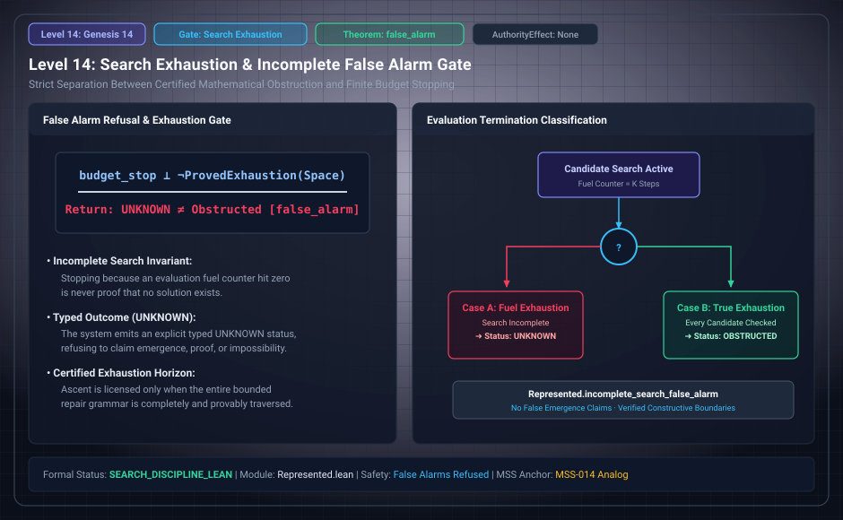

# Level 14: Bounded search outcomes

AuthorityEffect: None. Teaching milestone; no identity with an S(n) stage or MSS index.

**Carrier:** Finite candidate enumeration under declared item, arity, round and node bounds.

**Supplied assumptions:** Declare a complete enumeration domain and resource stopping conditions.

**Statement:** No witness in a fully searched finite domain differs from invalid candidate, resource exhaustion and an unbounded impossibility theorem. Keep these as separate terminal outcomes. An OPEN_AT_BOUND result is usable evidence about its bound, not a silent refusal or proof of nonexistence.

**Evidence:** FINITE COMPUTATION AND SEARCH CONTRACT. [Pinned source](https://github.com/dbccpage/19L57G1/blob/f1d56c010e6ba10a3b9418bd7cc5953c067250f2/research/second/paper.md). Source statements and recorded compilation are distinguished from fresh companion tests.

**Implementation or open obligation:** An unbounded result needs an additional argument beyond increasing the tested bound.

See the [current Genesis account](../genesis.md), [all-source crosswalk](../source_crosswalk.md), [selected families](../primitives/README.md) and [actual source adapters](../research_extension/docs/source_fidelity.md).

