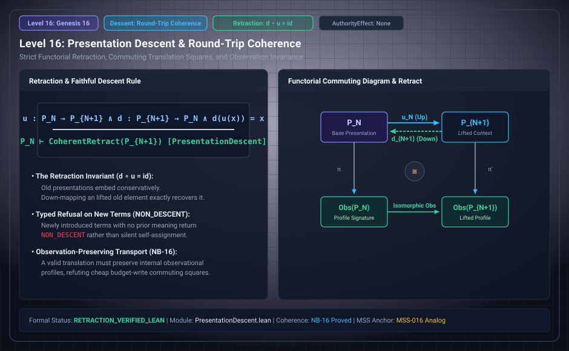

# Level 16: Retraction and observed transport

AuthorityEffect: None. Teaching milestone; no identity with an S(n) stage or MSS index.

**Carrier:** An inclusion u:B→E, a map r:E→B and declared observations.

**Supplied assumptions:** A retraction satisfies r∘u=id_B; it need not satisfy u∘r=id_E.

**Statement:** Retraction recovers the base but can erase extension information. NB-16 additionally requires native observation after encoding to factor through the declared source observation. An injective observation map then forces that source observation to be constant on cycles. Passage budget writes allow cycles: monotonicity of the core does not prohibit them.

**Evidence:** POST-SEAL CONDITIONAL THEOREM. [Pinned source](https://github.com/dbccpage/19L57G1/blob/f1d56c010e6ba10a3b9418bd7cc5953c067250f2/research/native_bridge/lean/ResearchNativeBridge/Observe.lean). Source statements and recorded compilation are distinguished from fresh companion tests.

**Implementation or open obligation:** Retain continuation-relevant extension data or state the quotient question and loss.

See the [current Genesis account](../genesis.md), [all-source crosswalk](../source_crosswalk.md), [selected families](../primitives/README.md) and [actual source adapters](../research_extension/docs/source_fidelity.md).

