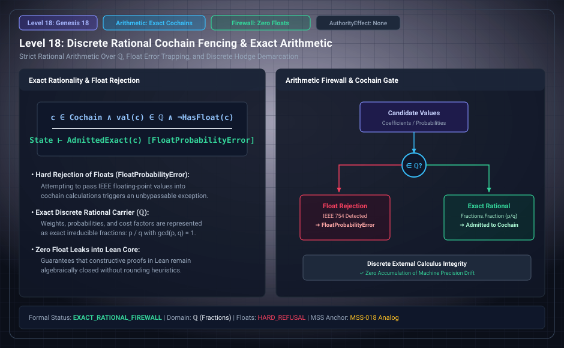

# Level 18: Admitted cochain models

AuthorityEffect: None. Teaching milestone; no identity with an S(n) stage or MSS index.

**Carrier:** A supplied finite chain/cochain complex with declared coefficient ring.

**Supplied assumptions:** List cells, incidence, orientations, differential and protected readout.

**Statement:** Cochains are a legitimate extension when their construction is explicit. The sealed admission signature alone does not supply a differential. Verify ∂²=0 on the declared complex before interpreting closed/exact or homology. Exact rational arithmetic controls representation error; it does not supply missing mathematical structure.

**Evidence:** DECLARED EXTENSION; POST-SEAL RESULTS ON NAMED CARRIER. [Pinned source](https://github.com/dbccpage/19L57G1/blob/f1d56c010e6ba10a3b9418bd7cc5953c067250f2/research/native_structure/lean/ResearchNativeStructure/Boundary.lean). Source statements and recorded compilation are distinguished from fresh companion tests.

**Implementation or open obligation:** Use the separate WDP primitive-to-complex construction for its actual source/interpretation interface.

See the [current Genesis account](../genesis.md), [all-source crosswalk](../source_crosswalk.md), [selected families](../primitives/README.md) and [actual source adapters](../research_extension/docs/source_fidelity.md).

