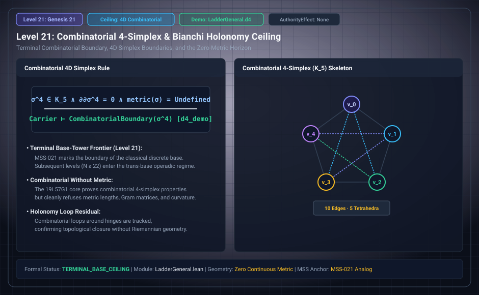

# Level 21: An explicit four-simplex

AuthorityEffect: None. Teaching milestone; no identity with an S(n) stage or MSS index.

**Carrier:** Five supplied vertices and their finite simplicial faces.

**Supplied assumptions:** Declare ordered distinct vertices, all faces and alternating boundary signs.

**Statement:** The displayed four-simplex is a finite construction. Face cancellation proves ∂²=0 with that differential; five vertices do not establish a universal dimensional ceiling. A metric or attachment policy is additional data. Higher admitted dimensions remain possible under their own rules.

**Evidence:** SEALED SUPPLEMENTARY CONSTRUCTION. [Pinned source](https://github.com/dbccpage/19L57G1/blob/f1d56c010e6ba10a3b9418bd7cc5953c067250f2/lean4/Derivation/LadderGeneral.lean). Source statements and recorded compilation are distinguished from fresh companion tests.

**Implementation or open obligation:** Separate lawful attachment indices from the proof of face closure and signed boundary cancellation.

See the [current Genesis account](../genesis.md), [all-source crosswalk](../source_crosswalk.md), [selected families](../primitives/README.md) and [actual source adapters](../research_extension/docs/source_fidelity.md).

