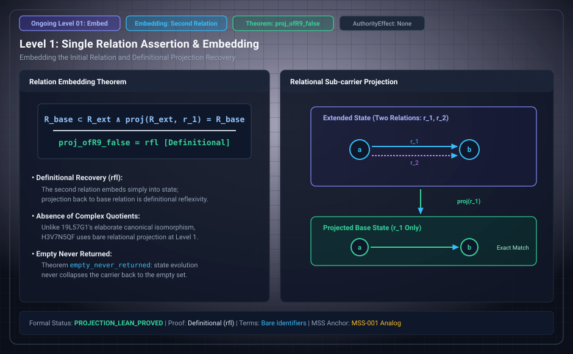

# Level 01: a second relation, derivations 8 and 9

**AuthorityEffect:** None.

**Pin:** `dbccpage/H3V7N5QF` at `5d9488324ce976817987bd83a28d901371cfc073`.

**Package:** [`genesis_ongoing`](/atlas/papers/finite_obstruction_calculus/genesis_ongoing).

The drawing `genesis_ongoing_01_relation_embedding.svg` is an education schematic in this documentation tree. The sentences below are taken from the pinned package.

Derivation 8, [`paper/eighth/paper.md`](/atlas/papers/finite_obstruction_calculus/genesis_ongoing/paper/eighth/paper.md), starts from `arb` once and adds a second relation `s`. Derivation 9, [`paper/ninth/paper.md`](/atlas/papers/finite_obstruction_calculus/genesis_ongoing/paper/ninth/paper.md), uses two relations and an empty beginning.

`lean4/Ninth/State.lean` has `theorem proj_ofR9_false (m : NSt) : m.ofR.proj false = m := rfl`. The equality is definitional. The same file has `theorem swap9_swap (s : NDSt) : s.swap.swap = s`.

The review row for the ninth derivation is in `meta/review/derivation_review.md`. It records two routes, through the seventh and the eighth, and says projected steps may stutter.

## Research Working Notes (`research/`)

The working notes for derivations 8 and 9 detail the semantic shift of adding relation channels:

- **Eighth derivation notes (`research/eighth/reading_the_seed.md`):** `r` and `s` share terms but have distinct assertions. Changes identify terms across both relations simultaneously, creating cross-relational coupling.
- **Ninth derivation notes (`research/ninth/reading_the_seed.md`):** Starting from nothing under two relations gives full symmetry between `r` and `s`. A state decomposes into two relational projections sharing a common term set. The swap involution `swap9_swap` exchanges `r` and `s` identically.
- **Projection stuttering:** Projecting a step from the two-relation system down to a single relation may map a change in `s` to an identity step in `r`, exhibiting projection stuttering.

## Files

- [`paper/eighth/paper.md`](/atlas/papers/finite_obstruction_calculus/genesis_ongoing/paper/eighth/paper.md)
- [`paper/ninth/paper.md`](/atlas/papers/finite_obstruction_calculus/genesis_ongoing/paper/ninth/paper.md)
- [`research/eighth/reading_the_seed.md`](/atlas/papers/finite_obstruction_calculus/genesis_ongoing/research/eighth/reading_the_seed.md)
- [`research/ninth/reading_the_seed.md`](/atlas/papers/finite_obstruction_calculus/genesis_ongoing/research/ninth/reading_the_seed.md)
- [`lean4/Ninth/State.lean`](/atlas/papers/finite_obstruction_calculus/genesis_ongoing/lean4/Ninth/State.lean)
- [`lean4/Eighth/State.lean`](/atlas/papers/finite_obstruction_calculus/genesis_ongoing/lean4/Eighth/State.lean)
