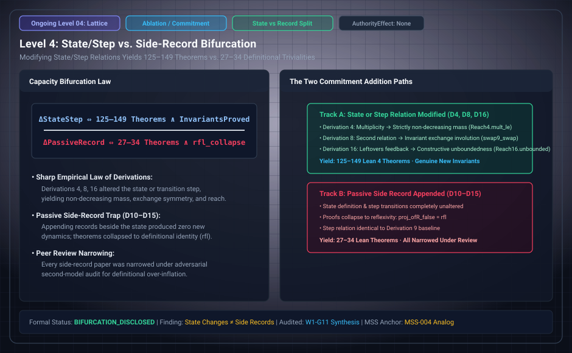

# Level 04: state and step versus a side record

**AuthorityEffect:** None.

**Pin:** `dbccpage/H3V7N5QF` at `5d9488324ce976817987bd83a28d901371cfc073`.

**Package:** [`genesis_ongoing`](/atlas/papers/finite_obstruction_calculus/genesis_ongoing).

The drawing `genesis_ongoing_04_bifurcation_lattice.svg` is an education schematic in this documentation tree. The sentences below are taken from the pinned package.

`meta/review/derivation_review.md` compares each derivation with its parent. For the tenth through the fifteenth, the review says the chosen state and step model is the ninth's by construction, with a tagged reading kept beside it.

The sixteenth row says the derivation has its own `RSt` and `Step16`, and that admitting a leftover changes the state. The manuscript is `paper/sixteenth/paper.md`.

The same review table stops at the twenty-first derivation. Papers 22 through 25 are in this pin and are outside that 21-row audit.

## Research Notes Context: C-L1 vs C-L2 & Tripartite Leftovers

`research/tenth/reading_the_seed.md` and `research/sixteenth/reading_the_seed.md` document the architectural bifurcation governing this sequence:

1. **The Tripartite Leftover Partition:** In the tenth seed, leftover is defined as not an assertion and splits every change into three outcomes:
   - **Nothing left:** Additions of terms or assertions deposit their entire effect directly into the state.
   - **Leftover clearable by a later move:** Removals (restored by re-adding the assertion in that same relation) and identifications in states asserting nothing (restored up to writing by adding a term).
   - **Leftover no later move can clear:** Identifications merging asserted multiplicities (since adding terms or assertions cannot un-merge collapsed counts).
2. **Chosen Reading C-L1 (Side Record):** Leftover is recorded strictly on the change/attempt rather than embedded in the state carrier. Consequently, derivations 10 through 15 retain the ninth derivation's state space, cost formula (size = terms + multiplicities), and reachability structure without modification.
3. **Unchosen Reading C-L2 (Tagged Result):** Leftover status tags the result as an incoming field, generating multiple tagged results from a single ninth-derivation state and bifurcating the cost/count landscape.
4. **Transition to Sovereign Carrier (Seed 16):** While derivations 10–15 keep leftover as a side classification, derivation 16 (`paper/sixteenth/paper.md`) admits leftovers into the operational carrier itself (`RSt` and `Step16`), creating unbounded feedback loops and non-trivial reachable topologies.

## Files

- [`meta/review/derivation_review.md`](/atlas/papers/finite_obstruction_calculus/genesis_ongoing/meta/review/derivation_review.md)
- [`paper/tenth/paper.md`](/atlas/papers/finite_obstruction_calculus/genesis_ongoing/paper/tenth/paper.md)
- [`paper/fifteenth/paper.md`](/atlas/papers/finite_obstruction_calculus/genesis_ongoing/paper/fifteenth/paper.md)
- [`paper/sixteenth/paper.md`](/atlas/papers/finite_obstruction_calculus/genesis_ongoing/paper/sixteenth/paper.md)
- [`research/tenth/reading_the_seed.md`](/atlas/papers/finite_obstruction_calculus/genesis_ongoing/research/tenth/reading_the_seed.md)
- [`research/sixteenth/reading_the_seed.md`](/atlas/papers/finite_obstruction_calculus/genesis_ongoing/research/sixteenth/reading_the_seed.md)

