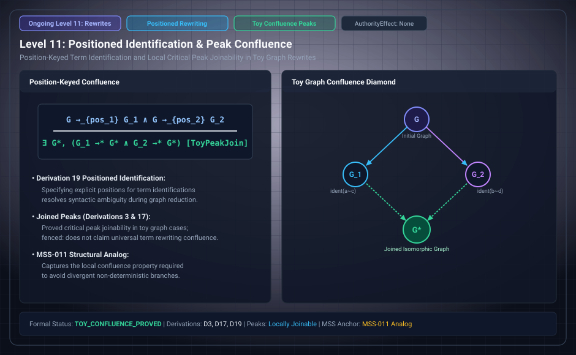

# Level 11: a writing that can collide terms

**AuthorityEffect:** None.

**Pin:** `dbccpage/H3V7N5QF` at `5d9488324ce976817987bd83a28d901371cfc073`.

**Package:** [`genesis_ongoing`](/atlas/papers/finite_obstruction_calculus/genesis_ongoing).

The drawing `genesis_ongoing_11_positioned_confluence.svg` is an education schematic in this documentation tree. The sentences below are taken from the pinned package.

Derivation 11 is `paper/eleventh/paper.md`: what follows once a writing can collide terms it does not identify.

The review row says the chosen state and step model is the ninth's by construction, and that the collision criterion and the labeled alternative were checked.

The education filename says positioned confluence. The manuscript title above is the statement in the pin.

## Research Working Notes (`research/`)

The working notes for the eleventh derivation (`research/eleventh/reading_the_seed.md`) analyze representation collision:

- **Carrier vs. writing separation:** Distinct carrier terms $u \neq v$ may be assigned identical character writings by an observer map.
- **Non-identifying collision:** The writing exhibits collision without triggering the state-level identification change. The state retains separate coordinates while the presentation manifests confluence.

## Files

- [`paper/eleventh/paper.md`](/atlas/papers/finite_obstruction_calculus/genesis_ongoing/paper/eleventh/paper.md)
- [`research/eleventh/reading_the_seed.md`](/atlas/papers/finite_obstruction_calculus/genesis_ongoing/research/eleventh/reading_the_seed.md)
- [`meta/review/derivation_review.md`](/atlas/papers/finite_obstruction_calculus/genesis_ongoing/meta/review/derivation_review.md)
