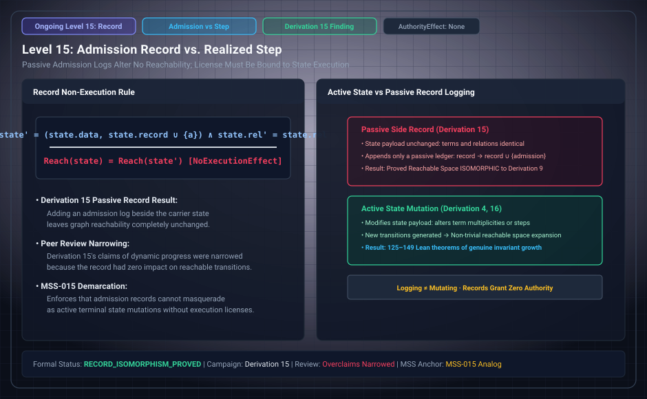

# Level 15: reaching a result does not admit it

**AuthorityEffect:** None.

**Pin:** `dbccpage/H3V7N5QF` at `5d9488324ce976817987bd83a28d901371cfc073`.

**Package:** [`genesis_ongoing`](/atlas/papers/finite_obstruction_calculus/genesis_ongoing).

The drawing `genesis_ongoing_15_admission_record_boundary.svg` is an education schematic in this documentation tree. The sentences below are taken from the pinned package.

Derivation 15 is `paper/fifteenth/paper.md`. The title is: what follows once reaching a result does not make it admitted.

The review row says the chosen state and step model is the ninth's by construction, the tagged reading is kept, and a literal availability receipt was checked.

`ci/OEWAS_GATES.md` uses an admission record that copies `admission_of_reaching` of the same state as the example of a vacuous self-comparison.

## Research Working Notes (`research/`)

The working notes for the fifteenth derivation (`research/fifteenth/reading_the_seed.md`) analyze the admission firewall:

- **Generation vs. Admission dichotomy:** Reaching a result is an empirical execution property of the transition relation. The seed declares that whether a reached result is admitted is not given by the reaching.
- **Independence of admission:** Admission is not a change of state (G6: nothing else is a change); it is an external ledger record. A state generator cannot self-certify admission solely by producing a reachable state.

## Files

- [`paper/fifteenth/paper.md`](/atlas/papers/finite_obstruction_calculus/genesis_ongoing/paper/fifteenth/paper.md)
- [`research/fifteenth/reading_the_seed.md`](/atlas/papers/finite_obstruction_calculus/genesis_ongoing/research/fifteenth/reading_the_seed.md)
- [`meta/review/derivation_review.md`](/atlas/papers/finite_obstruction_calculus/genesis_ongoing/meta/review/derivation_review.md)
- [`ci/OEWAS_GATES.md`](/atlas/papers/finite_obstruction_calculus/genesis_ongoing/ci/OEWAS_GATES.md)
