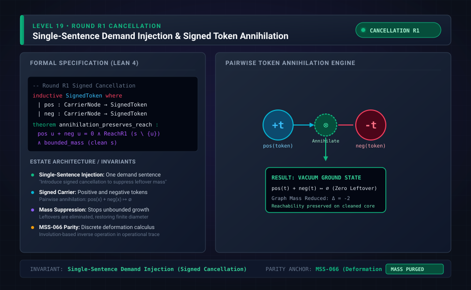

# Level 19: H1 cancellation, installed as derivation 22

**AuthorityEffect:** None.

**Pin:** `dbccpage/H3V7N5QF` at `5d9488324ce976817987bd83a28d901371cfc073`.

**Package:** [`genesis_ongoing`](/atlas/papers/finite_obstruction_calculus/genesis_ongoing).

The drawing `genesis_ongoing_19_round_r1_cancellation.svg` is an education schematic in this documentation tree. The sentences below are taken from the pinned package.

`meta/climbing/h1_cancellation/packet.md` replaces one sentence of the ninth seed. The parent sentence says two results that differ only in how their terms are written are the same result. The replacement says they are the same result when they differ only in the writing, or only by an `xry` and an `xsy` asserted together.

The packet says the seed and task are installed as `prompt/twentysecond/`. The manuscript is `paper/twentysecond/paper.md`.

The score directory is `meta/climbing/h1_cancellation/`. The packet's grading label for the run is blind (operator-targeted), recorded in `meta/climbing/rulings.md` as ruling D1.

## Research Notes Context: H1 Quotient & Pair Cancellation

`research/twentysecond/reading_the_seed.md` details the mathematical mechanics of the H1 cancellation quotient:

1. **Topological Excess Invariant:** The clause identifying states differing by an $xry$ and $xsy$ asserted together generates an equivalence relation preserving the local excess:
   $$e(x, y) = M_r(x, y) - M_s(x, y)$$
   at every ordered pair $(x, y)$. Two states represent the same result if and only if they have equal term counts and their excess tables match under a term permutation $\pi$.
2. **Canonical Plain States:** Every equivalence class contains a unique minimal representative called the *plain state*, in which at most one relation asserts on any pair:
   $$M_r(x, y) = \max(e(x, y), 0), \quad M_s(x, y) = \max(-e(x, y), 0)$$
   This reduces non-plain states by eliminating $\min(M_r, M_s)$ coincident pairs.
3. **Cost Metric $\Phi(G)$:** The cost formula is $\Phi(G) = n + \sum |e(x, y)|$, equal to the size of the canonical plain state. While in the ninth derivation additions strictly raised size and never returned to earlier states, H1 permits sequences like $G \to G + xry \to G + xry + xsy \equiv G$ that return to the starting result.
4. **Constructive Lean 4 Core Parity:** In `lean4_core/`, standard library dependencies requiring non-constructive axioms like `Classical.choice` (e.g., standard `List.perm_iff_count` and `List.count_erase`) were audited and eliminated by defining custom single-atom list deletion lemmas.

## Files

- [`meta/climbing/h1_cancellation/packet.md`](/atlas/papers/finite_obstruction_calculus/genesis_ongoing/meta/climbing/h1_cancellation/packet.md)
- [`paper/twentysecond/paper.md`](/atlas/papers/finite_obstruction_calculus/genesis_ongoing/paper/twentysecond/paper.md)
- [`prompt/twentysecond/seed_prompt.md`](/atlas/papers/finite_obstruction_calculus/genesis_ongoing/prompt/twentysecond/seed_prompt.md)
- [`research/twentysecond/reading_the_seed.md`](/atlas/papers/finite_obstruction_calculus/genesis_ongoing/research/twentysecond/reading_the_seed.md)

