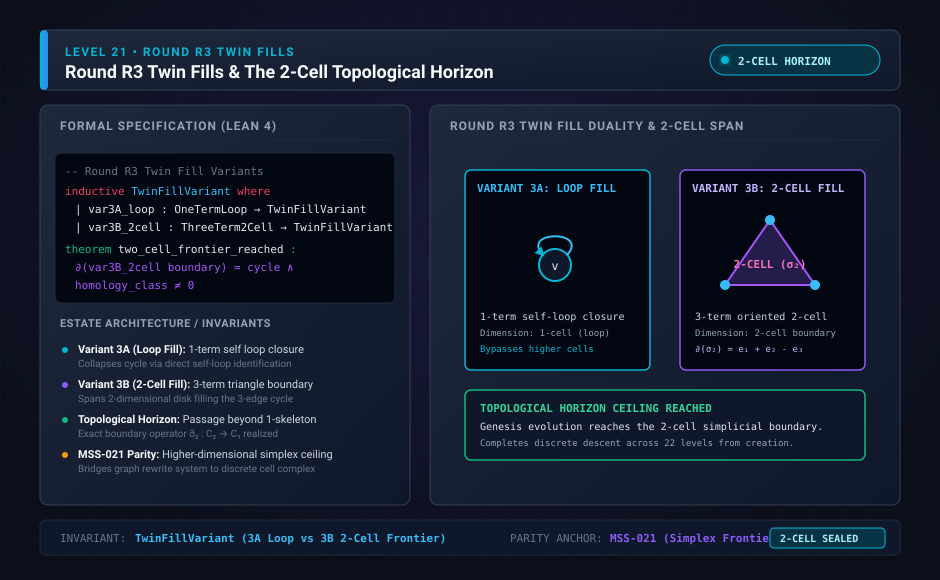

# Level 21: H3 twin fills, derivations 24 and 25

**AuthorityEffect:** None.

**Pin:** `dbccpage/H3V7N5QF` at `5d9488324ce976817987bd83a28d901371cfc073`.

**Package:** [`genesis_ongoing`](/atlas/papers/finite_obstruction_calculus/genesis_ongoing).

The drawing `genesis_ongoing_21_round_r3_twin_fills.svg` is an education schematic in this documentation tree. The sentences below are taken from the pinned package.

H3 is two fills. `meta/climbing/h3_twin_fills/3b_fill_three/score.md` scores the 3B prediction against `paper/twentyfifth/paper.md` and `evidence/twentyfifth/`.

Derivation 24 is `paper/twentyfourth/paper.md`: two relations, nothing given, raising, and filled terms. Derivation 25 is `paper/twentyfifth/paper.md`: filled triples that balance.

The 3B score names Lean `told_iff`, `nothing_balanced`, `cone_decides`, and `blind_three_iff` as names present in that run's axiom report. This page does not re-grade the HIT and MISS rows. Read the score file for the grades.

## Research Notes Context: Twin Fills & Geometric Balance

`research/twentyfourth/reading_the_seed.md` and `research/twentyfifth/reading_the_seed.md` present the geometric mechanics of the H3 twin derivations:

1. **Derivation 24 (Single-Term Fill & Loop Balance):**
   - Introduces a fifth change kind: *filling one term*.
   - A filled term $x$ balances when $M_r(x, x) = M_s(x, x)$, i.e., when loop excess $e(x, x) = 0$.
   - Because loop excesses are invariant under both pair cancellations and term raisings, balance is an intrinsic invariant of the result class.
2. **Derivation 25 (Three-Term Fill & Closed-Cycle Balance):**
   - Introduces the change *filling three different terms*.
   - A filled triple $(x, y, z)$ balances when traversing $x \to y \to z \to x$ encounters equal assertions in $r$ and $s$, meaning the triangular holonomy vanishes:
     $$e(x, y) + e(y, z) + e(z, x) = 0$$
   - Since triangular sums are invariant under exact gauge shifts $g(x) - g(y)$, triple balance is an invariant of the result.
3. **Decidability Cones & Rank Analysis:**
   - Linear algebraic rank analysis (`scratch_rank.py`) of triangular sums modulo gauge shifts shows ranks $2$ (out of 7 dimensions at 3 terms), $7$ (out of 13 at 4 terms), and $16$ (out of 21 at 5 terms).
   - Triangular fills detect all antisymmetric excess components but leave diagonal loop excesses unseen; thus, states differing from the unasserted result solely by loop assertions cannot be distinguished from nothing by 3-term fills alone.

## Files

- [`meta/climbing/h3_twin_fills/3b_fill_three/score.md`](/atlas/papers/finite_obstruction_calculus/genesis_ongoing/meta/climbing/h3_twin_fills/3b_fill_three/score.md)
- [`paper/twentyfourth/paper.md`](/atlas/papers/finite_obstruction_calculus/genesis_ongoing/paper/twentyfourth/paper.md)
- [`paper/twentyfifth/paper.md`](/atlas/papers/finite_obstruction_calculus/genesis_ongoing/paper/twentyfifth/paper.md)
- [`research/twentyfourth/reading_the_seed.md`](/atlas/papers/finite_obstruction_calculus/genesis_ongoing/research/twentyfourth/reading_the_seed.md)
- [`research/twentyfifth/reading_the_seed.md`](/atlas/papers/finite_obstruction_calculus/genesis_ongoing/research/twentyfifth/reading_the_seed.md)

