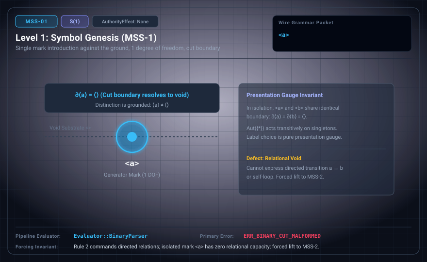

# MSS-N Level 01: Symbol Genesis and First Mark Admission

**AuthorityEffect:** None.\
**Level:** Level 01 (Single Mark Introduction / One Degree of Freedom)\
**Carrier:** Single Mark Carrier ⟨a⟩ | Raw Terminal `a`\
**Runtime Pipeline:** `Evaluator::BinaryParser` | Primary Error: `ERR_BINARY_CUT_MALFORMED`\
**Atlas Capabilities:** `generator_zero`, `generator_one`, `quiescence_preservation`

---

## 1. Schematic & Conceptual Architecture



MSS-1 introduces the first mark $\langle a \rangle$ against the unmarked ground, establishing one degree of freedom ($|C| = 1$). In the language of the Witnessed Difference Programme (WDP, §1.2), an exhibited cut has been produced and a mark retained. However, an isolated symbol possesses strictly zero relational capacity. It cannot express directed relations, edges, paths, or comparisons.

### Mathematical Perspectives on Level 01

1. **Genesis Metatheory ($S(1)$):**
   - The datum `a` is formally logged: $\operatorname{AdmitDatum}(a)$, yielding carrier $R_0 = \{a\}$.
   - **Quiescence:** Because only one datum exists, no transitions are permitted: ${\longrightarrow}_0 = \varnothing$. The state sits in complete equilibrium.
2. **Homotopy Type Theory (HoTT):**
   - A 0-dimensional contractible space consisting of a single point $a$.
   - The identity type $\operatorname{Id}(a, a)$ contains only the trivial reflexivity loop $\operatorname{refl}_a$.
3. **Category Theory:**
   - The terminal category $\mathbf{1}$ consisting of one object and its identity morphism $\operatorname{id}_a$.
4. **Presentation Gauge:**
   - The choice of glyph `a` is pure presentation gauge; the automorphism group $\operatorname{Aut}(\{*\})$ acts transitively. Naming the symbol `a`, `1`, or `x` carries zero structural difference.

---

## 2. Wire Packet Grammar & Successor Rationale

- **Declared Successor Rationale:** An isolated symbol $\langle a \rangle$ has zero relational capacity; MSS-2 is declared as the successor stage adding a second distinct mark to enable relational comparison and difference genesis. (Lift status to MSS-2 remains an unproved transition obligation until a second datum admission is attested.)
- **Grammar Forms:**
  - *Boundary Profile (`boundary.ebnf`):*
    ```ebnf
    packet ::= "<" "a" ">"
    ```
  - *Raw Glyph Profile (`mssn.ebnf`):*
    ```ebnf
    S ::= "a"
    ```
- **Wire Packet(s):**
  ```text
  <a>
  ```

---

## 3. Runtime Evaluator & Mathematical Core

- **Single Mark Inhabitance:** The carrier contains exactly one generator. The distinction $\langle a \rangle \neq \langle\rangle$ is grounded.
- **Relational Impotence:** Any attempt to evaluate transitions, ordering, or adjacency at Level 01 fails closed. A single point cannot witness direction.
- **WDP Alignment:** While an exhibited mark exists, duration, succession, and measurement remain undefined because no second mark exists against which a comparison or interval can be calibrated.
- **Error Trigger:** Emits `ERR_BINARY_CUT_MALFORMED` upon receiving multiple distinct symbols or relation tokens before Level 02 is admitted.

---

## 4. Verification Obligation & Falsifier Boundary

- **Verification Obligation:** The evaluator accepts precisely the single-mark packet `<a>` (or raw token `a`) and verifies that the payload contains exactly one generator. (Preserving `<>` under a proposed lift from MSS-0 is a **candidate-lift obligation**, not an established local property of MSS-1, since lifts remain unlicensed.)
- **Negative Counterexample:** The input `<b>`, `<ab>` or `a>b`, or any payload of more than one glyph, is rejected. (The canonical tower's MSS-1 stage check differs: it refuses `<a>` and accepts binary atoms such as `<01>`.)
- **Gauge Invariant:** Permuting the label `a` to another single glyph without changing carrier cardinality preserves the contract under gauge equivalence.

---

## 5. Claim Hygiene Quadrant

1. **What this supports:**
   - Verifies that the Level 01 parser accepts exactly the single admitted mark and maintains quiescence (${\longrightarrow}_0 = \varnothing$).
   - Demonstrates the transition from zero degrees of freedom (Level 00) to one degree of freedom (Level 01).
2. **What this does not support:**
   - Does not establish the existence of relations, arrows, graphs, or directed orderings.
   - Does not show that a single mark possesses intrinsic semantic meaning beyond its formal admission in the carrier.
3. **The narrowest defensible claim:**
   - In this test setting, MSS-1 accepts exactly single-mark tokens conforming to $\langle a \rangle$ and rejects relational or multi-character expressions.
4. **Next test needed:**
   - Advance to MSS-2 by imposing distinction between two admitted data ($\operatorname{Impose}(a, b)$).
