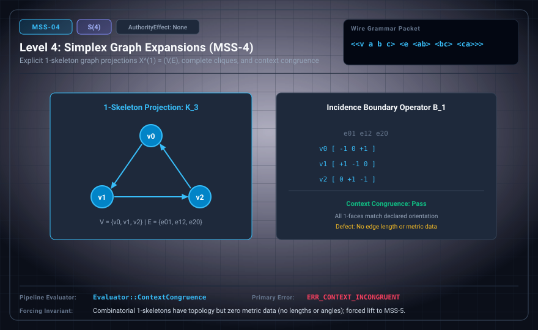

# MSS-N Level 04: Simplex Graph Expansions

**AuthorityEffect:** None.\
**Level:** Level 04 (1-Skeleton Graph Projections / Combinatorial Graph Traversal)\
**Carrier:** Graph Projection Packets ⟨⟨v ...⟩ ⟨e ...⟩⟩\
**Runtime Pipeline:** `Evaluator::ContextCongruence` | Primary Error: `ERR_CONTEXT_INCONGRUENT`\
**Atlas Capabilities:** `one_skeleton`, `transitive_orientation`

---

## 1. Schematic & Conceptual Architecture



MSS-4 projects abstract simplices into explicit 1-skeleton graph representations X^(1) = (V, E). A k-simplex decomposes into its complete graph K_{k+1}, resolving face boundaries into explicit directed edge cycles.

---

## 2. Wire Packet Grammar & Successor Rationale

- **Declared Successor Rationale:** MSS-4 contains no metric primitives; MSS-5 adds a declared metric-simplex carrier with exact rational squared edge lengths. (Lift status to MSS-5 remains an unproved transition obligation.)
- **Wire Packet(s):**
```text
<<v a b c> <e <ab> <bc> <ca>>>
```

---

## 3. Runtime Evaluator & Mathematical Core

- **1-Skeleton Projection:** Decomposes $k$-simplices into complete graph $K_{k+1}$.
- **Transitive Orientation:** Edge orientations are induced by the declared vertex ordering (e.g. $[v_i, v_j]$ with $i < j$), ensuring compatible combinatorial boundaries.
- **Congruence Verification:** `Evaluator::ContextCongruence` verifies context category congruence across test frames, emitting `ERR_CONTEXT_INCONGRUENT` on discrepancies.

---

## 4. Verification Obligation & Falsifier Boundary

- **Verifier Obligation:** Match graph edges to simplex 1-faces with orientation induced by the declared vertex ordering.
- **Negative Counterexample:** A missing edge of a declared triangle is rejected.
- **Boundary Warning:** Graph expansions define combinatorial connectivity without metric edge lengths.

---

## 5. Claim Hygiene Quadrant

1. **What this supports:**
   - Verification that 1-skeleton graph projections faithfully represent simplicial boundaries as oriented directed cycles.
2. **What this does not support:**
   - Does not establish metric embedding, distance functions, or continuous curvature.
3. **The narrowest defensible claim:**
   - MSS-4 verifies complete 1-skeleton graph expansions for simplices, enforcing context category congruence.
4. **Next test needed:**
   - Advance to MSS-5 by introducing exact rational edge lengths and Regge curvature deficits.
