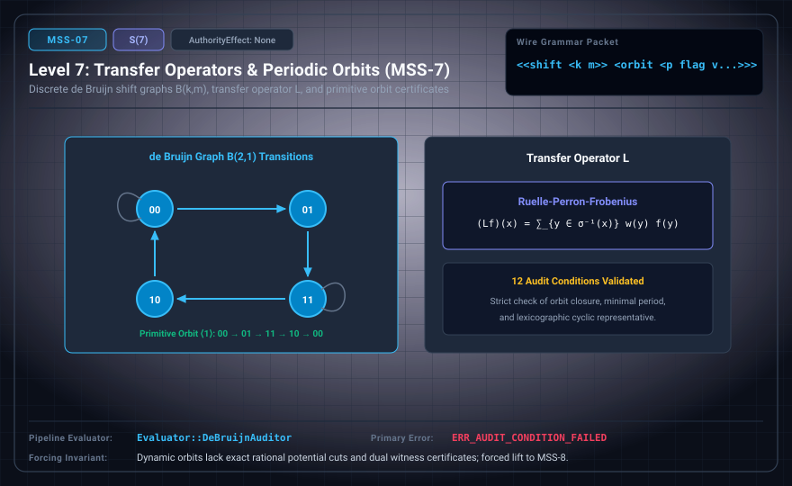

# MSS-N Level 07: Transfer Operators & Periodic Orbits

**AuthorityEffect:** None.\
**Level:** Level 07 (Discrete Dynamical Systems / de Bruijn Shift Graphs)\
**Carrier:** Shift Spec & Periodic Orbit Packets\
**Runtime Pipeline:** `Evaluator::DeBruijnAuditor` | Primary Error: `ERR_AUDIT_CONDITION_FAILED`\
**Atlas Capabilities:** `shift_spec`, `primitive_orbit`

---

## 1. Schematic & Conceptual Architecture



MSS-7 specifies discrete dynamical systems on de Bruijn shift graphs B(k, m) while specifically verifying implemented test cases on canonical B(2, 1). The discrete Ruelle-Perron-Frobenius transfer operator ℒ governs state transitions. Periodic orbits are validated against 12 Audit Conditions, with primitive orbit flags ensuring minimal cyclic representation.

---

## 2. Wire Packet Grammar & Successor Rationale

- **Declared Successor Rationale:** Dynamic orbits lack exact rational potential cuts and dual witness certificates on cochains; MSS-8 is declared as the successor stage to introduce this capability within the external research atlas. (Lift status to MSS-8 remains an unproved transition obligation.)
- **Wire Packet(s):**
```text
<<shift <k m>> <orbit <period flag v1 v2 ...>>>
```

---

## 3. Runtime Evaluator & Mathematical Core

- **de Bruijn Shift Spec:** Alphabet size $k$ and block length $m$ in specification; the implemented host auditor specifically evaluates canonical $B(2, 1)$.
- **Primitive Orbit Flag:** Flag `⟨1⟩` certifies $\gcd(\{j : \sigma^j(w) = w\}) = |w|$.
- **Audit Conditions:** `Evaluator::DeBruijnAuditor` tests $B(2,1)$ orbit transitions against 12 deterministic Audit Conditions, emitting `ERR_AUDIT_CONDITION_FAILED` on violations.

---

## 4. Verification Obligation & Falsifier Boundary

- **Verifier Obligation:** Check orbit closure, minimal period, and cyclic representative.
- **Negative Counterexample:** `00` claimed as a primitive period-two orbit is rejected.
- **Boundary Warning:** Discrete symbolic shift graphs do not imply continuous chaos or ergodic measure preservation.

---

## 5. Claim Hygiene Quadrant

1. **What this supports:**
   - Verification of primitive orbit conditions and transfer matrix action on the canonical de Bruijn graph B(2, 1) against 12 Audit Conditions.
2. **What this does not support:**
   - Does not claim host test execution for arbitrary B(k, m) beyond B(2, 1), nor does it establish continuous chaotic dynamics or thermodynamic equilibration.
3. **The narrowest defensible claim:**
   - MSS-7 validates discrete periodic orbits on canonical B(2, 1) against 12 deterministic Audit Conditions, within the declared B(k, m) specification family.
4. **Next test needed:**
   - Advance to MSS-8 by constructing monadic adjunctions and solving exact ℓ¹ cochain cuts with zero duality gap.
