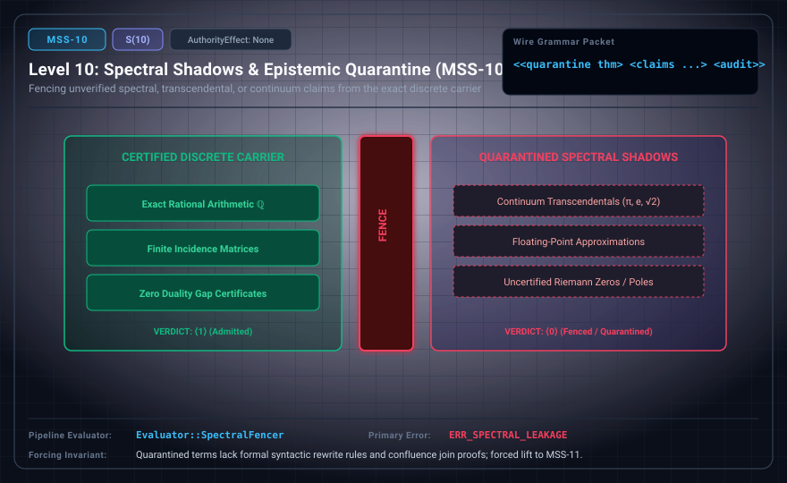

# MSS-N Level 10: Spectral Shadows & Epistemic Quarantine

**AuthorityEffect:** None.\
**Level:** Level 10 (Epistemic Quarantine / Continuum Claim Isolation)\
**Carrier:** Quarantine Packets with Claims, Audit Verdict, and Scope Fences\
**Runtime Pipeline:** `Evaluator::SpectralFencer` | Primary Error: `ERR_SPECTRAL_LEAKAGE`\
**Atlas Capabilities:** `shadow_packet`, `scope_fence`

---

## 1. Schematic & Conceptual Architecture



MSS-10 enforces an epistemic quarantine fence isolating assertions that require imported continuum or transcendental semantics (such as $\pi$, continuous $U(1)$, or uncertified numerical approximations) from the exact discrete carrier. This is an ontological and semantic typing boundary rather than a judgment on classical theorems: classical continuum constants are not admitted as native discrete ground terms unless accompanied by certified discrete rational enclosures or explicit algebraic specifications. Verdict ⟨0⟩ indicates quarantine; verdict ⟨1⟩ indicates verified discrete boundary containment.

---

## 2. Wire Packet Grammar & Successor Rationale

- **Declared Successor Rationale:** Quarantined terms lack formal syntactic rewrite rules and confluence join proofs; MSS-11 is declared as the successor stage to introduce this capability within the external research atlas. (Lift status to MSS-11 remains an unproved transition obligation.)
- **Wire Packet(s):**
```text
<<quarantine thm> <claims p u z a> <audit check verdict> <body type transcript>>
```

---

## 3. Runtime Evaluator & Mathematical Core

- **Fenced Assertions:** Imported continuum or transcendental semantics (e.g. continuous $\pi$, uncertified continuous field approximations, uncertified numerical eigenvalues).
- **Verdict Logic:** Verdict `⟨0⟩` fences uncertified continuum assertions; verdict `⟨1⟩` confirms certified discrete boundary containment.
- **Spectral Fencer:** `Evaluator::SpectralFencer` evaluates spectral representations and emits `ERR_SPECTRAL_LEAKAGE` when uncertified continuum or transcendental terms attempt to enter discrete solvers.

---

## 4. Verification Obligation & Falsifier Boundary

- **Verifier Obligation:** Prevent imported continuum/transcendental semantics from entering discrete verification chains without certified rational enclosures.
- **Negative Counterexample:** A floating-point or transcendental representation of $\pi$ injected into discrete linear algebra without an interval enclosure is rejected with `ERR_SPECTRAL_LEAKAGE`.
- **Boundary Warning:** Quarantining an assertion that imports continuum semantics isolates the discrete solver boundary without asserting falsity of the corresponding mathematical theorem in classical analysis.

---

## 5. Claim Hygiene Quadrant

1. **What this supports:**
   - Verification that assertions requiring imported continuum or transcendental semantics and uncertified numerical approximations are quarantined from exact discrete certificate chains.
2. **What this does not support:**
   - Does not claim mathematical falsity of classical continuum theorems, nor does it decide continuous conjectures.
3. **The narrowest defensible claim:**
   - MSS-10 enforces strict semantic quarantine against uncertified continuum and transcendental imports into discrete verification contexts.
4. **Next test needed:**
   - Advance to MSS-11 by introducing 2-polygraph string rewrites and Church-Rosser confluence peak joins.
