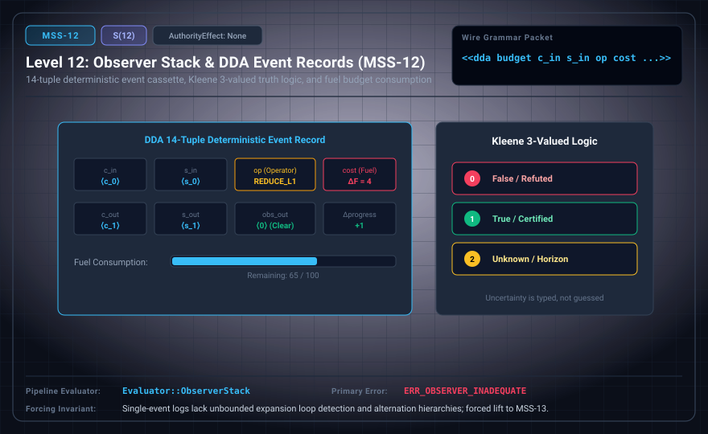

# MSS-N Level 12: Observer Stack & DDA Event Records

**AuthorityEffect:** None.\
**Level:** Level 12 (Discrete Deformation Analysis / Kleene 3-Valued Truth Logic)\
**Carrier:** DDA 14-Tuple Event Ledger Packets\
**Runtime Pipeline:** `Evaluator::ObserverStack` | Primary Error: `ERR_OBSERVER_INADEQUATE`\
**Atlas Capabilities:** `kleene_value`, `event_ledger`

---

## 1. Schematic & Conceptual Architecture



MSS-12 incorporates the Discrete Deformation Analysis (DDA) 14-tuple event record and Kleene 3-valued truth logic {0=False, 1=True, 2=Unknown/Horizon}. Tracks state transformations, fuel consumption, and obstruction persistence across discrete observer frames.

---

## 2. Wire Packet Grammar & Successor Rationale

- **Declared Successor Rationale:** Single-event logs lack unbounded expansion loop detection and bounded quantifier alternation hierarchies; MSS-13 is declared as the successor stage to introduce this capability within the external research atlas. (Lift status to MSS-13 remains an unproved transition obligation.)
- **Wire Packet(s):**
```text
<<dda budget c_in s_in op cost c_out s_out d_in d_out obs_in obs_out delta_c receipt p_digest>>
<<kernel budget context state obstruction>>
```

---

## 3. Runtime Evaluator & Mathematical Core

- **14-Tuple Event Record Schema:** Explicitly captures 14 fields: (1) budget, (2) context_in, (3) state_in, (4) operator, (5) declared_cost, (6) context_out, (7) state_out, (8) digest_in, (9) digest_out, (10) obstruct_in, (11) obstruct_out, (12) delta_c, (13) info_receipt, (14) parent_digest.
- **Minimal Runtime Kernel:** 4-field irredundant configuration $(B, C, x, \Omega)$ = `(budget, context, state, obstruction)`.
- **Kleene 3-Valued Logic:** $\{0 = \text{False}, 1 = \text{True}, 2 = \text{Unknown/Horizon}\}$.
- **Observer Stack:** `Evaluator::ObserverStack` records deterministic execution events, emitting `ERR_OBSERVER_INADEQUATE` on fuel depletion without typed horizon tokens.

---

## 4. Verification Obligation & Falsifier Boundary

- **Verifier Obligation:** Recompute bounded transition with parent digest and typed uncertainty across all 14 schema fields.
- **Negative Counterexample:** A model-written Pass without host proof is rejected with `ERR_OBSERVER_INADEQUATE`.
- **Boundary Warning:** A budget-stopped `Unknown` state must not be reported as a mathematical obstruction proof.

---

## 5. Claim Hygiene Quadrant

1. **What this supports:**
   - Verification of deterministic 14-tuple state transitions and Kleene 3-valued logic accounting under finite computational budgets.
2. **What this does not support:**
   - Does not establish that infinite computations converge or that horizon states are decidable.
3. **The narrowest defensible claim:**
   - MSS-12 records discrete execution events in explicit 14-tuples, managing fuel consumption with Kleene 3-valued truth logic.
4. **Next test needed:**
   - Advance to MSS-13 by tracking quantifier alternation ladders and detecting autopoietic expansion cycles.
