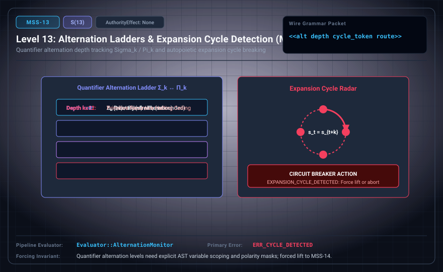

# MSS-N Level 13: Alternation Ladders & Expansion Cycle Detection

**AuthorityEffect:** None.\
**Level:** Level 13 (Quantifier Alternation Depth / Halting Cycle Detection)\
**Carrier:** Alternation Packets with Cycle Tokens and BQNF Defect Routes\
**Runtime Pipeline:** `Evaluator::AlternationMonitor` | Primary Error: `ERR_CYCLE_DETECTED`\
**Atlas Capabilities:** `cycle_record`, `route_token`

---

## 1. Schematic & Conceptual Architecture



MSS-13 formalizes quantifier alternation tracking (Σ_k / Π_k up to depth 12) and halting cycle detection. Halts unproductive autopoietic recursion via EXPANSION_CYCLE_DETECTED and routes cochain defects across 11 deterministic BQNF terminal routes.

---

## 2. Wire Packet Grammar & Successor Rationale

- **Declared Successor Rationale:** Quantifier alternation levels need explicit AST variable scoping and polarity masks; MSS-14 is declared as the successor stage to introduce this capability within the external research atlas. (Lift status to MSS-14 remains an unproved transition obligation.)
- **Wire Packet(s):**
```text
<<alt depth cycle_token route>>
<<bqnf defect route cert>>
```

---

## 3. Runtime Evaluator & Mathematical Core

- **Alternation Monitoring:** Tracks depth $k \le 12$ across quantifier switches.
- **Expansion Cycle Halting:** Emits `EXPANSION_CYCLE_DETECTED` on repeated states lacking constructive progress.
- **BQNF Terminal Routes:** Routes defects across 11 canonical codes (`ROUTE_REPAIR`, `ROUTE_LIFT`, etc.).
- **Evaluator:** `Evaluator::AlternationMonitor` emits `ERR_CYCLE_DETECTED` on non-progressing loops.

---

## 4. Verification Obligation & Falsifier Boundary

- **Verifier Obligation:** Check repeated state with unchanged progress and replay chosen route.
- **Negative Counterexample:** A syntactic route code alone cannot certify exact repair.
- **Boundary Warning:** Bounding alternation depth to k ≤ 12 leaves higher arithmetical sentences unaddressed.

---

## 5. Claim Hygiene Quadrant

1. **What this supports:**
   - Verification that repeated machine states without progress are halted via cycle detection and routed across BQNF codes.
2. **What this does not support:**
   - Does not solve the general Turing halting problem or prove termination of unbounded programs.
3. **The narrowest defensible claim:**
   - MSS-13 bounds quantifier alternation depth to k ≤ 12 and halts non-progressing recursive cycles.
4. **Next test needed:**
   - Advance to MSS-14 by introducing bounded quantifier alternation grammar with explicit polarity masks.
