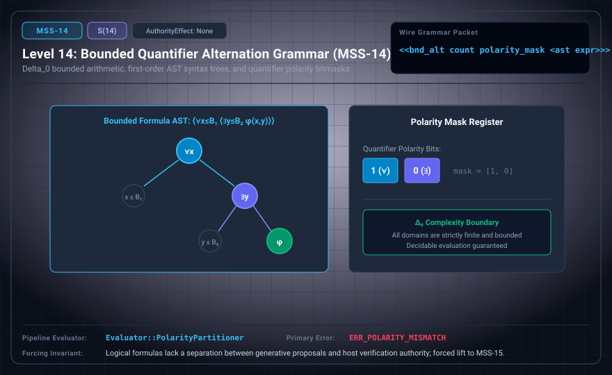

# MSS-N Level 14: Bounded Quantifier Alternation Grammar

**AuthorityEffect:** None.\
**Level:** Level 14 (Δ_0 Arithmetical Hierarchy / Polarity Mask Verification)\
**Carrier:** Bounded Quantifier AST Packets with Polarity Bitmasks\
**Runtime Pipeline:** `Evaluator::PolarityChecker` | Primary Error: `ERR_POLARITY_MISMATCH`\
**Atlas Capabilities:** `bound_ast`, `polarity_mask`

---

## 1. Schematic & Conceptual Architecture



MSS-14 formalizes first-order formulas within the bounded arithmetical hierarchy ($\Delta_0$), bounded by explicit quantifier alternation counts and polarity masks. The polarity bitmask tracks quantifier switches ($\forall \leftrightarrow \exists$) along the formula AST, verifying that all quantified variables are bounded by finite terms.

---

## 2. Wire Packet Grammar & Successor Rationale

- **Declared Successor Rationale:** Logical formulas lack a separation between generative proposals and host verification authority; MSS-15 is declared as the successor stage to introduce this capability within the external research atlas. (Lift status to MSS-15 remains an unproved transition obligation.)
- **Wire Packet(s):**
```text
<<bnd_alt count polarity_mask <ast <var bound>... expr>>>
```

---

## 3. Runtime Evaluator & Mathematical Core

- **Δ_0 Hierarchy:** All quantifiers are explicitly bounded by finite terms: $(\forall x < b) \, P(x)$.
- **Polarity Bitmask:** Encodes quantifier parity switches along AST traversal paths.
- **Polarity Checker:** `Evaluator::PolarityChecker` validates quantifier alternation depth and polarity bitmask consistency across AST traversal paths, emitting `ERR_POLARITY_MISMATCH` on mask discrepancies.

---

## 4. Verification Obligation & Falsifier Boundary

- **Verifier Obligation:** Enumerate finite domains and recompute mask from formula tree.
- **Negative Counterexample:** An unbounded quantifier with a finite step budget is rejected.
- **Boundary Warning:** Finite domain evaluation scales with domain size; large bounds may trigger fuel exhaustion.

---

## 5. Claim Hygiene Quadrant

1. **What this supports:**
   - Verification of finite domain quantification and polarity bitmask consistency in Δ_0 arithmetical formulas.
2. **What this does not support:**
   - Does not establish truth of unbounded Peano arithmetic formulas or undecidable Gödel sentences.
3. **The narrowest defensible claim:**
   - MSS-14 evaluates bounded first-order formulas in Δ_0, verifying variable bounds and polarity masks.
4. **Next test needed:**
   - Advance to MSS-15 by constructing the tripartite Red-Blue-Green master authority horizon.
