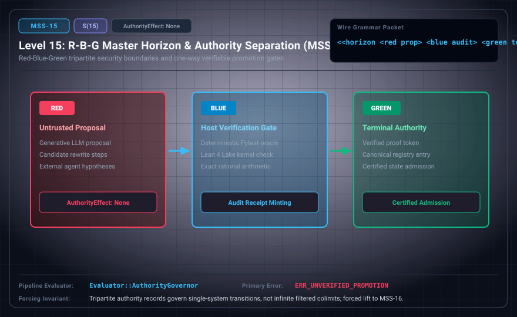

# MSS-N Level 15: R-B-G Master Horizon & Authority Separation

**AuthorityEffect:** None.\
**Level:** Level 15 (Tripartite Authority Horizon / Proposer-Host Governance)\
**Carrier:** Horizon Packets with Red Proposal, Blue Audit, and Green Token\
**Runtime Pipeline:** `Evaluator::AuthorityGovernor` | Primary Error: `ERR_UNVERIFIED_PROMOTION`\
**Atlas Capabilities:** `candidate_proposal`, `host_receipt`

---

## 1. Schematic & Conceptual Architecture



MSS-15 enforces the Red-Blue-Green tripartite authority boundary. Red represents untrusted candidate proposals (`AuthorityEffect: None`). Blue represents deterministic host evaluation receipts. Green represents a **scoped terminal certification token** (certifying that a specific bounded intake passed all declared checks), not ambient execution authority, because the row itself and all its components operate under `AuthorityEffect: None`.

---

## 2. Wire Packet Grammar & Successor Rationale

- **Declared Successor Rationale:** Tripartite authority records govern single-system transitions, not infinite filtered colimits of entire system towers; MSS-16 is declared as the successor stage to introduce this capability within the external research atlas. (Lift status to MSS-16 remains an unproved transition obligation.)
- **Wire Packet(s):**
```text
<<horizon <red proposal> <blue host_audit> <green terminal_token>>>
```

---

## 3. Runtime Evaluator & Mathematical Core

- **Red (Proposal):** Untrusted generative candidate stream, `AuthorityEffect: None`.
- **Blue (Host Audit):** Independent, deterministic checker verification receipt.
- **Green (Scoped Terminal Token):** Certified proof digest and scoped terminal certification token, admitted only with matching Blue verification; does not confer ambient execution authority.
- **Authority Governor:** `Evaluator::AuthorityGovernor` enforces Theorems 1–15, blocking unverified promotions under `ERR_UNVERIFIED_PROMOTION`.

---

## 4. Verification Obligation & Falsifier Boundary

- **Verifier Obligation:** Bind verifier digest and scope before accepting any terminal authority.
- **Negative Counterexample:** A candidate-authored Green verdict is rejected with `ERR_UNVERIFIED_PROMOTION`.
- **Boundary Warning:** Green is a scoped terminal certification token bound to a specific intake and host receipt, never ambient system authority; authority separation prevents unverified promotion but does not ensure the proposer discovers valid answers.

---

## 5. Claim Hygiene Quadrant

1. **What this supports:**
   - Verification of the tripartite authority firewall, preventing untrusted proposals from elevating their own authority status.
2. **What this does not support:**
   - Does not establish that candidate models will produce valid proposals or that all verifiable truths are discoverable.
3. **The narrowest defensible claim:**
   - MSS-15 enforces tripartite authority boundaries, requiring matching host audit receipts before admitting scoped terminal certification tokens (AuthorityEffect: None).
4. **Next test needed:**
   - Advance to MSS-16 by modeling infinite symbolic systems as filtered colimits of finite stage presentations.
