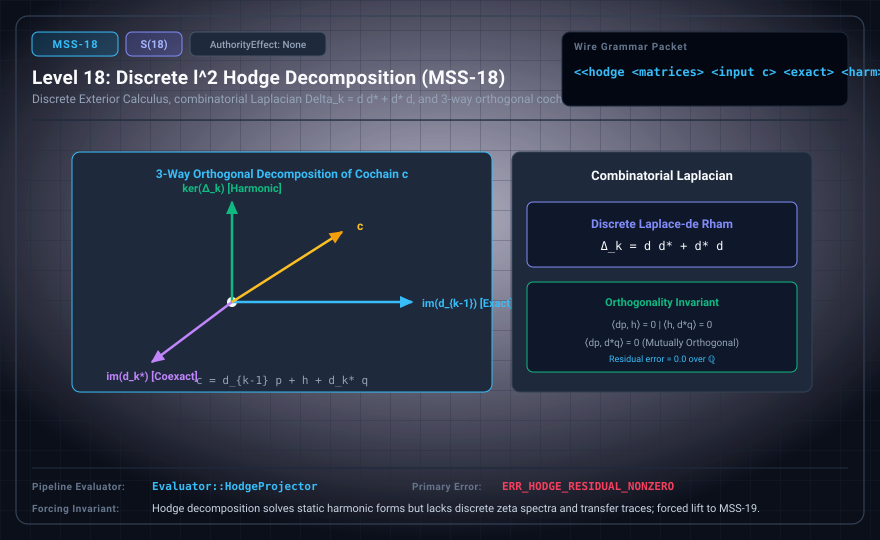

# MSS-N Level 18: Discrete ℓ² Hodge Decomposition

**AuthorityEffect:** None.\
**Level:** Level 18 (Discrete Exterior Calculus / Orthogonal Cochain Splitting)\
**Carrier:** Hodge Packets with Matrices, Input Cochain, Components, and Receipt\
**Runtime Pipeline:** `Evaluator::HodgeProjector` | Primary Error: `ERR_HODGE_RESIDUAL_NONZERO`\
**Atlas Capabilities:** `harmonic_component`, `coexact_component`

---

## 1. Schematic & Conceptual Architecture



MSS-18 specifies finite cochain data for orthogonal $\ell^2$ Hodge decomposition over $\mathbb{Q}$. For a finite rational cochain complex with $d_k d_{k-1}=0$ and rational symmetric positive-definite weight matrices, every cochain $c \in C^k$ splits uniquely into exact, harmonic, and coexact components: $c = d_{k-1} p + h + d_k^* q$. The three components are unique; the potentials $p$ and $q$ need not be, because either may be changed by an element of the relevant kernel. Harmonic cochains provide canonical representatives of cohomology classes under the declared finite inner-product structure.

---

## 2. Wire Packet Grammar & Successor Rationale

- **Declared Successor Rationale:** Hodge decomposition solves static harmonic forms but lacks discrete zeta spectra and transfer trace polynomials; MSS-19 is declared as the successor stage to introduce this capability within the external research atlas. (Lift status to MSS-19 remains an unproved transition obligation.)
- **Wire Packet(s):**
```text
<<hodge <matrices d0 d1 m0 m1 m2> <input c> <exact> <harmonic> <coexact> <receipt>>>
```

---

## 3. Runtime Evaluator & Mathematical Core

- **Discrete Codifferential:** For $d_k: C^k \to C^{k+1}$ with inner-product weight matrices $M_k$ on $C^k$ and $M_{k+1}$ on $C^{k+1}$, the matrix adjoint is $d_k^* = M_k^{-1} d_k^T M_{k+1}: C^{k+1} \to C^k$.
- **Combinatorial Laplacian:** $\Delta_k = d_{k-1} d_{k-1}^* + d_k^* d_k = d_{k-1} (M_{k-1}^{-1} d_{k-1}^T M_k) + (M_k^{-1} d_k^T M_{k+1}) d_k$.
- **Orthogonal Splitting:** $c = d_{k-1} p + h + d_k^* q$ with $p \in C^{k-1}$, $h \in \mathcal{H}^k$ ($d_k h = 0$ and $d_{k-1}^* h = 0$), and $q \in C^{k+1}$.
- **Proposed Hodge Projector:** `Evaluator::HodgeProjector` is required to compute orthogonal projection vectors over $\mathbb{Q}$, emitting `ERR_HODGE_RESIDUAL_NONZERO` on non-zero residuals.

---

## 4. Verification Obligation & Falsifier Boundary

- **Verifier Obligation:** Verify differential nilpotence, matrix dimensions and positive definiteness of every weight matrix. Reconstruct input cochain $c$ and verify exact harmonic/coexact orthogonality under $d_k^* = M_k^{-1} d_k^T M_{k+1}$.
- **Negative Counterexample:** A zero residual field without matrices is rejected.
- **Boundary Warning:** Discrete Hodge decomposition on finite complexes does not imply smooth Riemannian manifold metrics.

---

## 5. Claim Hygiene Quadrant

1. **What this supports:**
   - Verification of unique orthogonal cochain splitting $c = d_{k-1} p + h + d_k^* q$ and harmonic kernel calculation over rational complexes.
2. **What this does not support:**
   - Does not establish smooth de Rham-Hodge theorems on continuous curved manifolds.
3. **The narrowest defensible claim:**
   - MSS-18 specifies a rational orthogonal decomposition and checks needed to verify a submitted result; the evaluator label is not an implementation receipt.
4. **Next test needed:**
   - Advance to MSS-19 by computing Ihara zeta functions as exact integer characteristic polynomials.
