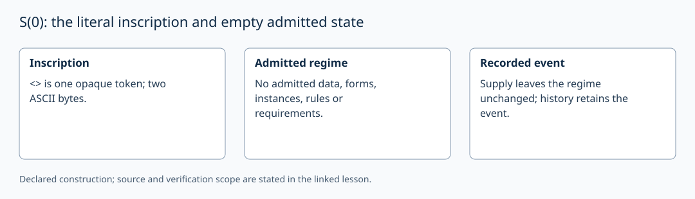

# S(0): the literal inscription and empty admitted state

AuthorityEffect: None. [Source correspondence and proof scope](../source_correspondence.md).

The literal `<>` is a supplied opaque whole. It occupies one token position
and two ASCII bytes. In the source event model, the initial admitted regime
has no data, forms, instances, rules or requirements. Supplying an inscription
leaves this admitted regime unchanged; the ordered history still records it.

`genesis_underivable` and `supply_no_op` in the pinned source's
`lean4/Derivation/Inertia.lean` establish their respective statements about
that model. No parsing of the two characters is used by the regime.

The local `S0Ground` example checks an empty supplied carrier and demand set.
In Lean, `Carrier 0 = Fin 0`, and `ground_carrier_empty` proves it has no
inhabitant. These are model statements about admission, not a claim that the
host language lacks containers.

For the ledger exercise set W₀=∅ and s₀=0. Recording a receipt of this check
in H₀ does not create an unresolved demand. The next event must be supplied
by the recorded continuation policy; its cost is measured when it is admitted.
