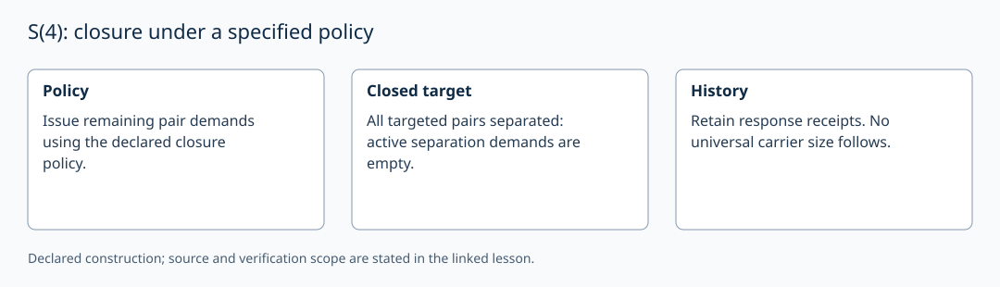

# S(4): closure under a specified policy

AuthorityEffect: None. [Source correspondence and proof scope](../source_correspondence.md).

A closure policy may reissue separation demands on collapsed pairs and
select valid responses, taking source automorphism classes into account.
The source closure theorems concern their declared transition and terminal
predicates. Neither supply nor a stage number selects this policy.

At a terminal state where all targeted pairs are separated, the active
separation-demand set is empty. Recording the successful responses preserves
history. Thus W₄=∅ and s₄=0 can coexist with nonempty H₄. There is no universal
claim that the carrier has four data or that exactly five receipts were issued.

A complete graph K_m can *record* all unordered separated pairs of m data.
It does not mean that the source admitted a binary relation for every edge:
separation can come from unary forms. The local `S4Orbit` class checks this
complete-graph counting example and rejects duplicate vertex labels; it does
not implement source automorphism-orbit search.

For m≥1, K_m is connected and its graph cycle-space dimension is
m(m−1)/2−m+1. Adding all higher simplices would change the object and its
homology. Graph cycle count and pending source demands are different values.
