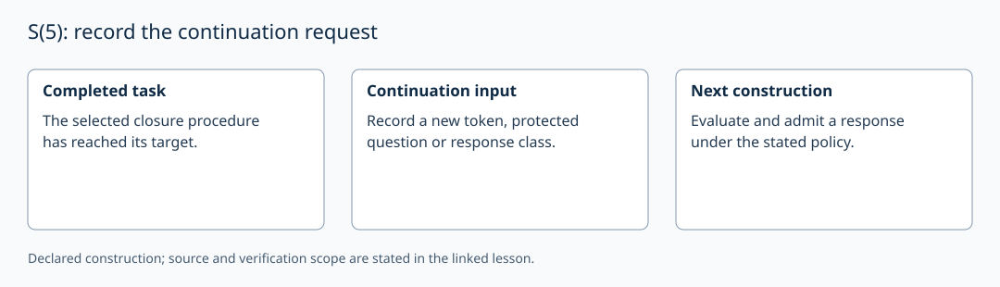

# S(5): record the continuation request

AuthorityEffect: None. [Source correspondence and proof scope](../source_correspondence.md).

After a selected closure procedure reaches its target, continuation requires
a stated next input or policy. The source explores such policies; its open
question OB-1 must not be restated as a proved impossibility of endogenous
continuation across every admissible system.

A continuation request can name a fresh token, a new protected question or a
new response class. Record that request before selecting a response. The local
ledger labels one such request `obs_continuation_gap`, giving s₅=1 for the
exercise. This is a prescribed request, not a count deduced from the source.

`S5Continuation` checks its Boolean fixture and copying of a set. It does not
search policies or prove a universal continuation theorem. The worthwhile
engineering continuation is the actual history-preserving construction inside
WDP, using the canonical Rust primitives.

Metric geometry is an independent application of a chosen incidence model.
Lengths, Gram matrices and curvature are not implicit in this stage label;
see [the metric application](../domains/physics/regge_metric.md).
