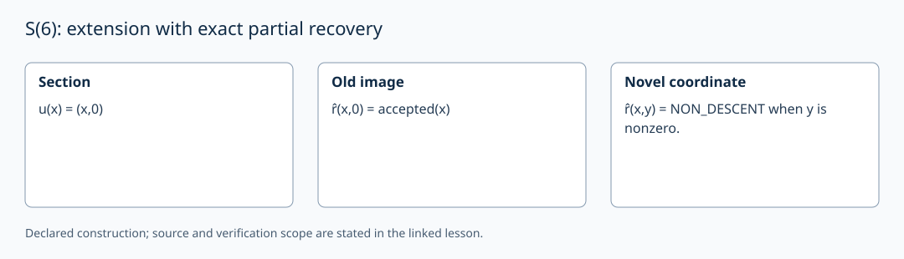

# S(6): extension with exact partial recovery

AuthorityEffect: None. [Source correspondence and proof scope](../source_correspondence.md).

This is a later construction in the S(n) strand. Given an injection u:A→B,
a decidable image and a computable inverse on that image, define

\[
\widehat r:B\to A\sqcup\{\mathrm{NON\_DESCENT}\},\qquad
\widehat r(u(x))=\mathrm{inl}(x).
\]

Refuse every y outside the image. The law implies injectivity of u; conversely
the stated image and inverse data define r̂. A total retraction B→A is a
different requirement. For example ∅→{b} admits this partial recovery, while
no total function {b}→∅ exists.

For u(x)=(x,0) on integers, exact descent accepts (x,0) and refuses (x,y) when
y≠0. This is now the Python `S6Descent` example. The number of added operators
or the survivor count cannot decide image membership. The local Lean
`old_image_base` theorem proves exact recovery for the flat grammar's
`BasePresentation` source type, at every index. Nested lifts and retractions
are not silently erased into ground.

To transport a protected answer F, require its target counterpart F′ to satisfy
F′∘u=F. To preserve future operations, give the corresponding commuting
transition equations. The old-image identity alone proves neither a logical
conservative extension, an adjunction nor resolution of an unrelated demand.

The exercise value s₆=1 records an issued descent-checking obligation. Once
that particular check closes, update its receipt; no theorem forces it to
remain unresolved. E16 studies composition of these partial inverses.
