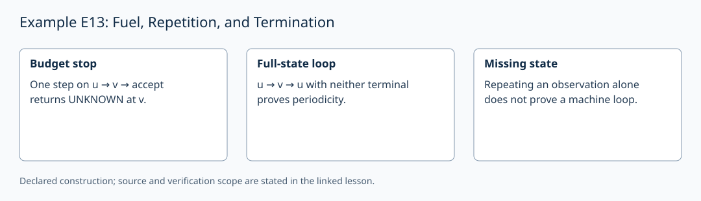

# Example E13: Fuel, Repetition, and Termination

**AuthorityEffect:** None.
**GenesisEffect:** None (realization must never extend Genesis merely by being constructed).
**Layer:** Written finite example
**Realizes:** E13 Example Adapter
**LegacyRealizationId:** 13 (historical candidate locator; not a Genesis core stage)
**ReflectionBridge:** Unproved (shadow-local representation; zero generative authority over Genesis).
**Description:** Distinguish a witnessed loop, a completed run, and a budget stop in deterministic transition systems.

---

## 1. Schematic & Conceptual Architecture

This example formalizes the distinction between a budget stop, a witnessed state loop, and a structural termination proof. A finite fuel bound halts execution but does not establish reachability or non-reachability of terminal states. Witnessed full-state periodicity proves non-reachability under a fixed transition rule, whereas observation-collapsed state repetition fails to guarantee machine periodicity.

---

## 2. Mathematical Presentation & Transition Rules

> [!NOTE]
> **Epistemic Shadow Guardrail:** All mathematical structures and transition metrics in this document represent verification engine machinery. They do not define, alter, or extend the Genesis-native survivor register, and possess zero generative authority over Genesis.

1. **Seed A (Budget vs Completion):**
   - Deterministic transition system: $u \to v \to \mathrm{accept}$.
   - Fuel budget $B = 1$: Execution stops at $v$ returning $\mathrm{UNKNOWN}$.
   - Fuel budget $B = 2$: Execution completes, reaching state $\mathrm{accept}$.
   - The $\mathrm{UNKNOWN}$ result reflects budget exhaustion, not the falsity of terminal reachability.

2. **Seed B (Witnessed State Loop):**
   - Deterministic transition system: $u \to v \to u$, where neither state is terminal.
   - Repeating full transition-determining state $u$ after 2 steps display periodicity and proves non-reachability of any terminal state under fixed transition rules.

3. **Counterexample to Observed-State Repetition:**
   - Let $q(u) = q(v)$ be a collapsed observation.
   - Repetition of observation $q$ does not imply repetition of full machine state: $v \to \mathrm{accept}$ still terminates.
   - Hashing a token-erased presentation does not repair observation loss.

4. **Counterexample to Cycle Detection as Universal Termination Test:**
   - Counter system: $n \to n+1$ over $\mathbb{N}$.
   - Admits no repeated state; a bounded monitor returns $\mathrm{UNKNOWN}$. Divergence requires an independent proof over transition rules.

5. **Adapter Cost Accounting:**
   - Seed A witness cost: 2 transitions.
   - Seed B loop witness cost: 2 transitions.
   - Well-founded decreasing rank vs fuel bound: Rank proves unfuelled termination; fuel is an execution limit.

---

## 3. Implementation & Verification Evidence

The mathematical argument above is a written finite example. The local
`test_sn_grammar.py` cases check lift/retraction spelling and stage numerals;
they do not contain this example's semantic payload or verify its conclusions.
SN_001–SN_085 are the actual syntax-case identifiers. The older attribution
of semantic checks to these strings is withdrawn. The following verifier
obligations describe the semantic checks required for this example.

---

## 4. Verifier Obligation & Falsifier Boundary

- **Verifier Obligation:** Produce all three result types with full supporting traces and prove quotient observations preserve transition and terminal behavior before admitting loop proofs.
- **Falsifier Boundary:** A repeated observation quotient without state-fidelity proof is rejected as proof of periodicity.

---

## 5. Claim Hygiene Quadrant

1. **What this supports:**
   - Verification that fuel bounds, full-state loops, and termination ranks yield distinct execution receipts.
2. **What this does not support:**
   - Does not prove termination of unbounded transition systems via cycle detection alone.
3. **The narrowest defensible claim:**
   - Full-state periodicity proves non-reachability in finite deterministic transition systems, whereas fuel bounds produce budget-exhaustion receipts.
4. **Next test needed:**
   - Add a semantic check on non-injective observation projections to ensure quotient collisions do not false-positive as machine state loops.

