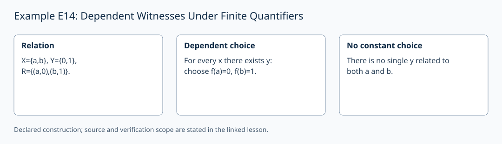

# Example E14: Dependent Witnesses Under Finite Quantifiers

**AuthorityEffect:** None.
**GenesisEffect:** None (realization must never extend Genesis merely by being constructed).
**Layer:** Written finite example
**Realizes:** E14 Example Adapter
**LegacyRealizationId:** 14 (historical candidate locator; not a Genesis core stage)
**ReflectionBridge:** Unproved (shadow-local representation; zero generative authority over Genesis).
**Description:** Demonstrate that a dependent witness function for each input does not yield a constant witness for all inputs.

---

## 1. Schematic & Conceptual Architecture

This example formalizes finite quantifier order dependence. Reversing quantifier order changes sentence truth values over finite relation domains. A dependent witness map $f: X \to Y$ certifies $\forall x \in X, \exists y \in Y, R(x,y)$, whereas candidate constant witnesses fail $\exists y \in Y, \forall x \in X, R(x,y)$.

---

## 2. Mathematical Presentation & Transition Rules

> [!NOTE]
> **Epistemic Shadow Guardrail:** All mathematical structures and quantifier evaluations in this document represent verification engine machinery. They do not define, alter, or extend the Genesis-native survivor register, and possess zero generative authority over Genesis.

1. **Seed Definition:**
   - Domains: $X = \{a,b\}$, $Y = \{0,1\}$.
   - Relation: $R = \{(a,0), (b,1)\}$.

2. **Quantifier Order Discrepancy:**
   - $\forall x \in X, \exists y \in Y, R(x,y)$ is **true**.
     - Dependent witness certificate: $f(a) = 0$, $f(b) = 1$.
   - $\exists y \in Y, \forall x \in X, R(x,y)$ is **false**.
     - Candidate $y = 0$ fails at input $b$ since $(b,0) \notin R$.
     - Candidate $y = 1$ fails at input $a$ since $(a,1) \notin R$.

3. **Boundary Cases (Empty Domains):**
   - For $X = \emptyset, Y = \emptyset$:
     - $\forall x \in \emptyset, \exists y \in \emptyset, R(x,y)$ is vacuously **true**.
     - $\exists y \in \emptyset, \forall x \in \emptyset, R(x,y)$ is **false** (no element $y$ exists).

4. **Representation & Adapter Costs:**
   - Dependent witness certificate cost: 2 table entries ($f(a)=0, f(b)=1$).
   - Counterexample certificate cost: 2 rejecting inputs ($b$ for $y=0$, $a$ for $y=1$).
   - Total atomic relation checks: $\le 4$.

---

## 3. Implementation & Verification Evidence

The mathematical argument above is a written finite example. The local
`test_sn_grammar.py` cases check lift/retraction spelling and stage numerals;
they do not contain this example's semantic payload or verify its conclusions.
SN_001–SN_085 are the actual syntax-case identifiers. The older attribution
of semantic checks to these strings is withdrawn. The following verifier
obligations describe the semantic checks required for this example.

---

## 4. Verifier Obligation & Falsifier Boundary

- **Verifier Obligation:** Verify dependent witness tables, evaluate counterexample rejections, and check quantifier order non-commutation over declared finite relations.
- **Falsifier Boundary:** Asserting $\exists y \forall x R(x,y)$ based on a dependent witness map $f(x)$ without checking constant $y$ invariance is rejected.

---

## 5. Claim Hygiene Quadrant

1. **What this supports:**
   - Verification that $\forall x \exists y R(x,y)$ and $\exists y \forall x R(x,y)$ are distinct finite propositions certified by dependent witness functions or constant candidates.
2. **What this does not support:**
   - Does not instantiate the unbounded arithmetical hierarchy or prove first-order logical validity over infinite domains.
3. **The narrowest defensible claim:**
   - Dependent witness maps certify $\forall \exists$ formulas over finite domains, while counterexample entries falsify the swapped $\exists \forall$ order.
4. **Next test needed:**
   - Add a semantic check on empty domain edge cases ($X=\emptyset, Y=\emptyset$) to certify vacuous universal truth and existential refusal.

