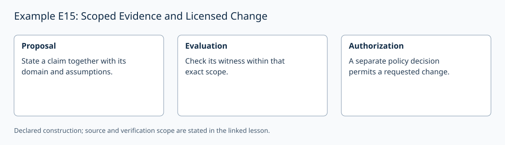

# Example E15: Scoped Evidence and Licensed Change

**AuthorityEffect:** None.
**GenesisEffect:** None (realization must never extend Genesis merely by being constructed).
**Layer:** Written finite example
**Realizes:** E15 Example Adapter
**LegacyLevel:** 15 (historical candidate locator; not a Genesis core stage)
**ReflectionBridge:** Unproved (shadow-local representation; zero generative authority over Genesis).
**Description:** Distinguish verified proof scope from licensed change permissions when extending statement domains.

---

## 1. Schematic & Conceptual Architecture

This example formalizes proof scope discipline and permission separation. A verified proof receipt over scope $X$ does not transport to extended domain $X'$. Extending a statement's domain creates a fresh proof obligation. Furthermore, checking proof validity and granting execution permission remain separately typed operations.

---

## 2. Mathematical Presentation & Transition Rules

> [!NOTE]
> **Epistemic Shadow Guardrail:** All mathematical structures and authorization records in this document represent verification engine machinery. They do not define, alter, or extend the Genesis-native survivor register, and possess zero generative authority over Genesis.

1. **Seed & Extension Challenge:**
   - Base domain $X = \{a,b\}$, relation $R = \{(a,0), (b,1)\}$. Statement $\forall x \in X \exists y R(x,y)$ is certified by $f(a)=0, f(b)=1$.
   - Extended domain $X' = \{a,b,c\}$ with $R$ unchanged.
   - The old proof receipt is valid for scope $X$, but fails for $X'$: element $c$ has no witness in $R$.

2. **Priced Repair:**
   - Response class: Admit new relation instances.
   - Minimal repair: Admit $R(c,0)$ (cost: 1 new relation tuple). Zero new instances cannot give $c$ a witness.
   - Extended witness certificate supplies $f(c)=0$ citing the newly admitted instance $R(c,0)$.

3. **Separation of Proof, Permission, and Execution:**
   - **Proof Checker:** Validates formula soundness against matching statement, assumptions, and scope.
   - **Permission Gate:** Evaluates whether a state mutation (admitting $R(c,0)$) is authorized by declared policy.
   - A valid proof certificate cannot self-grant mutation permission; authentication binds custody, not mathematical or policy soundness.

4. **Inductive Invariant:**
   - If verified statement insertions require matching sound proof certificates, every stored statement has such a proof.
   - If state mutations require explicit matching permission records, execution preserves policy constraints.

---

## 3. Implementation & Verification Evidence

The mathematical argument above is a written finite example. The local
`test_sn_grammar.py` cases check lift/retraction spelling and stage numerals;
they do not contain this example's semantic payload or verify its conclusions.
SN_001–SN_085 are the actual syntax-case identifiers. The older attribution
of semantic checks to these strings is withdrawn. The following verifier
obligations describe the semantic checks required for this example.

---

## 4. Verifier Obligation & Falsifier Boundary

- **Verifier Obligation:** Reject transported old proofs when domain scope grows, enforce separate permission records for state mutation, and verify witness tables on extended domains.
- **Falsifier Boundary:** A self-asserted proof verdict without scope matching or lacking an independent permission record is rejected.

---

## 5. Claim Hygiene Quadrant

1. **What this supports:**
   - Verification that proof validity is strictly bound to scope, and state changes require distinct authorization records.
2. **What this does not support:**
   - Does not prove that arbitrary domain extensions can be repaired or that signatures imply correctness.
3. **The narrowest defensible claim:**
   - Transporting a proof to a larger domain creates a fresh proof obligation, while verification checks and mutation permissions are separately typed.
4. **Next test needed:**
   - Add a semantic check on unauthorized domain extension attempts to ensure unpermitted relation additions are rejected by the permission gate.

