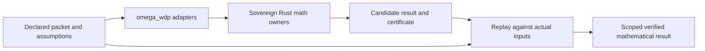

# WDP derivation guide

The expert swarm completed all nineteen registered open targets at explicit finite or conditional scopes. All154 canonical IDs remain. The final source-bound observer result recovers all 44 original texts, verifies529 absorbed occurrences and supplies distinct typed adapters for every identified family. [The completion proof](/atlas/papers/finite_obstruction_calculus/witnessed_difference_programme/docs/observer_adapter_completion.md) gives the exact criterion, countermodels and domains. External Genesis access is unnecessary.

Read the [paper derivation review](/atlas/papers/finite_obstruction_calculus/witnessed_difference_programme/docs/derivation_review.md) and its expert proof notes for exact statements, constructive witnesses and scope. Appendix J contains the new derivations; the canonical claim ledger controls status.

| Topic | What is now established |
| --- | --- |
| Retention | Complete typed extension space, arbitrary-tolerance relation, named signature classifications and relational quotient |
| Routing/refinement | Checked declared finite policies and commuting lifts; least congruent coarsening; reflecting-completion obstruction |
| Sheaf theory | Explicit finite observer site and exact matching-family fiber criterion; constrained local reports can fail to glue |
| Self-reference | Original R1/R2/R3 with partiality, accessible state, provenance and later comparison; exact successful-report existence |
| Reconstruction/composition | Signed representation criteria, PR joint/local reconstruction obstruction, sufficient imported quantum tensor package |
| Phases | Conditional real-character bridge and distinct exact rational-turn branch; gauge/normalization do not select Born |
| Sampling/repair | Arbitrary-context exact compatible-polytope distance and iid finite-sample tolerances |
| Measurement | All-state repeatability criterion and complete independently checked measurement receipts |

Reusable mathematics lives in the category, matrix, probability, functional, solver, number-theory, quantum and measurement crates. WDP supplies named packets and binds receipts to actual inputs. Homology, HoTT and holonomy owners supply their declared structures; a zero cochain period cannot establish path homotopy or Kan fibrancy.

From omega_engine/crates_rs, run `cargo run --locked --offline -p omega_wdp --example finite_derivations`. The example now includes the three-context radius 4/3, repeatability and a conditional sampling tolerance alongside retention, clock, valuation, calibration and profile replay.

Core-only Lean modules (18 modules / 264 declarations at baseline; 19 modules / 280 declarations in v0.5.0) and their source-bound selected-declaration reports compile independently of Mathlib through `scripts/verify_finite_derivations.py`. This gives partial formal coverage; the full analytic/probability/matrix arguments are stated in the paper and proof notes, rather than credited as Lean theorems. Physical authenticity, phenomenology, Born selection and authority are not inferred.

The native category owner now supplies many-sorted partial-structure descent and exact all-word transducer checks; the functional owner separates general sensing from repair-invariant quotients; the quantum owner verifies actual trace-geometry receipts. WDP assembles original-six, operational-ten, world-five and policy-five packets. The core-only Lean spine audits 264 selected declarations at baseline (280 in v0.5.0); source custody and complete operator-analysis coverage remain separately stated.
