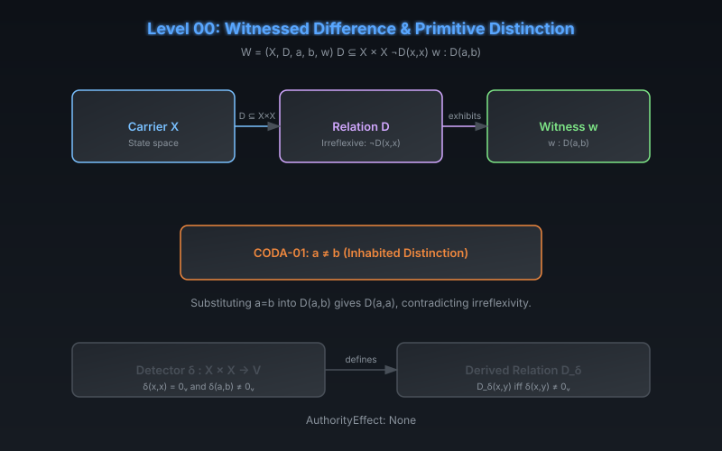

# CODA Level 00: Witnessed Difference & Primitive Distinction

**AuthorityEffect:** None.  
**Level:** Level 00 (Foundation)  
**CODA Reference:** §2.1 (Witnessed Difference)  
**Claim ID:** CODA-01

---

## 1. Schematic & Conceptual Architecture

CODA begins with the weakest possible starting point: a **witnessed irreflexive relation**. Before any notion of measurement, algebra, repair, cost, or authority, the system admits a single exhibited distinction between two elements of a carrier.

---

## 2. Mathematical Presentation

1. **Witnessed Difference Signature:**
   $$W = (X, D, a, b, w), \quad D \subseteq X \times X, \quad (\forall x \in X)\;\neg D(x,x), \quad w : D(a,b)$$

2. **Properties Absent from the Definition:**
   - Symmetry, transitivity, decidability, finiteness, and numerical magnitude are not assumed.
   - Ordinary equality in the ambient mathematics is already available; CODA does not construct a new notion of identity.

3. **CODA-01 (Inhabited Distinction):**
   - **Theorem:** The supplied elements satisfy $a \neq b$.
   - **Proof:** Substituting $a = b$ into $D(a,b)$ gives $D(a,a)$, contradicting irreflexivity. The witness also rules out an empty carrier.
   - **Evidential Grade:** Lean 4 mechanized (`Foundations.lean`).

4. **Detector Alternate Path:**
   - A detector $\delta : X \times X \to V$ with $\delta(x,x) = 0_V$ and $\delta(a,b) \neq 0_V$ defines a derived irreflexive relation $D_\delta(x,y) :\Leftrightarrow \delta(x,y) \neq 0_V$.
   - Symmetry requires an additional law; a quotient by $\delta(x,y) = 0_V$ requires that zero-relation to be an equivalence relation.

---

## 3. Connection to Genesis & S(n)

- Genesis Level 00 (Presentation Void) corresponds to the state before any distinction is admitted — $V_0 = \emptyset$.
- Genesis Level 02 (Primitive Difference & Separation) corresponds directly to CODA-01: the irreflexivity law $\neg D(x,x)$.
- $S(0)$ initializes at the void carrier with survivor count $s_0 = 0$.

---

## 4. What This Level Supports

- An exhibited pair $(a, b)$ with $a \neq b$ in the carrier.
- The carrier is non-empty (at least 2 elements).
- No structure beyond irreflexive relation and witness.

## 5. What This Level Does Not Support

- Symmetry, transitivity, or metric structure.
- Any numerical magnitude or distance measure.
- Any authority, observation, or repair capability.

## 6. Narrowest Defensible Claim

An irreflexive witnessed relation on a carrier entails $a \neq b$ and a non-empty carrier.

## 7. Next Test Needed

Add an observation map $p : X \to P$ and test whether a query $q : X \to Y$ can factor through it (Level 01).
