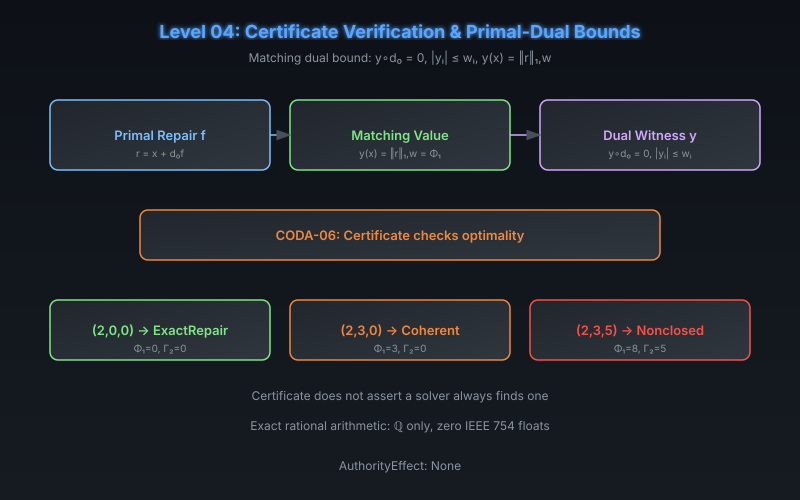

# CODA Level 04: Certificate Verification & Primal-Dual Bounds

**AuthorityEffect:** None.  
**Level:** Level 04 (Certificates)  
**CODA Reference:** §4.2  
**Claim ID:** CODA-06

---

## 1. Schematic & Conceptual Architecture

FOC outcomes can be independently verified by supplying a matching **dual witness** that certifies the primal repair is optimal.

---

## 2. Mathematical Presentation

1. **CODA-06 (Matching Dual Bound):**
   - **Theorem:** Suppose $r = x + d_0 f$, a covector $y$ satisfies $y \cdot d_0 = 0$ and $|y_i| \le w_i$, and $y(x) = \|r\|_{1,w}$. Then $f$ is an optimal repair and that common value equals $\Phi_1([x])$.
   - **Proof:** For every $g$, annihilation gives $y(x + d_0 g) = y(x)$, while coordinate bounds give $y(x + d_0 g) \le \|x + d_0 g\|_{1,w}$. The supplied repair attains this lower bound.

2. **Worked Examples (Exact Rational):**

   | Input | Repair | Residual | $\Phi_1$ | $\Gamma_2$ | Grade |
   |---|---|---|---:|---:|---|
   | $(2, 0, 0)$ | $-2$ | $(0, 0, 0)$ | 0 | 0 | `ExactRepair` |
   | $(2, 3, 0)$ | $-2$ | $(0, 3, 0)$ | 3 | 0 | `CoherentResidual` |
   | $(2, 3, 5)$ | $-2$ | $(0, 3, 5)$ | 8 | 5 | `NonclosedDefect` |

---

## 3. Connection to Genesis & S(n)

- Genesis Level 08 (Isomorphism Quotient): discrete primal-dual lower bound matched by constructive path witness.
- MSS-N Level 3 (Exact LP Weak Duality): $c^\top x \le b^\top y$ for feasible primal-dual pairs over $\mathbb{Q}$.
- Paper 043 theorem `lp_max_form_weak_duality` (Lean 4, `[propext, Classical.choice, Quot.sound]`).

---

## 4. What This Level Supports

- Independent certificate checking of a supplied primal-dual pair.
- Exact rational arithmetic throughout (zero IEEE 754 floats).

## 5. What This Level Does Not Support

- Assertion that a particular solver always finds a certificate.
- Extension of the certificate beyond the specific packet, weights, and query.

## 6. Narrowest Defensible Claim

A supplied primal repair and matching dual witness certify optimality when annihilation and coordinate bounds hold.

## 7. Next Test Needed

Test whether the FOC representation can be transported between different state spaces (Level 05).
