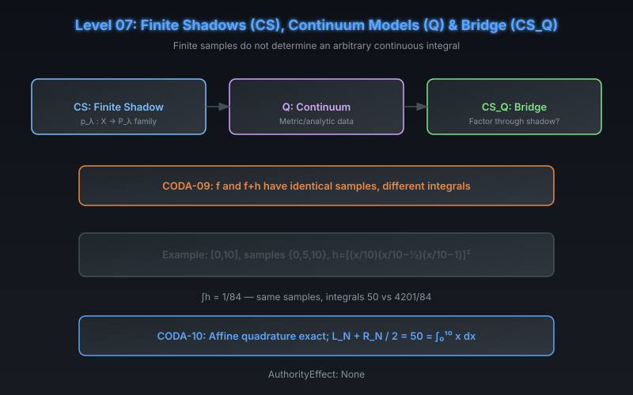

# CODA Level 07: Finite Shadows (CS), Continuum (Q) & Bridge (CS_Q)

**AuthorityEffect:** None.  
**Level:** Level 07 (Shadows & Continuum)  
**CODA Reference:** §6  
**Claim IDs:** CODA-09, CODA-10

---

## 1. Schematic & Conceptual Architecture

Three related components address the boundary between finite observations and continuum models:

- **CS (Continuum Shadow):** A declared observation family $p_\lambda : X \to P_\lambda$ — a finite shadow.
- **Q (Continuum):** Continuum models requiring admitted metric, topological, or completion data.
- **CS_Q (Bridge):** Whether a continuum query factors through a given shadow family.

---

## 2. Mathematical Presentation

1. **CODA-09 (The Sampling Collision):**
   - **Theorem:** On a nondegenerate compact real interval, a finite set of point samples does not determine the integral of every continuous function.
   - **Proof:** For sample nodes $x_1, \ldots, x_k$, set $h(x) = \prod_i (x - x_i)^2$. This polynomial vanishes at every node but has positive integral. Thus $f$ and $f + h$ have identical samples but different integrals.
   - **Worked Example:** $[0, 10]$, samples $\{0, 5, 10\}$, $h = [(x/10)(x/10 - 1/2)(x/10 - 1)]^2$, $\int_0^{10} h = 1/84$. Integrals: $50$ vs $4201/84$.

2. **CODA-10 (Affine Quadrature):**
   - For $f(x) = x$ on $[0, 10]$: $L_N = 50 - 50/N$, $R_N = 50 + 50/N$, $T_N = 50 = \int_0^{10} x\,dx$.
   - The trapezoid value is exact for admitted affine functions but does not reconstruct arbitrary continuous functions.

---

## 3. Connection to Genesis & S(n)

- Genesis Level 18 (Discrete Cochain Fencing): injection of continuous inner products or smooth manifolds into discrete regimes is refused.
- Genesis Level 19 (Spectral Zeta & Polynomial Fencing): infinite-dimensional spectral operators without finite polynomials are refused.
- WDP Nonclaim N1 (No Continuous Spacetime): continuum structure is admitted data, not derived from finite distinction.

---

## 4. What This Level Supports

- Finite samples cannot determine arbitrary continuous integrals (sampling collision).
- When the admissible class is restricted (e.g., affine), reconstruction may succeed.

## 5. What This Level Does Not Support

- Construction of the continuum domain from finite observations.
- Convergence theorems from family names alone.
- Authority from finite-continuum agreement.

## 6. Narrowest Defensible Claim

Identical finite samples can yield different integrals for distinct continuous functions; exact descent requires restricting the function class.

## 7. Next Test Needed

Introduce authority separation between evidence and grants (Level 08).
