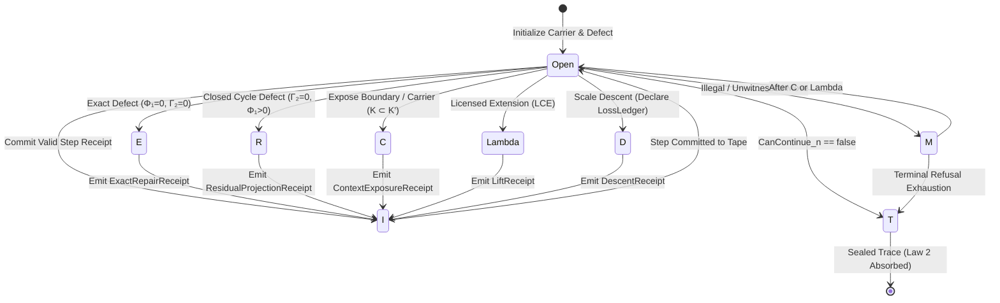

# DDC Operational Levels: The 8 Operational Letters of the Calculus

**AuthorityEffect:** None. Complete mathematical and engineering level guide to the 8-letter operational trace alphabet $\mathcal{A}_{\mathrm{DDC}}$; no authorization is conferred.

---

## 1. Overview of the 8 Operational Levels

In the **Discrete Deformation Calculus (DDC)**, every state transition is typed by exactly one operational rune from the canonical alphabet:

$$\mathcal{A}_{\mathrm{DDC}} = \{E, R, C, I, \Lambda, D, M, T\}$$

Each letter corresponds to an explicit operational level governing how a computation witnesses, transforms, or halts upon encountering a discrete obstruction:

| Level | Rune | Operation | Mathematical Subspace | Coda Atlas Python | Sovereign Rust Crate | Governing Law & Gate | Diagram |
| :---: | :---: | :--- | :--- | :--- | :--- | :--- | :---: |
| [**Level 01**](level_01_e_exact_repair.md) | **`E`** | **Exact Repair** | $\operatorname{im}(d_0) \subset C^1$ (Coboundary) | [`exact_repair.py`](/atlas/papers/finite_obstruction_calculus/witnessed_difference_programme/docs/source_archive/discrete_deformation_calculus_package/code/ddc/exact_repair.py) | [`DdcOp::ExactRepair`](../../../../../omega_engine/crates_rs/omega_wdp/src/ddc/dda_alphabet.rs#L38) | Law 7, $\Phi_1 = 0, \Gamma_2 = 0$, Zero-curl check | [SVG](../../_images/ddc_01_e_exact_repair.svg) |
| [**Level 02**](level_02_r_residual_projection.md) | **`R`** | **Residual Projection** | $\mathcal{H}^1 \cong \ker(d_1)/\operatorname{im}(d_0)$ (Harmonic) | [`residual_projection.py`](/atlas/papers/finite_obstruction_calculus/witnessed_difference_programme/docs/source_archive/discrete_deformation_calculus_package/code/ddc/residual_projection.py) | [`DdcOp::ResidualProjection`](../../../../../omega_engine/crates_rs/omega_wdp/src/ddc/dda_alphabet.rs#L40) | DDC-R-02, $\Gamma_2$ invariance, $\Xi$ tie-break gate | [SVG](../../_images/ddc_02_r_residual_projection.svg) |
| [**Level 03**](level_03_c_context_exposure.md) | **`C`** | **Context Exposure** | $E(K') = E_{\mathrm{int}} \sqcup E_{\mathrm{bnd}}$ | [`context_exposure.py`](/atlas/papers/finite_obstruction_calculus/witnessed_difference_programme/docs/source_archive/discrete_deformation_calculus_package/code/ddc/context_exposure.py) | [`DdcOp::ContextExposure`](../../../../../omega_engine/crates_rs/omega_wdp/src/ddc/dda_alphabet.rs#L42) | Law 8 (Carrier Monotonicity, no scope laundering) | [SVG](../../_images/ddc_03_c_context_exposure.svg) |
| [**Level 04**](level_04_i_integration.md) | **`I`** | **Integration** | Cryptographic Merkle Tape | [`integration_tape.py`](/atlas/papers/finite_obstruction_calculus/witnessed_difference_programme/docs/source_archive/discrete_deformation_calculus_package/code/ddc/integration_tape.py) | [`DdcOp::Integration`](../../../../../omega_engine/crates_rs/omega_wdp/src/ddc/dda_alphabet.rs#L44) | Law 1 (Determinism), Law 5 (Receipt requirement) | [SVG](../../_images/ddc_04_i_integration.svg) |
| [**Level 05**](level_05_lambda_structural_lift.md) | **`Λ`** | **Structural Lift** | $\mathbb{Q}^n \hookrightarrow \mathbb{Q}^{n+k}$ (Zero Padding) | [`structural_lift.py`](/atlas/papers/finite_obstruction_calculus/witnessed_difference_programme/docs/source_archive/discrete_deformation_calculus_package/code/ddc/structural_lift.py) | [`DdcOp::Lift`](../../../../../omega_engine/crates_rs/omega_wdp/src/ddc/dda_alphabet.rs#L49) | Law 4 (Trigger Law), `LicensedLiftGate` | [SVG](../../_images/ddc_05_lambda_structural_lift.svg) |
| [**Level 06**](level_06_d_descent.md) | **`D`** | **Scale Descent** | $\mathbb{Q}^m \twoheadrightarrow \mathbb{Q}^{n}$ ($n \le m$) | [`descent.py`](/atlas/papers/finite_obstruction_calculus/witnessed_difference_programme/docs/source_archive/discrete_deformation_calculus_package/code/ddc/descent.py) | [`DdcOp::Descent`](../../../../../omega_engine/crates_rs/omega_wdp/src/ddc/dda_alphabet.rs#L51) | Law 6 (`LossLedger` $L_{\mathrm{adapter}}$ mandate) | [SVG](../../_images/ddc_06_d_descent.svg) |
| [**Level 07**](level_07_m_typed_refusal.md) | **`M`** | **Typed Refusal** | Closed 7-Member Taxonomy | [`typed_refusal.py`](/atlas/papers/finite_obstruction_calculus/witnessed_difference_programme/docs/source_archive/discrete_deformation_calculus_package/code/ddc/typed_refusal.py) | [`DdcOp::Refusal`](../../../../../omega_engine/crates_rs/omega_wdp/src/ddc/dda_alphabet.rs#L53) | Law 3 (Refusal Absorption, identity on state) | [SVG](../../_images/ddc_07_m_typed_refusal.svg) |
| [**Level 08**](level_08_t_terminalization.md) | **`T`** | **Terminalization** | Routing Terminal Sinks | [`terminalization.py`](/atlas/papers/finite_obstruction_calculus/witnessed_difference_programme/docs/source_archive/discrete_deformation_calculus_package/code/ddc/terminalization.py) | [`DdcOp::Terminalize`](../../../../../omega_engine/crates_rs/omega_wdp/src/ddc/dda_alphabet.rs#L56) | Law 2 (Terminal Absorption), `non_authority.rs` | [SVG](../../_images/ddc_08_t_terminalization.svg) |

---

## 2. Finite State Machine & Allowed Transitions

The transitions between the 8 letters obey strict FSM control rules:



---

## 3. Dual-Estate Architecture: Coda Atlas vs. Sovereign Rust Crate

The Discrete Deformation Calculus is dual-implemented across two authoritative workspace estates:

1. **Coda Atlas Research Estate** ([`atlas/papers/finite_obstruction_calculus/witnessed_difference_programme/docs/source_archive/discrete_deformation_calculus_package/`](/atlas/papers/finite_obstruction_calculus/witnessed_difference_programme/docs/source_archive/discrete_deformation_calculus_package/)):
   - **Monograph & Chapters:** Full mathematical derivations in [`discrete_deformation_calculus.md`](/atlas/papers/finite_obstruction_calculus/witnessed_difference_programme/docs/source_archive/discrete_deformation_calculus_package/discrete_deformation_calculus.md) and [`chapters/`](/atlas/papers/finite_obstruction_calculus/witnessed_difference_programme/docs/source_archive/discrete_deformation_calculus_package/chapters/).
   - **Lean 4 Mechanization:** Lake proof library in [`lean4/Ddc/`](/atlas/papers/finite_obstruction_calculus/witnessed_difference_programme/docs/source_archive/discrete_deformation_calculus_package/lean4/Ddc/).
   - **Python Prototype:** Modular operational packages in [`code/ddc/`](/atlas/papers/finite_obstruction_calculus/witnessed_difference_programme/docs/source_archive/discrete_deformation_calculus_package/code/ddc/) and 5 minimal finite demos in [`demos.py`](/atlas/papers/finite_obstruction_calculus/witnessed_difference_programme/docs/source_archive/discrete_deformation_calculus_package/code/ddc/demos.py).

2. **Sovereign Rust Crate** ([`omega_engine/crates_rs/omega_wdp/src/ddc/`](../../../../../omega_engine/crates_rs/omega_wdp/src/ddc/)):
   - **Operation Alphabet:** Canonical [`DdcOp`](../../../../../omega_engine/crates_rs/omega_wdp/src/ddc/dda_alphabet.rs#L37) enum, [`DdcStep`](../../../../../omega_engine/crates_rs/omega_wdp/src/ddc/dda_alphabet.rs), and [`DdcTrace`](../../../../../omega_engine/crates_rs/omega_wdp/src/ddc/dda_alphabet.rs).
   - **State-Level Verification Gate:** [`op_verification.rs`](../../../../../omega_engine/crates_rs/omega_wdp/src/ddc/op_verification.rs) checks `(before, after)` cochain states via [`verify_step`](../../../../../omega_engine/crates_rs/omega_wdp/src/ddc/op_verification.rs#L241) and emits typed [`OpViolation`](../../../../../omega_engine/crates_rs/omega_wdp/src/ddc/op_verification.rs#L111) errors on fraudulent claims.
   - **Sovereign Non-Authority:** [`non_authority.rs`](../../../../../omega_engine/crates_rs/omega_wdp/src/ddc/non_authority.rs) unconditionally enforces `AuthorityEffect::None`.
   - **Structural Lift Gate:** [`licensed_lift_gate.rs`](../../../../../omega_engine/crates_rs/omega_wdp/src/ddc/licensed_lift_gate.rs) gates dimension expansion behind explicit non-destruction, preservation, and obstruction witnesses.

---

## 4. Four-Axis Separation Guard

Across all 8 operational levels, the runtime enforces an immutable four-axis separation firewall:

$$\boxed{\text{DiagnosticClass} \neq \text{RoutingTerminal} \neq \text{ExtensionStatus} \neq \text{AuthorityStatus}}$$

1. **DiagnosticClass:** The mathematical state of the cochain defect (`ExactRepair`, `ClosedResidual`, `OpenBoundary`).
2. **RoutingTerminal:** The finite state machine stopping condition (`ExactResolved`, `IrreducibleResidual`, `BudgetIntact`).
3. **ExtensionStatus:** The carrier licensing state (`Unextended`, `LicensedExtension`).
4. **AuthorityStatus:** Sovereign authority effect, which remains unconditionally:

$$\text{AuthorityEffect} = \textbf{None}$$

---

## 5. Verification Commands

All 8 operational levels can be validated locally using the workspace test harnesses:

1. **Governance Invariant Gate:**
   ```bash
   py -3.12 .agents/skills/governance-wdp/scripts/check_ddc.py
   ```
2. **Sovereign Rust Crate Test Suite:**
   ```bash
   cargo test --manifest-path omega_engine/crates_rs/omega_wdp/src/ddc/Cargo.toml
   ```
3. **Coda Atlas Python Test Suite:**
   ```bash
   py -3.12 -m pytest atlas/papers/finite_obstruction_calculus/witnessed_difference_programme/docs/source_archive/discrete_deformation_calculus_package/code/tests
   ```
