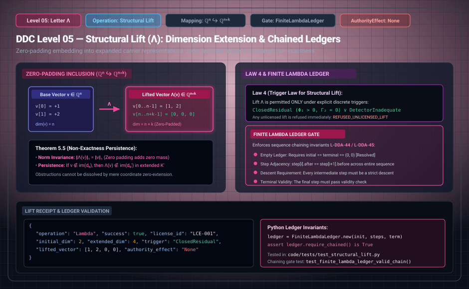

# DDC Level 05: Letter Λ — Structural Lift

**AuthorityEffect:** None. Licensed discrete carrier expansion, dimension extension, and structural capacity embedding only; no external authorization is conferred.  
**Operational Level:** Level 05 (`Λ`)  
**Mathematical Mapping:** $\iota : \mathbb{Q}^n \hookrightarrow \mathbb{Q}^{n+k}$ (Zero-Padding Inclusion)  
**Norm Invariance:** $\|\Lambda(v)\|_1 = \|v\|_1$  
**Governing Laws:** Law 4 (Trigger Law for Structural Lift), `LicensedLiftGate` Three-Witness Mandate  
**Licensing Gate:** Mandatory Licensed Context Extension (LCE) and explicit trigger verification  
**Rust Crate Definition:** [`DdcOp::Lift`](../../../../../omega_engine/crates_rs/omega_wdp/src/ddc/dda_alphabet.rs#L49)  

---

## 1. Schematic & Architectural Flow



---

## 2. Mathematical Definition & Non-Exactness Persistence

When an obstruction cannot be resolved on the active carrier complex, unconstrained or arbitrary expansion would launder authority. Letter `Λ` represents licensed carrier expansion: it strictly requires both a valid discrete licence and an audited trigger condition. **A trigger alone does not constitute a licence.**

Let $\iota : \mathbb{Q}^n \hookrightarrow \mathbb{Q}^{n+k}$ denote the zero-padding canonical inclusion mapping:

$$\iota(x)_i = \begin{cases} x_i & \text{if } 1 \le i \le n \\ 0 & \text{if } n < i \le n + k \end{cases}$$

Because newly appended coordinates are strictly zero, the $\ell^1$ norm is invariant:

$$\|\Lambda(v)\|_1 = \|v\|_1$$

### Proposition 5.1 (DDC-Λ-01: Non-Zero Defect Persistence)
If a defect $v \in \mathbb{Q}^n$ is non-zero ($v \neq 0$), then its zero-padded lift $\Lambda(v) \in \mathbb{Q}^{n+k}$ is non-zero with strictly identical $\ell^1$ norm:
$$\|\Lambda(v)\|_1 = \|v\|_1 > 0$$
Zero-padding cannot magically resolve or dissipate an existing obstruction.

---

## 3. Transition Fences & Rust Gate Enforcement

The governance contract [`quotient_transport.contract.yaml`](../../../../../omega_engine_governance/contracts/contracts_omega_engine_crates/mathematics/discrete_deformation_algebra/quotient_transport.contract.yaml), [`licensed_lift_gate.rs`](../../../../../omega_engine/crates_rs/omega_wdp/src/ddc/licensed_lift_gate.rs), and [`op_verification.rs`](../../../../../omega_engine/crates_rs/omega_wdp/src/ddc/op_verification.rs#L359-L374) enforce strict structural fences:

1. **Carrier Restructure Mandate:** `Λ` must alter the carrier topology:
   ```rust
   if before.same_carrier(after) {
       return Err(OpViolation::CarrierUnchangedUnderRestructure { op: step.op });
   }
   ```
2. **Explicit Lift Licence Mandate:** Structural expansion without an audited licence is halted:
   ```rust
   if !w.lift_licence {
       return Err(OpViolation::UnlicensedLift);
   }
   ```
3. **Law 4: Trigger Law for Structural Lift:**  
   `Λ` may be proposed **only** from a closed residual / stabilized survivor ($\Phi_1 > 0, \Gamma_2 = 0$) or when evaluating on an inadequate detector (`!before.adequate`):
   ```rust
   let is_closed = before_diag.classification == DegreeTrichotomy::StabilizedSurvivor
       || (before_diag.classification != DegreeTrichotomy::Exact && before_diag.gamma == 0);
   if !(is_closed || !before.adequate) {
       return Err(OpViolation::LiftWithoutTrigger);
   }
   ```
4. **Three-Witness Triad ([`LicensedLiftGate`](../../../../../omega_engine/crates_rs/omega_wdp/src/ddc/licensed_lift_gate.rs)):**  
   Every licensed lift must supply:
   - **Obstruction Witness:** Certified non-zero obstruction on active carrier.
   - **Preservation Witness:** Proof that key survivor invariants are retained under embedding.
   - **Non-Destruction Witness:** Mathematical proof that expansion introduces no uncontrolled divergence.

---

## 4. Step Receipt Wire Format (RFC 8785 JSON)

Every successful Level 05 structural lift emits a machine-verifiable `LiftReceipt`:

```json
{
  "operation": "Λ",
  "status": "STRUCTURAL_LIFT_APPLIED",
  "paper_id": "DDC-Λ",
  "step_index": 2,
  "carrier_nodes_before": 3,
  "carrier_nodes_after": 4,
  "dimension_before": 3,
  "dimension_after": 4,
  "norm_before": "2",
  "norm_after": "2",
  "trigger_class": "CLOSED_RESIDUAL",
  "license_id": "LIC-2026-09-30-TRIANGLE-EXT",
  "step_sha256": "0x56a1b2c3d4e5f60718293a4b5c6d7e8f90123456789abcdef0123456789abcde",
  "authority_effect": "None"
}
```

---

## 5. Formal Theorems, Rust Delegation & Mechanization

| Claim ID | Formal Statement | Lean 4 Theorem | Rust Crate Test | Python Binding |
| :--- | :--- | :--- | :--- | :--- |
| **DDC-Λ-01** | Zero-padding inclusion preserves $\ell^1$ norm: $\|\Lambda(v)\|_1 = \|v\|_1$. | `Ddc.Lambda_norm_invariant` | [`tests/finite_lambda_ledger_integration.rs`](../../../../../omega_engine/crates_rs/tests/omega_wdp/ddc_finite_lambda_ledger_integration.rs) | `test_structural_lift.py::test_zero_padding` |
| **DDC-Λ-02** | Structural lift requires explicit trigger ($\Gamma_2 = 0, \Phi_1 > 0$ or blind) (Law 4). | Trigger gate theorem | [`op_verification.rs::tests`](../../../../../omega_engine/crates_rs/omega_wdp/src/ddc/op_verification.rs) | `test_automaton.py::test_lift_without_trigger` |
| **DDC-Λ-03** | Structural lift requires discrete licence; otherwise `UnlicensedLift`. | Licensing firewall | [`licensed_lift_gate.rs::tests`](../../../../../omega_engine/crates_rs/omega_wdp/src/ddc/licensed_lift_gate.rs) | `test_automaton.py::test_unlicensed_lift` |

### Lean 4 Proof Kernel
[`lean4/Ddc/StructuralLift.lean`](/atlas/papers/finite_obstruction_calculus/witnessed_difference_programme/docs/source_archive/discrete_deformation_calculus_package/lean4/Ddc/StructuralLift.lean):
```lean
theorem Ddc.Lambda_norm_invariant : ∀ (v : Vector ℚ n), norm₁ (lift_vector v k) = norm₁ v
```

### Sovereign Rust Test Bindings
- [`omega_engine/crates_rs/omega_wdp/src/ddc/licensed_lift_gate.rs`](../../../../../omega_engine/crates_rs/omega_wdp/src/ddc/licensed_lift_gate.rs):
  - Validates full three-witness certificate verification before issuing lift permits.
- [`omega_engine/crates_rs/tests/omega_wdp/ddc_finite_lambda_ledger_integration.rs`](../../../../../omega_engine/crates_rs/tests/omega_wdp/ddc_finite_lambda_ledger_integration.rs):
  - `finite_lambda_ledger_integration_accepts_declared_three_step_sequence()`: Tests declared lift sequences.
  - `finite_lambda_ledger_integration_refuses_broken_middle_link()`: Tests fail-closed integrity when witness link is broken.

---

## 6. Falsifiers & Counterexamples

- **Unlicensed Expansion Rejection:** Expanding dimension without an explicit `lift_licence` halts as `OpViolation::UnlicensedLift`.
- **Premature Lift Rejection:** Attempting to lift an exact state or unverified open state without a valid trigger halts as `OpViolation::LiftWithoutTrigger`.

---

## 7. Epistemic Scope & Nonclaims

```text
Λ embeds state into a higher-dimensional carrier complex.
Λ does not resolve obstructions and does not confer operational authority.
No authorization is conferred.
```
