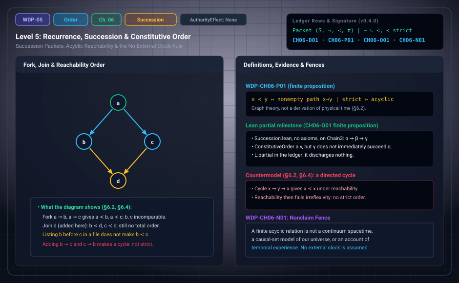

# WDP Level 05: Recurrence, Succession, and Constitutive Order

**AuthorityEffect:** None.  
**Level:** Level 05 (Chapter 6: Recurrence, Succession, and Constitutive Order)  
**Monograph Chapter:** Chapter 6, §6.1–§6.5 (Part II: Order, quantity, and finite probability), *The Witnessed Difference Programme* v0.4.0.  
**Part:** Part II: Order, Quantity, and Finite Probability  
**Ledger Rows:** `WDP-CH06-D01` (definition), `WDP-CH06-P01` (finite proposition), `WDP-CH06-O01` (finite supplement), `WDP-CH06-N01` (nonclaim).  

---

## 1. What this level does

Part II begins with order. If a retained mark can be accessed in two
distinguishable exhibitions, there is a *recurrence*. Recurrence alone does not
say which exhibition came first: two records can be compared symmetrically. An
order appears only when an asymmetric relation is declared or built from
additional data.

Chapter 6 does four things. It defines a **succession packet** that records
where its order comes from. It proves that reachability on a finite directed
graph is a strict partial order exactly when the graph has no directed cycle.
It separates five things that are often all called "time". And it gives a
three-element fork that has succession but no total order.

The finite target `WDP-CH06-O01` is resolved by relational classification and an order obstruction. A symmetry argument in §6.5 shows why: on a carrier with
no prior order, a parameter-free construction that respects all relabellings
cannot produce any nonempty strict order. In that setting, order data has to be
supplied.

---

## 2. Definitions and results

### 2.1 Recurrence is not yet succession (§6.1)

Let $S$ be a finite set of retained states or events. A **succession
candidate** is a binary relation $\prec\subseteq S\times S$. To be a strict
partial order it must be irreflexive and transitive. Local transition data may
instead give a directed relation $\leadsto$ that is not transitive; its
transitive closure can define $\prec$ when there are no cycles.

> **`WDP-CH06-D01` — Definition (constitutive succession).** A constitutive
> succession packet is $\mathfrak S=(S,\leadsto,\prec,\pi)$, where $\leadsto$
> is an exhibited immediate-transition relation, $\prec$ is a declared or
> proved strict partial order containing $\leadsto$, and $\pi$ records the
> assumptions under which that containment and order are valid.

The component $\pi$ is the point of the definition. It forces a usually hidden
choice into view: is the order primitive, generated by acyclic reachability, or
inferred by an observer from records? These are different models.

### 2.2 Immediate succession and cycles (§6.2)

On a finite directed graph $G=(S,E)$, write $x\prec y$ when there is a
nonempty directed path from $x$ to $y$.

> **`WDP-CH06-P01` — Finite proposition.** Nonempty reachability on a finite
> directed graph is a strict partial order exactly when the graph is acyclic.

*Proof sketch.* Transitivity follows by joining paths. A directed cycle through
$x$ gives $x\prec x$. Conversely, if $x\prec x$, the nonempty path from $x$ to
$x$ contains a directed cycle.

This is graph theory, not a derivation of physical time. It says what an
admitted transition graph must satisfy to support a strict order.

### 2.3 No external clock in the definition (§6.3)

A transition record can be indexed for storage without treating the index as
duration. If an algorithm enumerates states $s_0,s_1,\ldots$, that order belongs
to the implementation. A foundational claim must not silently transfer it to
the represented system. The monograph keeps five notions apart:

| Notion | What it is |
| :--- | :--- |
| execution order | the order in which an algorithm processes data |
| record order | an order stored in a trace |
| constitutive order | the relation asserted of the modeled events |
| coordinate time | a numeric label assigned after a clock convention |
| duration | an additive or otherwise composed magnitude on intervals |

Any bridge between two of them is a theorem or a declaration, not a synonym.
Duration and clocks are the subject of [Level 06](level_06_finite_event_valuations.md).

### 2.4 The finite kernel and its boundary (§6.5)

The finite order facts above are elementary and suitable for proof assistants.
The stronger targets are not automatic:

- constructing the event carrier without presupposing ordered inputs;
- proving that a retained-difference mechanism selects one transition relation;
- connecting the order to physical causal structure;
- recovering continuum topology or metric;
- explaining an experienced passage of time.

> **`WDP-CH06-O01` — Finite proposition (relational retention and succession).** A declared finite nonempty labelled transition system with exact reports or a validated report equivalence admits greatest strong bisimilarity and its minimal bounded quotient. Its raw directed relation has a strict transitive edge extension exactly when acyclic. Cycles obstruct such an extension; SCC condensation changes the carrier. A nonempty strict order cannot be chosen invariantly from a fully symmetric carrier. Directional transition or symmetry-breaking order data must therefore be declared. See Appendix J.

The current ledger marks this row **Finite proposition**. Appendix J gives greatest strong bisimilarity and the minimal bounded quotient; acyclicity is exactly the criterion for a strict transitive edge extension.

**The symmetry argument (§6.5, item 1).** Let $M$ be a finite carrier with
$|M|\ge2$ and no prior order, so its symmetry group is
$G=\operatorname{Sym}(M)$. A parameter-free construction must be
$G$-equivariant, so its output relation must be $G$-invariant. $G$ acts
2-transitively on $M$, so it acts transitively on ordered pairs of distinct
elements. Hence the only
$G$-invariant sets of distinct pairs are $\emptyset$ and all of
$M\times M\setminus\Delta$. The full set is symmetric, so it is not a strict
order. The empty relation is formally a strict partial order but contains no
pair, so it gives no succession. Therefore no nonempty $G$-equivariant strict
partial order exists: in this setting, order data or a symmetry-breaking
selection must be supplied. The argument has the same shape as the
no-selection results of [Level 02](level_02_residuals_obstructions.md) and the fixed-target criterion
`WDP-CH03-P02` of [Level 04](level_04_boundary_separation_contraction.md). It covers only the parameter-free
equivariant setting. The broader declared finite relational classification is proved separately in Appendix J. Standalone `RelationalRetention.lean` covers part of that result; it does not mechanize the entire row.

**A Lean milestone (§6.5, item 2).** `lean4/WitnessedDifference/Succession.lean`
defines an `IncidencePacket` of immediate incidences, witnesses `K11Witness`
built by `edge` and `join` (nonempty paths), `ConstitutiveOrder` as the
existence of such a witness, the admission condition `M3` (no self-incidence,
no closed witness), and `ImmediateSuccession` from a `RecurrenceSignature`
whose registrations are grounded in immediate incidences. On the three-cut
chain `Chain3` ($\alpha\leadsto\beta\leadsto\gamma$), the theorem
`chain_constitutive_order_separates_immediate_succession` proves that
$\alpha$ constitutively precedes $\gamma$ while $\gamma$ does not immediately
succeed $\alpha$. `axiom_report.txt` records that it depends on no axioms. The
ledger counts it as a partial milestone, `L:partial`; it discharges nothing.

**A row with this chapter's prefix that lives elsewhere.** `WDP-CH06-D02`
(duration-respecting coarse-graining) has its canonical location in Chapter 9,
§9.5, and is covered in [Level 08](level_08_discrete_observer_layer.md).

---

## 3. Worked example: fork without total order (§6.4)

Let $S=\{a,b,c\}$ with immediate transitions $a\leadsto b$ and $a\leadsto c$.

1. Reachability gives $a\prec b$ and $a\prec c$.
2. There is no path from $b$ to $c$ or from $c$ to $b$, so $b$ and $c$ are
   incomparable. The packet has succession but no total order.
3. A file format may list $b$ before $c$. That is record order; it does not
   change the constitutive relation.

Now change the transition graph:

| Transitions $\leadsto$ | Reachability $\prec$ | Irreflexive? | Total? |
| :--- | :--- | :---: | :---: |
| $a\leadsto b,\ a\leadsto c$ | $a\prec b,\ a\prec c$ | yes | no |
| add $b\leadsto c$ | $a\prec b,\ a\prec c,\ b\prec c$ | yes | yes |
| add $b\leadsto c$ and $c\leadsto b$ | also $b\prec b,\ c\prec c,\ c\prec b$ | no | — |

Adding $b\leadsto c$ makes one branch later than the other. Adding both
directions creates a cycle, so by `WDP-CH06-P01` reachability is no longer a
strict order. The rows were recomputed by transitive closure.

The diagram draws the fork $a\leadsto b$, $a\leadsto c$ and adds a join $d$
with $b\leadsto d$, $c\leadsto d$. The join is the diagram's addition, not the
monograph's. It orders $b$ and $c$ below $d$ but still leaves them
incomparable.

---

## 4. Evidence bindings

Paths are relative to the monograph package
[`witnessed_difference_programme/`](/atlas/papers/finite_obstruction_calculus/witnessed_difference_programme/).

| Row | Status | Ledger evidence | Lean | Executable binding | Notebook |
| :--- | :--- | :--- | :--- | :--- | :--- |
| `WDP-CH06-D01` | Definition | P | none; `CLAIM_MAP.md` lists it among definition rows without an exact declaration | none | none |
| `WDP-CH06-P01` | Finite proposition | P | none; prose-only in `CLAIM_MAP.md` (see below for related, narrower declarations) | none | none |
| `WDP-CH06-O01` | Finite proposition | P; C; N; L:partial (standalone supplement) | partial Lean coverage; see derivation guide | `code/witnessed_difference/relational_retention.py`; native owners in derivation guide | none |
| `WDP-CH06-N01` | Nonclaim | P | none | none | none |

**What the Lean declarations check.** `constitutiveOrder_trans` proves that
`ConstitutiveOrder` is transitive, and `constitutiveOrder_irrefl_of_m3` proves
it irreflexive under `M3`. `M3`'s field `noClosed` already forbids a closed
witness, so irreflexivity there is immediate. The file does not state the
equivalence of `WDP-CH06-P01` for arbitrary finite graphs: Appendix D.1 and
`CLAIM_MAP.md` both record that row as prose only. `immediateSuccession_asymm_of_m3`
proves that registered immediate succession is asymmetric under `M3`. In the
argument order of the Lean file, `ImmediateSuccession P Sigma b a` means "$b$
immediately succeeds $a$".

**Related executable check (not bound to a Chapter 6 row).**
`code/witnessed_difference/symmetry.py` enumerates binary relations on three
labels. `invariant_binary_relations(3)` returns exactly four relations
invariant under all six permutations: $\emptyset$, the diagonal, the
off-diagonal pairs, and all pairs. Only $\emptyset$ is a strict partial order.
This is the $|M|=3$ case of the §6.5 symmetry argument. `claim_code_map.json`
binds this module to `WDP-CH03-P01`, `WDP-CH03-P02`, and `WDP-CH03-N01`, not
to `WDP-CH06-O01`.

**Record order in the package's own code.** `occurrence_chain` in
`code/witnessed_difference/duration.py` stores each label's position in its
input tuple as an integer `index`. In the terms of §6.3 that is record order.
It does not assert a constitutive order.

---

## 5. Misreadings the chapter rules out

- **Recurrence read as order.** §6.1: re-accessing a mark in two exhibitions
  does not say which is earlier.
- **Enumeration order read as time.** §6.3: the order in which an algorithm
  visits states is execution or record order, not constitutive order, and not
  duration.
- **A listing read as an order.** §6.4: writing $b$ before $c$ in a file does
  not make $b\prec c$.
- **Reachability on a cyclic graph read as an order.** `WDP-CH06-P01`: a
  directed cycle gives $x\prec x$, so strictness fails.
- **Constitutive order read as immediate succession.** On `Chain3`,
  $\alpha\prec\gamma$ holds although $\gamma$ does not immediately succeed
  $\alpha$. Reachability is the transitive closure of $\leadsto$ and is larger
  than it.
- **Order read as derived from retention.** `WDP-CH06-O01` proves the finite order obstruction: in the parameter-free equivariant setting a nonempty order needs symmetry-breaking input. Directed transition data must be declared.
- **Order read as physical causality or lived time.** §6.5 lists the
  connection to physical causal structure, continuum topology or metric, and
  experienced passage as targets that are not automatic.
- **Succession read as duration.** Order says which intervals compose;
  duration assigns them a magnitude. Chapter 7 keeps the two apart.

---

## 6. Nonclaims

- **`WDP-CH06-N01`.** A finite acyclic relation is not a continuum spacetime,
  a causal-set model of our universe, or an account of temporal experience.

**Current result.** `WDP-CH06-O01` is a finite proposition: the declared relational packet admits the stated bisimulation quotient, and its directed edges admit a strict order extension exactly when acyclic. Lean coverage is partial; prose and native checks cover the remaining finite construction.

---

## 7. Claim discipline

1. **What this level supports:** a succession packet
   $(S,\leadsto,\prec,\pi)$ that records where its order comes from; the
   finite proposition that nonempty reachability is a strict partial order
   exactly on acyclic graphs; the fork example of succession without a total
   order; the §6.5 argument that no parameter-free
   $\operatorname{Sym}(M)$-equivariant construction gives a nonempty strict
   order; and the Lean separation of constitutive order from immediate
   succession on `Chain3`.
2. **What it does not support:** a construction of succession from
   order-free retention in general; any claim about physical causality,
   spacetime, a causal-set model, continuum structure, duration, or temporal
   experience.
3. **Narrowest defensible claim:** an admitted finite transition graph
   supports a strict order exactly when it is acyclic, and which order is used
   is a declared input recorded in $\pi$.
**Finite supplement.** These finite targets are answered under the explicit hypotheses in Appendix J. See [the current derivation guide](../derivation_review.md) for complete statements, counterexamples, native ownership and partial Lean coverage.

---

---

## Expert derivation supplement (2026-10-01)

- **CH06-O01 — Finite proposition.** A declared finite nonempty labelled transition system with exact reports or a validated report equivalence admits greatest strong bisimilarity and its minimal bounded quotient. Its raw directed relation has a strict transitive edge extension exactly when acyclic. Cycles obstruct such an extension; SCC condensation changes the carrier. A nonempty strict order cannot be chosen invariantly from a fully symmetric carrier. Directional transition or symmetry-breaking order data must therefore be declared. See Appendix J.

The original 154 identifiers are preserved. The historical Lean census is unchanged; new standalone proofs, native replay and source custody are described in [the derivation guide](../derivation_review.md). Physical interpretation, Born selection and authority remain separate assumptions.

---

## Navigation

- **Previous:** [Level 04: Optional Quantum-Capable Carriers](level_04_boundary_separation_contraction.md)
- **Next:** [Level 06: Duration, Exactness, Periods, and Clocks](level_06_finite_event_valuations.md)
- **Levels Index:** [README.md](README.md)
