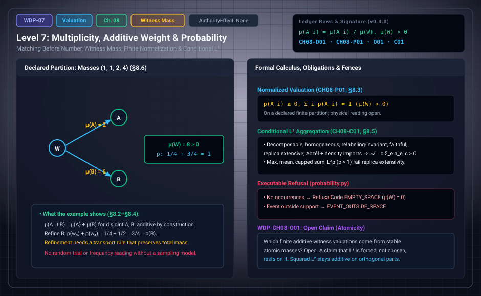

# WDP Level 07: Multiplicity, Additive Weight, and Finite Probability

**AuthorityEffect:** None.  
**Level:** Level 07 (Chapter 8: Multiplicity, Additive Weight, and Finite Probability)  
**Monograph Chapter:** Chapter 8, §8.1–§8.6 (Part II: Order, quantity, and finite probability), *The Witnessed Difference Programme* v0.5.0.  
**Part:** Part II: Order, Quantity, and Finite Probability  
**Ledger Rows:** `WDP-CH08-D01` (definition), `WDP-CH08-P01` (finite proposition), `WDP-CH08-O01` (finite proposition), `WDP-CH08-C01` (conditional result).  

---

## 1. What this level does

Chapter 8 builds finite quantity from exhibited families, in four steps:

1. It compares two finite families by an exhibited **matching**, without taking
   a number object as primitive.
2. It puts a declared nonnegative **mass** on a finite family of typed
   witnesses. Finite additivity then holds by construction.
3. It **normalizes** the mass on a declared finite partition with positive
   total mass. The values are nonnegative and sum to one.
4. It explains why $L^1$ is the natural norm for additive witness mass, why
   that does not ban $L^2$, and under which hypotheses an aggregator must be
   $L^1$.

Calling the normalized value a probability is standard for a finite sample
model. Its physical interpretation stays open. [Level 08](level_08_discrete_observer_layer.md) fences it.

---

## 2. Definitions and results

### 2.1 Matching before number (§8.1)

Let $A$ and $B$ be finite exhibited families. A **matching** is a finite set of
pairing incidences such that:

1. no endpoint takes part in two pairings;
2. every endpoint in both families takes part in a pairing;
3. the pairing preserves the comparisons declared relevant.

These conditions describe a bijective correspondence without a primitive
number object. They still presuppose the exhibited families and a frozen
comparison scope.

> **`WDP-CH08-D01` — Definition (comparison-relative congruence).** $A$ and $B$
> are congruent relative to $\mathcal K$ when a matching preserving
> $\mathcal K$ is exhibited.

**Scope.** This does not show that plurality itself is derived from one cut. It
describes how finite multiplicity can be compared once plural exhibited tokens
are available.

### 2.2 Witness mass (§8.2)

Let $W=\{w_1,\ldots,w_n\}$ be a finite family of typed witnesses and
$m:W\to\mathbb R_{\ge0}$ a declared mass. For $A\subseteq W$,

$$
\mu(A)=\sum_{w\in A}m(w),\qquad
\mu(A\sqcup B)=\mu(A)+\mu(B)\ \text{ for disjoint }A,B.
$$

This is finite additivity by construction. If $m(w)=1$ for every $w$, $\mu(A)$
is a tally.

Symmetry gives equal weights only under an extra requirement. If the witnesses
are indistinguishable under a declared transitive symmetry *and* $m$ is
required to be equivariant, equal weights follow on that orbit. The
equivariance requirement carries the load. Indifference is not obtained from
ignorance alone. The exact statement of what symmetry buys is
`WDP-CH08-P02` (invariant masses correspond to functions on the orbit set). It
carries this chapter's prefix but lives in §9.7 and is covered in
[Level 08](level_08_discrete_observer_layer.md).

### 2.3 Normalized valuation (§8.3)

Let $\mathcal P=\{A_1,\ldots,A_k\}$ be a declared finite partition of $W$ with
$\mu(W)>0$, and define

$$
p(A_i)=\frac{\mu(A_i)}{\mu(W)}.
$$

> **`WDP-CH08-P01` — Finite proposition.** The values $p(A_i)$ are nonnegative
> and sum to $1$.

**Scope.** The proof is finite arithmetic. The result is a normalized additive
valuation on a declared finite partition, under the positive-total-mass
hypothesis. Its physical interpretation remains open.

### 2.4 Refinement (§8.4)

If a cell $A_i$ is refined into disjoint cells $B_{i1},\ldots,B_{ir}$, finite
additivity gives $p(A_i)=\sum_jp(B_{ij})$. The equality can fail if the mass
assigned to a witness changes under refinement, because then a new model has
been introduced. A refinement theorem therefore needs a transport rule that
preserves total mass.

> **`WDP-CH08-O01` — Finite proposition.** Every nonnegative additive valuation on a finite Boolean event algebra has unique algebra-atom masses and measurable-map pushforward; nonnegative masses on individual witnesses extending it are unique exactly when every nonsingleton algebra atom has mass zero.
> See Appendix I and [the derivation guide](../derivation_review.md).

Atomic representation is now characterized for the declared finite Boolean
algebra. That result alone does not force $L^1$ as a universal evaluator.

### 2.5 Why $L^1$ appears, and what it does not exclude (§8.5)

For nonnegative vectors with disjoint support,
$\|x+y\|_1=\|x\|_1+\|y\|_1$. For $p>1$, $\|x+y\|_p$ is in general not the sum
of the norms. So $L^1$ is the natural norm when the magnitude must be
degree-one homogeneous and exactly additive over disjoint positive sectors.

This does not ban $L^2$. Squared $L^2$ magnitude is additive on orthogonal
components: $\|x\oplus y\|_2^2=\|x\|_2^2+\|y\|_2^2$. The two expressions answer
different questions. Moving from witness mass to amplitude geometry changes the
object and its rules.

**The finite argument (additivity assumed).** Let $\mathcal A$ send finite
families $(a_e)_{e\in E}$ of nonnegative edge magnitudes to $[0,\infty)$.
Suppose $\mathcal A$ is edge-decomposable, additive over disjoint edge sets,
positively homogeneous on each edge, invariant under relabeling edges, and
faithful ($\mathcal A_{\{e\}}(1)>0$). Then:

1. additivity over singletons gives $\mathcal A((a_e))=\sum_e\mathcal A_{\{e\}}(a_e)$;
2. homogeneity gives $\mathcal A_{\{e\}}(a_e)=a_e\,\mathcal A_{\{e\}}(1)$;
3. relabeling invariance makes $\mathcal A_{\{e\}}(1)=c$ independent of $e$;
4. faithfulness gives $c>0$.

So $\mathcal A((a_e))=c\sum_ea_e$. The conditional part of the row below is
replacing additivity by the weaker replica extensivity.

> **`WDP-CH08-C01` — Conditional result (conditional $L^1$ aggregation from
> replica extensivity).** Let $\mathcal A$ be edge-decomposable, positively
> homogeneous on each edge, invariant under relabeling edges, faithful, and
> replica extensive,
> $\mathcal A(\delta\sqcup\cdots\sqcup\delta)=N\mathcal A(\delta)$. Importing
> Aczél's representation of continuous, strictly monotone associative
> operations and a hypothesis that the attained values are dense
> [REF-MATH-006], $\mathcal A$ is additive over disjoint edge sets, and hence
> $\mathcal A((a_e))=c\sum_ea_e$ for some $c>0$.

The proof sketch uses the imported representation to turn replica
extensivity into additivity; the finite argument then gives the form. The
hypotheses are not idle:

| Aggregator | Hypothesis it fails |
| :--- | :--- |
| bottleneck (max), density (mean), saturating (capped sum), $L^p$ with $p>1$ | replica extensivity |
| typical aggregators with cross-edge coupling | replica extensivity |
| sum of squares $\sum_ea_e^2$ | only homogeneity |
| weighted sum $\sum_ec_ea_e$ with unequal positive $c_e$ | only relabeling invariance |
| the zero aggregator | only faithfulness |

**Scope.** The result selects $L^1$ for evaluators that require independent
defects to add. It does not make $L^1$ universal. The classification of gauges
by edge symmetry monoids belongs to a separate source that the monograph does
not absorb.

---

## 3. Worked example: a declared partition (§8.6)

Let $W=\{w_1,w_2,w_3,w_4\}$ with masses $(1,1,2,4)$. Partition it into
$A=\{w_1,w_2\}$ and $B=\{w_3,w_4\}$.

1. Total mass: $\mu(W)=1+1+2+4=8>0$, so normalization is defined.
2. $\mu(A)=1+1=2$, so $p(A)=2/8=1/4$.
3. $\mu(B)=2+4=6$, so $p(B)=6/8=3/4$.
4. $p(A)+p(B)=1/4+3/4=1$, as `WDP-CH08-P01` says.
5. Refine $B$ into $\{w_3\}$ and $\{w_4\}$: $2/8=1/4$ and $4/8=1/2$. They sum
   to $3/4=p(B)$, because the refinement kept each witness's mass.

Because these masses are natural numbers, the executable binding can replay
the example by repeating labels: `FiniteWitnessSpace(("w1", "w2", "w3", "w3",
"w4", "w4", "w4", "w4"))` gives `event_probability` values $1/4$ for
$\{w_1,w_2\}$ and $3/4$ for $\{w_3,w_4\}$.

Nothing in this calculation says the witnesses were random trials or that the
numbers predict frequencies. Those readings need a sampling or physical model.

---

## 4. Evidence bindings

Paths are relative to the monograph package
[`witnessed_difference_programme/`](/atlas/papers/finite_obstruction_calculus/witnessed_difference_programme/).

| Row | Status | Ledger evidence | Lean | Executable binding | Notebook |
| :--- | :--- | :--- | :--- | :--- | :--- |
| `WDP-CH08-D01` | Definition | P | none; listed among definition rows without an exact declaration | none | none |
| `WDP-CH08-P01` | Finite proposition | P; C | narrower than the row: `WitnessedDifference.Probability.sum_normalizedMultiplicity` (with `normalizedMultiplicity_nonnegative`) proves only the natural-multiplicity instance with an explicit nonzero denominator (axiom report: `propext`, `Classical.choice`, `Quot.sound`) | `code/witnessed_difference/probability.py`, tested by `code/unit_tests/test_duration_probability_histories.py` | `050_duration_and_finite_probability.ipynb` |
| `WDP-CH08-O01` | Finite proposition | P; C; N | no full-row Lean proof | finite_adequacy.py; test_boolean_event_valuation.py; omega_finite_probability::finite_valuation | Appendix I; current supplement |
| `WDP-CH08-C01` | Conditional result | P; R (`REF-MATH-006`) | none; prose-only in `CLAIM_MAP.md` | none | none |

**What the executable binding for `WDP-CH08-P01` checks.** `probability.py`
represents a witness family as a tuple of occurrences; a repeated label is a
multiplicity. `event_probability` returns the exact fraction of occurrences
that fall in the event. It returns `RefusalCode.EMPTY_SPACE` when there are no
occurrences, which is the positive-total-mass hypothesis, and
`RefusalCode.EVENT_OUTSIDE_SPACE` when the event names an outcome outside the
support. `disjoint_additivity` returns `RefusalCode.NOT_DISJOINT` for
overlapping events and otherwise checks $p(A\cup B)=p(A)+p(B)$. Like the
narrower Lean declaration, it covers natural-number multiplicities only, not the real masses
$m:W\to\mathbb R_{\ge0}$ of §8.2. The module's `conditional_probability`
computes a ratio inside the same finite table. It is bound to no ledger row and
is not Bayesian updating in the sense of §9.9, which needs a prior and a
likelihood model.

---

## 5. Misreadings the chapter rules out

- **Reading matching as a derivation of number or plurality.** A matching
  presupposes exhibited families and a frozen comparison scope. It compares
  multiplicities; it does not derive plurality from one cut.
- **Equal weights from ignorance.** Equal weights on an orbit need a declared
  symmetry and an equivariance requirement on $m$. Symmetry fixes nothing
  across different orbits (`WDP-CH08-P02`, Level 8).
- **Refinement always preserves probabilities.** Only a mass-preserving
  transport rule does. Per §21.4, refinement invariance fails if transported
  atomic mass is not conserved.
- **$L^1$ is universal, or $L^2$ is banned.** `WDP-CH08-C01` selects $L^1$
  only for evaluators that require independent defects to add, under stated
  hypotheses and an imported representation theorem. Squared $L^2$ is additive
  on orthogonal components and answers a different question.
- **$L^1$ is proved forced.** The replica-extensive route is conditional on an
  import. The finite atomicity theorem resolves `WDP-CH08-O01` under its
  explicit algebra/additivity hypotheses; it does not force a universal norm.
- **Reading the normalized table as chance or frequency.** §8.6 says the
  calculation is silent about random trials and predicted frequencies. The
  rows that fence this reading are in Level 8.
- **Assuming rational or path-counting weights.** §8.2 declares real
  nonnegative masses on typed witnesses. Rational or integer weights are a
  special case, used by the executable and Lean bindings.

---

## 6. Nonclaims

Chapter 8 has no nonclaim row of its own. The rows that fence the reading of its
valuation are stated in Chapter 9 and covered in [Level 08](level_08_discrete_observer_layer.md):
`WDP-CH09-N01` (a finite witness valuation is not chance, frequency
convergence, exchangeability, a continuum probability measure, or the Born
rule) and `WDP-CH09-N02` (equal weights under a declared symmetry do not
establish a universal principle of indifference). Chapter 21's consolidated
list (§21.7, items 5 and 6) also refuses the claims that finite normalized
weight is physical probability and that normalization selects the Born rule.

**Current statuses.**

- **`WDP-CH08-O01`** (finite proposition): Every nonnegative additive valuation on a finite Boolean event algebra has unique algebra-atom masses and measurable-map pushforward; nonnegative masses on individual witnesses extending it are unique exactly when every nonsingleton algebra atom has mass zero.

---

## 7. Claim discipline

1. **What this level supports:** comparison-relative congruence by an
   exhibited matching; finite additivity of declared witness mass by
   construction; normalization on a declared finite partition with positive
   total mass (`WDP-CH08-P01`); the finite $L^1$ form under additivity; and
   the conditional $L^1$ form under replica extensivity plus the Aczél import
   (`WDP-CH08-C01`).
2. **What it does not support:** a derivation of number or plurality from one
   cut, stable atomicity, universality of $L^1$, a ban on $L^2$, or any reading
   of the normalized values as chance, frequency, or Born probability.
3. **Narrowest defensible claim:** nonnegative masses on a finite witness
   family, summed over the cells of a declared partition and divided by a
   positive total, give nonnegative values that sum to one.
4. **Next exercise:** replay the declared finite result and its negative
   controls listed in [the derivation guide](../derivation_review.md), then change
   one hypothesis and identify which conclusion still follows.

---

---

## Current finite derivation and Rust integration

Membership signatures produce the measurable atoms of any finite Boolean event algebra. Additivity gives unique atom masses. Individual witness extensions are unique iff every nonsingleton atom has zero mass; otherwise first-point and last-point concentrations give explicit alternatives. Measurable pushforward preserves total mass. The native owner is omega_finite_probability::finite_valuation.

See Appendix I and [the derivation guide](../derivation_review.md) for exact
claim statuses, test results and the runnable Rust example.

---

## Navigation

- **Previous:** [Level 06: Duration, Exactness, Periods, and Clocks](level_06_finite_event_valuations.md)
- **Next:** [Level 08: Probability Scope Fences](level_08_discrete_observer_layer.md)
- **Levels Index:** [README.md](README.md)
