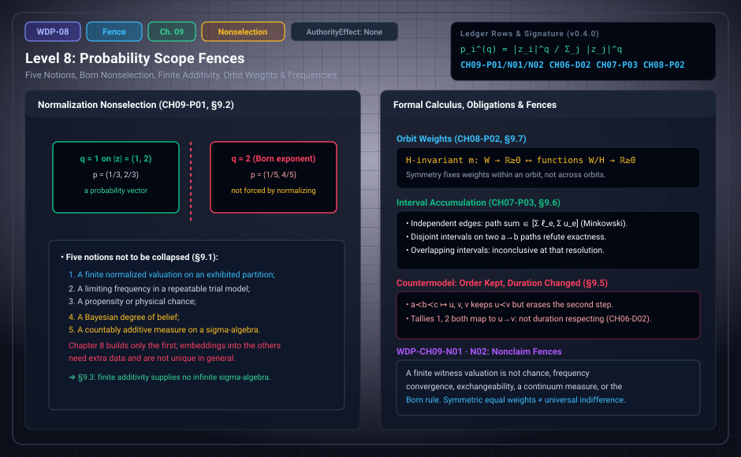

# WDP Level 08: Probability Scope Fences

**AuthorityEffect:** None.  
**Level:** Level 08 (Chapter 9: Probability Scope Fences)  
**Monograph Chapter:** Chapter 9, §9.1–§9.10 (Part II: Order, quantity, and finite probability), *The Witnessed Difference Programme* v0.4.0.  
**Part:** Part II: Order, Quantity, and Finite Probability  
**Ledger Rows:** `WDP-CH09-P01` (finite proposition), `WDP-CH09-N01` and `WDP-CH09-N02` (nonclaims); stated in this chapter under earlier prefixes: `WDP-CH06-D02` (definition), `WDP-CH07-P03` and `WDP-CH08-P02` (finite propositions).  

---

## 1. What this level does

[Level 07](level_07_finite_probability_multiplicity.md) built one object: a finite normalized valuation on a
declared partition. Chapter 9 fences what that object is not. It:

- lists five notions of probability that must not be collapsed;
- proves that normalization does not select the Born rule;
- separates finite additivity on a finite algebra from countable additivity;
- makes the dependence of a valuation on an observer's partition explicit.

The second half of the chapter (§9.5–§9.10) adds finite material on duration
transport under temporal coarse-graining, interval accumulation of durations,
what symmetry buys for mass, coarse reports, frequencies and updating, and a
checklist for using a finite valuation as a measurement probability. Three rows stated here carry earlier chapter
prefixes: `WDP-CH06-D02`, `WDP-CH07-P03`, and `WDP-CH08-P02`.

---

## 2. Definitions and results

### 2.1 Five distinct notions (§9.1)

The following must not be collapsed:

1. a finite normalized valuation on an exhibited partition;
2. a limiting frequency in a repeatable trial model;
3. a propensity or physical chance;
4. a Bayesian degree of belief;
5. a countably additive measure on a sigma-algebra.

Chapter 8 constructs only the first. A finite valuation can be embedded into
some of the others after additional data are supplied, but in general the
embedding is not unique.

### 2.2 Normalization does not select the Born rule (§9.2)

Let $z=(z_1,\ldots,z_n)$ be a nonzero finite amplitude vector. For any $q>0$,

$$
p_i^{(q)}=\frac{|z_i|^q}{\sum_j|z_j|^q}.
$$

Then $p_i^{(q)}\ge0$ and $\sum_ip_i^{(q)}=1$ for every $q>0$. Normalization
alone does not select $q=2$.

> **`WDP-CH09-P01` — Finite proposition (normalization nonselection).** On any
> amplitude vector with at least two unequal nonzero magnitudes, the normalized
> vectors for exponents $q,r>0$ with $q\ne r$ are distinct, while each is a
> probability vector.

*Proof.* For two nonzero coordinates of unequal magnitude, the normalized
coordinate ratio is $(|z_i|/|z_j|)^q$. The positive base differs from $1$, so
equal ratios force $q=r$.

Any derivation of the Born rule must use structure beyond positivity and
normalization: for example, the noncontextuality and Hilbert-space assumptions
of a Gleason-type theorem [REF-PROB-002], or the operational axioms of a
reconstruction [REF-QM-003; REF-QM-004; REF-QM-006]. Levels
[17](level_17_semiring_coarse_graining.md) and [18](level_18_exact_rational_bounds.md) audit those routes.

### 2.3 Finite additivity is not countable additivity (§9.3)

On a finite algebra, finite and countable additivity coincide trivially,
because only finitely many disjoint nonempty cells exist. This does not supply
a sigma-algebra over an infinite outcome space, regularity, convergence, or a
continuum measure. Each of those is a separate import.

### 2.4 Probability and observers (§9.4)

An observer profile may select the partition: which distinctions the observer
can report, which outcomes are grouped, and which events are out of scope. The
resulting valuation is then profile-relative. That does not make it subjective
in a psychological sense. It makes the dependence on a partition map explicit.
Later chapters require an observer to publish the partition and value map used
in a measurement. Without that declaration, two normalized tables may disagree
because they answer different questions.

### 2.5 Order-preserving maps and temporal coarse-graining (§9.5)

Let $(S,\prec_S)$ and $(T,\prec_T)$ be strict partial orders. A map
$f:S\to T$ is monotone when $x\prec_Sy$ implies $f(x)=f(y)$ or
$f(x)\prec_Tf(y)$, depending on whether the target convention permits
collapsed intervals. If equality is forbidden, strict monotonicity is used.

> **`WDP-CH06-D02` — Definition (duration-respecting coarse-graining).** Given
> duration packets $(S,\lambda_S)$ and $(T,\lambda_T)$, a monotone map $f$ is
> duration respecting relative to an edge/path assignment $F$ when every
> source path $p$ satisfies $D_{\lambda_T}(F(p))=D_{\lambda_S}(p)$, or lies
> within a separately stated error bound.

**Scope.** Such preservation is extra data. Order preservation alone does not
imply it. A duration transport theorem must say whether collapsed edges
contribute zero, are summed into a coarse edge, or make the map inadmissible.

### 2.6 Duration uncertainty (§9.6)

Suppose edge durations are intervals $I_e=[\ell_e,u_e]$. For a finite path $p$,
interval addition gives

$$
I_p=\left[\sum_{e\in p}\ell_e,\ \sum_{e\in p}u_e\right].
$$

> **`WDP-CH07-P03` — Finite proposition (interval accumulation).** Under the
> model that each edge value can be selected independently from its declared
> interval, the set of possible finite path sums is contained in the Minkowski
> sum of the edge intervals, which for real intervals is the displayed
> endpoint sum.

**Scope.** Correlation constraints can only preserve or narrow this bound,
because they select a subset of the Cartesian product. A wider set needs
different interval semantics (for example, marginal confidence sets) and is a
different model. If two paths from $a$ to $b$ have disjoint duration intervals,
path independence is refuted robustly. If the intervals overlap, exactness is
not established; the data are inconclusive at that resolution. A clock
comparison over $k$ ticks, each with interval $I$, gives $kI$ by naive
addition, but drift, shared calibration error, and quantization may be
correlated. Those rules belong to the uncertainty packet of
[Level 12](level_12_context_interference_state_spaces.md) (monograph Chapter 13).

### 2.7 Orbit weights (§9.7)

Let a finite group $H$ act on a witness family $W$. An $H$-invariant mass
function $m:W\to\mathbb R_{\ge0}$ is constant on each orbit, and any choice of
one nonnegative mass per orbit defines an invariant mass.

> **`WDP-CH08-P02` — Finite proposition (invariant mass classification).**
> $H$-invariant nonnegative mass functions on $W$ are in bijection with
> nonnegative functions on the orbit set $W/H$.

*Proof.* Invariance forces equal values on orbit-related witnesses. Conversely,
a function pulled back along the orbit projection is invariant.

**Scope.** This states exactly what symmetry buys. It does not fix the mass of
one orbit relative to another. If the action is transitive and total mass is
fixed, equal atomic mass follows uniquely. With several orbits, their relative
weights stay free. A statement of "equal probability by symmetry" must name the
group, the action, the orbit structure, and the total-mass normalization.

### 2.8 Coarse partitions and sufficient reports (§9.8)

Let $q:W\to P$ assign each witness to a report class. The pushforward mass is
$(q_*\mu)(p)=\sum_{w:q(w)=p}m(w)$. Normalization commutes with this finite
pushforward when total mass is preserved. Two fine-grained models with the
same pushforward cannot be told apart by any evaluator that uses only $P$. This
is the probability analogue of the presentation blind spot of
[Level 13](level_13_self_reference_gaps_fixed_points.md) (monograph Chapter 14). A report is sufficient for a
query when the query factors through $q$. Sufficiency is query-relative.

### 2.9 Frequencies, exchangeability, and updating (§9.9)

- An empirical frequency $n_i/N$ is a finite normalized valuation on the
  observed trial multiset. It is a fact about those records. A law of large
  numbers links it to a probability parameter only after a stochastic model is
  supplied.
- Exchangeability is a substantive assumption. Finite exchangeability does not
  give an infinite de Finetti representation [REF-PROB-005]. An observer's
  choice to ignore order does not make the physical process exchangeable.
- Bayesian updating starts from a prior and a likelihood model. The calculus
  can record and audit them, but symmetry alone does not select a uniquely
  rational prior. A maximum-entropy rule [REF-PROB-006] adds a constraint set,
  a reference measure, and an optimization principle.

### 2.10 Probability-to-measurement interface checklist (§9.10)

Before a finite valuation is used as a measurement probability, record: (1) the
trial or instrument protocol; (2) the outcome partition and its version;
(3) whether weights are counts, modeled chances, likelihoods, or decision
weights; (4) the sampling or exchangeability assumptions; (5) missing-data and
stopping rules; (6) calibration and detection-efficiency treatment; (7) the
uncertainty statement; (8) the inference rule and its scope. Without these
fields, a normalized table is valid arithmetic with no unique empirical
reading.

---

## 3. Worked examples: two exponents, one collapse

**Two exponents on magnitudes $(1,2)$ (§9.2).**

1. $q=1$: the denominator is $1+2=3$, so $p^{(1)}=(1/3,\,2/3)$.
2. $q=2$: the denominator is $1^2+2^2=5$, so $p^{(2)}=(1/5,\,4/5)$.
3. Both are probability vectors: $1/3+2/3=1$ and $1/5+4/5=1$.
4. They differ. The coordinate ratio is $2^1=2$ for $q=1$ and $2^2=4$ for
   $q=2$, as `WDP-CH09-P01` requires.

Nothing in normalization picks the second vector over the first.

**Collapsing a chain (§9.5).** Map $a\prec b\prec c$ by $f(a)=u$, $f(b)=v$,
$f(c)=v$, with target $u\prec_T v$ joined by one edge.

1. The image keeps $u\prec v$ but erases the second step, so $f$ is monotone
   only under a convention that permits collapsed intervals.
2. Under the unit tally, $D(a\to b)=1$ and $D(a\to b\to c)=2$.
3. Both source paths run from $u$ to $v$ in the image, so an assignment $F$
   must send both to the one target path $u\to v$.
4. No single value $\lambda_T(u\to v)$ equals both $1$ and $2$. So $f$ is not
   duration respecting in the exact sense of `WDP-CH06-D02` for any choice of
   that value. It needs a stated error bound, or the map is inadmissible for
   exact transport.

---

## 4. Evidence bindings

Paths are relative to the monograph package
[`witnessed_difference_programme/`](/atlas/papers/finite_obstruction_calculus/witnessed_difference_programme/).

| Row | Status | Ledger evidence | Lean | Executable binding | Notebook |
| :--- | :--- | :--- | :--- | :--- | :--- |
| `WDP-CH09-P01` | Finite proposition | P | none; prose-only in `CLAIM_MAP.md` | none | none |
| `WDP-CH09-N01` | Nonclaim | P; C | none | `code/witnessed_difference/probability.py`, tested by `code/unit_tests/test_duration_probability_histories.py` and `code/integration_tests/test_duration_history_quantum_scope.py` | `050_duration_and_finite_probability.ipynb` |
| `WDP-CH09-N02` | Nonclaim | P | none | none | none |
| `WDP-CH06-D02` | Definition | P | none; listed among definition rows without an exact declaration | none | none |
| `WDP-CH07-P03` | Finite proposition | P | none; prose-only in `CLAIM_MAP.md` | none | none |
| `WDP-CH08-P02` | Finite proposition | P | none; prose-only in `CLAIM_MAP.md` | none | none |

**What the executable binding for `WDP-CH09-N01` checks.** It is a scope
binding; the ledger's evidence type is "scope firewall: finite multiplicity is
not chance or Born probability". `probability.py` returns exact fractions of
occurrence counts and has no field that interprets them as chance, frequency,
or Born probability. Its refusals (`RefusalCode.EMPTY_SPACE`,
`EVENT_OUTSIDE_SPACE`, `NOT_DISJOINT`) concern the finite table only. The
integration test computes a finite proportion of $3/4$ beside a declared $U(1)$
holonomy. It then checks two things: `supports_quantum_reconstruction` in
`quantum.py` refuses `QuantumEvidence.DECLARED_U1_CALCULATION` with
`RefusalCode.SCOPE_VIOLATION`, and an open reconstruction claim stays open
after a finite witness is attached (`relative_status.py`). No code in the
package computes the $q$-family of §9.2; `WDP-CH09-P01` rests on its prose
proof. The Lean package's `NONCLAIM` registry has a `bornUniqueness` label;
`CLAIM_MAP.md` says those labels are documentation, not propositions.

---

## 5. Misreadings the chapter rules out

- **One word, one object.** A normalized table, a limiting frequency, a
  propensity, a degree of belief, and a sigma-additive measure are five
  different objects. Chapter 8 built only the first.
- **Normalization implies the Born rule.** The positive-power family refutes
  it: every $q>0$ normalizes. Per §21.4, Born selection from normalization is
  refuted by this family. Chapter 19 records that Born-quadratic uniqueness is
  not proved (`WDP-CH19-N01`, [Level 18](level_18_exact_rational_bounds.md)).
- **Finite additivity is countable additivity.** They coincide only on a
  finite algebra. That supplies no sigma-algebra, regularity, convergence, or
  continuum measure.
- **Profile-relative means arbitrary or psychological.** It means the partition
  map is part of the data and must be published.
- **Order preservation carries duration.** The chain collapse keeps order and
  changes unit-tally duration. Duration transport is extra data
  (`WDP-CH06-D02`).
- **Overlapping intervals confirm exactness.** They are inconclusive at that
  resolution. Only disjoint intervals refute path independence robustly.
- **Equal probability by symmetry.** Symmetry forces equality within an orbit
  only. Relative orbit weights stay free (`WDP-CH08-P02`).
- **Frequencies, exchangeability, and priors come free.** Each is an added
  model: a stochastic model for a law of large numbers, a substantive
  exchangeability assumption, a prior and likelihood for updating.

---

## 6. Nonclaims

- **`WDP-CH09-N01`.** A finite witness valuation is not thereby chance,
  frequency convergence, exchangeability, a continuum probability measure, or
  the Born rule.
- **`WDP-CH09-N02`.** Equal weights under a declared symmetry do not establish
  a universal principle of indifference.

Chapter 21's consolidated list (§21.7, items 5 and
6) also refuses the claims that finite normalized weight is physical
probability and that normalization selects the Born rule.

**Finite supplement.** These finite targets are answered under the explicit hypotheses in Appendix J. See [the current derivation guide](../derivation_review.md) for complete statements, counterexamples, native ownership and partial Lean coverage.

---

## 7. Claim discipline

1. **What this level supports:** five probability notions kept apart;
   normalization nonselection (`WDP-CH09-P01`); the coincidence of finite and
   countable additivity only on finite algebras; profile-relative partitions;
   and three finite rows used later: duration-respecting coarse-graining
   (`WDP-CH06-D02`), interval accumulation (`WDP-CH07-P03`), and the orbit
   classification of invariant masses (`WDP-CH08-P02`).
2. **What it does not support:** chance, frequency convergence,
   exchangeability, a continuum probability space, the Born rule, a universal
   principle of indifference, or a uniquely rational prior.
3. **Narrowest defensible claim:** positivity and normalization admit a
   one-parameter family of distinct probability vectors on any amplitude vector
   with two unequal nonzero magnitudes, so they cannot select $q=2$.
4. **Next test needed:** a finite, machine-checked instance of
   `WDP-CH09-P01` or of the interval bound `WDP-CH07-P03`, both of which are
   currently prose-only. This is a suggested next step, not a ledger row.

---

---

## Expert derivation supplement (2026-10-01)

- **CH18-O01 — Conditional result.** Signed report weights have a classical state representation exactly when every observable block mass is nonnegative; signed instrument updates admit a classical report-instrument quotient exactly under the stated fiber-intertwining and stochastic-quotient conditions. The unrestricted witness/observer/measurement class admits accepted PR tables, refuting reconstruction that preserves their declared probabilities together with classical joint runs or bipartite local Hilbert measurement composition. Classical and quantum alternatives require the explicit additional packages in Appendix J; neither is forced by the original packets.
- **CH19-O03 — Conditional result.** A declared continuous character $\chi_\theta(t)=e^{i\theta t}$ maps real cochains into complex path amplitudes and descends under gauge to phase-blind operational readouts; its cycle-period lattice and anchor dependence are explicit. An independent exact rational-turn/cyclotomic branch is implemented. Declared effect/instrument pairing supplies a conditional operational model, while normalized quadratic and quartic readouts prove nonselection by phase invariance. No Born rule or faithful real phase embedding is inferred.

The original 154 identifiers are preserved. The historical Lean census is unchanged; new standalone proofs, native replay and source custody are described in [the derivation guide](../derivation_review.md). Physical interpretation, Born selection and authority remain separate assumptions.

---

## Navigation

- **Previous:** [Level 07: Multiplicity, Additive Weight, and Finite Probability](level_07_finite_probability_multiplicity.md)
- **Next:** [Level 09: A Layered Observer Architecture](level_09_behavioral_quotients_finite_states.md)
- **Levels Index:** [README.md](README.md)
