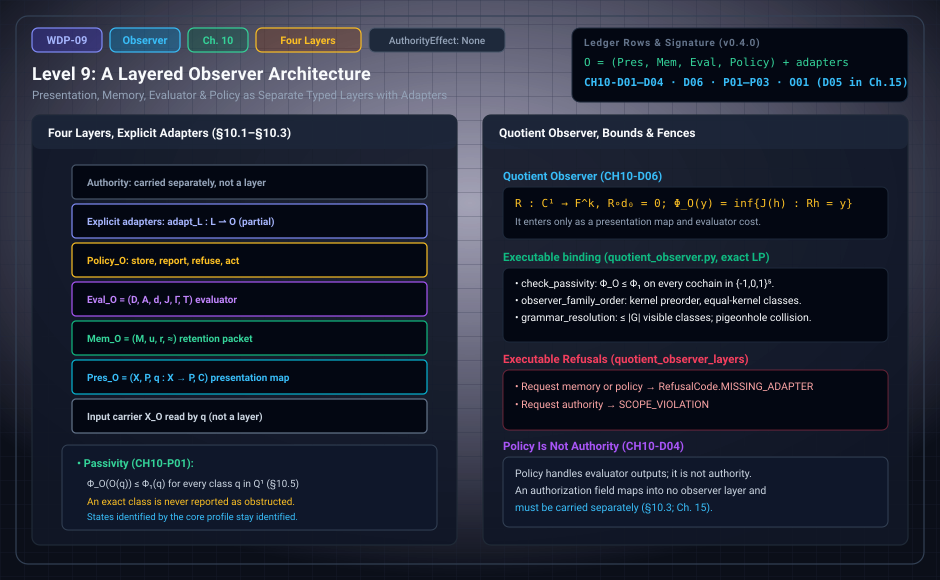

# WDP Level 09: A Layered Observer Architecture

**AuthorityEffect:** None.  
**Level:** Level 09 (Chapter 10: A Layered Observer Architecture)  
**Monograph Chapter:** Chapter 10, §10.1–§10.5 (Part III: Observer, observation, and measurement), *The Witnessed Difference Programme* v0.4.0.  
**Part:** Part III: Observer, Observation, and Measurement  
**Ledger Rows:** `WDP-CH10-D01`–`D04` and `WDP-CH10-D06` (definitions), `WDP-CH10-P01`–`P03` (finite propositions), `WDP-CH10-O01` (conditional result). `WDP-CH10-D05` carries this chapter's prefix but lives in Chapter 15 (§15.4).  

---

## 1. What this level does

The source papers use *observer* for several distinct objects: quotient and
sensing maps, the original Genesis six, the operational ten-symbol packet,
two different five-component assemblies, a normalized nine, and evaluator,
operator and self-witnessing extensions. Their fields and hypotheses differ.

Chapter 10 organizes these objects into **four layers**: presentation,
memory, evaluator and policy, joined by explicit typed adapters. Authority is
outside these layers. The completed `WDP-CH10-O01` result supplies partial
adapters for every identified source family, with exact domain predicates,
preservation arguments and necessary-hypothesis countermodels. The quotient
observer also supports the chapter's passivity, declared-family order and
finite grammar-resolution results.

---

## 2. Definitions and results

### 2.1 Four layers instead of one tuple (§10.1)

> **`WDP-CH10-D01` — Definition (observer presentation).** An observer
> presentation is
> $\mathsf{Pres}_{\mathcal O}=(X_{\mathcal O},P_{\mathcal O},q_{\mathcal O},\mathcal C_{\mathcal O})$,
> where $X_{\mathcal O}$ is the admitted input carrier, $P_{\mathcal O}$ is the
> presentation or report carrier, $q_{\mathcal O}:X_{\mathcal O}\to P_{\mathcal O}$
> is a presentation map, and $\mathcal C_{\mathcal O}$ is a declared
> context/profile family.

> **`WDP-CH10-D02` — Definition (observer memory).** An observer memory is a
> retention packet
> $\mathsf{Mem}_{\mathcal O}=(M_{\mathcal O},u_{\mathcal O},r_{\mathcal O},\approx_{\mathcal O})$
> as in Chapter 3, with a typed interface from presentations into memory and
> from memory into reports.

> **`WDP-CH10-D03` — Definition (observer evaluator).** An observer evaluator is
> $\mathsf{Eval}_{\mathcal O}=(D_{\mathcal O},A_{\mathcal O},d_{\mathcal O},J_{\mathcal O},\Gamma_{\mathcal O},T_{\mathcal O})$:
> a defect carrier, an admissible repair carrier and repair map, a declared
> cost, any well-typed closure tests, and a terminalizer returning a status in
> a declared finite status set.

> **`WDP-CH10-D04` — Definition (observer policy).** An observer policy
> specifies what the system does with evaluator outputs: store, request more
> data, emit a report, refuse an ill-typed query, or take a domain-specific
> action. Policy is not authority.

The **layered observer** is

$$
\mathcal O=(\mathsf{Pres}_{\mathcal O},\mathsf{Mem}_{\mathcal O},
\mathsf{Eval}_{\mathcal O},\mathsf{Policy}_{\mathcal O})
$$

together with explicit adapters among the layers. Each entry is itself a
declared packet, so the observer is a tuple of tuples, not a flat list.

A related definition with this chapter's prefix sits in Chapter 15, where
observer morphisms are discussed. **`WDP-CH10-D05` (report simulation)** says
that $\mathcal O'$ report-simulates $\mathcal O$ on an input family $D$ when an
input adapter and a report decoder make the declared report diagram commute on
$D$. It does not imply memory-state isomorphism or evaluator equivalence. See
[Level 14](level_14_traceability_provenance_receipts.md).

### 2.2 Quotient evaluators (§10.2)

The quotient construction of Chapter 4 ([Level 03](level_03_discrete_complex_cochains.md)) gives one useful
evaluator. If the presentation exposes a defect class $[\delta]\in Q^1$, the
evaluator computes

$$
\Phi_{\mathcal O}([\delta])=\inf_{\alpha\in A_{\mathcal O}}
J_{\mathcal O}(\delta-d_{\mathcal O}\alpha).
$$

Under the hypotheses of Chapter 4 this value is well defined and attained. A
terminalizer may return `Accept` when the value is below a declared tolerance,
`Reject` when a certified lower bound exceeds it, and `Undetermined`
otherwise. The tolerance, the repair family, and the cost are observer-profile
data.

This is evaluation. It is not perception in the phenomenological sense, and it
is not proposal generation: the evaluator compares a supplied candidate with a
declared profile.

### 2.3 Adapters for legacy packets (§10.3)

An adapter from a legacy packet $L$ is a partial map
$\operatorname{adapt}_L:L\rightharpoonup\mathcal O$ with a domain predicate
that lists the required fields and laws. Typical placements:

- a quotient observer maps mainly into the evaluator layer;
- a report map and a context family map into the presentation layer;
- update and re-access maps map into the memory layer;
- a terminal status map maps into the policy layer;
- an authorization field maps into **none** of the layers and must be carried
  separately.

> **`WDP-CH10-O01` — Conditional result.** Every identified observer family
> in the selected source corpus admits an explicit typed partial adapter on
> its declared domain. The adapter preserves the supplied operations,
> relations and partiality; missing fields require an independent declaration.
> Countermodels show why the required hypotheses cannot be dropped.

The source archive is now complete: **44 original input texts** were recovered
exactly for offline replay, and **529 absorbed occurrences** match their
recorded Git blobs. The source-family index covers all 573 occurrences; manual
semantic review classifies all 79 cue-bearing records, including 53 semantic
candidates. This reconciles the selected corpus. A citation to an external
theorem remains a citation and does not supply an undefined field.

| Source family | Data retained and adapter scope | Native binding |
| :--- | :--- | :--- |
| Original Genesis six `(M,U,p,rho,G,T)` | Initialized memory, free history update, profile, actual history contexts, separate grammar and terminal rule. A profile-to-grammar encoder is extra data. | `omega_wdp::genesis_observer`; `omega_category_theory::finite_history_context` |
| Original operational **ten-symbol** packet | `Sigma,S,s0,Lambda,C,Pi,u,r,p,rho`: input-dependent Mealy reports, independent profiles, initial state and state contexts. A history lift requires reachable-state preservation. | `omega_wdp::genesis_observer` |
| Observer-relative world five `(image p,C,H,W,G)` | History/profile map, contexts, witnesses and grammar. The finite executable restriction must be closed under the declared contexts; fact enumeration requires a grammar interpretation. | `omega_wdp::observer_world_adapter`; `omega_category_theory::context_reflection` |
| Compressed policy five `(C,D,G,R,T)` | Carrier, comparison domain, gauge transformations, repair and terminal rules. The exact source-bound supplement is *The Authority Gap*; scalar norm and intertwining laws are separate declarations. | `omega_wdp::policy_observer_adapter`; `omega_functional::phi1` |
| Normalized nine `(K,F,R,delta,d0,d1,J,M,tau)` | Actual stalk/report/comparison maps, defect, repair, optional closure, gauge, transformations and terminalizer. Here M means transformations, not memory. | `omega_wdp::legacy_observer_adapters`; `omega_functional::linear_observer_presentation` |
| Aggregation/transformation/gauge triple | Actual aggregation and per-edge gauge compose to J; transformations remain separate. Carrier, repairs, closure and terminalizer are additional inputs. | `omega_wdp::legacy_observer_adapters` |
| General reports, predicates, invariant classifiers and capacity maps | The actual typed output or truth table. No quotient, memory or evaluator is inferred. | `omega_wdp::observer_adapter_completeness`; `omega_category_theory::finite_partial_structure` |
| General linear sensing and quotient reports | Actual rational report and repair matrices. Sensing becomes a quotient report exactly when `R d0=0`. | `omega_functional::linear_observer_presentation`; `omega_wdp::legacy_observer_adapters` |
| Vector-norm and operator observers | Actual state/comparison defects, declared repair space and norm geometry. Exact certificates cover their stated rational subdomain. | `omega_quantum_physics::trace_observer_certificate`; `omega_wdp::operator_observer_adapter` |
| Evaluator/control, memory, measurement and self-witness extensions | Actual diagnostics, budgets, directed comparisons, updates, calibrated records, targets and decoders. Missing bridges return typed refusals. | `omega_wdp::legacy_observer_adapters`, `calibration_adapter`, `instrument_adapter`, `self_reference_adapter` |

The mathematical owners are
[`finite_partial_structure.rs`](../../../../omega_engine/crates_rs/omega_category_theory/src/finite_partial_structure.rs),
[`finite_history_context.rs`](../../../../omega_engine/crates_rs/omega_category_theory/src/finite_history_context.rs),
[`linear_observer_presentation.rs`](../../../../omega_engine/crates_rs/omega_functional/src/linear_observer_presentation.rs)
and [`trace_observer_certificate.rs`](../../../../omega_engine/crates_rs/omega_quantum_physics/src/trace_observer_certificate.rs).
The source bindings include
[`genesis_observer.rs`](../../../../omega_engine/crates_rs/omega_wdp/src/genesis_observer.rs),
[`observer_world_adapter.rs`](../../../../omega_engine/crates_rs/omega_wdp/src/observer_world_adapter.rs),
[`policy_observer_adapter.rs`](../../../../omega_engine/crates_rs/omega_wdp/src/policy_observer_adapter.rs)
and [`legacy_observer_adapters.rs`](../../../../omega_engine/crates_rs/omega_wdp/src/legacy_observer_adapters.rs).

These are source-specific adapters, not identifications based on tuple length.
The world five and compressed policy five have different meanings. The
operational source specifies ten symbols, not a five-component Mealy core.
The education six is also distinct from the recovered original Genesis six.

The complete criterion is simple. Choose onto maps on the declared source
sorts. A partial operation descends uniquely iff its output, including
undefinedness, is constant on each input fibre after applying the output map.
A relation descends uniquely iff its truth value is constant on each input
fibre. Necessity follows because one target input has one value; sufficiency
uses a representative, with fibre constancy making the choice independent.
The finite owner checks this criterion for every supplied operation and
predicate, including empty sorts and nullary operations. Identity maps give a
faithful adapter without inventing fields.

For original history actions, put `q(w)=U*(m0,w)`. A state action representing
rho exists on reached states iff equal q-values imply equal q-values after
rho. Checked finite transducers decide this over **all finite histories** by
reachability in a finite product graph; there is no history-length cutoff.
Arbitrary context programs retain their own semantics, and a successful
invocation does not certify their global totality. Conversely a state context
lifts to histories iff it sends reached states to reached states.

Original O1 is nonconstancy of the induced profile; O2 is a context separating
two histories with equal original profiles. Merely changing one profile does
not establish O2. Both criteria depend on `(M,U,p,rho)`; varying G/T leaves
them unchanged. G/T remain separate report-interface data, and no `R→G`
encoder is supplied by the original tuple. Input-independent updates may also
retain history-length parity, so they do not by themselves imply O0.

See the [completion theorem and source bindings](/atlas/papers/finite_obstruction_calculus/witnessed_difference_programme/docs/observer_adapter_completion.md),
[universal adapter proof](/atlas/papers/finite_obstruction_calculus/witnessed_difference_programme/docs/swarm_observer_adapter_completeness.md),
[original history proof](/atlas/papers/finite_obstruction_calculus/witnessed_difference_programme/docs/swarm_original_genesis_observer.md),
[world fact criterion](/atlas/papers/finite_obstruction_calculus/witnessed_difference_programme/docs/source_observer_world_adapter.md),
[policy hypotheses](/atlas/papers/finite_obstruction_calculus/witnessed_difference_programme/docs/swarm_policy_observer_adapter.md),
[operator proof](/atlas/papers/finite_obstruction_calculus/witnessed_difference_programme/docs/source_operator_observer_adapters.md),
and [source recovery report](/atlas/papers/finite_obstruction_calculus/witnessed_difference_programme/docs/source_recovery_report.md).

### 2.4 The quotient observer as an adapter (§10.5)

The primitive-axiomatics source defines an observer as a repair-compatible
quotient of $Q^1$. Chapter 10 fits that packet into the architecture through
one adapter.

> **`WDP-CH10-D06` — Definition (quotient-observer adapter).** A quotient
> observer on a window (§4.7) is a linear map $\mathcal O:Q^1\to Q^1_{\mathcal O}$,
> equivalently a linear report map $R:C^1\to\mathbb F^k$ with $Rd_0=0$. It
> enters the layered observer only as a presentation report map and as an
> evaluator cost, the induced norm
> $\Phi_{\mathcal O}(y)=\inf\{\Phi_1(r):r\in Q^1,\ \mathcal O(r)=y\}$. It
> supplies no memory, policy, or authority layer, and requests for those layers
> are refused.

Because $\Phi_1(r)$ is itself an infimum over representatives,
$\Phi_{\mathcal O}(y)=\inf\{J(h):h\in C^1,\ Rh=y\}$. For weighted $L^1$ this is
a finite linear program.

> **`WDP-CH10-P01` — Finite proposition (observer passivity).** For a quotient
> observer, $\Phi_{\mathcal O}(\mathcal O(q))\le\Phi_1(q)$ for every
> $q\in Q^1$. Hence an observer cannot report positive obstruction for an exact
> class, and states identified by the core profile remain identified by every
> quotient observer.

*Why.* The class $q$ lies in the fiber over $\mathcal O(q)$, and an infimum is
at most any member of its set. If $\Phi_1(q)=0$ then
$0\le\Phi_{\mathcal O}(\mathcal O(q))\le0$. If a core profile $p$ has
$p(x)=p(y)$, then $\mathcal O(p(x))=\mathcal O(p(y))$ because $\mathcal O$ is a
function; linearity is not needed.

Two consequences follow. An observer that sends an exposed context residual
(§11.5, [Level 10](level_10_observation_measurement_calibration.md)) to zero carries no context witness for that
anomaly. And two reports $q_A,q_B$ from observers $\mathcal O_A,\mathcal O_B$
share a core preimage exactly when
$\mathcal O_A^{-1}(q_A)\cap\mathcal O_B^{-1}(q_B)$ is nonempty; an empty fiber
means the reports cannot describe one core class.

> **`WDP-CH10-P02` — Finite proposition (declared observer families).** For a
> declared finite family of report maps, set $\mathcal O\preceq\mathcal P$ when
> $\ker\mathcal O\subseteq\ker\mathcal P$, that is, when $\mathcal P$
> identifies whatever $\mathcal O$ identifies. This relation is a preorder;
> modulo equal kernels it is a partial order; the identity observer, when
> present, is finest, and the zero observer, when present, is coarsest.

**Scope of this row.** Finiteness belongs to the declared family. Over an
infinite field the set of all quotient observers on a nonzero $Q^1$ is
infinite, and when $\dim Q^1\ge2$ even their kernels form an infinite family.

> **`WDP-CH10-P03` — Finite proposition (grammar resolution bound).** A
> deterministic report map $r$ from a declared finite set of core classes into a
> finite grammar $\mathcal G$ exposes at most
> $|\operatorname{im}r|\le|\mathcal G|$ visible classes. If the core set has
> more than $|\mathcal G|$ elements, two distinct core classes share a report.

The visible classes are the fibers of $r$, one per element of
$\operatorname{im}r$, and the collision is the pigeonhole principle. For
reports of length at most $L$ over an alphabet $\Sigma$,
$|\mathcal G|\le\sum_{\ell=0}^{L}|\Sigma|^\ell$; for $|\Sigma|=2$ and $L=3$
that is $1+2+4+8=15$. Grammar design is therefore a resolution constraint, not
a presentation detail. Two further consequences: a quotient observer separates
all of $Q^1$ exactly when $\ker R=\operatorname{im}d_0$, which needs at least
$\dim Q^1$ report coordinates; and a reporter that reads windows of radius $d$
over $k$ letters has at most $k^{2d+1}$ reports, so a longer run of distinct
local situations must repeat a report.

---

## 3. Worked example: a three-sensor observer (§10.4)

Every component is declared.

| Layer | Declaration |
| :--- | :--- |
| Presentation | $X=\mathbb R^3$ (three sensor readings), $q(x_1,x_2,x_3)=(x_1-x_2,\ x_2-x_3)$ |
| Memory | retains the previous presented pair |
| Evaluator | repair family $d(a)=(a,a)$ (the diagonal), $L^1$ cost |
| Policy | may emit `stable`, `unstable`, or `insufficient-history` |

The evaluator computes the $L^1$ distance from the presented pair $y=(y_1,y_2)$
to the diagonal:

$$
\Phi(y)=\min_{a}\big(|y_1-a|+|y_2-a|\big)=|y_1-y_2|,
$$

attained at any $a$ between $y_1$ and $y_2$. It is zero exactly when
$y$ lies in the repair image, that is, when the two reported differences are
equal. In terms of the readings, $\Phi(q(x))=|x_1-2x_2+x_3|$.

1. $x=(3,1,0)$: $q(x)=(2,1)$ and $\Phi=|2-1|=1$; any $a\in[1,2]$ attains it.
2. $x=(2,1,0)$: $q(x)=(1,1)$ lies on the diagonal, so $\Phi=0$.
3. $x=(5,2,-1)$: $q(x)=(3,3)$, so $\Phi=0$.

The chapter names the policy's three outputs but does not fix the rule that chooses among them.
Nothing in this construction authorizes a decision outside the policy's
declared domain, and nothing makes the system conscious.

**Executable check of passivity (package fixture, not in the monograph).** The
test `test_passivity_can_be_strict_and_core_identifications_survive` in
`code/unit_tests/test_quotient_observer.py` uses a square with one diagonal:
vertices $0,1,2,3$ and edges in the order $(01,12,23,03,02)$, so
$\dim Q^1=5-3=2$. The report row $R=(1,1,0,0,-1)$ reads the circulation
$h_{01}+h_{12}-h_{02}$ of the triangle $0\to1\to2\to0$, and $Rd_0=0$ because
$(f_1-f_0)+(f_2-f_1)-(f_2-f_0)=0$. Take $\delta=(1,0,1,0,0)$ with unit weights.

- **Core value.** $\Phi_1([\delta])=2$. The functional
  $\ell=(1,1,1,-1,0)$, the sum of the two triangle circulations, vanishes on
  $\operatorname{im}d_0$, has entries of size at most $1$, and gives
  $\ell(\delta)=2$, so every representative costs at least $2$; $\delta$
  itself costs $2$.
- **Observer value.** $R\delta=1$, and $\Phi_{\mathcal O}(1)=1$: the fiber
  contains $h=(1,0,0,0,0)$, and $R$ itself (entries of size at most $1$) shows
  that no $h$ with $Rh=1$ costs less than $1$.
- **Passivity.** $1\le2$, and the inequality is strict. With both triangle
  circulations as report rows, $\ker R=\operatorname{im}d_0$ and the observer
  value equals the core value $2$.

---

## 4. Evidence bindings

Paths are relative to the monograph package
[`witnessed_difference_programme/`](/atlas/papers/finite_obstruction_calculus/witnessed_difference_programme/).

| Row | Status | Ledger evidence | Lean | Executable binding | Notebook |
| :--- | :--- | :--- | :--- | :--- | :--- |
| `WDP-CH10-D01` | Definition | P; C | none; `CLAIM_MAP.md` lists it among definition rows without an exact declaration | `code/witnessed_difference/observer.py`, tested by `code/unit_tests/test_witness_observer.py` | `030_observer_representations.ipynb` |
| `WDP-CH10-D02` | Definition | P | none | none | none |
| `WDP-CH10-D03` | Definition | P | none | none | `030_observer_representations.ipynb` (anchor) |
| `WDP-CH10-D04` | Definition | P | none | none | none |
| `WDP-CH10-O01` | Conditional result | P; C; N; L:partial (standalone supplement) | partial Lean coverage; see derivation guide | `code/witnessed_difference/semantic_legacy_observers.py`; native owners in derivation guide | `030_observer_representations.ipynb` |
| `WDP-CH10-D06` | Definition | P; C | none; definition row without an exact declaration | `code/witnessed_difference/quotient_observer.py`, tested by `code/unit_tests/test_quotient_observer.py` and `code/integration_tests/test_obstruction_pipeline.py` | none |
| `WDP-CH10-P01` | Finite proposition | P; C | narrower than the row: `WitnessedDifference.Obstruction.observer_passivity_of_infimum` and `observer_exact_class_stays_exact` | `quotient_observer.py` (`check_passivity`), same tests | none |
| `WDP-CH10-P02` | Finite proposition | P; C; L:exact | `WitnessedDifference.ObserverResolution.declared_family_order` | `quotient_observer.py` (`kernel_le`, `observer_family_order`), tested by `test_quotient_observer.py` | none |
| `WDP-CH10-P03` | Finite proposition | P; C; L:exact | `WitnessedDifference.ObserverResolution.grammar_resolution_bound` | `quotient_observer.py` (`grammar_resolution`, `bounded_string_capacity`), tested by `test_quotient_observer.py` and `code/injection_tests/test_mutation_recovery.py` | none |

**Lean scope.** `WDP-CH10-P02` and `WDP-CH10-P03` are mechanized in Lean at the
rows' finite scope. `declared_family_order` bundles `observer_kernel_preorder`,
`identity_observer_finest`, and `zero_observer_coarsest`; its kernels are
equivalence kernels of report maps, and their agreement with linear kernels for
linear report maps is not formalized. `grammar_resolution_bound` bundles
`visible_classes_le_grammar` and `pigeonhole_resolution_limit`; the
bounded-length string count after the row is not mechanized. For
`WDP-CH10-P01`, `observer_passivity_of_infimum` takes the fiberwise lower
bound as a hypothesis, which at $y=\mathcal O q$ is the inequality itself,
and the clause about core identifications, which holds for any function
$\mathcal O$, is not formalized. In
`lean4/axiom_report.txt`, `declared_family_order` depends on no axioms, and
`grammar_resolution_bound` and `observer_passivity_of_infimum` depend on
`propext`, `Classical.choice`, and `Quot.sound`. The Lean `ObserverPacket` in
`Observer.lean` has presentation, memory, and evaluator fields and no policy
field; `CLAIM_MAP.md` binds it to none of `WDP-CH10-D01`–`D04`.

**What the executable bindings check.**

- `make_linear_quotient_observer` admits a report matrix only when its rows are
  exact and $R\circ d_0=0$ exactly; otherwise it returns
  `RefusalCode.NOT_REPAIR_COMPATIBLE` (or `INVALID_INPUT` for malformed rows).
  Every entry point re-admits a stored observer rather than trusting it.
- `quotient_observer_layers` returns only the presentation and evaluator
  layers. A request for memory or policy returns `RefusalCode.MISSING_ADAPTER`;
  a request for authority returns `RefusalCode.SCOPE_VIOLATION`.
- `induced_observer_norm` solves the linear program for
  $\Phi_{\mathcal O}(y)$ exactly and reports the value only after checking a
  preimage and a dual certificate; otherwise it returns
  `RefusalCode.CERTIFICATE_MISMATCH`. A value outside $\operatorname{im}R$ is
  refused as `INFEASIBLE`.
- `check_passivity` compares the observer value with the certified core value.
  The tests run it on every cochain in $\{-1,0,1\}^5$ on the square fixture for
  four declared observers.
- `observer_family_order` computes kernel inclusion by exact rank and groups
  equal kernels; `grammar_resolution` reports visible classes, capacity, and a
  collision, and returns `RefusalCode.GRAMMAR_VIOLATION` for a report outside
  the grammar.
- `WDP-CH10-O01` additionally binds the source-specific modules in §2.3,
  native finite partial-structure descent, all-history transducer checks,
  symbolic linear certificates and operator replay. The earlier `observer.py`
  refusal checks remain useful interface checks; they are not the whole
  completed adapter evidence.

**Adapter Lean scope.** Standalone `ObserverAdapterCompleteness` proves the
stated algebraic descent/completion criteria, and `OriginalGenesisObserver`
proves the arbitrary-total-history criterion and core-independence results.
The all-family source reconciliation retains **partial Lean** coverage:
source custody, each finite native algorithm and every matrix/analysis theorem
are not claimed to form one mechanized corpus theorem. The original Lean
census is retained separately from these standalone additions.

---

## 5. Misreadings the chapter rules out

- **One observer tuple.** Compressing the source objects into one tuple hides
  which part does what (§10.1). The lexicon (§21.12) maps "observer tuple" to a
  named layer or the full layered observer, "observer" for a bare linear map to
  the presentation map $q_{\mathcal O}$, and "observer standing" to evaluator
  standing.
- **Evaluation as perception.** The quotient evaluator compares a supplied
  candidate with a declared profile. It does not perceive in the
  phenomenological sense and it does not generate proposals (§10.2).
- **Policy as authority.** `WDP-CH10-D04` says policy is not authority, and an
  authorization field maps into no layer (§10.3).
- **Passivity as non-disturbance.** `WDP-CH10-P01` compares two numbers: the
  obstruction a report can show and the core obstruction. It says an observer
  cannot create obstruction in its reports. It is not a statement about leaving
  a physical system undisturbed; the chapter has no model of physical
  back-action.
- **A quotient observer as a full observer.** It supplies presentation and
  evaluator data only. Memory, policy, and authority requests are refused
  (`WDP-CH10-D06`).
- **All observers form a finite poset.** Only a declared family does. The set
  of all quotient observers over an infinite field is infinite (§10.5, after
  `WDP-CH10-P02`).
- **Grammar as a cosmetic choice.** A finite grammar bounds how many core
  classes can be told apart (`WDP-CH10-P03`).
- **A completed adapter schema admits every input.** The result is conditional
  on explicit source-domain predicates. It does not certify arbitrary programs,
  rounded numerical certificates or external observers.

---

## 6. Nonclaims

Chapter 10 contains the canonical nonclaim row **`WDP-CH10-N01`**: a tolerance
status belongs to the evaluator—a class whose quotient residual lies below a
declared tolerance is not thereby exact, absent, infinite, or continuous, and
changing the tolerance changes the status but not the class, its residual, or its
certificate. In addition, the chapter's prose fences are part of its rows and
text: policy is not authority (`WDP-CH10-D04`), an authorization field maps into
no layer (§10.3), and the worked observer authorizes nothing and is not conscious
(§10.4). The consolidated nonclaims of §21.7 that bear on this level:

- the monograph does not claim that a quotient evaluator is a conscious
  observer (§21.7, item 7);
- it does not claim that observer acceptance confers authority (§21.7, item 8).

Two programme-wide nonclaim rows apply: **`WDP-CH00-N02`**, the monograph does
not identify a formal witness with experience, consciousness, agency, or moral
status; and **`WDP-CH00-N03`**, no local proof, test, dashboard, archive, or
status in the monograph confers authority.

**Completion status.** `WDP-CH10-O01` is a conditional result at its original
partial-adapter scope. Its domain predicates remain part of the result; a
missing semantic field is not repaired by attributing a new default to the
historical source.

---

## 7. Claim discipline

1. **What this level supports:** four declared observer layers; source-specific
   typed partial adapters for every identified family in the reconciled corpus;
   universal fibre criteria with necessary-hypothesis countermodels; quotient
   passivity, declared-family order and grammar resolution bounds.
2. **What it does not support:** automatic totality of context programs,
   replacement of infinite coefficient spaces by finite tables, physical
   disturbance or consciousness claims, or authority from evaluation or policy.
3. **Narrowest defensible completion claim:** preserve the actual declared
   source sorts, operations, relations and undefinedness on the adapter domain;
   require explicit bridges for stronger layer requests.
4. **Verification:** the completion guide links native owners, independently
   replayed certificates, hermetic paper instances, source custody and the
   exact scope of the standalone Lean proofs. Further applications must check
   their own adapter-domain hypotheses.

---

---

## Expert derivation supplement (2026-10-01)

`WDP-CH10-O01` is completed as a **conditional result**. All 44 original
source texts are recovered, all 529 absorbed occurrences are verified, and
source-specific partial adapters retain the distinct six-, ten-, five-, nine-
and other source families. The original 154 identifiers and historical Lean
census are preserved. New standalone proofs and source-specific evidence are
linked in the [completion guide](/atlas/papers/finite_obstruction_calculus/witnessed_difference_programme/docs/observer_adapter_completion.md)
and [derivation guide](../derivation_review.md). Physical interpretation and
authority remain separate assumptions.

---

## Navigation

- **Previous:** [Level 08: Probability Scope Fences](level_08_discrete_observer_layer.md)
- **Next:** [Level 10: Intersubjective Presentation, Descent, and Redundancy](level_10_observation_measurement_calibration.md)
- **Levels Index:** [README.md](README.md)
