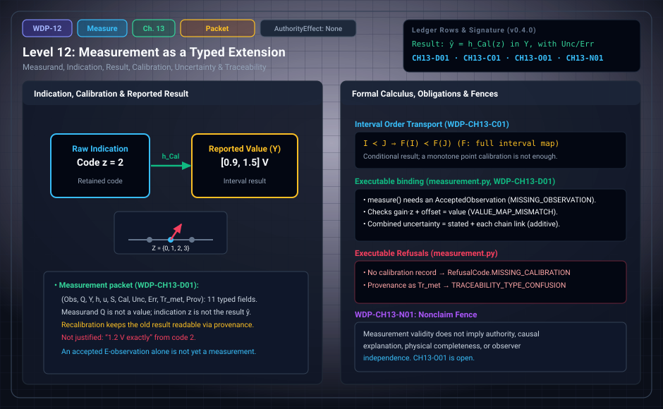

# WDP Level 12: Measurement as a Typed Extension of Observation

**AuthorityEffect:** None.  
**Level:** Level 12 (Chapter 13: Measurement as a Typed Extension of Observation)  
**Monograph Chapter:** Chapter 13, §13.1–§13.6 (Part III: Observer, observation, and measurement), *The Witnessed Difference Programme* v0.5.0.  
**Part:** Part III: Observer, Observation, and Measurement  
**Ledger Rows:** `WDP-CH13-D01` (definition), `WDP-CH13-C01` (conditional result), `WDP-CH13-O01` (conditional result), `WDP-CH13-N01` (nonclaim). The related open row `WDP-CH13-O02` is stated in §15.11 and is covered in [Level 14](level_14_traceability_provenance_receipts.md).  

---

## 1. What this level does

[Level 11](level_11_linear_sensing_projection.md) ends with an accepted E-observation: an interaction, a
registration, a typed witness, a re-comparison, and the evaluator result
`Accept`. That is not yet a measurement. Chapter 13 says what has to be added:
a statement of the quantity intended (the measurand), a separate carrier for
reported values, a map from indications to values, a unit or scale, a
versioned calibration, declared uncertainty or error semantics, and a
provenance record that lets a later evaluator replay the result.

The chapter repairs an earlier measurement draft. That draft used *authority*
where *evaluator standing* was meant, did not separate measurand from
indication, and had no calibration, uncertainty, traceability, or
instrument-response semantics (§13.1). The repair is a typed packet. It is not
a full physical theory of metrology.

---

## 2. Definitions and results

### 2.1 The finite measurement packet (§13.1)

> **`WDP-CH13-D01` — Definition (finite measurement packet).** In this
> WDP-specific interface, a finite measurement packet is the tuple
> $\mathfrak M=(\mathsf{Obs},Q,Y,h,u,\mathcal S,\mathsf{Cal},\mathsf{Unc},\mathsf{Err},\mathsf{Tr}_{\mathrm{met}},\mathsf{Prov})$,
> which keeps the accepted observation, the measurand specification, the
> reported-value carrier, uncertainty, error semantics, metrological
> traceability, and provenance distinct.

| Field | What it holds |
| :--- | :--- |
| $\mathsf{Obs}$ | an accepted E-observation receipt; a WDP-specific prerequisite, stronger than the VIM definition of measurement |
| $Q$ | the measurand specification: the quantity intended to be measured, with system, quantity kind, and stated conditions |
| $Y$ | a distinct carrier for reported values or results |
| $h$ | a map from admissible indications or records to reported values |
| $u$ | a unit or scale convention, when the value type needs one |
| $\mathcal S$ | the permitted value or partition structure |
| $\mathsf{Cal}$ | a versioned calibration record: reference values and their uncertainties, indications and their uncertainties, conditions, and the relation used to get a result |
| $\mathsf{Unc}$ | the measurement-uncertainty model and budget, when that claim is made |
| $\mathsf{Err}$ | any correction, error estimate, worst-case bound, confidence set, or result enclosure, each with its own semantics |
| $\mathsf{Tr}_{\mathrm{met}}$ | any claim of metrological traceability: a documented unbroken calibration chain, each calibration contributing to the stated uncertainty |
| $\mathsf{Prov}$ | provenance and re-access: links to the procedure, calibration version, evaluator, and raw record |

The packet is **valid relative to a profile** only when each component is
typed, the evaluator accepts its declared checks, and the result lies in the
procedure's domain.

### 2.2 Measurand, indication, result (§13.2)

Three objects are kept apart. $Q$ says what is intended; it is not a value. An
instrument produces an indication $z$; that is not the result either. A value
map and a calibration give an estimate $\hat y=h_{\mathsf{Cal}}(z)$ in $Y$. A
result pairs that estimate with an uncertainty description, not with an exact
numeral the procedure does not justify.

A finite interval $E(z)=[\hat y-\epsilon_-,\hat y+\epsilon_+]$ can be declared
as a worst-case enclosure or error bound. A confidence set can be declared
under a stated sampling model. Neither is automatically a VIM/GUM measurement
uncertainty. A claim of measurement uncertainty must state its components, its
evaluation and propagation method, any coverage convention, and its relation to
the reported result. Probabilistic uncertainty needs a probability model; it is
not read off finite witness weights.

For machine audit, §13.2 proposes that an observation or measurement packet
could be recorded in a 12-field evidential receipt (claim id, theory profile,
inputs, operation, result, witness role, assumptions, provenance, uncertainty,
falsifier, tool version, dependencies), which would keep the raw indication,
calibration lineage, and uncertainty model separate. The schema is a proposal
of the text, not a package interface: the executable `Receipt` in
`code/witnessed_difference/receipts.py` has six fields (subject, input and
output digests, claim ids, implementation version, receipt digest).

### 2.3 Calibration (§13.3)

Reference inputs $y_1,\dots,y_k$ have accepted values with stated
uncertainties and conditions; the instrument gives indications
$z_1,\dots,z_k$ with their own uncertainties. A calibration record relates
the two and records how that relation yields a result and its uncertainty. A
fitted affine curve $\hat y=az+b$ is one component of the record, not the
whole calibration. Reference, indication, model, and fit-residual
contributions go into the uncertainty or error accounts. Extrapolation outside
the calibrated range must be flagged separately.

> **`WDP-CH13-C01` — Conditional result (interval-order transport).** Write
> $I\prec J$ for compact indication intervals with $\sup I<\inf J$. Let $F$ be
> the complete declared interval map, including calibration and every
> uncertainty or error enlargement used in the report. If $F$ is
> order-preserving on the admitted range in the exact sense
> $I\prec J\Rightarrow F(I)\prec F(J)$, then ordered separated indication
> intervals yield ordered separated reported-value intervals.

**Scope of this row.** The hypothesis is about the whole interval map,
enlargements included. A monotone point calibration does not supply it. It has
to be verified, for example by an explicit gap-versus-enlargement bound.

### 2.4 Traceability, provenance, and re-access (§13.4)

These are three different properties.

- **Metrological traceability** is a property of a measurement result: a
  documented unbroken chain of calibrations to a stated reference, with every
  calibration contributing to the measurement uncertainty. It is not a hash
  chain or data lineage. The chain may end in an external standard. The
  monograph can type and check supplied finite records and their internal
  links; it does not certify an external institution, reference, or
  calibration event.
- **Provenance** records where the data came from and which transformations
  were applied.
- **Re-access** is the stronger WDP-specific ability of a later evaluator to
  retrieve the raw indication, calibration version, transformation,
  uncertainty inputs, and profile used for the report.

Neither provenance nor re-access alone establishes traceability. A number
without its provenance/re-access packet is an assertion, not a replayable
measurement result in this architecture.

### 2.5 Measurement and probability (§13.6)

Repeated measurement gives a finite table of outcomes, and
[Level 07](level_07_finite_probability_multiplicity.md) (Chapter 8) can normalize its declared weights. Reading
the table as sampling frequencies or as a stochastic instrument needs more: a
trial protocol, exchangeability or independence conditions as appropriate, and
a probability model. A single measurement packet contains none of these.

> **`WDP-CH13-O01` — Conditional result.** For sequential affine calibration stages with declared gain, offset and residual error bounds, the radius recurrence (abs(a)+alpha)r+alpha abs(x)+beta+eta contains every admissible realization without independence assumptions; nominal calibration updates have exact interval sup error abs(da x+db)+abs(da)r.
> See Appendix I and [the derivation guide](../derivation_review.md).

---

## 3. Worked example: a four-level voltage sensor (§13.5)

A finite sensor has raw codes $Z=\{0,1,2,3\}$. A calibration table maps them
to intervals in volts:

$$
0\mapsto[0.0,0.4],\quad 1\mapsto[0.4,0.9],\quad 2\mapsto[0.9,1.5],\quad 3\mapsto[1.5,2.0].
$$

1. An interaction registers code $2$. The checksum and range tests pass.
   Memory stores the raw code and the calibration hash. This much is the
   accepted E-observation.
2. The measurand is terminal voltage under the declared loading condition. It
   is fixed by $Q$, not by the reading.
3. The reported result may be the interval $[0.9,1.5]$ V. The monograph also
   allows a representative value with an explicitly derived uncertainty. The
   midpoint is $1.2$ V and the half-width $0.3$ V, so one option is $1.2$ V
   with a worst-case bound of $0.3$ V, recorded in $\mathsf{Err}$; by §13.2
   that bound is not thereby a GUM uncertainty. Reporting "$1.2$ V exactly"
   is not justified.
4. A new calibration maps code $2$ to $[1.0,1.6]$ V. The old result stays
   interpretable, because its provenance/re-access packet names the old
   calibration version. A policy may request re-evaluation, but the new table
   does not change the stored raw code.
5. Whether either result is metrologically traceable is a separate question.
   It requires checking its calibration hierarchy and uncertainty
   contributions.

**A check on `WDP-CH13-C01` (our observation, not a ledger row).** The table
is monotone: higher codes give higher intervals. But neighbouring intervals
share an endpoint. For the singleton indication intervals $\{1\}\prec\{2\}$,
the reports are $[0.4,0.9]$ and $[0.9,1.5]$, and $0.9<0.9$ fails, so
$F(\{1\})\not\prec F(\{2\})$. The hypothesis of `WDP-CH13-C01` therefore fails
on the admitted range $\{0,1,2,3\}$. It holds on a range such as $\{0,2\}$ or
$\{1,3\}$, where the reported intervals are strictly separated
($0.4<0.9$ and $0.9<1.5$). This is the §13.3 caveat in concrete form:
monotone point data do not by themselves give separated reports.

---

## 4. Evidence bindings

Paths are relative to the monograph package
[`witnessed_difference_programme/`](/atlas/papers/finite_obstruction_calculus/witnessed_difference_programme/).

| Row | Status | Ledger evidence | Lean | Executable binding | Notebook |
| :--- | :--- | :--- | :--- | :--- | :--- |
| `WDP-CH13-D01` | Definition | P; C | none exact; `MeasurementPacket` in `lean4/WitnessedDifference/Measurement.lean` is a strictly narrower packet, per `CLAIM_MAP.md` | `code/witnessed_difference/measurement.py`, tested by `code/unit_tests/test_observation_measurement.py`, `code/integration_tests/test_observer_measurement_pipeline.py`, `code/injection_tests/test_mutation_recovery.py` | `040_observation_to_measurement.ipynb` |
| `WDP-CH13-C01` | Conditional result | P | none; `CLAIM_MAP.md` says interval-order transport is not formalized, and `MeasurementPacket.uncertainty_fields_nonnegative` proves only a narrower nonnegativity obligation | none | none |
| `WDP-CH13-O01` | Conditional result | P; C; N | no full-row Lean proof | calibration_composition.py; omega_measurement::affine_calibration; omega_wdp::calibration_adapter | Appendix I; current supplement |
| `WDP-CH13-N01` | Nonclaim | P; C | none | `code/witnessed_difference/measurement.py`: a `Measurement` cannot carry an authority effect; tested by `code/unit_tests/test_observation_measurement.py` | `040_observation_to_measurement.ipynb` |

**What the executable binding checks.** `measure(...)` in `measurement.py`
returns either an accepted `Measurement` or a `Refused` outcome. It checks the
fields in a fixed order and refuses with:

- `RefusalCode.MISSING_OBSERVATION` when the first argument is not an
  `AcceptedObservation` (a bare attempt receipt is refused); refusals from
  `classify_observation` pass through, for example `CLAIM_STATUS_FIREWALL`
  for a receipt whose authority field was tampered;
- `MISSING_MEASURAND` (empty quantity or system), `MISSING_REPORTED_VALUE`,
  and `MISSING_VALUE_MAP`;
- `VALUE_MAP_MISMATCH` when the map does not bind the registered and reported
  carriers, or when gain times indication plus offset differs from the
  reported value;
- `MISSING_SCALE`, `MISSING_UNIT`, `MISSING_CALIBRATION`; `ADAPTER_MISMATCH`
  when the calibration names another scale; `EVALUATOR_MISMATCH` when
  calibration and observation use different evaluators;
- `MISSING_PROVENANCE`; and for the traceability chain,
  `TRACEABILITY_TYPE_CONFUSION` when a `Provenance` object is offered in its
  place, `MISSING_TRACEABILITY`, `BROKEN_TRACEABILITY` (a link that does not
  continue the chain, a cycle, or the wrong terminal reference), and
  `MISSING_CHAIN_UNCERTAINTY` (a link with no uncertainty or a negative one);
- `INVALID_UNCERTAINTY` for a negative or inexact stated uncertainty, or a
  combination rule other than `additive_upper_bound`; `INVALID_INPUT` for
  inexact scalars, floats included; `OUT_OF_RANGE` and `OFF_GRID` when the
  corrected value lies outside the scale or off its resolution grid.

An accepted packet carries a combined uncertainty equal to the stated
uncertainty plus each chain link's contribution. The module declares this
additive upper bound as package data, not as a general metrology formula. In
notebook 040's packet, a display reading of $12$ with calibration correction
$\tfrac12$ gives $\tfrac{25}{2}$ V, and a stated uncertainty of $\tfrac14$ plus
one link of $\tfrac1{10}$ gives $\tfrac{7}{20}$ V; the notebook's result cell
states the same two values.

The module differs from the definition in three ways; `claim_code_map.json`
records the first two in its description of `WDP-CH13-D01`. It has no separate
$\mathsf{Err}$ field: its only correction term sits in the calibration record.
It is stricter where the definition is conditional: it requires a
traceability chain and a stated uncertainty for every measurement, while the
definition asks for them only when those metrological claims are made. And it
checks only the shape of a supplied chain; it does not authenticate an
external certificate. A stated uncertainty of $0$ is accepted; only negative
values are refused.

---

## 5. Misreadings the chapter rules out

- **An exact numeral from a coarse code.** Code $2$ supports the interval
  $[0.9,1.5]$ V, not "$1.2$ V exactly" (§13.5).
- **An error bound read as an uncertainty.** A worst-case enclosure or a
  confidence set is not automatically a VIM/GUM measurement uncertainty
  (§13.2). Chapter 15 adds that mixing a worst-case bound with a standard
  deviation without an adapter is a type error (§15.7, [Level 14](level_14_traceability_provenance_receipts.md)).
- **Provenance read as traceability.** A hash chain or data lineage is not
  metrological traceability (§13.4). The module refuses the substitution with
  `TRACEABILITY_TYPE_CONFUSION`.
- **A monotone calibration read as order transport.** `WDP-CH13-C01` needs
  order preservation of the full interval map, enlargements included (§13.3).
  Section 3 shows neighbouring codes where it fails.
- **Recalibration read as rewriting the past.** A new table does not alter the
  stored raw code; the old result stays interpretable through its provenance
  (§13.5).
- **Uncertainty read off witness weights.** Probabilistic uncertainty needs a
  probability model, and a frequency reading of repeated outcomes needs a
  trial protocol and exchangeability or independence conditions (§13.2,
  §13.6).
- **Acceptance read as measurement.** An accepted E-observation still lacks
  the measurand, value map, unit, calibration, uncertainty, and provenance
  fields (§12.4). The falsifier list in §21.5 says measurement validity fails
  when any of these is absent, and a traceability claim fails when the
  documented calibration hierarchy or any calibration's uncertainty
  contribution is absent.
- **Internal checks read as certification of an external standard.** The
  monograph checks supplied finite records; it does not certify an
  institution, reference, or calibration event (§13.4).

---

## 6. Nonclaims

- **`WDP-CH13-N01`.** Measurement validity does not imply authority, causal
  explanation, physical completeness, or observer independence.

The consolidated list in §21.7 repeats one part of this: the monograph does
not claim that a measurement packet is observer-independent (item 9).

**Current statuses.**

- **`WDP-CH13-O01`** (conditional result): For sequential affine calibration stages with declared gain, offset and residual error bounds, the radius recurrence (abs(a)+alpha)r+alpha abs(x)+beta+eta contains every admissible realization without independence assumptions; nominal calibration updates have exact interval sup error abs(da x+db)+abs(da)r.
- **`WDP-CH13-O02`** (finite proposition): The declared finite registration/witness/measurement instance replays the retained indication, composed affine map, correction and uncertainty enclosure against separate re-access data; altered records, understated uncertainty and rehashed false enclosures are rejected.

---

## 7. Claim discipline

1. **What this level supports:** an eleven-field typed measurement packet that
   keeps observation, measurand, reported value, calibration, uncertainty,
   error semantics, traceability, and provenance apart; the conditional
   result `WDP-CH13-C01` under its interval-order hypothesis; and an
   executable check that refuses packets which omit or confuse these fields.
2. **What it does not support:** a full physical theory of metrology,
   certification of any external reference or calibration event, composed
   uncertainty outside the declared affine error model, a probabilistic reading of repeated
   outcomes without a declared model, or any authority, causal, completeness,
   or observer-independence claim.
3. **Narrowest defensible claim:** in this interface, a reported number is a
   measurement result only together with its measurand, result carrier, value
   map, calibration version, declared uncertainty or error semantics, and
   provenance/re-access record; without them it is an assertion.
4. **Next exercise:** replay the declared finite result and its negative
   controls listed in [the derivation guide](../derivation_review.md), then change
   one hypothesis and identify which conclusion still follows.

---

---

## Current finite derivation and Rust integration

Sequential affine calibration propagates center x and radius r by x′ = ax+b and r′ = (abs(a)+alpha)r+alpha abs(x)+beta+eta. The proof permits dependent errors. A nominal calibration update has exact interval supremum abs(da x+db)+abs(da)r. omega_measurement::affine_calibration owns the kernel interval algebra; omega_wdp::calibration_adapter independently binds the actual input and every ordered stage to the receipt.

See Appendix I and [the derivation guide](../derivation_review.md) for exact
claim statuses, test results and the runnable Rust example.

---

## Navigation

- **Previous:** [Level 11: The Observation Ladder](level_11_linear_sensing_projection.md)
- **Next:** [Level 13: Self-Reference and the Awareness Boundary](level_13_self_reference_gaps_fixed_points.md)
- **Levels Index:** [README.md](README.md)
