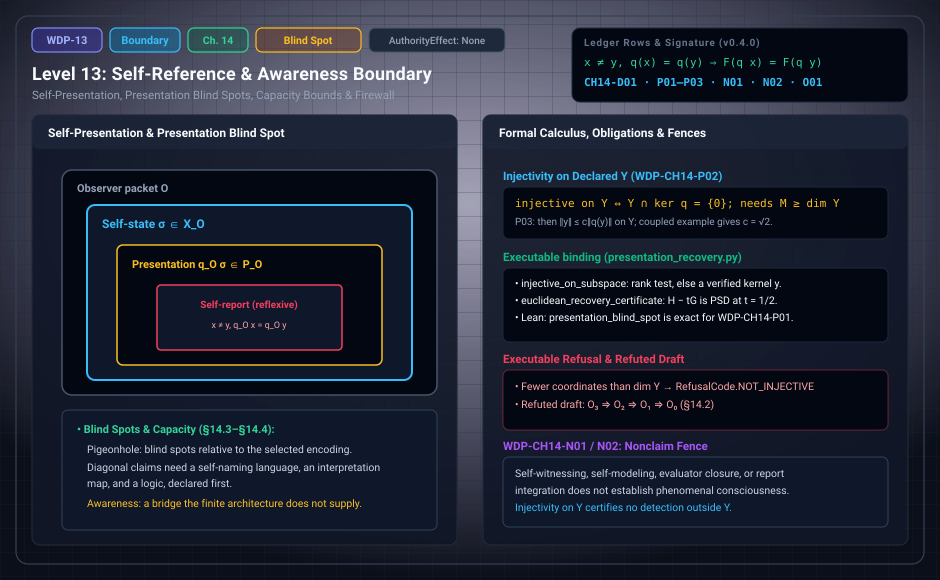

# WDP Level 13: Self-Reference and the Awareness Boundary

**AuthorityEffect:** None.  
**Level:** Level 13 (Chapter 14: Self-Reference and the Awareness Boundary)  
**Monograph Chapter:** Chapter 14, §14.1–§14.5 (Part III: Observer, observation, and measurement), *The Witnessed Difference Programme* v0.4.0.  
**Part:** Part III: Observer, Observation, and Measurement  
**Ledger Rows:** `WDP-CH14-D01` (definition), `WDP-CH14-P01`, `WDP-CH14-P02`, `WDP-CH14-P03` (finite propositions), `WDP-CH14-N01`, `WDP-CH14-N02` (nonclaims), `WDP-CH14-O01` (finite supplement).  

---

## 1. What this level does

An observer can take part of its own state as input. Chapter 14 asks what
finite mathematics says about that, and the answer is modest. A self-report is
an ordinary report whose provenance path loops back to the observer. Its limits
are the limits of the presentation map: when the map identifies two inputs, no
evaluator that sees only the presentation can tell them apart. For linear
presentations the chapter makes this quantitative. It says exactly when a
declared subspace can be recovered, how many report coordinates that takes,
and with what constant.

The chapter also withdraws an earlier claim. A draft hierarchy of
self-observation levels, $O_3\Rightarrow O_2\Rightarrow O_1\Rightarrow O_0$,
is a refuted draft. Finally, the chapter reserves the word *awareness* for a
bridge that the finite architecture does not supply.

---

## 2. Definitions and results

### 2.1 Self-presentation (§14.1)

The notation comes from [Level 09](level_09_behavioral_quotients_finite_states.md): an observer presentation has an
input carrier $X_{\mathcal O}$, a presentation carrier $P_{\mathcal O}$, and a
presentation map $q_{\mathcal O}:X_{\mathcal O}\to P_{\mathcal O}$
(`WDP-CH10-D01`). Let $\sigma$ encode the accessible self-state as an element
of $X_{\mathcal O}$; then $q_{\mathcal O}\sigma$ is its presentation, and a
self-report is an ordinary report with a reflexive provenance path.

> **`WDP-CH14-D01` — Definition (self-witnessing event).** A self-witnessing
> event is an accepted E-observation whose target proposition concerns a typed
> component of the same observer packet and whose provenance/re-access record
> exhibits that reflexive target.

The definition uses no phenomenological vocabulary. A program that checks its
own version hash is a simple instance. It witnesses a proposition about an
accessible representation, not every fact about itself.

### 2.2 The refuted implication ladder (§14.2)

An earlier draft printed a hierarchy of the form
$O_3\Rightarrow O_2\Rightarrow O_1\Rightarrow O_0$. As stated, its levels mixed
incompatible context actions, and in some models $O_0$ and $O_1$ were
contrary. The universal ladder is a **refuted draft**, not a theorem.

The repair uses independent predicates joined by explicit bridges:

- $R_1$: a self-report is linked to an accessible self-state;
- $R_2$: the report stays stable under a declared context transport;
- $R_3$: an evaluator can compare the report with later behavior or state.

Each bridge can fail independently. A total implication theorem would need
explicit bridge hypotheses; Appendix J now gives the full declared finite classifications and original R1/R2/R3 availability and success criteria for `WDP-CH14-O01`. Chapter 15 gives a finer repaired
hierarchy for self-model calibration (§15.9, [Level 14](level_14_traceability_provenance_receipts.md)).

### 2.3 Blind spots (§14.3)

> **`WDP-CH14-P01` — Finite proposition (presentation blind spot).** If
> $x\ne y$ but $q_{\mathcal O}(x)=q_{\mathcal O}(y)$, then every function
> $F:P_{\mathcal O}\to Z$ assigns the same output to the presentations of $x$
> and $y$.

The proof is one line: $F(q_{\mathcal O}(x))=F(q_{\mathcal O}(y))$ because the
arguments are equal. The Lean declaration
`WitnessedDifference.presentation_blind_spot` states this for arbitrary types
of states, reports, and outputs and proves it by `congrArg`. The distinctness
hypothesis appears in the statement but the proof does not use it; it is what
makes the pair a blind spot rather than a single point.

A blind spot is a pair of distinct inputs with the same presentation, that is,
a nontrivial fibre of $q_{\mathcal O}$. It compares inputs with inputs. It is
not a state that differs from its own model: that comparison is not even well
typed, because a presentation lives in $P_{\mathcal O}$ and a state in
$X_{\mathcal O}$.

The monograph calls this factorization fact a precise limit on self-knowledge
*in the model*. It is not the philosophical hard problem, and it does not imply
that a human or machine lacks awareness.

### 2.4 Capacity and diagonal questions (§14.4)

- **Pigeonhole.** A finite observer with a finite report alphabet cannot
  injectively encode an arbitrarily large state space, so pigeonhole
  arguments give blind spots *relative to the selected encoding*. The finite
  statement is `WDP-CH10-P03` in [Level 09](level_09_behavioral_quotients_finite_states.md), mechanized as
  `grammar_resolution_bound`.
- **Diagonal arguments.** Stronger diagonal or self-reference results need a
  language that can name its own reports, an interpretation map, and a logic.
  The monograph requires these to be listed before Gödelian language is used.
  Chapter 14 supplies none of them and proves no diagonal theorem.
- **Frauchiger–Renner-style scenarios** can serve as adversarial tests for
  context mixing in a quantum host. They are not evidence for a general
  awareness theorem, and no protocol or proof from that work is imported.

Linear presentations make the capacity bound quantitative. Let
$q:V\to\mathbb F^M$ be a linear presentation map on a finite-dimensional space
$V$, and let $Y\subseteq V$ be a declared target subspace. $Y$ is a target, not
a defect: in [Level 03](level_03_discrete_complex_cochains.md) the image of $d_0$ is the repair image, and a
quotient observer is built to be blind to it (`WDP-CH10-D06`).

> **`WDP-CH14-P02` — Finite proposition (injectivity on a declared
> subspace).** A linear presentation map $q$ on a finite-dimensional space is
> injective on a declared subspace $Y$ exactly when $Y$ meets $\ker q$ only in
> $0$. This requires at least $\dim Y$ report coordinates, and with fewer,
> exact elimination over the coefficient field exhibits a nonzero $y\in Y$
> with $q(y)=0$.

*Why.* $q(y)=q(y')$ with $y,y'\in Y$ means $q(y-y')=0$, so injectivity on $Y$
is the condition $Y\cap\ker q=\{0\}$. By rank–nullity,
$\dim(Y\cap\ker q)\ge\dim Y-M$, so $M<\dim Y$ forces a nonzero kernel vector,
and Gaussian elimination on $q$ restricted to a basis of $Y$ produces one.

> **`WDP-CH14-P03` — Finite proposition (recovery bound).** If a linear
> presentation map $q$ is injective on a finite-dimensional declared subspace
> $Y$, and norms are declared on $Y$ and on reports, over $\mathbb R$ or
> $\mathbb C$, or over $\mathbb Q$ as restrictions of norms on the real
> extensions, then some $c>0$ satisfies $\|y\|\le c\|q(y)\|$ for every
> $y\in Y$. A report perturbed by $\eta$ with $\|\eta\|\le\varepsilon$ still
> gives $\|y\|\le c(\|q(y)+\eta\|+\varepsilon)$.

**Scope of this row.** The norm hypothesis is needed. With $Y=\mathbb Q^2$,
$q$ the identity, the $L^1$ norm on $Y$, and the report norm
$|r_1+\sqrt2\,r_2|$, no constant exists: that report norm is a norm on
$\mathbb Q^2$ but not the restriction of a norm on $\mathbb R^2$, and rational
reports can make $|r_1+\sqrt2\,r_2|$ as small as desired while $|r_1|+|r_2|$
stays at least $1$.

**Euclidean constants.** For Euclidean norms and a basis matrix $V$ of $Y$
with Gram matrix $G=V^TV$, the best constant is $c=1/\sqrt t$ for the largest
$t$ with $V^Tq^TqV-tG\succeq0$. An exact $LDL^T$ factorization certifies a
rational lower bound on $t$. The exact Rayleigh quotient of a rational vector
bounds $t$ only from above, so it bounds the best constant from below and
cannot certify a recovery constant.

**Probe cost.** If every probe contributes one report coordinate at a declared
positive cost, a suite that is injective on $Y$ costs at least the sum of the
$\dim Y$ cheapest probes. This follows from `WDP-CH14-P02` and is stated in the
prose after the row.

### 2.5 The awareness firewall (§14.5)

The monograph reserves **awareness** for a bridge that the present finite
architecture does not supply. Functional self-report, global availability,
integration, and higher-order representation may be compared with theories of
consciousness (the monograph cites integrated information theory,
higher-order thought, self-representational theories, global workspace, and
the meta-problem), but no equivalence is asserted. The nonclaim
`WDP-CH14-N01` in Section 6 states the firewall.

> **`WDP-CH14-O01` — Finite proposition (declared functional bridges).** For independently declared finite presentation, report, context and calibration maps, factorization and stability have the complete implication classification of Appendix J. Explicit accessible self-state, reflexive provenance, later-state and partial comparison maps separately classify linkage, stability, comparison availability and comparison success; later-target and successful linked-report existence are exact fiber-constancy questions. No phenomenology premise occurs.

---

## 3. Worked example: the coupled two-edge carrier (§14.4)

Take $V=\mathbb Q^4$ with coordinates $(y_0,y_1,y_2,y_3)$, read as two edges
$(y_0,y_1)$ and $(y_2,y_3)$, and the declared subspace
$Y=\{(s_0,s_1,s_0,s_1)\}$ with basis $v_1=(1,0,1,0)$, $v_2=(0,1,0,1)$. So
$\dim Y=2$.

1. **One coordinate read alone.** Let $q_A(y)=y_0$. Then $M=1<2=\dim Y$, and
   $(0,1,0,1)\in Y$ has $q_A(0,1,0,1)=0$. The inputs $(0,0,0,0)$ and
   $(0,1,0,1)$ are distinct and share a presentation, so by `WDP-CH14-P01` no
   evaluator of $q_A$ separates them. Likewise $q_B(y)=y_3$ has the kernel
   vector $(1,0,1,0)$ in $Y$. Each read has a nontrivial kernel on its own.
2. **Both reads together.** Let $q(y)=(y_0,y_3)$. On $Y$ this is
   $(s_0,s_1)$, so $q$ is injective on $Y$, with $M=2=\dim Y$.
3. **The recovery constant.** On $Y$, $\|y\|_2^2=2s_0^2+2s_1^2$ and
   $\|q(y)\|_2^2=s_0^2+s_1^2$, so $\|q(y)\|_2^2=\tfrac12\|y\|_2^2$ and
   $\|y\|_2=\sqrt2\,\|q(y)\|_2$. In Gram form: $qV=I_2$, so
   $V^Tq^TqV=I_2$ and $G=V^TV=2I_2$, and $I_2-tG=(1-2t)I_2\succeq0$ exactly
   when $t\le\tfrac12$. The best $t$ is $\tfrac12$ and $c=1/\sqrt t=\sqrt2$.
4. **Outside $Y$.** The vector $x=(0,1,-1,0)$ is not in $Y$ and has
   $q(x)=(0,0)$. It is invisible to $q$, and injectivity on $Y$ says nothing
   about it. This is `WDP-CH14-N02` in miniature.

**Executable check (package functions on this carrier).**
`injective_on_subspace` accepts $q$ and refuses $q_A$ with `RefusalCode.NOT_INJECTIVE`, reporting the witness
$(0,1,0,1)$. `euclidean_recovery_certificate` certifies $t=\tfrac12$ and
refuses $t=\tfrac{51}{100}$ with `NOT_POSITIVE_SEMIDEFINITE`, exhibiting
$y=(1,0,1,0)$ with $\|qy\|^2=1<\tfrac{51}{100}\cdot2=\tfrac{51}{50}$.
`detection_scope` refuses $x=(0,1,-1,0)$ with `SCOPE_VIOLATION`. For the
noisy bound we chose $y=(1,2,1,2)$, $\eta=(\tfrac1{10},0)$, and
$\varepsilon=\tfrac1{10}$; then the report is $r=(\tfrac{11}{10},2)$,
$\|y\|^2=10$, $\|r\|^2=\tfrac{521}{100}$, and
$\sqrt{10}\approx3.162\le\sqrt2\,(\sqrt{5.21}+0.1)\approx3.369$, which
`noisy_recovery_bound` confirms exactly. The noise values are this page's
choice, not the monograph's.

---

## 4. Evidence bindings

Paths are relative to the monograph package
[`witnessed_difference_programme/`](/atlas/papers/finite_obstruction_calculus/witnessed_difference_programme/).

| Row | Status | Ledger evidence | Lean | Executable binding | Notebook |
| :--- | :--- | :--- | :--- | :--- | :--- |
| `WDP-CH14-D01` | Definition | P | none; `CLAIM_MAP.md` lists it among definition rows without an exact declaration | none | none |
| `WDP-CH14-P01` | Finite proposition | P; L:exact | `WitnessedDifference.presentation_blind_spot` in `lean4/WitnessedDifference/Observer.lean`; mechanized in Lean, and `axiom_report.txt` lists no axioms for it | none | none |
| `WDP-CH14-P02` | Finite proposition | P; C | none; prose-only in `CLAIM_MAP.md` | `code/witnessed_difference/presentation_recovery.py`, tested by `code/unit_tests/test_presentation_recovery.py` and `code/integration_tests/test_absorbed_finite_propositions.py` | none |
| `WDP-CH14-P03` | Finite proposition | P; C | none; prose-only in `CLAIM_MAP.md` | `presentation_recovery.py`, tested as for P02 and by `code/injection_tests/test_mutation_recovery.py`; Euclidean norms over $\mathbb Q$ only | none |
| `WDP-CH14-N01` | Nonclaim | P | none | none | none |
| `WDP-CH14-N02` | Nonclaim | P; C | none | `presentation_recovery.py` (`detection_scope`, `promote_presentation_evidence`), tested as for P03 | none |
| `WDP-CH14-O01` | Finite proposition | P; C; N; L:partial (standalone supplement) | partial Lean coverage; see derivation guide | `code/self_reference_bridges.py`; native owners in derivation guide | none |

**What the executable binding checks.** All computation in
`presentation_recovery.py` is exact over $\mathbb Q$.

- `injective_on_subspace(q_rows, basis)` accepts when $q$ has full rank on the
  declared basis of $Y$. Otherwise it refuses with
  `RefusalCode.NOT_INJECTIVE` and a nonzero kernel vector in $Y$ that
  `verify_kernel_witness` has re-checked. `kernel_witness` refuses with
  `NO_WITNESS` when $q$ is injective on $Y$.
- `euclidean_recovery_certificate` certifies $\|qy\|^2\ge t\|y\|^2$ on $Y$
  through an exact congruence certificate that $H-tG$ is positive
  semidefinite, and otherwise refuses with `NOT_POSITIVE_SEMIDEFINITE` and a
  violating vector. `verify_recovery_certificate` recomputes both Gram
  matrices and the congruence.
- `noisy_recovery_bound` checks the noisy inequality exactly by squaring; it
  refuses with `OUT_OF_RANGE` when $\|\eta\|^2>\varepsilon^2$ and with
  `OUTSIDE_CARRIER` when the vector is not in $Y$.
- `suite_cost_lower_bound` checks the probe-cost bound by enumerating every
  subset of a declared probe family, budgeted to 12 probes
  (`BUDGET_EXHAUSTED` beyond that; `SCOPE_VIOLATION` for a probe with more
  than one row; `INFEASIBLE` when no subset is injective on $Y$).
- `detection_scope` refuses any input outside $Y$ with `SCOPE_VIOLATION`, and
  `promote_presentation_evidence` refuses every attempt to treat presentation
  evidence as detection of unmodeled behavior or as selecting, pricing, or
  authorizing a sensor suite, also with `SCOPE_VIOLATION`.

The executable check covers Euclidean norms over $\mathbb Q$ only. The general
norm statement of `WDP-CH14-P03` rests on the prose proof.

---

## 5. Misreadings the chapter rules out

- **"Every finite observer has a blind spot about itself."** This is not
  proved. `WDP-CH14-P01` needs a displayed pair $x\ne y$ with equal
  presentations, and pigeonhole gives such a pair only relative to a selected
  encoding that is too small. Step 2 of Section 3 is a presentation with no
  blind spot on $Y$.
- **A blind spot as a state unequal to its model.** A blind spot compares two
  inputs through one presentation map. A model output and a state live in
  different carriers, so "$\mathrm{Model}(s)\ne s$" is not a well-typed
  condition here.
- **Diagonal name-dropping.** Diagonal or self-reference results need a
  self-naming language, an interpretation map, and a logic, listed first
  (§14.4). None is supplied, and no diagonal theorem is claimed.
- **The implication ladder.** $O_3\Rightarrow O_2\Rightarrow O_1\Rightarrow O_0$
  is a refuted draft; its replacement predicates $R_1,R_2,R_3$ are
  independent (§14.2).
- **Frauchiger–Renner as evidence.** Such scenarios are adversarial tests for
  context mixing in a quantum host, not evidence for an awareness theorem
  (§14.4).
- **A Rayleigh quotient as a certificate.** It bounds $t$ from above and so
  cannot certify a recovery constant; an exact $LDL^T$ factorization can
  (§14.4).
- **Recovery on $Y$ read as detection everywhere.** Injectivity on $Y$ says
  nothing about inputs outside $Y$ (Section 3, step 4).
- **A blind spot read as the hard problem.** The factorization fact limits
  self-knowledge in the model; it says nothing about whether a human or
  machine is aware (§14.3).

The falsifier list in §21.5 states the positive form: a self-knowledge
completeness claim fails whenever the presentation map has a displayed
nontrivial fibre.

---

## 6. Nonclaims

- **`WDP-CH14-N01`.** Self-witnessing, self-modeling, evaluator closure, or
  report integration does not establish phenomenal consciousness.
- **`WDP-CH14-N02`.** Injectivity of a presentation map on a declared subspace
  does not detect inputs outside that subspace, does not certify detection of
  unmodeled or adversarial behavior, and does not select, price, or authorize
  a sensor suite.

The consolidated list in §21.7 adds that the monograph does not claim that
self-reference proves awareness (item 15). The front-matter row
`WDP-CH00-N02` also applies: the monograph does not identify a formal witness
with experience, consciousness, agency, or moral status.

**Finite supplement.** These finite targets are answered under the explicit hypotheses in Appendix J. See [the current derivation guide](../derivation_review.md) for complete statements, counterexamples, native ownership and partial Lean coverage.

---

## 7. Claim discipline

1. **What this level supports:** the presentation blind-spot fact
   `WDP-CH14-P01`, mechanized in Lean; the injectivity criterion
   `WDP-CH14-P02` and the recovery bound `WDP-CH14-P03` on declared
   finite-dimensional subspaces, with exact executable checks in the Euclidean
   case over $\mathbb Q$; and a firewall between self-presentation and
   awareness.
2. **What it does not support:** that every finite observer has a blind spot
   about itself; any diagonal or Gödelian theorem; any claim about
   awareness or consciousness, or their absence; detection outside a declared
   subspace; or the selection, pricing, or authorization of a sensor suite.
3. **Narrowest defensible claim:** an evaluator that reads only a presentation
   cannot separate inputs that the presentation identifies, and a linear
   presentation that is injective on a declared subspace recovers inputs in
   that subspace with a finite constant while certifying nothing outside it.
**Finite supplement.** These finite targets are answered under the explicit hypotheses in Appendix J. See [the current derivation guide](../derivation_review.md) for complete statements, counterexamples, native ownership and partial Lean coverage.

---

---

## Expert derivation supplement (2026-10-01)

- **CH14-O01 — Finite proposition.** For independently declared finite presentation, report, context and calibration maps, factorization and stability have the complete implication classification of Appendix J. Explicit accessible self-state, reflexive provenance, later-state and partial comparison maps separately classify linkage, stability, comparison availability and comparison success; later-target and successful linked-report existence are exact fiber-constancy questions. No phenomenology premise occurs.

The original 154 identifiers are preserved. The historical Lean census is unchanged; new standalone proofs, native replay and source custody are described in [the derivation guide](../derivation_review.md). Physical interpretation, Born selection and authority remain separate assumptions.

---

## Navigation

- **Previous:** [Level 12: Measurement as a Typed Extension of Observation](level_12_context_interference_state_spaces.md)
- **Next:** [Level 14: Authority is a Separate Layer](level_14_traceability_provenance_receipts.md)
- **Levels Index:** [README.md](README.md)
