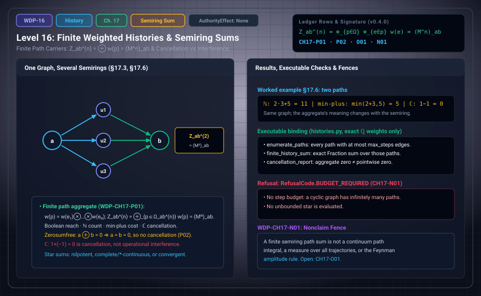

# WDP Level 16: Finite Weighted Histories

**AuthorityEffect:** None.  
**Level:** Level 16 (Chapter 17: Finite Weighted Histories)  
**Monograph Chapter:** Chapter 17, §17.1–§17.6 (Part IV: Histories and the quantum boundary), *The Witnessed Difference Programme* v0.5.0.  
**Part:** Part IV: Histories and the Quantum Boundary  
**Ledger Rows:** `WDP-CH17-P01` (finite proposition), `WDP-CH17-P02` (conditional result), `WDP-CH17-O01` (finite proposition), `WDP-CH17-N01` (nonclaim). The row `WDP-CH17-P03` carries this chapter's prefix but lives in Chapter 19 (§19.7); see section 2.6 below.  

---

## 1. What this level does

A history is a path, not an instantaneous state. Chapter 17 fixes a finite
carrier of paths, weights each path in a declared semiring, and aggregates the
weights. Its structural result is that the fixed-length aggregate is an entry
of a matrix power. It then shows that the same formula means different
things in different semirings: reachability, path count, optimal cost, or
amplitude-like cancellation.

Two limits run through the chapter. Every sum is finite, and an all-length sum
needs a stated extra hypothesis. And cancellation, meaning a sum of nonzero
terms that equals zero, is an algebraic event. The monograph reserves the word
*interference* for a model that also has alternatives, phase-sensitive
addition, and an operational readout (§19.8). Chapter 17 is about cancellation.

---

## 2. Definitions and results

### 2.1 Path carrier (§17.1)

Let $G=(V,E)$ be a finite directed graph with a declared admissibility
predicate on paths. For vertices $a,b$, let $\Omega_{a,b}^{(n)}$ be the finite
set of admissible paths of length $n$ from $a$ to $b$.

A length cutoff $n\le N$ gives a finite set, but the union of length-bounded
paths is not generally closed under concatenation: two paths of length at most
$N$ can concatenate to a path longer than $N$. So the bounded family is not a
category unless the composition law is restricted or the graph is suitably
acyclic.

### 2.2 Semiring weights (§17.2)

Let $(R,\oplus,\otimes,0,1)$ be a declared semiring with edge weights
$w:E\to R$. A path $p=e_1\cdots e_n$ has weight
$w(p)=w(e_1)\otimes\cdots\otimes w(e_n)$, and the empty path has weight $1$.
The finite length-$n$ history aggregate is

$$
Z_{a,b}^{(n)}=\bigoplus_{p\in\Omega_{a,b}^{(n)}}w(p).
$$

> **`WDP-CH17-P01` — Finite proposition (matrix path sum).** For the full family
> of directed graph paths of length $n$ in the stated graph, with weighted
> adjacency matrix $M$ and conventional ordered multiplication matching path
> composition, $(M^n)_{a,b}=Z_{a,b}^{(n)}$.

The proof is an induction on $n$ that distributes over the last edge of every
length-$(n+1)$ path.

**Scope: admissibility.** The row is about the *full* family of length-$n$
paths. If an admissibility predicate is compiled into a finite augmented-state
graph, let $\lambda_a$ be the declared row of admissible augmented start states
over $a$ and $\rho_b$ the declared column of accepting augmented end states
over $b$, including any start and end weights. If augmented paths are in
weight-preserving bijection with admissible original paths, the aggregate is
$\lambda_aM^n\rho_b$, generally a weighted block sum and not a single entry. An
arbitrary path-global predicate is not counted by a matrix power unless such a
finite-state compilation and endpoint maps are supplied.

**Scope: all-length sums.** The row is about one fixed length. In the
monograph's words, an all-length sum $I\oplus M\oplus M^2\oplus\cdots$ requires
nilpotence or a finite acyclic truncation, a complete or $*$-continuous
semiring, or an analytic convergence structure. A bare Conway/Kleene star
operation can define an algebraic $M^*$ without identifying it with that
countable indexed sum, and a bare semiring does not evaluate the infinite
series.

### 2.3 Families of meaning (§17.3)

| Semiring | Reading of the path formula |
| :--- | :--- |
| Boolean | reachability |
| natural numbers | path count |
| nonnegative reals | positive path weight |
| tropical min-plus | optimal cost |
| complex numbers | amplitude-like cancellation, after complex structure is declared |

Changing the semiring changes the theory. A proof over the nonnegative reals
cannot be advertised as a theorem about complex interference without a
transport argument.

### 2.4 Cancellation and zerosumfree carriers (§17.4)

A semiring is **zerosumfree** when $a\oplus b=0$ implies $a=b=0$. In such a
carrier, nonzero path contributions cannot add up to zero.

> **`WDP-CH17-P02` — Conditional result.** In a zerosumfree semiring, a finite
> sum is zero only if every summand is zero. The binary property extends by
> induction on the number of summands, using associativity.

Concretely, if $a_1\oplus\cdots\oplus a_n=0$, associativity writes the sum as
$(a_1\oplus\cdots\oplus a_{n-1})\oplus a_n=0$; zerosumfreeness gives $a_n=0$
and a zero sum of $n-1$ terms, and induction finishes. The hypothesis that does
the work is zerosumfreeness.

Complex numbers are not zerosumfree: $1+(-1)=0$. That cancellation is a
necessary ingredient for some amplitude phenomena, but it is not sufficient
for quantum theory. Quadratic readout, tensor composition, contextual
structure, and dynamics remain separate. From the definition, the Boolean,
natural-number, nonnegative-real, and min-plus carriers of section 2.3 are
zerosumfree (the min-plus zero is $+\infty$, and $\min(a,b)=+\infty$ forces
$a=b=+\infty$); the complex carrier is not.

### 2.5 Obstruction action and history dependence (§17.5)

Suppose a local action assigns $A(e)\in\mathbb R$ to each edge, with
$A(p)=\sum_{e\in p}A(e)$ and $w_\beta(p)=e^{-\beta A(p)}$. This is a declared
positive-real weighting.

- If $A=d_0f$ on edges, then $A(p)=f(b)-f(a)$ depends only on the endpoints,
  so all $a$-to-$b$ paths have equal weight.
- Nonzero periods can make the weighting genuinely history-dependent.
- The converse needs care: equal weights at one chosen $\beta$ may hide action
  differences if the exponential is noninjective in another coefficient
  system. Over real exponentials with $\beta\ne0$, equal weights imply equal
  actions.

This section has no ledger row.

### 2.6 Coarse-graining: the resolved finite target (§17.6, §19.7)

> **`WDP-CH17-O01` — Finite proposition.** For a finite rational row-source transition matrix and a nonempty block partition, representative-independent endpoint-block path sums at every finite length exist exactly when outgoing block sums are constant within each source block, equivalently M H = H B; B is unique and finite partition enumeration is exhaustive.
> See Appendix I and [the derivation guide](../derivation_review.md).

After the row, the monograph records a partial characterization. For a
partition $\{V_1,\dots,V_k\}$ of $V$, the representative-independent
outgoing-block condition asks that $\bigoplus_{v\in V_J}M_{u,v}$ be the same
value $\bar M_{I,J}$ for every $u\in V_I$; in matrix form this is
$MP^{T}=P^{T}\bar M$, where $P_{I,u}=1$ exactly when $u\in V_I$. The monograph
now proves in Appendix I that this condition classifies every partition for
the selected rational endpoint-block aggregate. The native implementation
checks the concrete partition; the standalone Lean milestone proves the
power-intertwining equivalence under explicit algebra laws.

A related row sits in Chapter 19 ([Level 18](level_18_exact_rational_bounds.md)):

> **`WDP-CH17-P03` — Finite proposition (aggregate-preserving pushforward,
> §19.7).** For a finite history family and a commutative additive operation,
> the coarse weights $\bar w(\bar p)=\bigoplus_{\pi(p)=\bar p}w(p)$ satisfy
> $\bigoplus_{\bar p}\bar w(\bar p)=\bigoplus_{p}w(p)$.

It is a finite reindexing. It may fail to preserve composition, and it does not
prove Markovianity, decoherence, or consistent histories.

---

## 3. Worked example: one graph, three semirings (§17.6)

The monograph takes two paths from $a$ to $b$: $p$ with edge weights $2,3$ and
$q$ with one edge of weight $5$. To check `WDP-CH17-P01` we name the middle
vertex of $p$ as $m$, so the edges are $a\to m$, $m\to b$, and $a\to b$.

1. **Natural numbers.** The total is $2\cdot3+5=11$.
2. **Min-plus**, reading the numbers as costs. The total is
   $\min(2+3,5)=5$. Both paths cost $5$, so the aggregate reports the optimal
   cost, not a unique optimal path.
3. **Complex numbers.** Choosing path weights $1$ and $-1$ (for example edge
   weights $1,1$ on $p$ and $-1$ on $q$) gives total $0$.

The graph is unchanged; the aggregate's meaning is not.

**Check against the matrix path sum.** Order the vertices $(a,m,b)$.

| Semiring | $(M)_{a,b}=Z^{(1)}_{a,b}$ | $(M^2)_{a,b}=Z^{(2)}_{a,b}$ | $M^3$ | all-length total |
| :--- | :---: | :---: | :---: | :---: |
| natural numbers | $5$ | $2\cdot3=6$ | $0$ | $5+6=11$ |
| min-plus | $5$ | $2+3=5$ | all entries $+\infty$ | $\min(5,5)=5$ |
| complex | $-1$ | $1\cdot1=1$ | $0$ | $-1+1=0$ |

The two paths have different lengths, so the §17.6 total is not a single
matrix-power entry. It is the all-length sum
$(I\oplus M\oplus M^2\oplus\cdots)_{a,b}$, which here is finite because the
graph is acyclic and $M$ is nilpotent ($M^3$ is the zero matrix of each
semiring). That is one of the hypotheses listed in section 2.2.

**Check against `WDP-CH17-P02`.** The natural numbers and min-plus are
zerosumfree, so a total equal to their zero ($0$, respectively $+\infty$) would
force every path weight to be that zero. The complex total $0$ comes from two
nonzero terms. That is cancellation. It is not interference in the §19.8 sense,
because no readout has been declared. If one declares the quadratic readout,
§19.8's identity $|z_1+z_2|^2=|z_1|^2+|z_2|^2+2\operatorname{Re}(z_1\overline{z_2})$
gives $0=1+1-2$ for $z_1=1$, $z_2=-1$; the cross term exists only because the
amplitudes were added before the readout.

**The executable instance.** Notebook `060_bounded_history_sums.ipynb` builds
a graph on $a,b,c$ with $w(a\to b)=\tfrac12$, $w(b\to c)=\tfrac23$,
$w(a\to c)=-\tfrac13$, and $w(c\to a)=\tfrac14$. With a budget of two steps, the
$a$-to-$c$ paths are $a\to c$ with weight $-\tfrac13$ and $a\to b\to c$ with
weight $\tfrac12\cdot\tfrac23=\tfrac13$. The sum is $0$, and neither term is
zero. Because $c\to a$ closes a cycle, the budget is required: without it the
path family is infinite.

---

## 4. Evidence bindings

Paths are relative to the monograph package
[`witnessed_difference_programme/`](/atlas/papers/finite_obstruction_calculus/witnessed_difference_programme/).

| Row | Status | Ledger evidence | Lean | Executable binding | Notebook |
| :--- | :--- | :--- | :--- | :--- | :--- |
| `WDP-CH17-P01` | Finite proposition | P | none; prose-only in `CLAIM_MAP.md` | none in `manifests/claim_code_map.json` | `060_bounded_history_sums.ipynb` names it as an anchor; the notebook computes length-bounded sums over $\mathbb Q$, not matrix powers |
| `WDP-CH17-P02` | Conditional result | P | none; prose-only in `CLAIM_MAP.md` | none in `claim_code_map.json`; `histories.cancellation_report` separates aggregate zero from pointwise zero | `060_bounded_history_sums.ipynb` |
| `WDP-CH17-O01` | Finite proposition | P; C; N; L:partial(SemiringCoarseGraining) | partial: SemiringCoarseGraining.lean; matrix partition construction is prose/native | code/semiring_coarse_graining.py; linear_algebra::semiring_lumpability; omega_wdp::semiring_coarse_graining | Appendix I; current supplement |
| `WDP-CH17-N01` | Nonclaim | P; C | none | `code/witnessed_difference/histories.py`, tested by `code/unit_tests/test_duration_probability_histories.py` and `code/injection_tests/test_mutation_recovery.py` | `060_bounded_history_sums.ipynb` |

**What the executable binding checks.** `histories.py` works with exact
rational weights only; it does not implement general semirings.
`enumerate_paths(graph, start, end, max_steps)` lists every path with at most
`max_steps` edges, including the length-zero path when `start == end`. So
`finite_history_sum` computes the truncated all-length sum
$\sum_{n\le N}Z^{(n)}_{a,b}$ over $(\mathbb Q,+,\cdot)$, not the fixed-length
aggregate of `WDP-CH17-P01`. Both functions return
`RefusalCode.BUDGET_REQUIRED` when the budget is missing, negative, or not an
integer, and `RefusalCode.OUTSIDE_CARRIER` for an endpoint outside the graph;
`path_weight` returns `RefusalCode.MISSING_EDGE` for a step that is not an
edge. This is the scope refusal for `WDP-CH17-N01`: no unbounded star is ever
evaluated. `cancellation_report` returns separate `aggregate_zero` and
`pointwise_zero` flags.

**What the Lean milestones are.** `SemiringTransport.lean` defines a minimal
class `FWSemiring` with only `zero_mul` and right distributivity as laws.
`lsum_mul_right` proves $(\sum xs)\cdot y=\sum(x\cdot y)$ for a list sum.
`coboundary_trivial_holonomy` proves that the coboundary of an integer
potential sums to $0$ around a closed walk; the telescoping lemma it rests on,
`holonomy_telescope`, is an integer-valued version of the first bullet of
§17.5, although the ledger binds it to no row. As §17.6 says, neither
declaration involves a partition or a coarse-graining, so neither bears on the
classification. Appendix I supplies that classification for the selected
rational endpoint-block aggregate; SemiringCoarseGraining.lean supplies the
separate power-intertwining milestone under explicit algebra laws.

---

## 5. Misreadings the chapter rules out

- **"A finite path sum is a discrete Feynman integral."** `WDP-CH17-N01`
  refuses this. The Feynman reference [REF-AUT-007] is a contrast, not an
  import.
- **"Cancellation is interference."** Cancellation is a vanishing algebraic
  sum, such as the notebook's zero over $(\mathbb Q,+,\times)$. Interference
  needs alternatives, phase-sensitive addition, and an operational readout
  (§19.8, [Level 18](level_18_exact_rational_bounds.md)). `WDP-CH19-N02` adds that phase,
  contextuality, and cancellation do not individually characterize quantum
  mechanics.
- **"A result over one semiring holds over another."** A proof over the
  nonnegative reals says nothing about complex weights without a transport
  argument.
- **"The matrix power counts any admissible family."** Path-global predicates
  need a finite-state compilation and declared endpoint maps.
- **"A star operation evaluates the infinite series."** A bare Conway/Kleene
  star defines an algebraic $M^*$; identifying it with the countable sum needs
  one of the hypotheses in section 2.2.
- **"Length-bounded paths form a category."** They are not closed under
  concatenation.
- **"Preserving the total preserves composition."** §19.7 shows that a
  pushforward can preserve the total aggregate and still break composition.
- **"Path sums carry unitarity or conserve probability."** Chapter 17 declares
  no inner product, no normalization, and no dynamics. Its carrier is a finite
  directed graph, not a causal poset.

---

## 6. Nonclaims

- **`WDP-CH17-N01`.** A finite semiring path sum is not a continuum path
  integral, a measure over all trajectories, or the Feynman amplitude rule.

**Current statuses.**

- **`WDP-CH17-O01`** (finite proposition): For a finite rational row-source transition matrix and a nonempty block partition, representative-independent endpoint-block path sums at every finite length exist exactly when outgoing block sums are constant within each source block, equivalently M H = H B; B is unique and finite partition enumeration is exhaustive.

---

## 7. Claim discipline

1. **What this level supports:** a finite path carrier; semiring-weighted
   fixed-length aggregates that equal matrix-power entries for the full path
   family; the fact that in a zerosumfree semiring a finite zero sum has only
   zero summands; and a worked example showing one graph read in three
   semirings.
2. **What it does not support:** a continuum or quantum path integral;
   interference in the operational sense; all-length sums without a stated
   hypothesis; transfer of results between semirings; a classification of
   aggregate-preserving coarse-grainings.
3. **Narrowest defensible claim:** for a finite directed graph with semiring
   edge weights, the sum over all length-$n$ paths from $a$ to $b$ is
   $(M^n)_{a,b}$, and whether nonzero contributions can sum to zero depends on
   the semiring: impossible in a zerosumfree one, possible over $\mathbb C$.
4. **Next exercise:** replay the declared finite result and its negative
   controls listed in [the derivation guide](../derivation_review.md), then change
   one hypothesis and identify which conclusion still follows.

---

---

## Current finite derivation and Rust integration

For the selected rational endpoint-block aggregate, every-length preservation is equivalent to MH = HB, with unique quotient B. Checking outgoing sums at length one classifies each finite partition; enumerating partitions exhausts the selected finite model. Signed cancellation does not preserve individual histories. omega_linear_algebra::semiring_lumpability owns the generic algorithm and WDP supplies the rational adapter.

See Appendix I and [the derivation guide](../derivation_review.md) for exact
claim statuses, test results and the runnable Rust example.

---

## Navigation

- **Previous:** [Level 15: Spatial/History Diagnostics and the Curved-Complex Fork](level_15_simplicial_branch.md)
- **Next:** [Level 17: Quantum Reconstruction as an Audit](level_17_semiring_coarse_graining.md)
- **Levels Index:** [README.md](README.md)
