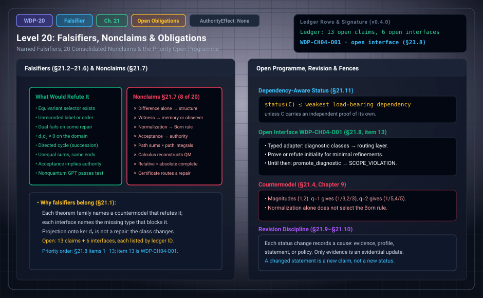

# WDP Level 20: Falsifiers, Nonclaims, and Open Obligations

**AuthorityEffect:** None.  
**Level:** Level 20 (Chapter 21: Falsifiers, Nonclaims, and Open Obligations)  
**Monograph Chapter:** Chapter 21, §21.1–§21.15 (Part V: Relative scope and the open programme), *The Witnessed Difference Programme* v0.4.0.  
**Part:** Part V: Relative Scope and the Open Programme  
**Ledger Rows:** `WDP-CH04-O01` (conditional supplement). Its ID carries the Chapter 4 prefix, but its canonical location is §21.8. No ledger row carries a `CH21` prefix.  

---

## 1. What this level does

Chapter 21 collects three inventories. It names, for each result family, the
small countermodel that would refute it (§21.2–§21.6). It lists twenty things
the monograph does not claim (§21.7). And it orders the open work (§21.8). It
then adds rules for how a status may change, how a claim keeps its identity, and
how a claim's status is limited by its dependencies (§21.9–§21.15).

The chapter proves no new theorem. Its one ledger row is an open interface.

---

## 2. Definitions and results

### 2.1 Why falsifiers belong in the monograph (§21.1)

Each theorem family should name a small countermodel that would refute it, and
each interface should name the missing type that prevents composition. The
monograph treats this as more informative than a list of aspirations.

A falsifier says what *would* refute a result. It is not a report that a test
passed.

### 2.2 Foundational falsifiers (§21.2)

- **Full-symmetry nonselection** ([Level 02](level_02_residuals_obstructions.md)) fails if a
  parameter-free equivariant selector exists for a moved target under the
  stated group action.
- **A retention theorem** fails if its memory packet cannot distinguish a
  displayed pair of histories that the theorem says it retains.
- **A "difference alone" theorem** fails if its construction uses an
  unrecorded label, order, measure, topology, or observer profile.

### 2.3 Cochain falsifiers (§21.3)

These refer to [Level 03](level_03_discrete_complex_cochains.md) and [Level 04](level_04_boundary_separation_contraction.md).

- Quotient well-definedness fails if changing the representative changes the
  claimed value.
- Cohomology language fails if $d_1d_0\ne0$ on the declared domain.
- A dual certificate fails if it does not annihilate every admissible repair or
  violates its norm constraint.
- Gauge invariance fails if gauge-related inputs give nonconjugate or otherwise
  inequivalent outputs under the stated invariant.
- A reported weighted-$L^1$ value of $\Phi_1$ is uncertified unless a repair and
  a bounded circulation with equal values accompany it (`WDP-CH04-P07`).
- The signature bound fails if some class has
  $\Gamma_2>\|d_1\|_{J\to1}\Phi_1$ on a window whose $d_1d_0=0$ certificate
  verifies.
- Two implementations given one declared window, coefficient field, weights,
  and cochain must return one signature. A divergence refutes an implementation
  or exposes an undeclared assumption.
- A coefficient-free cohomology claim fails when changing the declared field
  changes the answer, as on the projective plane (`WDP-CH05-P06`).
- A claimed repair fails when it subtracts an element outside
  $\operatorname{im}d_0$, such as an orthogonal projection onto $\ker d_1$. The
  result lies in a different class; the original class and its $\Phi_1$ are
  not repaired.
- A claim that a larger complex, attached faces, or equal-weight subdivision
  lowers $\Phi_1$ fails (`WDP-CH04-P09`). Only deleting cells, changing declared
  weights, or changing existing edge values can lower it.

### 2.4 Time and probability falsifiers (§21.4)

These refer to [Level 05](level_05_retention_discrete_succession.md) through [Level 08](level_08_discrete_observer_layer.md).

- Succession as a strict order fails on a directed cycle.
- Exact duration fails when two paths with the same endpoints have unequal
  declared sums.
- Clock adequacy fails when an admitted target interval has no comparable
  reference readout or exceeds the stated error bound.
- Refinement invariance fails if transported atomic mass is not conserved.
- Born selection from normalization is refuted by the positive-power family of
  Chapter 9: for every $q>0$, $p_i^{(q)}=|z_i|^q/\sum_j|z_j|^q$ is a
  probability vector, and on any vector with two unequal nonzero magnitudes,
  distinct exponents give distinct vectors (`WDP-CH09-P01`). For magnitudes $(1,2)$, $q=1$ gives $(1/3,2/3)$ and $q=2$
  gives $(1/5,4/5)$.

### 2.5 Observer and measurement falsifiers (§21.5)

These refer to [Level 09](level_09_behavioral_quotients_finite_states.md) through [Level 14](level_14_traceability_provenance_receipts.md).

- A legacy observer adapter fails when it silently drops a field used by a
  theorem or invents memory that the source packet does not have.
- Observation validity fails when a record cannot be connected to its target
  proposition.
- Measurement validity fails when any of these is absent: the measurand
  specification, the result carrier and value map, calibration, declared
  uncertainty/error semantics, or the required provenance/re-access record. If
  metrological traceability is claimed, a missing calibration hierarchy or a
  missing uncertainty contribution for any calibration refutes that claim.
- Any implication from evaluator acceptance to authority is ill typed unless an
  authority bridge is declared.
- A self-knowledge completeness claim fails whenever the presentation map has a
  displayed nontrivial fiber.

### 2.6 History and quantum falsifiers (§21.6)

These refer to [Level 15](level_15_simplicial_branch.md) through [Level 18](level_18_exact_rational_bounds.md).

- A length-bounded history category fails when two admissible paths compose to
  a path beyond the bound.
- A star-sum theorem over a bare semiring fails when the infinite sum has no
  declared semantics.
- A zerosumfree noncancellation theorem fails in a carrier with nonzero
  additive inverses.
- A quantum characterization fails on any nonquantum GPT that satisfies its
  proposed discriminator set.
- A contextuality/cohomology claim fails when only non-coboundary, and not
  cocycle, has been shown.

### 2.7 The twenty consolidated nonclaims (§21.7)

The monograph does **not** claim:

1. that Primitive Difference alone produces structure;
2. that witness implies memory, observer, or experience;
3. that retention uniquely produces time;
4. that finite duration is physical or continuum time;
5. that finite normalized weight is physical probability;
6. that normalization selects the Born rule;
7. that a quotient evaluator is a conscious observer;
8. that observer acceptance confers authority;
9. that a measurement packet is observer-independent;
10. that finite path sums are continuum or quantum path integrals;
11. that a cochain obstruction alone is quantum contextuality;
12. that declared complex carriers are derived from difference;
13. that contextuality is sufficient for quantum theory;
14. that the calculus reconstructs quantum mechanics;
15. that self-reference proves awareness;
16. that profile-relative completeness is absolute completeness;
17. that any chapter creates worlds or proves cosmogenesis;
18. that repository tests, formal elaboration, or publication status decides
    the interpretation of the mathematics;
19. that an obstruction signature or certificate selects a repair, stabilizes
    a residual, or routes a claim;
20. that combinatorial balance identities on finite complexes are physical
    conservation laws.

This is a prose list; its items carry no row IDs. The ledger separately holds
27 `NONCLAIM` rows (listed in §6). The two overlap without being one-to-one.
Clear matches include item 1 and `WDP-CH00-N01`, item 9 and `WDP-CH13-N01`,
item 10 and `WDP-CH17-N01`, item 15 and `WDP-CH14-N01`, items 16–17 and
`WDP-CH20-N01`, item 19 and `WDP-CH04-N01`, and item 20 and `WDP-CH05-N03`.
Some items, such as item 3, have no single matching row.

### 2.8 Priority programme (§21.8)

The roadmap below records the original priorities. Under the expert derivation
supplement (Appendices I–K), all nineteen registered open targets have now been
resolved as explicit finite propositions or conditional results, leaving zero
open obligations in the live ledger. [The derivation guide](../derivation_review.md)
gives the current register and production ownership.

The monograph orders the next work by dependency:

1. freeze the typed witness vocabulary and the legacy-term migration table;
2. verify the symmetry propositions and build finite separating models for each
   retention notion;
3. complete the observer-packet adapters;
4. formalize the observation ladder as a typed finite state machine;
5. align the measurement packet with the metrology registry, including an
   uncertainty-composition rule (`WDP-CH13-O01`) and an end-to-end finite
   measurement instance theorem with replay data (`WDP-CH13-O02`, §15.11);
6. merge and formalize the duration exactness classification;
7. prove or refute stable atomicity for the intended finite valuations;
8. decide the flat, curved, or higher-coherent outcome for the spatial/history
   operators;
9. prove the finite semiring history theorems with exactly stated star
   hypotheses;
10. populate the reconstruction audit with countermodels before attempting a
    quantum theorem;
11. formalize the profile-relative status algebra;
12. bind every proved row to exact prose, code, tests, formal theorem, and
    source revision where those artifacts exist;
13. supply the routing interface below before any obstruction diagnostic is
    used to select a repair, stabilize a survivor, or refine a presentation.

> **`WDP-CH04-O01` — Conditional result (routing and contextual reflection).** Under a declared terminal, lift and guarded-change policy, independently verified quotient/closure diagnostics feed checked finite routing receipts. Context-equivariant profile-preserving systems admit the least same-carrier congruent coarsening, initial in the specified comma category; a profile-reflecting completion of a noncongruent source is impossible. Appendix J supplies the construction and refutation. The diagnostic does not select its policy.

**Scope of this row.** The primitive-axiomatics source records that lemma as
open and reports that unconstrained initiality fails. Completion is therefore
conjectural in that source and absent from this monograph.

### 2.9 Evidence monotonicity and revision (§21.9)

Statuses can change, but not every change is an upgrade. Every status
transition should record one of four causes:

1. **evidence addition or correction** under the same proposition and profile;
2. **profile change**, altering admissible inputs or resources;
3. **statement change**, producing a new proposition version;
4. **policy change**, altering processing permission.

Only the first is ordinarily an evidential update. If the proposition changes,
the old status stays attached to the old proposition and is not overwritten.

### 2.10 Claim identity (§21.10)

A claim ID binds to normalized statement text, scope, hypotheses, and version.
Reusing an ID after strengthening a quantifier, deleting a hypothesis, or
changing the carrier creates false continuity. A typographic repair that keeps
the formal statement need not mint a new ID, but the changelog should say why.
The chapter lists the fields of a full claim record: `claim_id`, `statement`,
`status`, `hypotheses`, `scope`, `dependencies`, `proof_or_counterexample`,
`formal_anchor`, `executable_anchor`, `source_revision`, `nonclaims`,
`last_checked`. The monograph's own narrative anchor IDs are lighter than this;
they locate prose and do not replace such records.

### 2.11 Dependency-aware status (§21.11)

If claim $C$ uses claims $A$ and $B$, its status cannot exceed the weakest
load-bearing dependency unless $C$ carries an independent proof. An imported
standard supports a conditional result only when the source theorem's
hypotheses are matched. A mechanized special case cannot support an
unrestricted prose theorem. A historical receipt cannot support a new revision
without a transport or a rerun.

The audit has six steps: parse the explicit dependencies; verify each
dependency's exact statement and current evidence; check hypothesis discharge
at the use site; search definitions and examples for hidden imports; downgrade
or split the claim when its supported scope is narrower; keep the stronger
target as an open row instead of deleting it.

### 2.12 Canonical terminology migrations (§21.12)

The chapter's migration table has 19 rows. Eight of them:

| Legacy phrase | Canonical phrase |
| :--- | :--- |
| "witness" without modifier | typed witness kind |
| "observer standing" | evaluator standing |
| "probability from difference" | finite normalized valuation after mass and partition inputs |
| "cosmogenesis" | profile-relative completeness |
| "cohomology class" without $d_1$ | non-coboundary or quotient class |
| "curvature" for $\operatorname{im}d_1$ | closure charge |
| `ExactClass` as `ExactRepair` | diagnostic class, routed only by a checked policy |
| "Hodge repair" | orthogonal projection (not a repair) |

### 2.13 Editorial tests for the monograph (§21.13)

The manuscript should pass finite editorial checks. Among them: every theorem-like
sentence has a status; every external result has a registry key and a
consultation state; no observation or measurement statement implies authority;
every use of "witness" is typed by context; open claims stay visible instead of
being narrated as completed; nonclaims survive the summary and conclusion.
These checks are necessary for a reliable release. They do not prove the
mathematics.

### 2.14 Research claims versus release claims (§21.15)

A research claim answers "what has been established under these hypotheses?"
A release claim answers "what exact artifact contains the statement and its
evidence, and can another reader recover it?" A sound proof can have poor
artifact custody, and a well-hashed archive can contain a false theorem. The
package should report both dimensions without letting one stand in for the
other.

---

## 3. Worked example: a status transition (§21.14)

The claim is: "all accepted readings lie within $0.1$ V of the reference."

1. **Start.** Only three of the four sensor codes have calibration data. The
   claim is in profile and well typed, but not established: `Undetermined`.
2. **Evidence addition.** A fourth reference record is added and a finite
   exhaustive check over the four codes passes. With the claim, calibration
   model, and profile unchanged, the status may move to `Proved`, relative to
   those four codes. This is cause 1 of §21.9.
3. **What it does not become.** It is not "proved for every voltage". The domain
   is the finite, declared set of four codes.
4. **Statement/profile change.** If the calibration model changes from interval
   lookup to affine interpolation, the old proof stays valid for the old model.
   The new claim needs a new check. This is cause 2 or 3, not an evidential
   update.
5. **Policy change.** If a safety policy refuses code `3` regardless of
   calibration, the mathematical bound and the policy status coexist: a reading
   can be calibration-valid and policy-refused. This is cause 4.

---

## 4. Evidence bindings

Paths are relative to the monograph package
[`witnessed_difference_programme/`](/atlas/papers/finite_obstruction_calculus/witnessed_difference_programme/).

| Row | Status | Ledger evidence | Lean | Executable binding | Notebook |
| :--- | :--- | :--- | :--- | :--- | :--- |
| `WDP-CH04-O01` | Conditional result | P; C; N; L:partial (standalone supplement) | partial Lean coverage; see derivation guide | `code/witnessed_difference/context_reflection.py`; native owners in derivation guide | none |

**Executable checks that match falsifiers listed here.** Chapter 21 has no
executable binding of its own. Several of its falsifiers appear as negative
controls in `code/injection_tests/test_mutation_recovery.py`, where they are
bound to other rows:

| Control | What it checks | Falsifier |
| :--- | :--- | :--- |
| `dual_bound_tamper` | `verify_quotient_certificate` with an oversized dual returns `RefusalCode.CERTIFICATE_MISMATCH` | §21.3, dual certificate |
| `growth_as_repair` | `claim_growth_repair` on a restriction that lowers $\Phi_1$ returns `RefusalCode.SCOPE_VIOLATION` (bound to `WDP-CH04-N02`) | §21.3, growth |
| `diagnostic_as_terminal` | `promote_diagnostic` returns `RefusalCode.SCOPE_VIOLATION` for `ExactRepair`, `StabilizedSurvivor`, `OpenObstruction`, and `authority` (bound to `WDP-CH04-N01`) | nonclaim 19 |
| `d1d0_break` | on a filled triangle whose two paths from `a` to `c` sum to $2$ and $3$, `classify_duration` returns `DurationClass.ACTIVE_CLOSURE_FAILURE` | §21.4, exact duration |
| `measurement_without_scale`, `calibration_chain_missing_uncertainty` | return `RefusalCode.MISSING_SCALE` and `RefusalCode.MISSING_CHAIN_UNCERTAINTY` | §21.5 |
| `unbounded_history_star` | `finite_history_sum` with no step budget returns `RefusalCode.BUDGET_REQUIRED` | §21.6, star sums |

Each control checks one named finite case and proves no general statement.
While `WDP-CH04-O01` is open, the `diagnostic_as_terminal` refusal is what
keeps a diagnostic from being used as a routing decision; it does not discharge
the open interface.

---

## 5. Misreadings the chapter rules out

- **Inventing nonclaims.** The nonclaims are §21.7's twenty items and the
  ledger's 27 `NONCLAIM` rows, each with an ID. A boundary the monograph never
  states, such as one about quantum gravity, dark energy, or particle masses,
  is not a WDP nonclaim, however reasonable it sounds.
- **Reading falsifiers as verified findings.** A falsifier names the
  countermodel that would refute a result. It is not a record of a passed test.
- **Treating every status change as an upgrade.** Profile, statement, and policy
  changes are not evidential updates (§21.9).
- **Reusing a claim ID after strengthening a claim** creates false continuity
  (§21.10).
- **Letting a mechanized special case carry an unrestricted theorem.** The
  status of a claim is capped by its weakest load-bearing dependency (§21.11).
- **Treating editorial checks, tests, or hashes as proof.** They are necessary
  for a reliable release but do not prove the mathematics (§21.13, §21.15).
- **Using a diagnostic without its declared routing policy.** The proved
  CH04-O01 interface requires independently checked lifts, guards and updates.

---

## 6. Nonclaims

Chapter 21 has no nonclaim row of its own. Its consolidated list is §2.7 above.

**The ledger's 27 `NONCLAIM` rows**, by chapter prefix: `WDP-CH00-N01`,
`WDP-CH00-N02`, `WDP-CH00-N03`; `WDP-CH01-N01`; `WDP-CH02-N01`;
`WDP-CH03-N01`; `WDP-CH04-N01`, `WDP-CH04-N02`; `WDP-CH05-N01`,
`WDP-CH05-N02`, `WDP-CH05-N03`; `WDP-CH06-N01`; `WDP-CH07-N01`;
`WDP-CH09-N01`, `WDP-CH09-N02`; `WDP-CH10-N01`; `WDP-CH13-N01`;
`WDP-CH14-N01`, `WDP-CH14-N02`; `WDP-CH15-N01`; `WDP-CH16-N01`,
`WDP-CH16-N02`; `WDP-CH17-N01`; `WDP-CH18-N01`; `WDP-CH19-N01`,
`WDP-CH19-N02`; `WDP-CH20-N01`.

### Completed target register

All nineteen previously open targets have finite or conditional resolutions
under the explicit hypotheses in Appendices I–K. The canonical ledger has no
open claim or interface. The original identifiers continue to locate each
target; a counterexample resolves a false proposal without establishing it.

| Target | Current status | Result and declared scope |
| :--- | :--- | :--- |
| `WDP-CH03-O01` | Finite Proposition | For a finite nonempty carrier with total labelled deterministic updates and exact readouts or a validated report equivalence, descending partition refinement computes the greatest report-respecting update congruence, its minimal quotient, and behavioral classification by quotient isomorphism, without a global chronology. |
| `WDP-CH03-O02` | Finite Proposition | For fixed finite nonempty carrier $M$, input alphabet $I$ and nonempty report alphabet $O$, all typed retention extensions form the Cartesian product $M^{I\times M}\times O^M\times\mathcal P(O\times O)$. Named compatibility laws may couple its factors. For arbitrary report comparison the all-word relation is the greatest report-respecting forward-compatible relation; quotient and literal-readout descent require their separate stated conditions. Appendix J proves this result and the complete declared predicate classifications. |
| `WDP-CH04-O01` | Conditional Result | Under a declared terminal, lift and guarded-change policy, independently verified quotient/closure diagnostics feed checked finite routing receipts. Context-equivariant profile-preserving systems admit the least same-carrier congruent coarsening, initial in the specified comma category; a profile-reflecting completion of a noncongruent source is impossible. Appendix J supplies the construction and refutation. The diagnostic does not select its policy. |
| `WDP-CH05-O01` | Conditional Result | For two unweighted rational U(1) connection Laplacians on the same ordered finite carrier, the exact maximum absolute-real-plus-imaginary row sum of their difference bounds every ordered eigenvalue displacement; a separately valid gap bound greater than twice this value ensures gap survival. |
| `WDP-CH06-O01` | Finite Proposition | A declared finite nonempty labelled transition system with exact reports or a validated report equivalence admits greatest strong bisimilarity and its minimal bounded quotient. Its raw directed relation has a strict transitive edge extension exactly when acyclic. Cycles obstruct such an extension; SCC condensation changes the carrier. A nonempty strict order cannot be chosen invariantly from a fully symmetric carrier. Directional transition or symmetry-breaking order data must therefore be declared. See Appendix J. |
| `WDP-CH07-O01` | Finite Proposition | For a positive calibrated finite occurrence chain whose edge residuals are bounded by nonnegative declared budgets, every interval residual is bounded by the sum of those budgets, and endpoint-preserving block-sum refinement preserves the bound. |
| `WDP-CH08-O01` | Finite Proposition | Every nonnegative additive valuation on a finite Boolean event algebra has unique algebra-atom masses and measurable-map pushforward; nonnegative masses on individual witnesses extending it are unique exactly when every nonsingleton algebra atom has mass zero. |
| `WDP-CH10-O01` | Conditional Result | Every identified family in the selected 573-occurrence source corpus has an explicit typed partial adapter preserving actual maps, relations and absent layers. Under surjective sort maps, unique operation/predicate descent is equivalent to fiber constancy, and missing-layer recovery has its own exact fiber criterion. All 44 originals and 529 absorbed occurrences are verified; unbounded contexts and exact numerical certificates retain their declared executable domains. Appendix K supplies source-specific proofs and independent countermodels. |
| `WDP-CH11-O01` | Finite Proposition | On the finite inclusion site of intersection-closed contexts with union covers, checked report sets and coherent restriction maps form a presheaf. It is a sheaf exactly when every matching-family fiber contains one global report. Constrained assignment reports admit a glue exactly when their pointwise union is admitted; the equality-constraint countermodel refutes unrestricted local-to-global gluing. Appendix J defines the category and coverage and proves these criteria. |
| `WDP-CH13-O01` | Conditional Result | For sequential affine calibration stages with declared gain, offset and residual error bounds, the radius recurrence (abs(a)+alpha)r+alpha abs(x)+beta+eta contains every admissible realization without independence assumptions; nominal calibration updates have exact interval sup error abs(da x+db)+abs(da)r. |
| `WDP-CH13-O02` | Finite Proposition | The declared finite registration/witness/measurement instance replays the retained indication, composed affine map, correction and uncertainty enclosure against separate re-access data; altered records, understated uncertainty and rehashed false enclosures are rejected. |
| `WDP-CH14-O01` | Finite Proposition | For independently declared finite presentation, report, context and calibration maps, factorization and stability have the complete implication classification of Appendix J. Explicit accessible self-state, reflexive provenance, later-state and partial comparison maps separately classify linkage, stability, comparison availability and comparison success; later-target and successful linked-report existence are exact fiber-constancy questions. No phenomenology premise occurs. |
| `WDP-CH17-O01` | Finite Proposition | For a finite rational row-source transition matrix and a nonempty block partition, representative-independent endpoint-block path sums at every finite length exist exactly when outgoing block sums are constant within each source block, equivalently M H = H B; B is unique and finite partition enumeration is exhaustive. |
| `WDP-CH18-O01` | Conditional Result | Signed report weights have a classical state representation exactly when every observable block mass is nonnegative; signed instrument updates admit a classical report-instrument quotient exactly under the stated fiber-intertwining and stochastic-quotient conditions. The unrestricted witness/observer/measurement class admits accepted PR tables, refuting reconstruction that preserves their declared probabilities together with classical joint runs or bipartite local Hilbert measurement composition. Classical and quantum alternatives require the explicit additional packages in Appendix J; neither is forced by the original packets. |
| `WDP-CH19-O01` | Conditional Result | For any declared finite cover and nonempty rational run tables, the minimax context $L^1$ distance to the compatible polytope is the optimum of the exact standard-form LP in Appendix J, with independently verified primal/dual certificates. Under declared within-context iid categorical trials and compatible population marginals, the trial counts give explicit finite-sample pair tolerances and a union-bound failure probability. The empirical image retains only the previously stated outcome information. |
| `WDP-CH19-O02` | Conditional Result | Declaring positive finite Hilbert density states, local Hermitian dichotomic observables and trace pairing on the tensor composite gives the exact CHSH bound $S^2\le8$, excluding PR. Commuting complete local matrix units yield the tensor-factor representation up to a multiplicity space, removed by the stated dimension condition. The native instrument and observer adapters exhibit consistency with the finite architecture. These assumptions are inputs; CP alone does not supply them. |
| `WDP-CH19-O03` | Conditional Result | A declared continuous character $\chi_\theta(t)=e^{i\theta t}$ maps real cochains into complex path amplitudes and descends under gauge to phase-blind operational readouts; its cycle-period lattice and anchor dependence are explicit. An independent exact rational-turn/cyclotomic branch is implemented. Declared effect/instrument pairing supplies a conditional operational model, while normalized quadratic and quartic readouts prove nonselection by phase invariance. No Born rule or faithful real phase embedding is inferred. |
| `WDP-CH19-O04` | Finite Proposition | Grouped finite Gaussian-rational Kraus instruments preserve their declared probabilities, post-states and canonical dilation. On a common input/output carrier, outcome repeatability is equivalent to $K_{jb}K_{oa}=0$ for every $j\ne o,a,b$. Independent replay checks the complete registration, witness, accepted observation, indication, calibration enclosure and declared documentary hierarchy against actual inputs. Documentary traceability does not authenticate a physical standard or select the Born readout. |
| `WDP-CH20-O01` | Finite Proposition | A declared finite Boolean semantic model with admission, policy and bounded independent evidence replay has five exclusive and exhaustive statuses; injective value-preserving profile adapters transport verified evidence and rerun target evaluation rather than assuming status invariance under changed policy or resources. |

Source custody now covers all 44 original texts and 529 absorbed occurrences.
The universal adapter criterion and exact source-family domains complete
CH10-O01. Partial Lean tags mark remaining mechanization, rather than an open
mathematical statement at the proved scope. See [the current guide](../derivation_review.md).

---

## 7. Claim discipline

1. **What this level supports:** an explicit inventory: named falsifiers for
   each result family, the consolidated nonclaims, a completed
   target register, and rules for status revision, claim identity, and
   dependency-limited status.
2. **What it does not support:** any new theorem, the closure of any open row,
   or the reading of tests, formal elaboration, hashes, or publication status
   as proof or interpretation of the mathematics.
3. **Narrowest defensible claim:** each result family in the monograph comes
   with a small countermodel or missing type that would refute or block it, and
   its scoped resolutions are listed by ID with explicit hypotheses and proof bindings.
**Finite supplement.** These finite targets are answered under the explicit hypotheses in Appendix J. See [the current derivation guide](../derivation_review.md) for complete statements, counterexamples, native ownership and partial Lean coverage.

---

---

## Expert derivation supplement (2026-10-01)

- **CH03-O02 — Finite proposition.** For fixed finite nonempty carrier $M$, input alphabet $I$ and nonempty report alphabet $O$, all typed retention extensions form the Cartesian product $M^{I\times M}\times O^M\times\mathcal P(O\times O)$. Named compatibility laws may couple its factors. For arbitrary report comparison the all-word relation is the greatest report-respecting forward-compatible relation; quotient and literal-readout descent require their separate stated conditions. Appendix J proves this result and the complete declared predicate classifications.
- **CH04-O01 — Conditional result.** Under a declared terminal, lift and guarded-change policy, independently verified quotient/closure diagnostics feed checked finite routing receipts. Context-equivariant profile-preserving systems admit the least same-carrier congruent coarsening, initial in the specified comma category; a profile-reflecting completion of a noncongruent source is impossible. Appendix J supplies the construction and refutation. The diagnostic does not select its policy.
- **CH06-O01 — Finite proposition.** A declared finite nonempty labelled transition system with exact reports or a validated report equivalence admits greatest strong bisimilarity and its minimal bounded quotient. Its raw directed relation has a strict transitive edge extension exactly when acyclic. Cycles obstruct such an extension; SCC condensation changes the carrier. A nonempty strict order cannot be chosen invariantly from a fully symmetric carrier. Directional transition or symmetry-breaking order data must therefore be declared. See Appendix J.
- **CH10-O01 — Conditional result.** Construct and verify adapters for every legacy
observer packet in the source corpus, with counterexamples showing why each
missing hypothesis is necessary. Appendix J inventories all recorded sources and supplies checked semantic adapters for the recovered families. Appendix K completes the source-bound result after exact recovery of all 44 originals, preserving each packet's actual semantics.
- **CH11-O01 — Finite proposition.** On the finite inclusion site of intersection-closed contexts with union covers, checked report sets and coherent restriction maps form a presheaf. It is a sheaf exactly when every matching-family fiber contains one global report. Constrained assignment reports admit a glue exactly when their pointwise union is admitted; the equality-constraint countermodel refutes unrestricted local-to-global gluing. Appendix J defines the category and coverage and proves these criteria.
- **CH14-O01 — Finite proposition.** For independently declared finite presentation, report, context and calibration maps, factorization and stability have the complete implication classification of Appendix J. Explicit accessible self-state, reflexive provenance, later-state and partial comparison maps separately classify linkage, stability, comparison availability and comparison success; later-target and successful linked-report existence are exact fiber-constancy questions. No phenomenology premise occurs.
- **CH18-O01 — Conditional result.** Signed report weights have a classical state representation exactly when every observable block mass is nonnegative; signed instrument updates admit a classical report-instrument quotient exactly under the stated fiber-intertwining and stochastic-quotient conditions. The unrestricted witness/observer/measurement class admits accepted PR tables, refuting reconstruction that preserves their declared probabilities together with classical joint runs or bipartite local Hilbert measurement composition. Classical and quantum alternatives require the explicit additional packages in Appendix J; neither is forced by the original packets.
- **CH19-O01 — Conditional result.** For any declared finite cover and nonempty rational run tables, the minimax context $L^1$ distance to the compatible polytope is the optimum of the exact standard-form LP in Appendix J, with independently verified primal/dual certificates. Under declared within-context iid categorical trials and compatible population marginals, the trial counts give explicit finite-sample pair tolerances and a union-bound failure probability. The empirical image retains only the previously stated outcome information.
- **CH19-O02 — Conditional result.** Declaring positive finite Hilbert density states, local Hermitian dichotomic observables and trace pairing on the tensor composite gives the exact CHSH bound $S^2\le8$, excluding PR. Commuting complete local matrix units yield the tensor-factor representation up to a multiplicity space, removed by the stated dimension condition. The native instrument and observer adapters exhibit consistency with the finite architecture. These assumptions are inputs; CP alone does not supply them.
- **CH19-O03 — Conditional result.** A declared continuous character $\chi_\theta(t)=e^{i\theta t}$ maps real cochains into complex path amplitudes and descends under gauge to phase-blind operational readouts; its cycle-period lattice and anchor dependence are explicit. An independent exact rational-turn/cyclotomic branch is implemented. Declared effect/instrument pairing supplies a conditional operational model, while normalized quadratic and quartic readouts prove nonselection by phase invariance. No Born rule or faithful real phase embedding is inferred.
- **CH19-O04 — Finite proposition.** Grouped finite Gaussian-rational Kraus instruments preserve their declared probabilities, post-states and canonical dilation. On a common input/output carrier, outcome repeatability is equivalent to $K_{jb}K_{oa}=0$ for every $j\ne o,a,b$. Independent replay checks the complete registration, witness, accepted observation, indication, calibration enclosure and declared documentary hierarchy against actual inputs. Documentary traceability does not authenticate a physical standard or select the Born readout.

The original 154 identifiers are preserved. The historical Lean census is unchanged; new standalone proofs, native replay and source custody are described in [the derivation guide](../derivation_review.md). Physical interpretation, Born selection and authority remain separate assumptions.

---

## Navigation

- **Previous:** [Level 19: Relative Completeness for Observer-Indexed Presentations](level_19_quantum_reconstruction_audit.md)
- **Next:** [Level 21: Synthesis: What the Finite Calculus Establishes](level_21_open_horizon_claim_ledger.md)
- **Levels Index:** [README.md](README.md)
