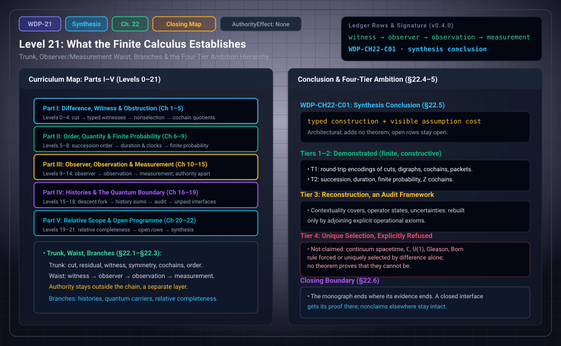

# WDP Level 21: Synthesis: What the Finite Calculus Establishes

**AuthorityEffect:** None.  
**Level:** Level 21 (Chapter 22: Synthesis: What the Finite Calculus Establishes)  
**Monograph Chapter:** Chapter 22, §22.1–§22.6 (Part V: Relative scope and the open programme), with pointers to Appendix A (dependency and status table) and Appendix D (formalization status), *The Witnessed Difference Programme* v0.4.0.  
**Part:** Part V: Relative Scope and the Open Programme  
**Ledger Rows:** `WDP-CH22-C01` (synthesis conclusion).  

---

## 1. What this level does

Chapter 22 closes the monograph. It restates what the finite calculus
establishes in three parts: a **trunk** of constructions, an
**observer/measurement waist**, and three **branches**. It places the programme
on a four-tier ambition hierarchy, states one synthesis conclusion, and ends
with a boundary: the monograph stops where its evidence stops.

This page also serves as a closing map of the curriculum. Each part of the
synthesis is linked to the levels where it is developed.

| Part | Chapters | Levels | Role in the Chapter 22 synthesis |
| :--- | :---: | :---: | :--- |
| I. Difference, witness, and finite obstruction | 1–5 | [0](level_00_admitted_cut.md#2-level-0-the-admitted-cut)–[4](level_04_boundary_separation_contraction.md) | trunk (Chapters 1–4); Chapter 5's quantum-capable carriers feed the quantum branch |
| II. Order, quantity, and finite probability | 6–9 | [5](level_05_retention_discrete_succession.md)–[8](level_08_discrete_observer_layer.md) | trunk: succession, duration, finite probability |
| III. Observer, observation, and measurement | 10–15 | [9](level_09_behavioral_quotients_finite_states.md)–[14](level_14_traceability_provenance_receipts.md) | the waist; Chapter 15 is the authority layer, which stays outside the chain |
| IV. Histories and the quantum boundary | 16–19 | [15](level_15_simplicial_branch.md)–[18](level_18_exact_rational_bounds.md) | branches: histories, and quantum-capable carriers with the reconstruction audit |
| V. Relative scope and the open programme | 20–22 | [19](level_19_quantum_reconstruction_audit.md)–21 | branch: relative completeness; then the inventory of falsifiers, nonclaims, and open rows; then this synthesis |

---

## 2. Definitions and results

### 2.1 The trunk (§22.1)

The monograph calls the trunk "modest and coherent". Each step adds a declared
input:

| Step | What it adds | What it supports | Level |
| :--- | :--- | :--- | :---: |
| Admitted cut | exhibited difference and the structure needed to type it | typed apartness | [0](level_00_admitted_cut.md#2-level-0-the-admitted-cut) |
| Residual and witness | a declared comparison that can fail | a residual, located, retained, repaired, separated, or refuted by typed witnesses, only through explicit adapters | [1](level_01_witness_function.md) |
| Symmetry | a full group action | no deterministic equivariant point choice of a moved target | [2](level_02_residuals_obstructions.md) |
| Cochains | a declared finite graph | quotient defects, bounded propositions, and certificates from finite-dimensional optimization | [3](level_03_discrete_complex_cochains.md) |
| Succession | retention and an admitted transition relation | finite succession | [5](level_05_retention_discrete_succession.md) |
| Duration | an additive valuation on succession | duration | [6](level_06_finite_event_valuations.md) |
| Probability | exhibited finite witness families, declared masses, and partitions | normalized finite probability | [7](level_07_finite_probability_multiplicity.md)–[8](level_08_discrete_observer_layer.md) |

Two points about symmetry are stated carefully. Full symmetry does not block
invariant probability laws; realizing a point from such a law adds a random
outcome or seed. And every successful deterministic point selection depends on
a declared symmetry-breaking input. When the candidate input family is finite
and removing the full declared dependency set restores a symmetry that moves the
output, that set contains at least one inclusion-minimal frontier element. A
particular implementation may also carry redundant inputs.

Each layer has a clear input ledger, and none supplies its usual physical
interpretation for free.

### 2.2 The observer/measurement waist (§22.2)

The central architectural result of the synthesis is the separation

$$
\text{witness}
\longrightarrow
\text{observer presentation/memory/evaluation}
\longrightarrow
\text{observation}
\longrightarrow
\text{measurement},
$$

with **authority outside the chain**.

- A **witness** is typed evidence for a proposition ([Level 01](level_01_witness_function.md)).
- An **observer** packages a presentation boundary, memory, evaluator, and
  policy ([Level 09](level_09_behavioral_quotients_finite_states.md)).
- An **observation** is a registered, witnessed, re-accessible interaction
  accepted by an evaluator ([Level 11](level_11_linear_sensing_projection.md)).
- A **measurement** adds a measurand specification, a distinct reported-value
  carrier and map, scale/unit, calibration, uncertainty, any claimed
  metrological-traceability evidence, and separate provenance/re-access
  ([Level 12](level_12_context_interference_state_spaces.md)).
- **Authority** is a separate declared layer ([Level 14](level_14_traceability_provenance_receipts.md)).

The waist lets duration and probability meet operational records without
claiming that either was derived as physical law.

### 2.3 The branches (§22.3)

- **Histories** ([Level 15](level_15_simplicial_branch.md), [Level 16](level_16_discrete_deformation_dynamics.md)). Projection can
  fail to descend. If a single-valued deterministic update on the unchanged
  presentation carrier is kept, extra state or history is then required;
  refinement, or relation-valued, set-valued, or stochastic dynamics, are the
  alternatives. Finite path aggregates over semirings are well defined at fixed
  length and have a matrix representation under the stated admissibility
  hypothesis. Infinite sums and quantum readings need more.
- **Quantum-capable carriers** ([Level 04](level_04_boundary_separation_contraction.md), [Level 17](level_17_semiring_coarse_graining.md),
  [Level 18](level_18_exact_rational_bounds.md)). Declared complex fibers, unitary connections,
  holonomy, and connection Laplacians support rigorous finite geometry. They
  remain assumption-bearing. The reconstruction audit shows the unpaid
  interfaces: empirical contexts, composition, continuity, purification or an
  alternative discriminator, and a probability rule stronger than
  normalization.
- **Relative completeness** ([Level 19](level_19_quantum_reconstruction_audit.md)). A finite evaluator can
  cover a declared query family with exclusive statuses *if* its rules are
  proved correct. That is an engineering and logical property of a profile,
  not an origin story for a universe.

### 2.4 The four-tier ambition hierarchy (§22.4)

The monograph sorts the programme by four levels of foundational ambition:

| Tier | Name | Monograph's label | What §22.4 lists under it |
| :---: | :--- | :--- | :--- |
| 1 | Syntactic representation | Demonstrated in finite models | round-trip invertible encodings, in the host substrate, of discrete distinction cuts, finite transition digraphs, discrete cochain complexes, permutation-isometry operators, and measurement packets |
| 2 | Faithful operational representation | Demonstrated in constructive settings | step commutation, formation, and derivability preserved for finite succession orders, additive duration valuations, finite normalized probabilities, and integer cochain dynamics over $\mathbb Z$ |
| 3 | Reconstruction under explicit principles | Characterized as an audit framework | empirical contextuality covers, operator-algebraic states, and continuous measurement uncertainties, reconstructed only by adjoining explicit operational axioms and cataloguing their external interfaces |
| 4 | Unique selection from primitive kernel | Explicitly refused | the programme does not claim that textbook continuous spacetime, the field $\mathbb C$, the circle group $U(1)$, Gleason frame uniqueness, or the Born rule is forced or uniquely selected by primitive difference, and proves no theorem that they cannot be |

The purpose is to keep a verified syntactic embedding (Tier 1) or a finite
operational model (Tier 2) from being mistaken for universal ontological
necessity (Tier 4). §18.6 applies the same four tiers to the quantum audit.

**Scope of the tiers.** The tiers carry no ledger rows, and their labels are
not statuses from the monograph's vocabulary; the evidence is in the named rows
of each chapter. Where Tier 4 stops is marked by nonclaims such as
`WDP-CH19-N01` (no Born uniqueness theorem is proved) and `WDP-CH06-N01` (a
finite acyclic relation is not continuum spacetime), and by the finite
witnesses of §18.5 and Appendix D.

### 2.5 Strongest defensible conclusion (§22.5)

> **`WDP-CH22-C01` — Synthesis conclusion.** Finite witnessed-difference
> systems can be organized into an explicit obstruction calculus in which every
> transition from residual to retention, order, magnitude, probability,
> observer, observation, measurement, history, or quantum-capable
> representation is exposed as a typed construction with a visible assumption
> cost.

**Scope of this row.** A synthesis conclusion is, in the monograph's status
vocabulary, "a bounded summary of results already established in named rows;
it introduces no additional theorem". The conclusion is architectural. It does
not claim that all listed open constructions exist or are unique. Its value is
that a failed derivation becomes local: one can point to the missing order,
map, law, calibration, or theorem.

### 2.6 Closing boundary (§22.6)

The monograph offers finite definitions, elementary propositions, conditional
proof sketches, comparison frameworks, and an exact map of open obligations. It
does not turn these into a physical theory by declaration. If a future result
closes one of the interfaces, the new hypothesis and proof should be attached
at that interface, and the nonclaims elsewhere should stay intact.

### 2.7 Where the status of each construction is recorded (Appendices A and D)

- **Appendix A** is a 32-row dependency and status table. For each construction
  it gives the required inputs, the output, and its status. Historically,
  Appendix A recorded intermediate milestones ("Clock: Definition; adequacy open";
  "Observer: Definition; adapters open"; "Quantum reconstruction: Open audit";
  "Relative completeness: Definition; proof open"). Under the expert derivation
  supplement, all nineteen registered open targets have been completed at
  explicit finite or conditional scopes: clock adequacy (`WDP-CH07-O01`, finite
  proposition), observer adapters (`WDP-CH10-O01`, `CH11-O01`, `CH12-O01`, finite
  propositions), quantum reconstruction (`WDP-CH19-O01` to `O03`, conditional
  results; `WDP-CH19-O04`, finite proposition), and relative completeness
  (`WDP-CH20-O01`, finite proposition).
- **Appendix D** records formalization status. The historical Mathlib Lean 4
  census retains its 202 selected theorem reports, with 16 exact row bindings
  under the v0.4.0 127-row baseline. The separate core-only `FiniteDerivations`
  spine (18 modules / 264 declarations at baseline; 19 modules / 280 declarations
  in v0.5.0) compiles without Mathlib, auditing against `{propext, Quot.sound,
  Classical.choice}`. The live ledger comprises 154 rows (127 positive claims/definitions
  and 27 nonclaims), with zero remaining open claims or interfaces. Appendix D
  also reports 548 Python tests and its 8-pointer evidence-separation rule (D.3).

---

## 3. Worked example: the compact end-to-end example (Appendix B)

Chapter 22 has no worked example of its own. Appendix B gives the one that
matches the synthesis: a device with states $S=\{s_0,s_1,s_2\}$, transitions
$s_0\to s_1\to s_2$, and a binary contact that is open at $s_0$, closes at
$s_1$, and stays closed at $s_2$.

| Step | New input | Conclusion | Level |
| :---: | :--- | :--- | :---: |
| 1 | open/closed roles declared distinct | a cut | 0 |
| 2 | a sensor record that differs from the open baseline at $s_1$ | a residual witness | 1 |
| 3 | a latch that stores the change bit through $s_2$ | retention | 2 |
| 4 | an acyclic transition graph | reachability is a strict order | 5 |
| 5 | edge weights $(2,3)$ in a declared unit | duration $2+3=5$ from $s_0$ to $s_2$ | 6 |
| 6 | the observer exposes `(contact, latch)` and hides the rest | an observer presentation | 9 |
| 7 | interaction, ADC registration, contact witness, retained record, and a range check returning `Accept` | an accepted E-observation | 11 |
| 8 | measurand (terminal voltage under the declared loading), a carrier $Y$ of closed voltage intervals, a calibration table from ADC code to $Y$, volts, a worst-case error bound, a calibration-version receipt | a measurement result; no metrological-traceability claim without an external calibration chain | 12 |
| 9 | separately declared repeated trials | a normalized finite table, with no stochastic reading until a trial model is added | 7 |
| 10 | positive-real edge weights, multiplied along paths and summed over alternatives | a history aggregate; with one path, no interference question arises | 16 |
| 11 | a separate jurisdictional rule | whether the result permits an external action | 14 |

At each step, deleting the new input removes the corresponding conclusion. The
monograph calls the example "a dependency demonstration, not a derivation from
one bit of difference".

---

## 4. Evidence bindings

Paths are relative to the monograph package
[`witnessed_difference_programme/`](/atlas/papers/finite_obstruction_calculus/witnessed_difference_programme/).

| Row | Status | Ledger evidence | Lean | Executable binding | Notebook |
| :--- | :--- | :--- | :--- | :--- | :--- |
| `WDP-CH22-C01` | Synthesis conclusion | P | none; `CLAIM_MAP.md` lists it among prose-only rows | none; not mapped in `manifests/claim_code_map.json` | `090_mutation_recovery_and_scope.ipynb` names it as an anchor |

**What the notebook does.** Notebook `090` teaches evidence separation: an
in-memory cell illustrates a copy-on-write mutant whose digest differs from the
pristine source and the recovery of the pristine digest (the release mutation
receipt itself comes from `scripts/check_mutations.py`), and an exercise
concludes that mutation and replay receipts cannot promote an `OPEN_CLAIM`.
It does not test the synthesis conclusion. The support for `WDP-CH22-C01` is
the set of named rows it summarizes. The ledger inventory is
154 rows: 27 definitions, 82 finite propositions, 15 conditional results, two
typing propositions,zero open claims or interfaces,27 nonclaims and one
synthesis conclusion.

---

## 5. Misreadings the chapter rules out

- **A derivation chain from one bit.** Appendix B is "a dependency
  demonstration, not a derivation from one bit of difference", and
  `WDP-CH00-N01` refuses derivation of all structure from Primitive Difference.
- **Any other four-tier scheme.** The hierarchy is the one in §2.4 above:
  syntactic representation, faithful operational representation,
  reconstruction under explicit principles, unique selection from the
  primitive kernel. The tiers grade foundational ambition, not kinds of model
  or physical subject matter.
- **"No continuum anywhere."** The standing scope discipline allows infinite
  coefficient and value spaces when typed ($\mathbb R$, $\mathbb C$, real
  intervals); only the combinatorial families are finite. The quantum branch
  imports $\mathbb C$ explicitly.
- **Reading the synthesis conclusion as a new theorem.** It summarizes named
  rows and adds none.
- **Reading Tier 4 as a proved impossibility result.** §22.4 refuses the
  ambition and proves no theorem that the Tier 4 items cannot be forced.
- **Putting authority inside the chain.** Observation and measurement do not
  confer authority; authority is a separate declared layer (§22.2).
- **Reading relative completeness as an origin story** (§22.3).

---

## 6. Nonclaims

Chapter 22 has no nonclaim row of its own. §22.6 requires that the nonclaims
elsewhere stay intact: the consolidated nonclaims of §21.7 and the 27
ledger `NONCLAIM` rows are listed in [Level 20](level_20_finite_adequacy_continuum_limits.md). Three
programme-level rows frame the whole synthesis:

- **`WDP-CH00-N01`.** The monograph does not derive all structure from
  Primitive Difference.
- **`WDP-CH00-N02`.** The monograph does not identify a formal witness with
  experience, consciousness, agency, or moral status.
- **`WDP-CH00-N03`.** No local proof, test run, dashboard, archive, or status
  label confers authority.

**Resolved targets.** All nineteen registered targets have finite or
conditional resolutions, listed in [Level 20,§6](level_20_finite_adequacy_continuum_limits.md#6-nonclaims).
Their explicit hypotheses and nonclaims continue to bound the synthesis.

---

## 7. Claim discipline

1. **What this level supports:** the architectural conclusion `WDP-CH22-C01`,
   organized as trunk, waist, and branches, with each transition typed and its
   assumption cost visible; and a four-tier hierarchy that keeps demonstrated
   representations apart from refused ambitions.
2. **What it does not support:** that the open constructions exist or are
   unique, that any physical theory follows, that the calculus derives from
   primitive difference alone, or that the Tier 4 items are proved impossible
   to force.
3. **Narrowest defensible claim:** in this calculus, every step from residual to
   measurement, history, or quantum-capable representation can be written as a
   typed construction whose added inputs are listed, so that a failed
   derivation points to a specific missing input.
**Finite supplement.** These finite targets are answered under the explicit hypotheses in Appendix J. See [the current derivation guide](../derivation_review.md) for complete statements, counterexamples, native ownership and partial Lean coverage.

---

---

## Expert derivation supplement (2026-10-01)

- **CH18-O01 — Conditional result.** Signed report weights have a classical state representation exactly when every observable block mass is nonnegative; signed instrument updates admit a classical report-instrument quotient exactly under the stated fiber-intertwining and stochastic-quotient conditions. The unrestricted witness/observer/measurement class admits accepted PR tables, refuting reconstruction that preserves their declared probabilities together with classical joint runs or bipartite local Hilbert measurement composition. Classical and quantum alternatives require the explicit additional packages in Appendix J; neither is forced by the original packets.

The original 154 identifiers are preserved. The historical Lean census is unchanged; new standalone proofs, native replay and source custody are described in [the derivation guide](../derivation_review.md). Physical interpretation, Born selection and authority remain separate assumptions.

---

## Navigation

- **Previous:** [Level 20: Falsifiers, Nonclaims, and Open Obligations](level_20_finite_adequacy_continuum_limits.md)
- **Next:** [Level 22: Genesis to WDP Foundational Bridges](level_22_genesis_to_wdp_bridges.md)
- **Levels Index:** [README.md](README.md)
