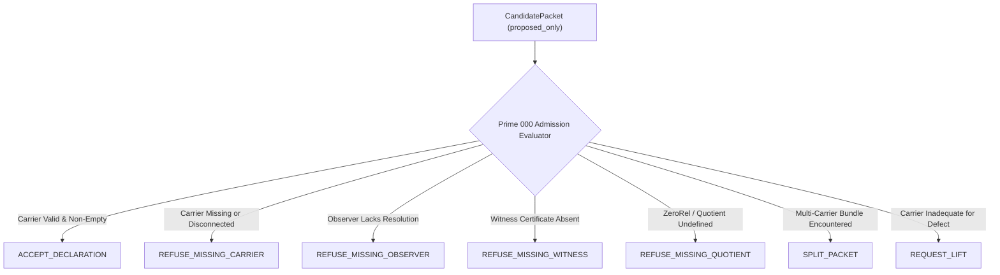

# Prime Triad Level 01: Prime -1 — Candidate Proposal Engine & Intake Trace Isolation

**AuthorityEffect:** None. Complete mathematical and runtime specification for Prime -1 candidate proposal compilation and intake trace isolation; no operational authorization is conferred.

---

## 1. Context & Intuition: Why Prime -1 Exists

Requiring an end-user or upstream agent to manually invent mathematical simplicial complexes, boundary operators, and exact dual witness vectors forces them to perform internal mathematical tasks.

**Prime -1 (Candidate Proposal Engine / Packet Compiler)** acts as the front-end intake compiler:

$$\boxed{\begin{gathered}
\text{\textbf{The Omega Engine does not begin by knowing the carrier.}} \\
\text{\textbf{It begins by proposing candidate carriers under scoped admission.}}
\end{gathered}}$$

Without Prime -1, two catastrophic failure modes arise:
1. **Un-grounded Carrier Hallucination:** Agents assume arbitrary continuum spaces or unindexed graphs without verifying combinatorial cell completeness.
2. **Operational Trace Contamination:** When a raw prompt or candidate proposal is malformed or invalid, recording that refusal directly on the operational trace ($\mathcal{A}_{\mathrm{DDC}}$) pollutes the cryptographic state with unadmitted hypotheses.

---

## 2. Canonical Schemas: CandidatePacket & IntakeTrace (`OE001-01`)

Under monograph claim `OE001-01`, candidate proposals carry immutable structural definitions:

### The CandidatePacket Schema
A `CandidatePacket` represents an unadmitted hypothesis. Its status is permanently initialized to `proposed_only`:

```yaml
CandidatePacket:
  artifact_id: "doc_001_ref"
  locus_id: "locus_frontmatter_01"
  problem_family: "claim | proof | narrative | code"
  primitive_difference_proposal: "metadata mismatch on line 12"
  carrier_proposal: "document simplicial metadata complex"
  zero_rel_proposal: "canonical key-value equality"
  observer_proposal: "frontmatter schema detector v1"
  witness_available: true
  quotient_or_refusal: "E"
  adapter_confidence: "high"
  status: "proposed_only"
  authority_effect: "None"
```

### The IntakeTrace Schema: Isolation of Pre-Admission Refusals
Pre-admission evaluation stays strictly off the operational execution trace:

```yaml
IntakeTrace:
  raw_artifact_hash: "e3b0c44298fc1c149afbf4c8996fb92427ae41e4649b934ca495991b7852b855"
  candidate_locus: "lines 1-12"
  candidate_packet: CandidatePacket
  intake_adapter_status: "ADMITTED | REFUSED_UNTYPED"
  enters_dda_trace: false
```

The boolean guard `enters_dda_trace: false` is an invariant firewall. Refusals at Prime -1 are recorded in an auxiliary audit log, preventing invalid candidate structures from creating false DDC state transitions.

---

## 3. Seven Formal Responses from Prime 000

When a `CandidatePacket` is presented to Prime 000, the admission engine must emit exactly one of seven typed verdicts:



1. **`ACCEPT_DECLARATION`:** All 7 declaration slots pass validation; packet promoted to `AdmittedDeclaration`.
2. **`REFUSE_MISSING_CARRIER`:** Simplicial complex $K = (V, E, F)$ is missing, has duplicate cells, self-loops, or dangling simplices.
3. **`REFUSE_MISSING_OBSERVER`:** No resolution window or observer envelope declared ($J_L = \varnothing$).
4. **`REFUSE_MISSING_WITNESS`:** Replay witness certificate is absent or un-verifiable.
5. **`REFUSE_MISSING_QUOTIENT`:** ZeroRel equivalence rule $\Delta(s) = 0$ is undeclared.
6. **`SPLIT_PACKET`:** The candidate spans heterogeneous carrier layers (e.g., text syntax + proof semantics) requiring decomposition via the `LensSpan` category.
7. **`REQUEST_LIFT`:** The candidate difference cannot be bounded on the proposed base complex without higher-degree cells.

---

## 4. Code Walkthrough: Rust & Python Implementations

### Rust Implementation: [`prime_candidate.rs`](../../../../../omega_engine/crates_rs/omega_wdp/src/prime_algos/prime_candidate.rs)

In Rust, the candidate packet enforces encapsulation:
```rust
# [derive(Debug, Clone, PartialEq, Eq, Serialize)]
pub struct CandidatePacket {
    artifact_id: String,
    locus_id: String,
    problem_family: String,
    primitive_difference_proposal: String,
    carrier_proposal: String,
    zero_rel_proposal: String,
    observer_proposal: String,
    witness_available: bool,
    quotient_or_refusal: String,
    adapter_confidence: String,
    status: CandidateStatus,
}

# [derive(Debug, Clone, Copy, PartialEq, Eq, Serialize)]
# [serde(rename_all = "snake_case")]
pub enum CandidateStatus {
    ProposedOnly,
}
```
Notice that `CandidateStatus` has only one variant: `ProposedOnly`. There is deliberately no variant for "Admitted" on this struct; admission requires passing through the Prime 000 admission gate which outputs a distinct Rust type [`AdmittedDeclaration`](../../../../../omega_engine/crates_rs/omega_wdp/src/prime_algos/prime_algorithm_0_admission.rs).

### Python Reference: [`oe_prime_algorithms.py`](/atlas/papers/finite_obstruction_calculus/witnessed_difference_programme/docs/source_archive/prime_algorithm_package/code/oe_prime_algorithms.py#L1098-L1125)

```python
@dataclass(frozen=True)
class CandidatePacket:
    artifact_id: str
    locus_id: str
    problem_family: str
    primitive_difference_proposal: str
    carrier_proposal: str
    zero_rel_proposal: str
    observer_proposal: str
    witness_available: bool
    quotient_or_refusal: str = "E"
    adapter_confidence: str = "high"
    authority_effect: str = "None"
    status: str = "proposed_only"

@dataclass(frozen=True)
class IntakeTrace:
    raw_artifact_hash: str
    candidate_locus: str
    candidate_packet: CandidatePacket
    intake_adapter_status: str = "ADMITTED"
    enters_dda_trace: bool = False
```

---

## 5. Anti-Cheat & Refusal Scenarios

### Anti-Cheat Scenario A: Raw Prompt Bypass
- **Hostile Move:** A caller attempts to instantiate an operational DDC trace directly from raw Markdown or natural language without proposing a carrier complex.
- **Engine Response:** Refused immediately with `REFUSED_UNTYPED`. The raw string has no vertices, edges, or coboundary operators.

### Anti-Cheat Scenario B: Direct Status Promotion
- **Hostile Move:** An upstream service sets `status: "admitted"` inside JSON payload for a `CandidatePacket`.
- **Engine Response:** Deserialization failure or typed rejection. In Rust, `CandidateStatus` only permits `ProposedOnly`. In Python, `evaluate_intake` validates all fields independently before returning `ACCEPT_DECLARATION`.

---

## 6. Self-Assessment Micro-Checks

1. **Why does `IntakeTrace` specify `enters_dda_trace: false`?**  
   *Answer:* To ensure that exploratory, unadmitted proposals and pre-admission rejections do not pollute the operational DDC execution trace with un-grounded hypotheses.
2. **What happens if `carrier_proposal` describes an invalid simplicial complex with a self-loop $(u, u)$?**  
   *Answer:* Validation fails at Step 1 of Prime 000, emitting `REFUSE_MISSING_CARRIER` because simplicial complexes forbid 1-point self-loops.
3. **Can a candidate packet carry non-zero authority?**  
   *Answer:* No. All candidate packets unconditionally declare `authority_effect: "None"`.

---

## 7. Claim Hygiene Quadrant

1. **What this supports:**
   - Formal isolation between raw intake proposals and verified operational cochains.
   - Elimination of trace contamination from pre-admission refusals (`enters_dda_trace: false`).
2. **What this does not support:**
   - Does not establish that any given heuristic proposal compiler will discover an optimal carrier.
   - Does not license automatic mathematical correctness of candidate hypotheses.
3. **The narrowest defensible claim:**
   - Prime -1 candidate packets remain in `proposed_only` status until every slot in the Prime 000 declaration order is verified.
4. **Next test needed:**
   - Run candidate proposal unit tests: `cargo test --manifest-path omega_engine/crates_rs/omega_wdp/src/prime_algos/Cargo.toml --lib prime_candidate`.
   - Run candidate proposal intake tests via `py -3.12 -m pytest atlas/papers/finite_obstruction_calculus/witnessed_difference_programme/docs/source_archive/prime_algorithm_package/code/test_oe_prime_algorithms.py -k test_intake`.
