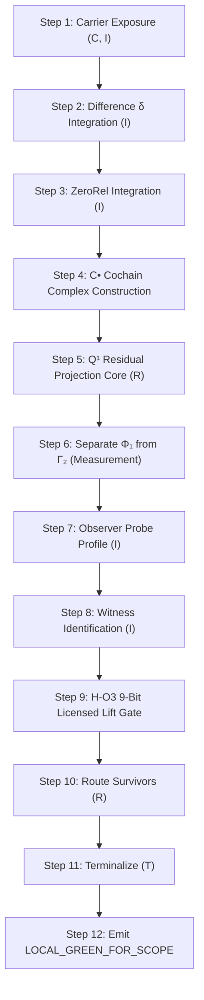

# Prime Triad Level 03: Prime 000 Phase 2 — The 12-Step Obstruction Packet Fill Order & Scoped Terminalization

**AuthorityEffect:** None. Complete mathematical and runtime reference for the 12-step obstruction packet fill order, `PrimeAlgos0Receipt`, and scoped terminalization; no operational authorization is conferred.

---

## 1. Executive Context: The 12-Step Operational Runner

Once a declaration is validated and admitted by Prime 000 Phase 1, the runtime invokes [`run_prime_algorithm_0`](../../../../../omega_engine/crates_rs/omega_wdp/src/prime_algos/prime_algorithm_0.rs#L663) or [`run_admitted`](../../../../../omega_engine/crates_rs/omega_wdp/src/prime_algos/prime_algorithm_0.rs#L382).

The runner executes a **binding 12-step obstruction packet fill order**. Every run records its operational letters onto a [`DdaTrace`](../../../../../omega_engine/crates_rs/omega_wdp/src/ddc/dda_alphabet.rs), validates mathematical invariants step-by-step, and emits a cryptographic, scope-bound [`PrimeAlgorithm0Receipt`](../../../../../omega_engine/crates_rs/omega_wdp/src/prime_algos/prime_algorithm_0.rs#L257).

---

## 2. Step-by-Step Breakdown of the 12-Step Fill Order



### Steps 1–3: Carrier, Primitive Difference & ZeroRel (Admitted Replay)
- **Step 1:** Emits `C` (`ContextExposure`) declaring carrier $K$ and `I` (`Integration`) opening the audit ledger.
- **Step 2:** Emits `I` recording the primitive difference $\delta = \omega \in C^1$.
- **Step 3:** Emits `I` recording the ZeroRel rule (gauge equivalence kernel $\operatorname{im} d_0$).

### Step 4: Cochain Complex Construction ($C^\bullet$)
- If the domain justifies a cochain packet, the complex dimensions $(\dim C^0, \dim C^1, \dim C^2)$ are constructed.
- Exact nilpotency $d_1 \circ d_0 = 0$ is asserted. If $d_1 \circ d_0 \neq 0$, the step emits a typed refusal.

### Step 5: $Q^1$ Residual Projection Core (`R`)
- Projects primitive difference $\delta$ into the quotient space $Q^1 = C^1 / \operatorname{im}(d_0)$, isolating the non-gauge residual component. Emits operational letter `R`.

### Step 6: Separate $\Phi_1$ from $\Gamma_2$ (Measurement)
- **Crucial Invariant:** Measurement occurs **strictly after admission** (Step 6), never before!
- Computes exact rational masses:
  - $\Phi_1 = \|[h]\|_{Q^1} = \min_{\phi \in C^0} \|h - d_0 \phi\|_1$ (Quotient Residual Mass).
  - $\Gamma_2 = \|d_1 h\|_1$ (Closure Defect Charge).
- Determines the [`DefectBranch`](../../../../../omega_engine/crates_rs/omega_wdp/src/prime_algos/prime_algorithm_0.rs#L69):
  - **`Closed`:** $\Phi_1 = 0 \land \Gamma_2 = 0$ (Removable gauge defect).
  - **`Open`:** $\Gamma_2 > 0$ (Non-closed boundary rupture; curl present).
  - **`StabilizedSurvivor`:** $\Phi_1 > 0 \land \Gamma_2 = 0$ (Harmonic topological obstruction).

### Steps 7–8: Observer Probe & Witness Identification
- **Step 7:** Emits `I` binding the observer detector profile and resolution envelope $J_L$.
- **Step 8:** Emits `I` binding the replay witness certificate $\chi$.

### Step 9: H-O3 Licensed Lift Gate
- Evaluates whether representation extension across carriers ($C^n \to C^{n+1}$) is licensed.
- Candidates must pass [`step9_licensed_lift_gate`](../../../../../omega_engine/crates_rs/omega_wdp/src/prime_algos/licensed_lift_gate.rs#L489) enforcing the **PaperER003 nine up-lift bits**:
  - If admitted, emits `Λ` (`Lift`).
  - If branch is `Open` ($\Gamma_2 > 0$), attempts same-level exact repair emitting `E`.
  - If branch is `Closed`, skips lift search.

### Step 10: Survivor Routing (`R`)
- Routes un-discharged residuals based on branch status and lift outcome. Emits letter `R`.

### Step 11: Terminalization (`PrimeTerminal`)
- Maps the active cochain state to a formal terminal kind:
  - `Certificate`: Branch is `Closed`.
  - `Repair`: Lift was admitted under the 9-bit gate.
  - `OracleNeeded`: Harmonic residual survives (`StabilizedSurvivor`).
  - `OpenResidual`: Non-closed rupture persists (`Open`).
  - `Refusal`: Evaluation or gate refused.

### Step 12: Scoped Terminalization (`OE001-04`)
- Emits scoped status $\mathsf{LOCAL\_GREEN\_FOR\_SCOPE}(\text{scope}, \text{remaining\_obligations})$.
- **No Global Green Rule:** Under no circumstances does terminalization convert a local repair into an un-scoped global green certificate.

---

## 3. Structural Anatomy of `PrimeAlgorithm0Receipt`

The resulting receipt is an immutable, machine-auditable artifact:

```rust
#[derive(Debug, Clone, PartialEq, Eq, Serialize)]
pub struct PrimeAlgorithm0Receipt {
    pub domain: PrimeDomain,
    pub branch: DefectBranch,
    pub terminal: PrimeTerminal,
    pub phi1: Option<u64>,
    pub gamma2: Option<u64>,
    pub letter_tape: String,           // e.g. "C I I I R I I I R T"
    pub letters_spaced: String,
    pub trace_terminal: String,
    pub residual_family_label: String,
    pub authority_effect: AuthorityEffect, // Invariantly AuthorityEffect::None
    pub steps: Vec<PrimeStepRecord>,
    pub evidence_provenance: EvidenceProvenance,
}
```

### Evidence Provenance: Fixture vs. Verifier
Every receipt explicitly declares how its numerical values were obtained:
```rust
pub enum EvidenceProvenance {
    /// Adapter-declared constants. Structure real, numbers fixtures.
    FixtureDrivenStructuralDemo,
    /// Masses computed by a verifier in this crate from an actual finite object.
    VerifierProduced,
}
```
Publishing fixture-driven structural numbers as empirical proofs is an integrity violation prevented by this enum.

### Three-File Manifest Parity (ADR-009)
When calling `receipt.write_files(run_dir)`, the engine writes the JSON receipt under **all three canonical filenames** with identical byte content:
1. `prime_algorithm_0_receipt.json`
2. `oeprmalg0_receipt.json`
3. `prime000_receipt.json`
accompanied by `letter_tape.txt`.

---

## 4. Conformance Audit Laws (`prime_algorithm_0_conformance.rs`)

The conformance verifier ([`prime_algorithm_0_conformance.rs`](../../../../../omega_engine/crates_rs/omega_wdp/src/prime_algos/prime_algorithm_0_conformance.rs)) checks receipts against structural laws:

1. **The R-Law (Residual Projection Invariance):**  
   An `R` step projects out gauge potential; it **must not move $\Phi_1$**:
   $$\Phi_1(\text{after } R) = \Phi_1(\text{before } R)$$
   The conformance auditor inspects consecutive `PrimeStepRecord` entries to confirm this equality.
2. **The D-Law (Descent Loss Accounting):**  
   A `D` step discarded information. Emitting `D` without a non-empty, audited `loss_ledger` is strictly rejected:
   $$\operatorname{loss\_ledger} \neq \varnothing \quad \text{for every } D \text{ step}$$
3. **The Authority-Is-None Invariant:**  
   If `receipt.authority_effect != AuthorityEffect::None`, the receipt is rejected as an invalid counterfeit.

---

## 5. Self-Assessment Micro-Checks

1. **Why does Step 6 record $\Phi_1$ and $\Gamma_2$ separately rather than summing them into a composite error?**  
   *Answer:* $\Phi_1$ is a quotient distance to gauge transformations ($\operatorname{im} d_0$), whereas $\Gamma_2$ is a 2-obstruction measuring non-closure ($\|d_1 h\|$). Summing them conflates boundary gauge with topological curl, destroying the defect trichotomy.
2. **Under what condition does terminalization emit `PrimeTerminal::Certificate`?**  
   *Answer:* Only when the defect is strictly in branch `Closed` ($\Phi_1 = 0 \land \Gamma_2 = 0$) under an adequate observer.
3. **What is the difference between `FixtureDrivenStructuralDemo` and `VerifierProduced`?**  
   *Answer:* `FixtureDrivenStructuralDemo` indicates the structural trace was evaluated using hardcoded adapter constants, while `VerifierProduced` certifies that all masses were calculated directly from a finite simplicial cochain complex by the linear solver.

---

## 6. Claim Hygiene Quadrant

1. **What this supports:**
   - 12-step cochain packet filling produces fully deterministic DDC letter tapes.
   - Conformance checking verifies that `R` steps preserve $\Phi_1$ and `D` steps book losses.
2. **What this does not support:**
   - Does not establish global convergence or termination of multi-agent dialogue loops.
   - Does not license converting $\mathsf{LOCAL\_GREEN\_FOR\_SCOPE}$ into global authority.
3. **The narrowest defensible claim:**
   - A valid `PrimeAlgorithm0Receipt` certifies that the declared difference was evaluated according to the 12-step fill order and that its terminal state matches the measured defect branch under `AuthorityEffect: None`.
4. **Next test needed:**
   - Run conformance tests via `cargo test --manifest-path omega_engine/crates_rs/omega_wdp/src/prime_algos/Cargo.toml --lib prime_algorithm_0_conformance`.
