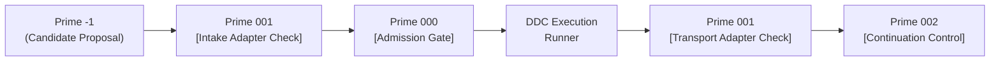

# Prime Triad Level 04: Prime 001 — Dual Boundary Placement & Transport Soundness

**AuthorityEffect:** None. Complete mathematical and runtime specification for Prime 001 intake and transport adapter soundness, loss ledgers, and validity non-conferral; no operational authorization is conferred.

---

## 1. Executive Context: The One Law of Transport

When moving between different representations (e.g. from an AST to a simplicial complex, or from a 2D mesh to a 3D volume), developers are tempted to assume that a property verified in the source system automatically holds in the target system.

In the Omega Engine, this is explicitly forbidden by **The One Law**:

$$\boxed{\begin{gathered}
\text{\textbf{Translation does not confer validity.}} \\
\text{A judgment that held on carrier } A \text{ arrives on carrier } B \text{ as \textbf{proposed}, never as \textbf{admitted}.}
\end{gathered}}$$

An adapter that upgrades status while moving carriers is an **authority-laundering device**, and it is the easiest one to construct by accident. Consequently, [`TransportedPacket`](../../../../../omega_engine/crates_rs/omega_wdp/src/prime_algos/prime_algorithm_1.rs#L180) has no constructor that yields an admitted status, and [`TransportStatus`](../../../../../omega_engine/crates_rs/omega_wdp/src/prime_algos/prime_algorithm_1.rs#L141) has no variant meaning "valid here because it was valid there".

---

## 2. Dual Boundary Placement Protocol (`OE002-01`)

To prevent ungrounded or invalid translations from contaminating the execution log, Prime 001 stands guard at **two distinct boundary points**:



1. **Intake Adapter Check:** Evaluates raw artifact $\to$ candidate packet translation before Prime 000 admission. It verifies that user-supplied entities map consistently to known problem families.
2. **Transport Adapter Check:** Evaluates inter-carrier transport steps whenever an operational DDC step shifts between distinct carriers ($C_{\mathrm{source}} \to C_{\mathrm{target}}$).

---

## 3. Adapter Descent Soundness & Loss Ledgers (`OE002-02`)

An adapter $\alpha: C_{\mathrm{source}} \to C_{\mathrm{target}}$ transitions cochains between differing simplicial carriers. An adapter is **sound** if and only if it satisfies four mathematical invariants:

1. **Differential Commutation:**
   $$d_{\mathrm{target}} \circ \alpha = \alpha \circ d_{\mathrm{source}}$$
2. **Witness Preservation:** Dual certificates in the source remain valid or are mapped under bounded Lipschitz distortion.
3. **Loss Accounting via $L_{\mathrm{adapter}}$:** All dropped coordinates, collapsed dimensions, or forgotten gauge phases are booked in an explicit `LossLedger`:
   $$L_{\mathrm{adapter}} = \{(\text{dimension}, \text{dropped\_basis}, \text{norm\_loss})\}$$
4. **Promotion Freeze on Debt:** If $L_{\mathrm{adapter}} \neq \varnothing$, the adapter emits `ADAPTER_DEBT` and halts automatic promotion (`HANDOFF-002`). Smuggling mathematical structures without explicit adapters is strictly forbidden.

---

## 4. The Sealed LossLedger Architecture: `prime_algorithm_1.rs`

In [`prime_algorithm_1.rs`](../../../../../omega_engine/crates_rs/omega_wdp/src/prime_algos/prime_algorithm_1.rs#L49), `LossLedger` is constructed as a sealed record:

```rust
# [derive(Debug, Clone, PartialEq, Eq, Serialize)]
pub struct LossLedger {
    scope: ScopeBinding,
    entries: BTreeMap<String, usize>,
    sound: bool,
}
```

### Key Architectural Invariants of `LossLedger`:
- **Immutable & Sealed:** Entries are private and there is no mutator function. A ledger cannot be edited or shrunk after construction.
- **Empty is a Positive Claim:**
  ```rust
  pub fn empty(scope: ScopeBinding) -> Self
  ```
  An empty ledger asserts the positive claim that *nothing was lost*. Prime 002's skeleton-preservation law explicitly distinguishes "nothing was lost" (`is_empty() == true`) from "no ledger was produced".
- **Zero-Count Rejection:**
  Booking "we lost 0 edges" as an entry is rejected as unsound (`sound: false`). Recording a zero count hides the distinction between a measured zero and an unmeasured field.
- **Cryptographic Commitment:**
  `ledger.commit()` produces a domain-separated SHA-256 digest:
  $$\operatorname{commit}(L) = \operatorname{SHA256}(\texttt{"oeprm.ledger.v1"} \parallel \operatorname{scope} \parallel \operatorname{entries} \parallel \operatorname{sound})$$
  which is folded into the tape head of the execution runner.

---

## 5. Transport Implementation: `transport` Function

Moving a packet across carriers is performed via [`transport`](../../../../../omega_engine/crates_rs/omega_wdp/src/prime_algos/prime_algorithm_1.rs#L214):

```rust
pub fn transport(
    from: Hash256,
    to: Hash256,
    payload: Hash256,
    ledger: LossLedger,
    _source_was_admitted: bool,
) -> Result<TransportedPacket, TransportRefusal> {
    if from == to {
        return Err(TransportRefusal::SameCarrier);
    }
    if ledger.scope().carrier() != &from {
        return Err(TransportRefusal::UnsoundLedger {
            detail: format!(
                "ledger bound to carrier {} does not match transport source {}",
                crate::prime_scope::short(ledger.scope().carrier()),
                crate::prime_scope::short(&from),
            ),
        });
    }
    if !ledger.is_sound() {
        return Err(TransportRefusal::UnsoundLedger {
            detail: ledger.to_string(),
        });
    }
    Ok(TransportedPacket {
        from,
        to,
        payload,
        ledger,
        status: TransportStatus::Proposed,
    })
}
```

Notice:
1. `from == to` is refused with `SameCarrier`. Transport is across different carriers; calling it transport on the same carrier would book false losses.
2. `_source_was_admitted` is accepted in the signature and **deliberately ignored for status assignment**. The resulting `TransportedPacket.status` is always `TransportStatus::Proposed`.

---

## 6. Refusal & Debt Taxonomy (`OE002-03`)

The transport layer categorizes boundary defects into three formal classes:

1. **`REFUSED_UNTYPED`:** Raw input cannot be mapped to any known carrier signature or observer probe.
2. **`ADAPTER_INADEQUATE`:** Candidate carrier mapping exists but fails boundary operator commutation ($d_{\mathrm{target}} \circ \alpha \neq \alpha \circ d_{\mathrm{source}}$) or dual witness preservation.
3. **`REFUSED_ADAPTER_DEBT`:** Transport across carrier boundaries discarded essential information without an audited loss ledger (`C · M · T`).

---

## 7. Self-Assessment Micro-Checks

1. **Why does `transport` refuse when `from == to`?**  
   *Answer:* Transport represents an inter-carrier shift. Invoking transport when the source and target carriers are identical would falsely create a loss ledger for an intra-carrier step.
2. **Why does `transport` take `_source_was_admitted` if it ignores it?**  
   *Answer:* To ensure that the caller explicitly acknowledges the discarded status at the call site, making authority stripping visible in the code.
3. **Can a caller remove entries from a `LossLedger` once constructed?**  
   *Answer:* No. Fields are private and no mutation functions exist, preventing after-the-fact ledger tampering.

---

## 8. Claim Hygiene Quadrant

1. **What this supports:**
   - Formal mathematical guarantee that packet transportation between carriers never elevates or preserves admission status.
   - Exact tracking and cryptographic binding of discarded representation data via sealed loss ledgers.
2. **What this does not support:**
   - Does not establish that any given projection or loss ledger recovers discarded information.
   - Does not prove that target representations preserve semantic equivalence under arbitrary nonlinear embeddings.
3. **The narrowest defensible claim:**
   - Every `TransportedPacket` carries `TransportStatus::Proposed` and an immutable, scope-bound `LossLedger` recording all admitted dimension reductions under `AuthorityEffect: None`.
4. **Next test needed:**
   - Run transport soundness tests via `cargo test --manifest-path omega_engine/crates_rs/omega_wdp/src/prime_algos/Cargo.toml --lib prime_algorithm_1`.
