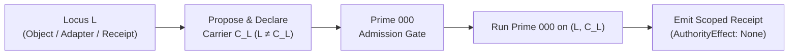

# Prime Triad Level 07: CODA Recursive Re-Entry, Cⁿ Ascent & Non-Authority

**AuthorityEffect:** None. Complete mathematical and runtime reference for CODA recursive re-entry $\Omega_{000}(L)$, lawful $C^n$ ascent, evaluator defect linearity, and sovereign non-authority; no operational authorization is conferred.

---

## 1. Executive Context: Universal Self-Examination Without Authority Inflation

In complex agentic architectures, the evaluator itself is an object that must be subject to scrutiny. An engine that cannot audit its own rules, adapters, or receipts is epistemically blind. However, an engine that audits itself and awards itself operational authority creates circular self-validation.

The **CODA Recursive Re-Entry & Ascent Protocol** solves this dilemma:

$$\boxed{\begin{gathered}
\text{Algorithm Prime 000 may be recursively re-entered at \textbf{any} CODA locus } L \in \text{CODA}, \\
\text{provided a candidate carrier } C_L \text{ is explicitly declared }(L \neq C_L), \\
\text{and the resulting evaluation unconditionally emits } \textbf{AuthorityEffect: None}.
\end{gathered}}$$

---

## 2. CODA Recursive Re-Entry Protocol (`OE004-01`)

Under monograph claim `OE004-01`, re-entry is parameterized by an arbitrary locus:

$$\Omega_{000}(L) \Longrightarrow \bigl(\text{Carrier}=C_L,\ \mathrm{ZeroRel}_L,\ \text{Observer}=J_L,\ \text{Witness}=\chi_L,\ \text{Residual}=R_L,\ \text{Quotient}=Q_L \bigr)$$



### The Strict Locus vs. Carrier Separation ($L \neq C_L$)
- **The Locus ($L$):** The specific entity under examination (e.g., an adapter contract, a Lean 4 proof file, a PR changeset, or the engine's own internal state $L_{\mathrm{self}}$).
- **The Carrier ($C_L$):** The declared combinatorial simplicial complex or chain module in which primitive differences on $L$ are represented.
- **The Failure Mode:** Conflating $L$ with $C_L$ without an explicit typing witness silently bypasses the Prime -1 intake compiler, treating unstructured text or code as an axiomatic simplicial complex.

In Python reference implementation (`oe_prime_algorithms.py#L1332`):
```python
def coda_reentry(
    self, locus_id: str, carrier_declared: bool = False, carrier: Optional[SimplicialCarrier] = None
) -> Dict[str, Any]:
    if not carrier_declared or (carrier is not None and not carrier.validate()):
        return {
            "locus": locus_id,
            "status": "REFUSED_UNTYPED_LOCUS_WITHOUT_CARRIER",
            "authority_effect": "None",
        }
    return {
        "locus": locus_id,
        "carrier": f"carrier_for_{locus_id}",
        "status": "REENTERED_ADMITTED",
        "authority_effect": "None",
    }
```

---

## 3. Lawful $C^n$ Degree Ascent Protocol (`OE004-02`)

Ascending from complex $C^k$ to $C^{k+1}$ across representation orders is permitted if and only if the evaluation establishes three conditions:

1. **Differential Complex Declaration:**  
   Declares carrier complex $C^k$, boundary operator $d^k: C^k \to C^{k+1}$, next operator $d^{k+1}: C^{k+1} \to C^{k+2}$, and exact nilpotency:
   $$d^{k+1} \circ d^k = 0$$
2. **Monotone Phase Embedding (`Prime.embedding_order_preserving`):**  
   Given an order-preserving map embedding admission into execution ($\operatorname{admit}(P) \le \operatorname{measure}(P)$), admission precedence is faithfully preserved in the execution trace.
3. **Exhibited Higher Obligation:**  
   Satisfies Law 1 (No Degree Laundering) via an exhibited $(k+1)$-dimensional obligation witness.

---

## 4. Evaluator Defect Linearity (`OE004-05`)

When composing multiple evaluators across layered complexes, local component success rates do not generally predict end-to-end composite success.

Let $\Omega$ be a finite probability space. Let $E_g: A \otimes B \to [0, 1]$ be a global composite evaluator, and $E_1: A \to [0, 1], E_2: B \to [0, 1]$ be local component evaluators. Define the global pass rate and joint local pass rate:

$$\mathrm{GPR} := \mathbb{E}[E_g(A \otimes B)], \qquad \mathrm{LPR} := \mathbb{E}[E_1(A) E_2(B)]$$

The pointwise evaluator defect is:
$$\Delta_E(A, B) := E_g(A \otimes B) - E_1(A) E_2(B)$$

By linearity of expectation over the joint probability measure:

$$\boxed{\mathrm{GPR} - \mathrm{LPR} = \mathbb{E}[E_g(A \otimes B) - E_1(A) E_2(B)] = \mathbb{E}[\Delta_E]}$$

### Consequences of Defect Linearity:
- When evaluators decouple without cross-module obstruction ($\Delta_E = 0$ pointwise), local pass rates predict global performance identically ($\mathrm{GPR} = \mathrm{LPR}$).
- If $\Delta_E < 0$, the system suffers from **Local Green, Global Red (LGGR)**: components pass independently while the composition fails.
- Notice that $\mathbb{E}[\Delta_E] = 0$ can occur via cancellation unless $\Delta_E \ge 0$; only an exact pointwise defect audit prevents false confidence.

---

## 5. Stop Conditions: GTLA_STOP vs. GTTA_GLOBAL_RESIDUAL (`OE004-03`)

When a recursive re-entry loop terminates with un-repaired obstructions, the engine categorizes the stop condition into two orthogonal classes:

1. **`GTLA_STOP` (Local Layered Authority Stop):**  
   The evaluation halted locally due to a missing carrier, an inadequate detector, an absent dual witness certificate, or budget exhaustion ($B < \delta_{\mathrm{control}}$). The residual is local to the declared scope.
2. **`GTTA_GLOBAL_RESIDUAL` (Global Topological Obstruction):**  
   The residual survives transport across all admissible adapters and remains non-zero in all licensed representations. It represents an ambient, irreducible topological obstruction in the problem space.

---

## 6. The Non-Authority Sovereign Invariant: `omega_prime_algos` & `descent_engine.rs`

A left-over class is not standing. In the Omega Engine, evaluation never awards authority. In [`descent_engine.rs`](../../../../../omega_engine/crates_rs/omega_wdp/src/prime_algos/descent_engine.rs#L58-L64), external authority grants are strictly refused by the coordinator:

```rust
pub fn execute_descent_with_grant(
    &mut self,
    carrier: &FiniteCarrier2,
    omega: &[i128],
    grant: Option<&ExternalAuthorityGrant>,
) -> Result<DescentExecutionReceipt, DescentRefusal> {
    if grant.is_some() {
        return Err(DescentRefusal::HaltingLaw(
            "EXTERNAL_GRANT_VERIFIER_UNAVAILABLE: external authority grant cannot be verified"
                .to_string(),
        ));
    }
    // ...
}
```

Every receipt emitted by the Prime Triad in `omega_prime_algos`—whether [`PrimeAlgorithm0Receipt`](../../../../../omega_engine/crates_rs/omega_wdp/src/prime_algos/prime_algorithm_0.rs#L257), [`LossLedger`](../../../../../omega_engine/crates_rs/omega_wdp/src/prime_algos/prime_algorithm_1.rs#L49), [`TerminalControlState`](../../../../../omega_engine/crates_rs/omega_wdp/src/prime_algos/prime_algorithm_2.rs), or [`DescentExecutionReceipt`](../../../../../omega_engine/crates_rs/omega_wdp/src/prime_algos/descent_engine.rs#L14)—asserts `AuthorityEffect::None`. Even after exhausting all anti-cheat laws and achieving $\Phi_1 = 0, \Gamma_2 = 0$, the engine certifies mathematical consistency within the declared scope, but never confers operational authority or external execution rights.

---

## 7. Self-Assessment Micro-Checks

1. **Why does CODA re-entry $\Omega_{000}(L)$ require proposing a carrier $C_L$ distinct from locus $L$?**  
   *Answer:* The locus is the artifact or module under examination, whereas the carrier is the formal simplicial complex providing vertices, edges, and coboundary operators. Conflating them treats unstructured text as an axiomatic space.
2. **What does $\mathbb{E}[\Delta_E] < 0$ indicate in multi-evaluator compositions?**  
   *Answer:* It proves that the composite system fails more frequently than predicted by local component evaluators, witnessing cross-module obstruction (Local Green, Global Red).
3. **What is the difference between `GTLA_STOP` and `GTTA_GLOBAL_RESIDUAL`?**  
   *Answer:* `GTLA_STOP` indicates local resource or carrier exhaustion on a specific representation, while `GTTA_GLOBAL_RESIDUAL` represents an ambient obstruction that persists across all admissible representation adapters.

---

## 8. Claim Hygiene Quadrant

1. **What this supports:**
   - Formal specification of recursive re-entry $\Omega_{000}(L)$ over declared simplicial complexes.
   - Exact mathematical derivation of evaluator defect linearity $\mathrm{GPR} - \mathrm{LPR} = \mathbb{E}[\Delta_E]$.
   - Sovereign non-authority enforcement across all emitted receipts.
2. **What this does not support:**
   - Does not establish that any finite evaluation engine achieves global self-proving completeness (Gödelian boundaries apply).
   - Does not license operational authority or automated code promotion.
3. **The narrowest defensible claim:**
   - Recursive re-entry under Prime 000 evaluates the declared locus strictly within the specified carrier and observer envelope, emitting scoped receipts under `AuthorityEffect: None`.
4. **Next test needed:**
   - Run the descent coordinator integration tests: `cargo test --manifest-path omega_engine/crates_rs/omega_wdp/src/prime_algos/Cargo.toml --test test_descent_engine`.
   - Run re-entry and non-authority regression tests via `py -3.12 -m pytest omega_engine_operations/tests/release/test_release_models_and_lggr.py`.
