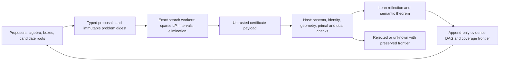

# MUB6 adversarial audit and Symbol Game architecture — 2026-09-22

**AuthorityEffect: None.**

**stated region only; mints no authority**

Audited repository: `C:\Users\a343o\source\repos\MUB6`. Baseline: `a4ae32f2201a92330c2a237490a545c6c7cee35d`. A fresh fetch of `origin/main` found that local `main` already matched it, with zero commits ahead or behind. No merge was needed.

This report covers all requested entry points and their relevant dependencies. It is a broad adversarial review, not a certificate that every defect in the repository has been found. The baseline production sources were not patched. Proposed changes are supplied separately and exercised in ignored scratch copies. No commit, push, publication, or upstream classification import was performed.

## 1. Executive Assessment & Epistemic Verdict

**Blocking mathematical claim gaps and concrete software acceptance errors were found.** The present stack supports useful exact algebraic lemmas, conditional abstract interfaces, and executable local checks. It does not supply the advertised discharge of its classification and concrete coverage premises. Several successful checks certify labels or caller-provided conclusions instead of the intended matrix property.

The most direct software counterexample is in the Rust Krawczyk API: for `f(x)=x²−1`, `X=[9/10,11/10]`, and the accepted custom center `x₀=2`, it returns `K(X)=[129/200,169/200]` and `is_disjoint=true`, although the exact root `1` lies in `X`. This is a false root-exclusion result for that public input path. [Reproducer](C:/Users/a343o/source/repos/MUB6/research/audit_2026_09_22/rust_probes.rs:10), [executed result](C:/Users/a343o/source/repos/MUB6/scratch/audit_2026_09_22/rust_probes.log).

There is also an exactness boundary failure: the Python governor admits a floating edge weight and converts it using `Fraction`. A triangle with weights `(0.1,1,1)` and unit claims produces `10808639105689191/36028797018963968`, rather than the intended decimal-rational `3/10`. This establishes float-to-rational laundering at an input boundary. I did **not** find evidence that the reviewed core certifiers deliberately run an approximate cancellation and then disguise the result as an exact identity. Float diagnostics elsewhere must be assessed by their acceptance path, not by token searches alone. [Probe results: `float_weight_laundering`](C:/Users/a343o/source/repos/MUB6/scratch/audit_2026_09_22/probe_results.json).

The Lean kernel is not the source of the principal claim failures. Fresh dependency queries for **231 declarations** in the fourteen focal Lean modules reported only subsets of `{propext, Classical.choice, Quot.sound}`. The selected synthesis results had no `sorryAx`. A comment-stripped scan of the tracked Lean sources found no explicit `axiom`, `sorry`, `admit`, `native_decide`, or `implemented_by` tokens. This is a declaration/dependency audit, not an independent audit of the Lean implementation or every imported library. Older notes about custom axioms do not describe this baseline. [Gluing dependency output](C:/Users/a343o/source/repos/MUB6/scratch/audit_2026_09_22/gluing_axioms.log), [Mathlib dependency output](C:/Users/a343o/source/repos/MUB6/scratch/audit_2026_09_22/mathlib_axioms.log), [scan](C:/Users/a343o/source/repos/MUB6/scratch/audit_2026_09_22/static_scan.json).

I found no literal `A ∧ ¬A` shortcut in the selected synthesis bodies. The consequential weakness is that some input structures already carry the desired obstruction or root, while other output labels have no concrete membership meaning. Their small axiom footprint does not establish that the intended concrete hypotheses are inhabited or discharged. The contradictory toy branches in the algebra modules are legitimate local refutation targets, not evidence for classification. [Input-obstruction audit theorem](C:/Users/a343o/source/repos/MUB6/research/audit_2026_09_22/GluingProbes.lean:16), [A12 root-bearing structure](C:/Users/a343o/source/repos/MUB6/lean4/gluing/TargetA12SmaleSentry.lean:198).

| Verification performed | Result and limit |
|---|---|
| Python repository suite, isolated basetemp/cache, eight workers | **504 passed, 1 skipped**. The skip is the optional PyTorch mechanism-proposer check. [Log](C:/Users/a343o/source/repos/MUB6/scratch/audit_2026_09_22/pytest.log). |
| Rust A10–A13, B1–B3 and adversarial L1 integration tests | **109 passed** across eight test binaries. [Log](C:/Users/a343o/source/repos/MUB6/scratch/audit_2026_09_22/rust_targets.log). |
| Both pinned Lean package builds | Success: gluing 91 jobs; Mathlib package 8,754 jobs. These builds reused existing artifacts and are not described as cache-free replays. [Gluing](C:/Users/a343o/source/repos/MUB6/scratch/audit_2026_09_22/lean_gluing_build.log), [Mathlib](C:/Users/a343o/source/repos/MUB6/scratch/audit_2026_09_22/lean_mub_build.log). |
| Fresh audit Lean files and dependency queries | Compiled against the package environments; expose actual statement scope and accepted weak predicates. The pilot attack inputs use `#eval`, not a new kernel-reflection theorem. [Gluing probes](C:/Users/a343o/source/repos/MUB6/research/audit_2026_09_22/GluingProbes.lean), [Mathlib probes](C:/Users/a343o/source/repos/MUB6/research/audit_2026_09_22/MathlibProbes.lean). |
| Ten artifact digests | All ten match their manifest after canonical CRLF-to-LF normalization. The classification manifest contains **no source SHA-256 digests** to check. Matching bytes do not validate the mathematical contents. [Digest results](C:/Users/a343o/source/repos/MUB6/scratch/audit_2026_09_22/probe_results.json). |
| Adversarial inputs | Fabricated theorem records, empty case records, duplicate receipt entries, inconsistent B3 summaries, and a gapped B1 chain were accepted by their respective baseline checks. See §2. |

**What survives mathematical inspection.** The concrete dephasing formula `Dᵢⱼ = conj(Hᵢ₀) Hᵢⱼ H₀₀ conj(H₀ⱼ)` preserves `IsCH6` and provides an equivalent dephased representative under the stated entrywise-unit hypotheses: `MUB.ConcreteSemantics.dephase_isCH6`, `equivalent_dephase`, and `dephase_exists`. The real/imaginary encoding has 50 free real coordinates, and `isCH6_decode_of_satisfies55` / `satisfies55_of_isCH6_decode` connect its 55 equations to one dephased Hadamard matrix. These are substantive foundations. They do not classify named families or encode compatibility of an entire tuple of bases. Joint mutual unbiasedness requires a common ambient transformation, as specified in P1; independent left-dephasing of each matrix is not licensed by these single-matrix theorems. [ConcreteSemantics](C:/Users/a343o/source/repos/MUB6/lean4/012_mutually_unbiased_bases/MUB/ConcreteSemantics.lean:261), [PolynomialEncoding](C:/Users/a343o/source/repos/MUB6/lean4/012_mutually_unbiased_bases/MUB/PolynomialEncoding.lean:233).

The requested upper-bound identity is correct as an identity over rational coefficients:

\[
-1=-\tfrac13(x^2+y^2-1)+\tfrac13(x-2)^2+\tfrac13y^2+\tfrac43(x-2).
\]

The two squared terms with coefficient `1/3` are nonnegative over the reals, and `4/3` is positive. The Lean statements `positivstellensatz_upper_identity`, `sigma0_upper_nonneg`, and `sigma1_upper_nonneg` establish these particular facts. The lower-bound identity, annihilated-entry identity, and all-ones-row identity also passed independent exact coefficient expansion; every residual coefficient was zero. [CADBranch](C:/Users/a343o/source/repos/MUB6/lean4/012_mutually_unbiased_bases/MUB/CADBranch.lean:88), [GroebnerBranch](C:/Users/a343o/source/repos/MUB6/lean4/012_mutually_unbiased_bases/MUB/GroebnerBranch.lean:62), [coefficient-check results](C:/Users/a343o/source/repos/MUB6/scratch/audit_2026_09_22/probe_results.json).

Excluding `x≥2` and `x≤−2` does not by itself give `−1≤x≤1`. The latter conclusion uses the additional circle equation `x²+y²=1` and nonnegativity of `y²` in `CaseCoverage.x_sq_le_one` and `x_abs_le_one`; their stated hypotheses are adequate. The incompatible-phase lemma currently takes `y₁=0` explicitly. Its displayed identity is valid for that statement, but the comment suggesting an implemented certificate using only the earlier four generators is stronger than the actual interface. [CaseCoverage](C:/Users/a343o/source/repos/MUB6/lean4/012_mutually_unbiased_bases/MUB/CaseCoverage.lean:87), [phase refutation](C:/Users/a343o/source/repos/MUB6/lean4/012_mutually_unbiased_bases/MUB/GroebnerBranch.lean:132).

## 2. Itemized Mistake & Vulnerability Log

Severity concerns the intended mathematical/host use. **CRITICAL** does not mean Lean accepted an invalid proof term; it includes a missing semantic implication or false certifier acceptance that blocks the advertised conclusion. All line references below refer to the audited baseline.

### CRITICAL

| ID | Exact location | Finding and evidence | Concrete remediation |
|---|---|---|---|
| **F01** | [lean4/TargetA11OrbitExhaustiveness.lean:396](C:/Users/a343o/source/repos/MUB6/lean4/gluing/TargetA11OrbitExhaustiveness.lean:396), lines 396–417; [research/g1_foundation/classification_manifest.json:99](C:/Users/a343o/source/repos/MUB6/research/g1_foundation/classification_manifest.json:99), lines 99–115; [g1_elimination_receipt.md:8](C:/Users/a343o/source/repos/MUB6/research/g1_foundation/g1_elimination_receipt.md:8) | The two `target_c3_*unconditional*` declarations still take the classification premise and transition/atlas/gauge or global-cover bridge hypotheses. One also takes G2/G3. The manifest statement strings omit those hypotheses and its summary flags assert discharge. `#print` confirms the gap. A small standard axiom footprint does not discharge theorem arguments. | Apply **P0** below: mark the claims conditional, retain the complete premise lists, set discharge flags false, and make an attempted unconditional verifier result fail closed. A future discharge requires an actual term of the premise and a concrete semantic bridge; no Boolean replacement can supply it. |
| **F02** | [lean4/MasterClassification.lean:40](C:/Users/a343o/source/repos/MUB6/lean4/012_mutually_unbiased_bases/MUB/MasterClassification.lean:40), lines 40–103; [CaseCoverage.lean:33](C:/Users/a343o/source/repos/MUB6/lean4/012_mutually_unbiased_bases/MUB/CaseCoverage.lean:33), lines 33–65 | `InModuliClassification` is dephasing plus `cornerDet≠0 ∨ cornerDet=0`. `ModuliComponent` contains names, without parameter domains or realization maps. In `comprehensive_moduli_exhaustiveness`, the witness `c` has no membership relation to `D`; choosing a constructor satisfies its last disjunction. `master_case_routing` is a valid exhaustive zero/nonzero split for **every complex matrix**; the polynomial is total and has no undefined branch. That split does not identify a Szöllősi or Karlsson family. | Replace the claimed classification API by **P1**: a family realization predicate, concrete reconstruction map, and coverage theorem. Rename the current result to `dephase_and_route_corner` and retain it as a foundational lemma. Keep the actual classification obligation open. |
| **F03** | [lean4/TargetA10GlobalCover.lean:185](C:/Users/a343o/source/repos/MUB6/lean4/gluing/TargetA10GlobalCover.lean:185), lines 185–204, 301–311, 352–401, 546–560; [ModuliReduction.lean:108](C:/Users/a343o/source/repos/MUB6/lean4/gluing/ModuliReduction.lean:108) | `GlobalPoint` already contains `HasCurvatureCertificate pt.triple`, from which the obstruction follows without consulting a cover. The checker sums independently stored volumes, tests interval ordering, positive numerators and interface flags. It does not derive geometric volume, disjointness, full-domain coverage, or an analytic inequality. Collapsing every interval to zero width while retaining stored volumes still gives `true` **by rfl**. [Audit theorems `point_obstruction_without_cover` and `zero_width_cover_accepted`](C:/Users/a343o/source/repos/MUB6/research/audit_2026_09_22/GluingProbes.lean:16). | **P2**: remove the already-certified conclusion from the input point type; derive a concrete bound from serialized leaf evidence. Reflect the same cell payload used by Python/Rust in `KernelReflection*.lean`. Derive relative volume from active coordinates and use exact split identities plus explicit boundary coverage. |
| **F04** | [lean4/TargetB3ManifoldIntegration.lean:112](C:/Users/a343o/source/repos/MUB6/lean4/gluing/TargetB3ManifoldIntegration.lean:112), lines 112–155, 191–207, 234–295; [TargetB2GlobalGluing.lean:154](C:/Users/a343o/source/repos/MUB6/lean4/gluing/TargetB2GlobalGluing.lean:154) | B3's 28 cells are `Fin 28` records with chart labels and a fixed numerator. The pointwise predicate checks the chart and numerator, not point coordinates or the denominator. A cell with denominator `30,000,000,000` passes the same predicate. `ModuliPoint6` carries four rational coordinates without a concrete matrix realization. B3's closure construction retains the earlier premises. [Audit theorem `tiny_margin_passes`](C:/Users/a343o/source/repos/MUB6/research/audit_2026_09_22/GluingProbes.lean:35). | **P2**: use a rational inequality for the margin, geometric membership, and a semantic bound on the actual residual. Remove “pointwise” and “discharged” interpretations from the present label-only checks until those terms exist. A denominator guard alone would not establish coverage. |
| **F05** | [lean4/TargetB2GlobalGluing.lean:170](C:/Users/a343o/source/repos/MUB6/lean4/gluing/TargetB2GlobalGluing.lean:170), lines 170–208, 273–307, 339–342, 382–438 | The nerve is a fixed graph; `Nerve2` uses pairwise edges rather than evidence of a common triple intersection. Transition/cocycle laws are inputs. The selected loop `(0,1,2,0)` bounds a declared 2-simplex, so its holonomy is the identity by the supplied cocycle law: the fresh `canonical_loop_holonomy_identity` theorem establishes this for every such family. The scalar L1 circulation has no supplied map to a nontrivial unitary transport obstruction. `CP5` is a `Basis` wrapper, and the “continuous section” predicate has no topology. `HolonomyObstruction` already assumes the requisite obstruction. | **P3**: separate graph-circulation results from geometric transport; use actual overlap witnesses, transport on candidate fibers, and a correctly typed obstruction theorem. Remove the triangle as an asserted nontrivial-holonomy witness. Keep nonexistence of a global section distinct from pointwise emptiness. |
| **F06** | [omega_engine/crates/mub_verify/target_b1_continuous_chaining.py:235](C:/Users/a343o/source/repos/MUB6/omega_engine/crates/mub_verify/target_b1_continuous_chaining.py:235), lines 235–274, 370–394; [lean4/TargetB1ContinuousChaining.lean:272](C:/Users/a343o/source/repos/MUB6/lean4/gluing/TargetB1ContinuousChaining.lean:272) | The default 60 centers have spacing `1/183` and radius `1/1000`. The rational point `1/122` is `1/366` from its nearest center, so it is uncovered. Yet the auditor reports “without gaps,” comparing spacing to `delta_crit`, not to the sum of radii. It assigns `psi_sq=margin` without evaluating a matrix. The Lean propagation theorem takes base and deviation inequalities as inputs. [Probe: `chain_coverage_gap`](C:/Users/a343o/source/repos/MUB6/scratch/audit_2026_09_22/probe_results.json). | The supplied patch checks actual adjacent radii and endpoint neighborhoods; the current default sample is correctly rejected. **P4** additionally requires independently certified anchors, a derivative bound in the same coordinate/metric, and cumulative travel accounting. |
| **F07** | [omega_engine/crates/mub_verify/g1_classification_verifier.py:133](C:/Users/a343o/source/repos/MUB6/omega_engine/crates/mub_verify/g1_classification_verifier.py:133), lines 133–204; [g1_case_verifier.py:121](C:/Users/a343o/source/repos/MUB6/omega_engine/crates/mub_verify/g1_case_verifier.py:121), lines 121–166; [verify_all_receipts.py:171](C:/Users/a343o/source/repos/MUB6/omega_engine/crates/mub_verify/verify_all_receipts.py:171), lines 171–258; [target_b3_manifold_integration.py:892](C:/Users/a343o/source/repos/MUB6/omega_engine/crates/mub_verify/target_b3_manifold_integration.py:892) | A wrong schema with `Missing.theorem`, `missing.lean`, statement `False`, axiom `InventedAxiom`, and witness `0=1` is reported `VERIFIED_CLEAN`. Six empty case records pass because the ledger checker tests hardcoded identities at sample points. Ten copies of one manifest entry pass. B3 accepts zero total volume, negative minimum margin, zero circulation, and zero checked points. The case verifier also uses removable Python `assert` statements. [All four mutations](C:/Users/a343o/source/repos/MUB6/research/audit_2026_09_22/reproduce.py:59). | Supplied patch: exact expected receipt registry, uniqueness and in-root paths. **P0/P5**: return metadata-only status until payload replay exists; use explicit exceptions, strict schemas, source/theorem binding, compiler-derived dependencies, and coefficient/interval replay. Reject unknown axioms with an allowlist obtained from the compiler, not the submitted JSON. |
| **F08** | [omega_engine/crates_rs/omega_mub/src/omega_native/mub6_smale_sentry.rs:909](C:/Users/a343o/source/repos/MUB6/omega_engine/crates_rs/omega_mub/src/omega_native/mub6_smale_sentry.rs:909), lines 909–1016, 1064–1086; [lean4/TargetA12SmaleSentry.lean:198](C:/Users/a343o/source/repos/MUB6/lean4/gluing/TargetA12SmaleSentry.lean:198), lines 198–219, 274–295 | The custom-center exclusion counterexample is reproduced in §1. An empty leaf scan returns `all_positive=true`, `scanned_count=0`, `min_margin=1000000`. Lean's `SmalePointCertificate` and `KrawczykContractor` already contain a root, its zero equation and uniqueness; their existence theorems project that supplied evidence. They do not derive existence from the numerical checker. | Supplied patch rejects centers outside the box and rejects empty success. **P6** requires a concrete analytic soundness bridge and full MUB encoding before `RootCertified` can mean a MUB witness. Validate dimensions, Hessian symmetry, interval ordering, and deserialized invariants at the public boundary. |
| **F09** | [lean4/CertificatePilot.lean:251](C:/Users/a343o/source/repos/MUB6/lean4/012_mutually_unbiased_bases/MUB/CertificatePilot.lean:251), lines 251–306, 353–358 | The structural hash loses the sign of constants and uses only variable-name length. Hashes for `1` and `−1`, and for `x` and `y`, coincide. More decisively, the checker accepts sources `[1]`, multipliers `[1]` both under an unknown empty-variable branch and under the pilot tag. These are valid identities for the substituted sources; they do not certify the original pilot system. The soundness theorem requires `cert=validPilotCertificate` and ignores the check hypothesis. [Mathlib probes](C:/Users/a343o/source/repos/MUB6/research/audit_2026_09_22/MathlibProbes.lean:9). | Supplied patch pins the exact source expressions and registered branch before identity checking. Keep the existing theorem explicitly scoped to the canonical instance. **P5** requests a generic normalization/evaluation theorem before arbitrary certificates become trusted. SHA binding is an additional custody measure, not a replacement for semantic equality. |
| **F10** | [omega_engine/crates/mub_verify/l1_governor.py:43](C:/Users/a343o/source/repos/MUB6/omega_engine/crates/mub_verify/l1_governor.py:43), lines 43–54, 129–151, 280–304, 439 | Type annotations do not stop float weights or claims from crossing the Python boundary. `Fraction(e.weight)` preserves the binary float's value and gives it exact-looking output. The triangle test records the wrong decimal interpretation. | Supplied patch accepts only runtime types `int` and `Fraction`, rejects Boolean weights, validates cochain values on evaluation, and guards `step_assert`. Extend the same validation to every public section/proposal mutation and structured wire decoder before calling this a complete boundary repair. |
| **F11** | [omega_engine/crates/mub_verify/l1_governor.py:564](C:/Users/a343o/source/repos/MUB6/omega_engine/crates/mub_verify/l1_governor.py:564), lines 564–640, 755 onward | `CUT(proposed_claims={})` changes a triangle's primary obstruction from `3` to `0` and is admitted as `ExactRepair`. This is deletion of the problem's constraints, not a sound algebraic inference. Minimization of a defect does not license changing its target. [Probe: `claim_erasure_cut`](C:/Users/a343o/source/repos/MUB6/scratch/audit_2026_09_22/probe_results.json). | Supplied patch refuses claim replacements until a semantic rule exists. **P7** requires immutable problem digests, proof-carrying rewrite/split/refutation moves, and dependency-aware retractions. Use L1 descent only for search scheduling or a licensed change of potential. |
| **F12** | [omega_engine/crates_rs/omega_mub/src/omega_native/l1_discrete_solver/network_simplex.rs:15](C:/Users/a343o/source/repos/MUB6/omega_engine/crates_rs/omega_mub/src/omega_native/l1_discrete_solver/network_simplex.rs:15), lines 15–22, 163–199, 270–285, 348–395, 605–678 | This engine uses fixed-width `i128`, not unbounded rational arithmetic. `Arc.upper=Some(0)` still yields flow `1` for a two-node demand. A mathematically balanced demand sequence `[MAX,1,MIN]` panics while summing in the debug build. Further unchecked operations occur in potentials, reduced costs, negation, doubled weights, and absolute values. Release-mode overflow behavior was not executed in this audit. | Supplied patch rejects unsupported capacities, checks demand accumulation/absolute values and artificial-cost addition. It is **partial containment**. Convert all arithmetic to `BigInt`/`BigRational` or complete checked operations with explicit error propagation, then independently verify primal feasibility, dual feasibility and their objective equality. |

### WARNING

| ID | Exact location | Finding | Concrete remediation |
|---|---|---|---|
| **F13** | [omega_engine/crates/mub_verify/packet_firewall.py:197](C:/Users/a343o/source/repos/MUB6/omega_engine/crates/mub_verify/packet_firewall.py:197), lines 197–231 | `verify_step` admits an undeclared operation and bad hashes when no rule map is supplied. Its documentation describes carrier/move checks, so this is an unsafe integration surface rather than evidence that `evaluate_pipeline` omits its replay call. The full pipeline also trusts a caller-supplied implementation and does not itself invoke Lean. | Supplied patch rejects a missing rule map. Rename the shallow API `lint_step`; reserve `VERIFIED` for **P7** host execution with an internal versioned rule registry, parent-state compare-and-swap, and a checked certificate. |
| **F14** | [omega_engine/crates/mub_verify/l1_governor.py:178](C:/Users/a343o/source/repos/MUB6/omega_engine/crates/mub_verify/l1_governor.py:178), lines 178–277; [CertificatePilot.lean:180](C:/Users/a343o/source/repos/MUB6/lean4/012_mutually_unbiased_bases/MUB/CertificatePilot.lean:180), lines 180–242; [exact_simplex.rs:340](C:/Users/a343o/source/repos/MUB6/omega_engine/crates_rs/omega_mub/src/omega_native/l1_discrete_solver/exact_simplex.rs:340) | Python enumerates spanning trees and combines component candidates; the list materialization can exhaust memory. Polynomial expansion and repeated rational LU/pivots can cause coefficient and expression growth even without numeric overflow. No production-scale resource bound follows from the small passing tests. | **P8**: input caps on variables, degree, monomials, coefficient bits, graph size and nesting; streaming sparse accumulation; cancellation/time budgets returning `UNKNOWN_RESOURCE_LIMIT`; exact dual checking outside the optimizer; deterministic resume state. Replace exhaustive tree enumeration with the exact LP backend for general graphs. |
| **F16** | [MasterClassification.lean:15](C:/Users/a343o/source/repos/MUB6/lean4/012_mutually_unbiased_bases/MUB/MasterClassification.lean:15), lines 15–20; [target_a10_global_cover.py:501](C:/Users/a343o/source/repos/MUB6/omega_engine/crates/mub_verify/target_a10_global_cover.py:501), lines 501–564, 813–918 | The taxonomy treats a “four-parameter affine Fourier/Diţă” chart, a one-parameter deltoid curve and other labels as established components. The checked literature does not substantiate that taxonomy. Python A10 does perform geometric containment/overlap/volume checks, but its canonical chart cells carry assigned margin and PSD/trace labels rather than a reconstructed analytic certificate. Neither fact supplies the missing family semantics. | **P1/P2**: replace family labels with definitions and source-specific theorem references; retain generic four-phase reconstruction as a separate candidate input. Make analytic leaf validation mandatory even after geometric validation succeeds. |

### PEDANTIC

| ID | Exact location | Finding | Concrete remediation |
|---|---|---|---|
| **F15** | [TargetA10GlobalCover.lean:546](C:/Users/a343o/source/repos/MUB6/lean4/gluing/TargetA10GlobalCover.lean:546), lines 546–576; [TargetB3ManifoldIntegration.lean:391](C:/Users/a343o/source/repos/MUB6/lean4/gluing/TargetB3ManifoldIntegration.lean:391); [research/paper.md:1364](C:/Users/a343o/source/repos/MUB6/research/paper.md:1364) | The A10 Lean canonical tree has **7 leaves and stored volume 1**; the other cover reports use 28 cells and total chart volume `5001/1000`; B3 separately creates 28 labels. There is no shared serialization equivalence theorem. A13/C3 selected master results use `[propext]`, but B3 master uses `[propext, Quot.sound]`. “All masters only propext” is inaccurate, though `Quot.sound` is permitted. | Replace aggregate prose by per-object counts, serialized-source identifiers and per-theorem dependency output. Explicitly mark the representations as unbridged. Generate these fields rather than editing counts by hand. |

### Reviewable patches and remaining formal obligations

The [seven-file containment patch](C:/Users/a343o/source/repos/MUB6/research/audit_2026_09_22/proposed_fixes.patch) applies cleanly to the audited baseline. It has **not** been applied to production. Its Python and Rust guards were tested in scratch copies. The patched pilot was compiled separately and its positive/negative evaluations checked. These focused checks do not establish whole-suite compatibility of a future applied patch. Some current tests should change because they encode the permissive behavior being rejected.

For findings that require new mathematics, a short code edit cannot complete remediation. The following are concrete interface/documentation changes and explicit acceptance obligations, not completed derivations:

**P0 — Quarantine the unsupported conclusion.** In the classification manifest, set both legacy `unconditional_*_proved` fields to `false`, add `claim_status: "CONDITIONAL_FOUNDATION"`, and list the actual premises from the Lean declarations. Replace the discharge sentences in `g1_elimination_receipt.md` lines 8, 17–19, 69–70, 79 and `mub6_roadmap.md` lines 159–160 with: “Concrete dephasing, encoding, and selected branch identities are available. Family classification and the concrete global-cover bridge remain open obligations.” In `verify_classification_manifest`, replace the two “must be true” checks and the success status by:

```python
if summary.get("unconditional_grand_synthesis_proved") or summary.get("unconditional_no_fourth_basis_proved"):
    raise ValueError("No audited discharge term is bound to this manifest")
return {"status": "METADATA_ONLY", "premises_discharged": False}
```

That is an immediate honest-status patch, not a replacement mathematical verifier. Full field validation remains P5. Preserve theorem identifiers for compatibility if necessary, but document their full conditional types and deprecate misleading public aliases.

**P1 — Bind a family to a matrix.** Introduce a parameter type and a checked realization map for each actual family, with a domain predicate. The needed result has the shape `∀ H, IsCH6 H → ∃ c p D, Domain c p ∧ Realizes c p D ∧ HadamardEquivalent H D`. Its conclusion must contain `Realizes`, and that predicate must enforce concrete entries/equations rather than encode the theorem itself. For a tuple, use one common ambient unitary, plus independent right monomial transformations of the bases. Do not independently left-dephase each transition matrix. The existing `dephase_exists` is the single-matrix foundation, not this tuple theorem.

**P2 — Bind coverage to the residual.** Proposed Lean obligation: for concrete decoded systems and a closed rational box, `checkLeaf problem leaf = true → ∀ x ∈ leaf.box, Constraints problem x → residual problem x ≥ leaf.margin`; for a refutation leaf, derive the appropriate local contradiction instead. `checkCover` must establish domain inclusion in the union of checked leaves, including every boundary and exceptional stratum. No `has_cert` field belongs in the point being covered. Reflect data in the required `MUB/KernelReflection*.lean` files with `by rfl`, and separately establish the semantic implication. Volume is an auxiliary consistency check; it is not a substitute for set coverage.

**P3 — Give transport geometric content.** Replace `Nerve2 := pairwise_edges` by a triple-overlap predicate or checked witness. Index transitions by points on overlaps and state their domains. Use a real topology and a projective quotient if those words remain in the API. State whether a result excludes a compatible global section or excludes every candidate in one fiber. Nonidentity transport alone is insufficient: `diag(1,−1,1,1,1,1)` fixes the first coordinate vector, as the exact audit computation records. Any proposed projective obstruction needs a checked statement about the relevant common fixed-ray set. The current audit theorem about identity holonomy on the canonical triangle must become a regression control. [Fixed-ray counterexample receipt](C:/Users/a343o/source/repos/MUB6/scratch/audit_2026_09_22/probe_results.json).

**P4 — Bind continuation to actual data.** For each independently verified anchor `a_i`, carry a bound `R(a_i)≥ε_i` and an exact enclosure establishing a Lipschitz constant on its stated neighborhood. Propagate as `R(t)≥ε_i−L_i|t−a_i|` only there, with complete interval coverage. A sequential chain without new anchors must accumulate travel. The exact one-step arithmetic is `37249/90000−(85/9)(1/1000)=12133/30000`; subtracting that erosion 60 times yields `−13751/90000`. These numbers were independently checked; they are not a derivative certificate. If the parameter is `t=θ/π`, explicitly transform the derivative bound and enclose the required factor of π. [Arithmetic receipt](C:/Users/a343o/source/repos/MUB6/scratch/audit_2026_09_22/probe_results.json).

**P5 — Separate custody, syntax and semantics.** Pin the problem source bytes, coefficient domain, ordered variables, polynomial list, branch guards, checker/toolchain versions, and imported proof dependencies. Reject duplicate/unknown fields and noncanonical rational encodings. Verify actual coefficient identities, interval enclosures and theorem types. The desired generic pilot theorem is `checkCertificate expectedProblem cert = true → Refutes expectedProblem`; it must follow from evaluator/normalizer correctness and source equality. The present theorem requiring equality to one canonical certificate may remain as a correctly scoped special case.

**P6 — Preserve the root-search lane.** Certify a square nonsingular subsystem only as such until every omitted equation and all orthonormality constraints are established for the enclosed root. A singular Jacobian, boundary contact, failed contraction, or resource limit returns `UNKNOWN`; none is a no-root witness. For an out-of-box center, either reject it (the supplied patch) or enclose derivatives on the hull of the center and the full box. Implementing the first option is smaller. General matrix entries need real algebraic or rational-interval representation; a fixed cyclotomic fixture does not cover arbitrary phases.

**P7 — Preserve the problem under every move.** Fix a problem digest and use a typed host rule table. A cut either partitions a region with a checked covering identity, derives a consequence with a proof, or closes a leaf with a refutation. It cannot delete source equations because a defect decreases. Retraction invalidates all dependent conclusions and reopens their cells. Parent hashes and claimed deltas are checked against the host's recomputed state, not accepted as narrative fields.

**P8 — Treat exhaustion as incomplete work.** A budgeted solver returns witnesses, exact progress state, and an `UNKNOWN` reason. Empty sets of checked leaves, dropped worker results, or swallowed arithmetic failures cannot become a success. Every leaf receives a durable status, and unresolved descendants remain in the frontier.

## 3. Roadmap Solvability Analysis

The architecture can support a serious exact-certificate research program. The present implementation does not complete the proposed global objective. Faster tiling or more LLM proposals cannot repair an unbound semantic target.

**The single most dangerous theoretical bottleneck is a complete, concrete, common-gauge cover of the relevant space of compatible tuples, with the actual candidate-basis equations preserved through every chart and exceptional branch.** Single-Hadamard classification would address only one part of that obligation. The current C3 wrapper still requires `ClassificationExhaustivenessPremise` and a global-cover bridge, while the new Mathlib classification result only supplies dephasing and corner routing. This is the live dependency gap identified in F01–F05, not a forecast about the eventual mathematical answer.

The history should not be reduced to unsupported claims that named researchers or particular CAS packages “failed.” Numerical optimization locates promising points or local minima; finite samples and a small residual do not constitute a global exclusion. Brierley–Weigert report numerical searches and separately discuss exact algebraic/discretization/SDP approaches. Their 2010 review's demonstrated SDP scope is a restricted spectral-matrix case. This audit did not reproduce performance failures in Singular, Macaulay2 or Magma, or attribute particular local minima to Zauner or Bengtsson. [Numerical search paper](https://arxiv.org/abs/0808.1614), [SDP review](https://arxiv.org/abs/1006.0093).

Polynomial encoding removes the need to certify trigonometric floating-point evaluations: the repository's circle and Gram equations already provide a rational-coefficient route for a single dephased matrix. It does not remove elimination complexity, high-dimensional compatibility equations, positive-dimensional solution sets, or singular branches. In a degree-bounded multiplier search, the number of possible monomials grows combinatorially; adaptive sparse supports can help, but a failed bounded search says only that the selected ansatz did not yield a certificate. [Encoding theorems](C:/Users/a343o/source/repos/MUB6/lean4/012_mutually_unbiased_bases/MUB/PolynomialEncoding.lean:233), [general certificate evaluation theorem](C:/Users/a343o/source/repos/MUB6/lean4/012_mutually_unbiased_bases/MUB/CertificatePilot.lean:47).

The literature taxonomy also needs correction. Beauchamp–Nicoară treats the self-adjoint subclass. Szöllősi's 2010 construction introduces a generic four-parameter family and states an exhaustiveness conjecture involving that family, Karlsson's family and Tao's matrix; it is not a four-parameter affine Fourier-family classification. A curve and a set of labels cannot stand in for those definitions. [Beauchamp–Nicoară](https://arxiv.org/abs/math/0609076), [Szöllősi](https://arxiv.org/abs/1008.0632).

There is a relevant **August 2026 upstream candidate**: Cárdenes Wuttig–Tindall, version 2 dated August 28, state an order-six finite-corner classification theorem and describe accompanying Lean material. Their Theorem 6 concerns recovery from a finite corner, with explicit attention to exceptional branches. This audit inspected the paper's scope but did not pin, replay or validate its Lean dependency closure. It is a concrete reuse target, not an imported premise discharge. Even a successfully imported single-matrix theorem would still need the tuple-compatibility bridge above. [Primary preprint, Theorem 6 and Definitions 9–11](https://arxiv.org/html/2608.18053v2).

**Density is the wrong completion criterion.** A finite list of sample points does not supply a cover. Full ambient or relative volume does not account for missing boundary or isolated points. The current 28-cell summaries, B1 sample, and five-chart nerve have no established semantic cover of the concrete moduli target; the B1 sample additionally has explicit rational gaps. Retain zero-dimensional and lower-dimensional strata as first-class obligations. A stratified class space should not be assumed to be one smooth four-dimensional manifold merely because generic parameters use four phases. [F03–F06 audit witnesses](C:/Users/a343o/source/repos/MUB6/research/audit_2026_09_22/GluingProbes.lean), [B1 gap receipt](C:/Users/a343o/source/repos/MUB6/scratch/audit_2026_09_22/probe_results.json).

**A12 is a local verification component, not an exhaustive root detector.** Its synthetic root examples validate arithmetic on those examples. They do not establish reachability of every MUB candidate, treatment of singular roots, or coverage of all box boundaries. The standard α-theory workflow concerns suitably conditioned polynomial systems; overdetermined-system handling needs additional care. The repository currently has both the concrete center bug and the abstract evidence-packing gap of F08. Root search should remain available throughout the program, with overlapping/enlarged boxes where necessary and no rejection caused solely by a root lying on a split boundary. [alphaCertified primary paper](https://arxiv.org/abs/1011.1091), [A12 implementation](C:/Users/a343o/source/repos/MUB6/omega_engine/crates_rs/omega_mub/src/omega_native/mub6_smale_sentry.rs:909).

## 4. Symbol Game Solution Engine Architecture Blueprint

This section specifies **proposed interfaces and proof obligations**, not a claim that the integrated engine exists. The architecture should optimize discovery while keeping acceptance independent of the proposer.



### 4.1 Concrete target, fields and canonical data

Use the existing 50-coordinate encoding for **one** dephased Hadamard matrix. Do not pretend those 55 equations are the whole fourth-basis problem. For a normalized tuple, add complete orthonormality, pairwise unbiasedness, common-gauge data and any candidate-basis variables. In an unnormalized Hadamard representation, cross products must use the scale appropriate to that representation; the current normalized residual `|⟨b,u⟩|²−1/6` and unnormalized matrix equations must not be mixed. The bridge should be a named Lean theorem, with both directions of any claimed equivalence. [Current single-matrix encoding](C:/Users/a343o/source/repos/MUB6/lean4/012_mutually_unbiased_bases/MUB/PolynomialEncoding.lean:101), [normalized residual evaluator](C:/Users/a343o/source/repos/MUB6/omega_engine/crates_rs/omega_mub/src/omega_native/mub6_smale_sentry.rs:729).

Proposed wire types:

```text
Rational       = {num: signed_decimal_string, den: positive_decimal_string}
Monomial       = sorted [(variable_index, nonnegative_exponent)]
Polynomial     = sorted [(Monomial, reduced_Rational)]  // zero coefficients omitted
Problem        = {schema, coefficient_field, variables, equalities, inequalities,
                  inequations, gauge_map, ambient_domain, source_digest}
Cell           = {id, problem_digest, chart_id, active_coordinates, closed_box,
                  branch_guards, parent_id, boundary_obligations}
Certificate    = Nullstellensatz | Positivstellensatz | IntervalExclusion |
                 IntervalRoot | CoverSplit | AlgebraicRoot | L1PrimalDual
ProofBinding   = {problem_digest, certificate_digest, checker_digest, toolchain,
                  imports_digest, theorem_name, theorem_type_digest, dependencies}
LeafStatus     = OPEN | EXCLUDED | ROOT_CANDIDATE | ROOT_VERIFIED | UNKNOWN
Event          = {schema, parent_state_digest, problem_digest, operation,
                  typed_payload, dependency_ids, proposer_id}
```

Parse no float tokens, Boolean-as-integer values, duplicate keys or unknown fields. Reduce fractions and reject zero/negative denominators before canonicalization. Fix UTF-8 encoding, LF policy, ordering and versioned domain separators. The host hashes the canonical bytes and compares them with its own problem snapshot. Digest equality supports custody; Lean connects the decoded data to semantics. If exact cyclotomic arithmetic is used, record the field representation and embedding. General phases remain variables or enclosed algebraic values rather than being rounded into `Q(ζ24)`.

### 4.2 Search for algebraic refutations using exact linear algebra

For a fixed equality branch `f₁,…,f_m` and degree/support budget, propose

\[
a_i(x)=\sum_{\mu\in S_i}c_{i\mu}x^\mu,
\qquad \sum_i a_i(x)f_i(x)=1.
\]

Expand once into a sparse coefficient matrix `A`; the proposed certificate condition is `Ac=b`, where `b` is the constant polynomial `1`. Use exact sparse linear algebra first. The existing `solve_weighted_l1_projection(target, weights, map_rows, iteration_budget)` can search for coefficients by minimizing `Σ_j w_j |b_j−(Ac)_j|` with positive rational weights. Accept a Nullstellensatz payload only after the host expands the original polynomials and obtains **exactly zero** residual in every coefficient. [Existing solver API](C:/Users/a343o/source/repos/MUB6/omega_engine/crates_rs/omega_mub/src/omega_native/l1_discrete_solver/exact_simplex.rs:340), [Lean evaluation soundness interface](C:/Users/a343o/source/repos/MUB6/lean4/012_mutually_unbiased_bases/MUB/CertificatePilot.lean:47).

A positive optimal residual, even with a checked dual witness, rejects only that bounded multiplier ansatz. It does not establish existence of a root or failure of all certificate degrees. Do not try to refute the original single-Hadamard system: it contains the known matrices being parameterized. Target a precisely defined excluded branch or incompatible extension system.

**Network Simplex is not a general polynomial coefficient solver.** Use it for a graph-incidence subproblem or an explicit reduction whose matrix structure has been checked. General polynomial multiplication matrices need the rational LP/linear-algebra engine. Integer scaling of rational graph data must preserve objective units and be replayed exactly; the present `i128` backend needs F12 repaired before it can be trusted on arbitrary input.

For real inequalities, propose a Positivstellensatz certificate of the form

\[
-1=\sum_i a_i f_i+\sum_{S}\sigma_S\prod_{j\in S}g_j,
\qquad g_j\ge0,
\]

with each `σ_S` accompanied by an exact nonnegativity certificate, for example a rational PSD Gram matrix and checked rational LDL decomposition. This is a proposed generalization of `CADBranch.positivstellensatz_soundness`; the existing theorem handles a smaller displayed case. A floating SDP output may suggest coefficients but cannot certify PSD. Clear denominators only with explicit nonzero/sign guards. Represent `q≠0` using a guarded inverse equation or a complete split including `q=0`; preserve the singular branch. [Current real-certificate soundness theorem](C:/Users/a343o/source/repos/MUB6/lean4/012_mutually_unbiased_bases/MUB/CADBranch.lean:49).

### 4.3 Optimize potentials with a separately checked primal/dual pair

Fix an orientation and let `B` map vertex potentials to edge differences. The proposed governor contract is

\[
\Phi_w(\omega)=\min_\alpha\sum_e w_e|\omega_e-(B\alpha)_e|,
\qquad
\max_z\;\omega^Tz\quad\text{subject to }B^Tz=0,\;|z_e|\le w_e.
\]

The host checks `r=ω−Bα`, every dual constraint, and exact equality `Σw_e|r_e|=ωᵀz`. Weak-duality arithmetic then certifies optimality for this **fixed discrete problem**. Anchor one potential in each connected component to remove gauge freedom. The existing exact-simplex tests already check dual annihilation, bounds and objective pairing; extract those checks into a small production verifier rather than trusting optimizer termination. [Primal/dual test checks](C:/Users/a343o/source/repos/MUB6/omega_engine/crates_rs/omega_mub/src/omega_native/l1_discrete_solver/exact_simplex.rs:673).

For higher-dimensional simplicial chains use the corresponding exact boundary matrix and rational LP. A higher-dimensional boundary matrix is not automatically a graph network matrix. For longer or overlapping graph cycles, the optimizer handles all cycles simultaneously; do not independently optimize a chosen cycle basis and assume the assembled potentials are globally optimal.

The number `12133/5000` is consistent with six copies of the recorded margin `12133/30000`, as the audit arithmetic confirms. To use a discrete lower bound as a physical obstruction requires an additional theorem mapping the concrete residual/transport data to this cochain and preserving the relevant inequality. No such implication is supplied by scalar nonzero circulation alone, and F05 rules out the currently selected triangle as nonidentity transport evidence. [Exact constant check](C:/Users/a343o/source/repos/MUB6/scratch/audit_2026_09_22/probe_results.json), [canonical-loop theorem](C:/Users/a343o/source/repos/MUB6/research/audit_2026_09_22/GluingProbes.lean:46).

### 4.4 Attention-guided proposals and fair bisection

Use attention information only when an actual model interface exposes it. Otherwise request an explicit coordinate ranking or read a model-generated sparse support suggestion; do not present that as measured attention. The existing mechanism proposer manipulates scores in a proposer lane and does not establish a mathematical certificate. [Mechanism proposer](C:/Users/a343o/source/repos/MUB6/omega_engine/crates/mub_verify/mechanism_proposer.py:45).

Combine untrusted rankings with exact host quantities: box widths, derivative enclosures, degree/support participation, interval overestimation, and unresolved boundary obligations. Choose a rational midpoint and preserve both closed children, including their shared face. Keep a deterministic fair queue that periodically services old cells and exceptional strata regardless of model preference. Measure progress by certified coverage and independently checked witnesses, not token attention or decrease of a mutable objective. Every proposal may be rejected without losing the original frontier.

### 4.5 Autonomous turn protocol

| Operation | Proposer payload | Host acceptance condition | Durable effect |
|---|---|---|---|
| `ASSERT` | Candidate identity, bound, chart membership, root, or domain statement plus certificate | Source binding, strict schema, independently replayed payload, and the appropriate semantic theorem | Adds a checked fact with dependencies; otherwise remains a proposal |
| `CUT` | Split dimension/rational cut, guarded algebraic partition, or leaf-refutation witness | Exact parent/children covering relation or a checked implication; immutable original equations | Replaces one open cell by all children, or closes exactly the certified region |
| `VERIFY` | References to existing evidence | Host replays the concrete payload and Lean module, checks full theorem type and transitive axiom allowlist | Records checked evidence for one problem/version/scope |
| `RETRACT` | Evidence/event identifier and reason | Identifier belongs to the current DAG; all dependents are located | Tombstones the item, invalidates descendants, and reopens affected coverage |

Use one state owner with compare-and-swap on the parent digest. Algebra, interval, and candidate-root workers can run independently and submit proposals; they do not write acceptance records. Stale submissions may be rebased only by the host after rechecking dependencies. Stable event digests make retries idempotent. Stop reasons distinguish `REJECTED`, `UNKNOWN`, `RESOURCE_LIMIT`, and `VERIFIED`; only an explicit checked cover closes a bounded task.

LLM-generated Lean source is also untrusted execution input. Prefer data-only certificates rendered through fixed templates. Run elaboration in an isolated process with read-only pinned dependencies, no network or credentials, and explicit resource limits. Inspect theorem types and axiom dependencies after compilation. Do not trust a printed success string, proposer-supplied axiom list, or an existing `.olean` with an unrelated source digest.

Proposed CLI entry points (design only; not existing commands):

```powershell
python -m mub_verify.symbol_game_host init --problem problem.json --state scratch/sg/state.json
python -m mub_verify.symbol_game_host propose --state scratch/sg/state.json --proposal proposal.json
cargo run -p omega_mub --bin mub_sg_search -- nullstellensatz --problem problem.json --degree 2 --budget-ms 30000
cargo run -p omega_mub --bin mub_sg_search -- cochain --problem nerve.json --emit-primal-dual candidate.json
python -m mub_verify.symbol_game_host verify --event event.json --lean-project lean4/012_mutually_unbiased_bases
python -m mub_verify.symbol_game_host frontier --state scratch/sg/state.json
python -m mub_verify.symbol_game_host retract --event-id EVENT --reason "invalid dependency"
```

The first integrated milestone should be the existing circle/tangent pilot with a pinned source list, degree-bounded coefficient search, independent coefficient replay, and a Lean semantic result. A second milestone should certify one actual matrix-derived box plus a neighboring boundary case. Neither milestone should claim to close the global research problem.

## 5. Actionable Recommendations for the Working Group

1. **Correct claim status and close the reproduced admission bugs.** Apply P0 and review the supplied containment patch. Add the hostile inputs as regression controls. Completion: fabricated theorem metadata, duplicate receipts, erased claims, uncovered intervals and out-of-box centers all fail closed; legacy conclusions are visibly conditional. Continue the remaining F10/F12 public-boundary work before advertising complete exact-input coverage.

2. **Replace the classification label with a concrete realization theorem and a tuple bridge.** Begin with one implemented family and explicit common-gauge transport. In parallel planning, pin the August 2026 upstream candidate and inventory its exact theorem types, dependencies and exceptional cases before importing anything. Completion: the new theorem's type includes concrete matrix realization and connects to the actual G1 premise; compilation alone is insufficient.

3. **Certify one meaningful cover end to end.** Use the same serialized leaf payload in Rust, Python and Lean, derive the analytic inequality from the actual residual, and check an adjoining lower-dimensional/boundary stratum. Completion: a fresh `KernelReflection*.lean` `by rfl` receipt plus semantic soundness; collapsed geometry and changed margins must be rejected. Keep the larger frontier open.

4. **Implement the minimal Symbol Game certificate host.** Start with source-pinned Nullstellensatz pilot search and exact primal/dual replay, then licensed split/refutation operations. Completion: claim-erasure, forged source hash, stale-parent, incorrect multiplier, duplicate event, and retraction tests preserve the problem and evidence DAG. Use metadata/heuristics only to choose work.

5. **Make the candidate-root lane a full semantic check.** Repair the Krawczyk center boundary, reject empty success, check omitted equations and basis orthogonality, and retain singular/boundary cases as unresolved work. Completion: exact known-root and known-no-root controls pass, the reproduced false exclusion is rejected, and no skipped cell can disappear from the final frontier.

Reproduction commands, artifact roles, and the precise limits of the proposed patch are in the [audit README](C:/Users/a343o/source/repos/MUB6/research/audit_2026_09_22/README.md). All runtime transcripts and generated attacks remain under ignored `scratch/audit_2026_09_22`.
