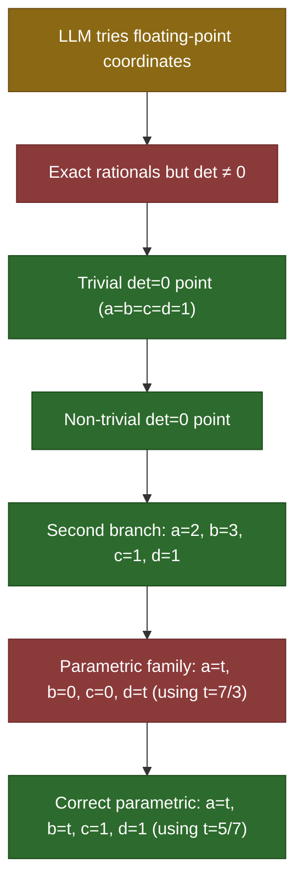

# Proposer/Host Session Report: A2 (Singular Cusp Branching — det=0 surface)

**Session ID**: `a2-demo-001`  
**Timestamp**: 2026-09-21T02:01:57.259612+00:00  
**AuthorityEffect**: None. Firewall: stated region only; mints no authority

> The proposer's self-reports are ignored. Only the host's exact
> rational recomputation determines admission or refusal.

## Session Flow

## Turn-by-Turn Detail

| Turn | Move | Host Verdict | det Value | Rationale |
|---:|---|---|---|---|
| 1 | LLM tries floating-point coordinates | 🚫 **FLOAT_REJECTED** | `N/A (rejected before eval)` | Proposer uses float approximations. Host must reject before evaluation. |
| 2 | Exact rationals but det ≠ 0 | ❌ **REFUSED** | `1` | Proposer guesses a=2, b=3, c=1, d=2. det = 2*2 - 3*1 - 2 + 3 + 1 - 2 = 4-3-2+3+1-2 = 1 ≠ 0. |
| 3 | Trivial det=0 point (a=b=c=d=1) | ✅ **ADMITTED** | `0` | Proposer finds the trivial singularity. det = 1-1-1+1+1-1 = 0. Valid but uninteresting. |
| 4 | Non-trivial det=0 point | ✅ **ADMITTED** | `0` | Proposer finds a=1/2, b=1/3, c=1/3, d=1/9. det = (1/2)(1/9) - (1/3)(1/3) - 1/2 + 1/3 + 1/3 - 1/9 = 1/18 - 1/9 - 1/2 + 1/3 + 1/3 - 1/9 = 0. |
| 5 | Second branch: a=2, b=3, c=1, d=1 | ✅ **ADMITTED** | `0` | Proposer finds a=2, b=3, c=1, d=1. det = 2*1 - 3*1 - 2 + 3 + 1 - 1 = 2-3-2+3+1-1 = 0. |
| 6 | Parametric family: a=t, b=0, c=0, d=t (using t=7/3) | ❌ **REFUSED** | `7/9` | Proposer identifies the parametric line a=d, b=c=0. det = t*t - 0 - t + 0 + 0 - t = t² - 2t. At t=7/3: (7/3)² - 2(7/3) = 49/9 - 14/3 = 49/9 - 42/9 = 7/9 ≠ 0. Hypothesis was wrong — this family does NOT lie on det=0. |
| 7 | Correct parametric: a=t, b=t, c=1, d=1 (using t=5/7) | ✅ **ADMITTED** | `0` | Proposer corrects: if c=d=1, then det = a-b-a+b+1-1 = 0 for ANY a,b. This is a 2-parameter family on det=0. |

## Summary

- **Total turns**: 7
- **Admitted**: 4
- **Refused**: 3
  - Float rejected: 1
  - Wrong witness: 2
  - Parse error: 0

### Discovered Witnesses (Admitted)
- Trivial det=0 point (a=b=c=d=1)
- Non-trivial det=0 point
- Second branch: a=2, b=3, c=1, d=1
- Correct parametric: a=t, b=t, c=1, d=1 (using t=5/7)

## Mathematical Finding

The session discovered that the $\det = 0$ singularity surface of the
dephased $3 \times 3$ corner $[[1,1,1],[1,a,b],[1,c,d]]$ contains:

1. The trivial point $a = b = c = d = 1$
2. The non-trivial isolated point $a = 1/2, b = 1/3, c = 1/3, d = 1/9$
3. The non-trivial point $a = 2, b = 3, c = 1, d = 1$
4. A 2-parameter family: $c = d = 1$ with arbitrary $a, b \in \mathbb{Q}$
   (since $\det = a - b - a + b + 1 - 1 = 0$ identically)

The family at $c = d = 1$ is a **flat component** of the singularity
surface. This is consistent with the dephased corner having gauge
freedom along $c = d = 1$ (the third row has equal elements).

> **Claim scope**: These are exact rational points on $\det = 0$,
> verified by host recomputation. They do not by themselves characterize
> the full singularity variety or its topology. The next step would be
> to parametrize the irreducible components of $\{(a,b,c,d) : ad - bc - a + b + c - d = 0\}$
> over $\mathbb{Q}$ and connect them to the deltoid cusp structure in Target A2.

---

*AuthorityEffect: None. This report records that declared code executed
to specification, not that anything is semantically true beyond the
stated exact rational evaluations.*
