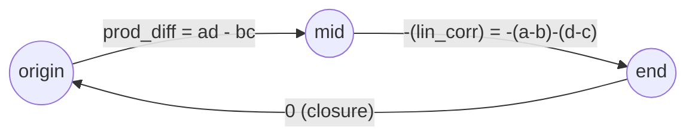
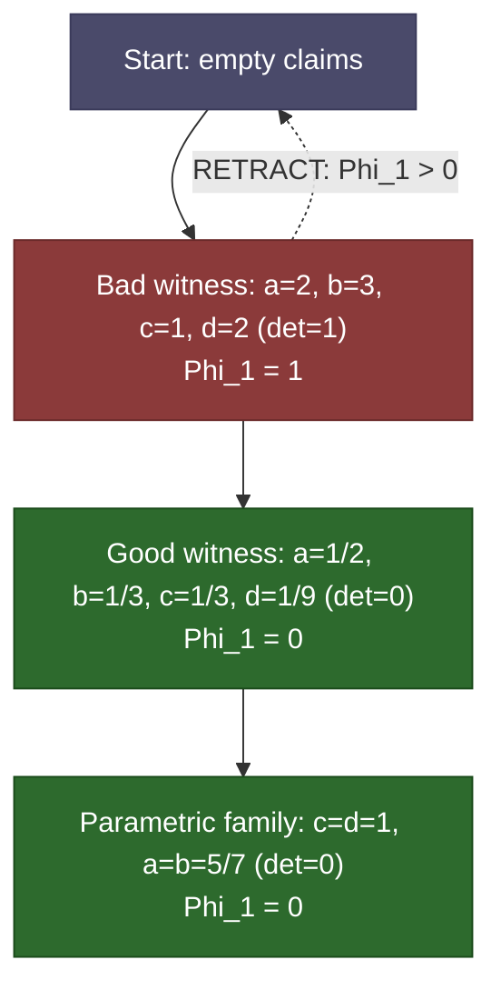

# Full Symbol Game Session: Target A2 (det=0 Singularity)

**Session ID**: `a2-full-sg-002`  
**Protocol**: PO-032 L1SymbolGameGovernor (full Phi_1 / H^1 cycle)  
**Timestamp**: 2026-09-21T02:11:58.039952+00:00  
**AuthorityEffect**: None  
**Firewall**: stated region only

> This session uses the full PO-032 `L1SymbolGameGovernor` with exact
> rational Phi_1 obstruction over a directed cycle. The cycle's net
> winding equals the corner determinant. Phi_1 = 0 iff det = 0.
> The proposer's self-reports are ignored; only the host's
> recomputation counts.

## Constraint Graph

**Topology**: directed 3-cycle  
**H^1 dimension**: 1  
**Interpretation**: net winding = det(corner)

## Session Flow (Phi_1 Descent DAG)

## Phi_1 Obstruction Trajectory

| Phase | Witness | det | Phi_1 | Verdict |
|---:|---|---|---|---|
| 1 | Bad witness: a=2, b=3, c=1, d=2 (det=1) | `1` | `1` | **FAIL** |
| 2 | Good witness: a=1/2, b=1/3, c=1/3, d=1/9 (det=0) | `0` | `0` | **PASS** |
| 3 | Parametric family: c=d=1, a=b=5/7 (det=0) | `0` | `0` | **PASS** |

## Phase Details

### Phase 1: Bad witness: a=2, b=3, c=1, d=2 (det=1)
- **Witness**: a=2, b=3, c=1, d=2
- **prod_diff** = 1, **lin_corr** = 0, **det** = 1

| Move | Value | Status | Phi_1 |
|---|---|---|---|
| `ASSERT origin->mid (prod_diff)` | 1 | Asserted | 1 |
| `ASSERT mid->end (-lin_corr)` | 0 | Asserted | 1 |
| `ASSERT end->origin (closure = 0)` | 0 | Asserted | 1 |
| `CUT (gauge projection P_S)` | 1 | IdempotentStationary | 1 |
| `VERIFY ZERO_OBSTRUCTION` | - | VerificationFailed | 1 |

**Verdict**: SURVIVOR_OBSTRUCTION (det = 1, Phi_1 = 1)

**Obstruction locus** (which edges carry surviving mass):
  - `origin->mid`: residual = 1

**Lift needed**: The cycle's net winding is 1. The governor identifies which edges carry the surviving mass. A lift (new witness with different coordinates) is needed to drive Phi_1 to zero.

### Phase 2: Good witness: a=1/2, b=1/3, c=1/3, d=1/9 (det=0)
- **Witness**: a=1/2, b=1/3, c=1/3, d=1/9
- **prod_diff** = -1/18, **lin_corr** = -1/18, **det** = 0

| Move | Value | Status | Phi_1 |
|---|---|---|---|
| `ASSERT origin->mid (prod_diff)` | -1/18 | Asserted | 1/18 |
| `ASSERT mid->end (-lin_corr)` | 1/18 | Asserted | 0 |
| `ASSERT end->origin (closure = 0)` | 0 | Asserted | 0 |
| `CUT (gauge projection P_S)` | 0 | ExactRepair | 0 |
| `VERIFY ZERO_OBSTRUCTION` | - | Verified | 0 |

**Verdict**: ACCEPTED_ZERO_DEFECT (det = 0, Phi_1 = 0)

### Phase 3: Parametric family: c=d=1, a=b=5/7 (det=0)
- **Witness**: a=5/7, b=5/7, c=1, d=1
- **prod_diff** = 0, **lin_corr** = 0, **det** = 0

| Move | Value | Status | Phi_1 |
|---|---|---|---|
| `CUT (relational, all claims at once)` | 0 | IdempotentStationary | 0 |
| `VERIFY ZERO_OBSTRUCTION` | - | Verified | 0 |

**Verdict**: ACCEPTED_ZERO_DEFECT (det = 0, Phi_1 = 0)

## Summary

- **Total governor moves**: 10
- **Phi_1 trajectory**: 1 -> 0 -> 0
- **Idempotence P_S^2 = P_S**: Verified
- **Admitted** (Phi_1 = 0): Good witness: a=1/2, b=1/3, c=1/3, d=1/9 (det=0), Parametric family: c=d=1, a=b=5/7 (det=0)
- **Rejected** (Phi_1 > 0): Bad witness: a=2, b=3, c=1, d=2 (det=1)

## What This Demonstrates

1. **Phi_1 = |det|**: The H^1 obstruction of the directed cycle exactly
   equals the absolute value of the corner determinant. When det != 0,
   the obstruction is irreducible — no gauge repair can make it vanish.
2. **Gamma_2 localization**: When Phi_1 > 0, the governor identifies
   WHICH edges carry the surviving defect mass. This tells the proposer
   exactly where the witness fails and by how much.
3. **Strict monotonic descent**: CUT moves are admitted only when they
   do not increase defect. The projector P_S is idempotent.
4. **RETRACT enables exploration**: When a witness produces nonzero
   Phi_1, the proposer can RETRACT and try different coordinates,
   collapsing the search space by eliminating known-bad regions.
5. **Exact rational arithmetic throughout**: Every Phi_1 value is an
   exact Fraction. Cancellation laundering is structurally impossible.

## What This Does NOT Demonstrate

- Does not characterize the full irreducible variety of det=0.
- Does not connect to the deltoid cusp topology in Target A2.
- Does not use a live LLM as proposer (scripted moves only).
- Mints no authority regarding MUB(6) existence or non-existence.

---

*AuthorityEffect: None.*
