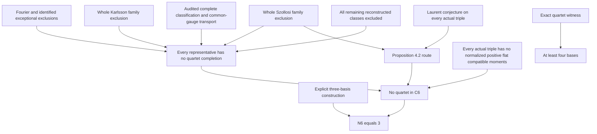

# MUB6 derivation checkpoint, 2026-10-11

AuthorityEffect: None. Goal remains active; no dimension-wide upper bound is established.

Base: `d34889300eea2fb351169ec56e348a44bcd7ffcd` from refreshed `origin/main`.
Branch: `codex/mub6-derivation`.
Worktree: `C:/Users/a343o/.codex/worktrees/mub6-derivation/the_symbol_game`.
The base contains the reported PR #725 merge `ebce2a8f9`.

## What changed mathematically

The inherited Subproblem 2 drafts consistently conflate a twelve-dimensional
phase action with twenty-four prescribed ambient coordinates. Their paired
audits catch this error, but also inherit an unsupported five-family partition.
The five Level 1 directories contain dispatch material, not completed solver
outputs. This checkpoint does not manufacture five independent reviews or mark
their missing results as sealed.

The corrected manuscript now distinguishes:

- 120 ambient real coordinates for two additional bases with a fixed first
  Hadamard; 170 if its dephased block also varies. Neither is a solution-set
  dimension claim.
- Twelve complex balance identities and their explicit polynomial residual
  identity, versus twenty-four independent equations. The balance equations
  are consequences, though useful for interval propagation.
- All twenty exact Tao sign-pattern evaluations, versus a proof that every
  MUB triple satisfies the conjectured vanishing condition.
- A three-parameter Karlsson family, versus the inherited two-parameter affine
  label. Vanishing of a necessary invariant alone cannot exclude this family.
- Single-matrix classification, equivalence transport, and simultaneous MU
  compatibility as different proof obligations.

The new Lean theorems are in
[`Conjecture2GeneralMechanization.lean`](../../../lean4/research_programs/mub6/Conjecture2GeneralMechanization.lean):
`balanced_mask_count`, `tao_all_balanced_masks`,
`tao_balanced_mask_nonzero`, and `tao_distinct_positive_rows`.
The last theorem directly quantifies over any three distinct positive row
indices, without using a bit-mask decoding premise.
All were freshly checked by Lean 4.33.1 and
depend on no axioms. They certify an integer phase-table computation.
The associated complex Laurent interpretation is explained in the manuscript,
but is not a new formal theorem here.

## Dependency graph

An arrow means the source is needed for that route. Nodes feeding a conjunction
must all hold. Alternative routes to Q are alternatives, not joint obligations.

The numerical or geometric constants in old drafts are not edges discharging
B, C, D, E or X. In particular, a local cusp deficit or a small polar error does
not quantify over all candidate bases and all parameter branches.

| Node | Exact target | Current status | Bottleneck and required artifact |
|---|---|---|---|
| L | Construct three unitary bases with all cross-overlap squared moduli 1/6. | Established construction; inherited Subproblem 1 contains the tensor-product derivation. | Fresh exact replay tied to its displayed matrices before including a new computational receipt. |
| G | Every completion of a fixed first Hadamard has a first-row-gauged representative in 120 ambient real coordinates. | Matrix lemmas present; algebraic derivation in paper §1.1. | New coordinate-bijection theorem and scoped fresh Mathlib replay. |
| S | Balance residuals lie in the ideal of row-Gram and first-row gauge residuals. | Explicit algebraic identity in paper (1); solution-level Lean theorems already present. | Formal polynomial identity and binding to the exact contractor. |
| A-F | No quartet contains the identity and any Fourier-family member, including equivalent pairs. | Published family result; concrete transport still needed locally. | Pinned Fourier definition plus a common-unitary/monomial transport theorem. |
| A-T | No third basis extends the identity and the specified Tao matrix. | Literature route to audit; exact Laurent norm 9 freshly checked for all balanced masks. | Identify and replay the actual common-ray/orthogonality certificate, or prove the general Laurent premise. Norm 9 alone does not discharge it. |
| A-H | Nonextension for the particular matrix denoted H6 in the campaign. | Open identification obligation. | Concrete entries, equivalence class, and exact source theorem. Do not inherit an unspecified Haagerup ceiling. |
| B | For every admissible two-circulant parameter, no two additional bases satisfy all quartet equations. | Conditionally reduced to concrete polynomial equations; global exclusion open. | Exhaustive parameter/candidate cover or exact ideal/SOS witness, including singular charts and all relative gauges. |
| B-cusp | The claimed deficit at least 3/2 controls every required cusp chart and excludes its candidates. | Not discharged by the handoff. | Derive the precise function, quantified domain, analytic bound and candidate contradiction. A parameter deficit is not automatically Jacobian nonsingularity. |
| C | No quartet contains any member of the complete three-parameter Karlsson family. | Open nonextension obligation. | Full parameterization with exceptional denominators, common gauge and exact exclusion; a two-parameter subfamily is insufficient. |
| D | Every first Hadamard is equivalent to an enumerated reconstructed representative, and quartet existence is preserved by that transport. | External finite-corner classification reported; local semantic bridge open. | Pin and independently audit the external theorem/axioms; bind reconstruction and transport to the actual complex matrices. |
| X | Every reconstructed class not covered by A/B/C also has no completion. | Open. | An exhaustive exclusion across the remaining continuous seed domain and its finite completion fibres. |
| C2 | Every actual MUB triple satisfies the two Laurent conditions of Matolcsi et al. Conjecture 2. | Open general theorem. | Polynomial ideal certificate or direct argument on genuine triple equations. Integer parity and finite class tables do not suffice. |
| E-flat | Fourth-basis existence is equivalent to normalized PSD moments with actual rank equality and finite relation equations. | Concrete Lean theorem present: `fourth_basis_iff_positive_flat_moments`; no fresh replay here. | Scoped fresh replay and axiom inspection, preserving all hypotheses. |
| E | Every actual triple fails to admit those moments. | Open. | Exact obstruction uniform over actual triples; do not infer it from the equivalence or from a negative diagnostic matrix. |
| E-polar | Every candidate lies in the claimed U(2) compressed region with p at most 0.0926. | Bound and global coverage not established in this checkpoint. | Rational bound 463/5000 with exact hypotheses, degenerate-block treatment and complete back-transport. |
| F | Four explicit complex unitary bases satisfy all MU equations. | No witness found in this checkpoint. | Exact algebraic/cyclotomic entries or isolated algebraic numbers with certified embeddings; numerical proposals alone are not acceptance evidence. |
| Q | No quartet exists in C6. | Open. | Complete one of the quantified nonexistence routes above. |

## Sources and scope corrections

1. [Jaming et al., arXiv:0902.0882v2](https://arxiv.org/abs/0902.0882v2):
   Fourier-pair nonextension to a quartet. The relevant paper is the 2009
   five-author paper, not the differently scoped three-author 2010 article.
2. [Maxwell and Brierley, arXiv:1402.4070v2](https://arxiv.org/abs/1402.4070v2):
   three-parameter Karlsson family and its Laurent identity. Their LP work does
   not supply the desired dimension-six nonexistence conclusion.
3. [Matolcsi et al., 2026, Proposition 4.2](https://doi.org/10.1007/s10801-026-01506-x):
   a conditional implication from Conjectures 2 and 3. Its text warns that a
   previously cited nonextension proof was incorrect. Preserve that warning.
4. [Cárdenes Wuttig and Tindall, arXiv:2608.18053v2](https://arxiv.org/abs/2608.18053v2):
   reported finite-corner classification, with linked formalization. Audit
   exact source bytes and theorem statements before admitting it locally.
5. [Sun, arXiv:2610.12180v1](https://arxiv.org/abs/2610.12180v1):
   recent partial extension and common-state results. The abstract explicitly
   does not claim the global MUB maximum or a classification of all triples.

## Operational recommendation

**CONTINUE TARGETED SOLVE.** The user has selected MUB6 derivation as the goal.
Concentrate on one missing mathematical bridge at a time, beginning with the
finite-corner classification and simultaneous-equivalence transport. That
audit can change the domain requiring exclusion; extending the inherited
five-family narrative would spend effort on an unsupported premise.

General engine development has a clearer deliverable boundary than solving
MUB6. No credible compute or token estimate for a complete proof follows from
the current evidence, and more tournament prose is not a substitute for one
new lemma or one exact candidate-dependent certificate. Use explicit stop
conditions for each local attempt: checked proof, exact counterexample, or a
recorded unresolved obligation with its narrow cause.

An archival benchmark could preserve useful code and formal implications, but
the historical drafts require scope repair, consistent source/artifact hashes,
and an honest reproduction record before a deposit is ready. A deposit would
not resolve the derivation. No Zenodo publication or public submission is
authorized or performed by this checkpoint.

## Immediate continuation

1. Complete a concrete complex interpretation of the all-pattern Tao theorem.
   The direct theorem already covers any three distinct positive row indices.
2. Formalize paper (1) as a polynomial identity; keep it separate from global
   exclusion. The existing local Mathlib cache is incomplete, so a pinned
   dependency setup is needed for a fresh scoped replay.
3. Pin the external classification repository and inspect its public theorem
   and transitive axioms before deciding which classification premise can be
   replaced. Single-Hadamard completeness does not itself imply triple landing.
4. Finish the corrected Subproblem 2 synthesis and manifests honestly as a
   single-agent consolidation. The staged five-agent merge is not completed.
5. Bind an acyclic machine-readable derivation graph to the verified source
   pointers and regenerate the manuscript outputs after the above checks.

**Supports:** a fresh exhaustive finite Tao calculation, a corrected gauge and
balance derivation, and a source-checked proof boundary.
**Does not support:** N(6)=3, N(6) at most 3, general Laurent vanishing,
complete exclusion coverage, external Lean replay, or publication readiness.
**Narrowest claim:** the recorded Tao phase table has norm 9 for all twenty
balanced bit masks, with no axioms in the new Lean proofs.
**Next test:** the concrete complex semantic bridge and pinned classification
audit, followed by a new quantified exclusion lemma.
